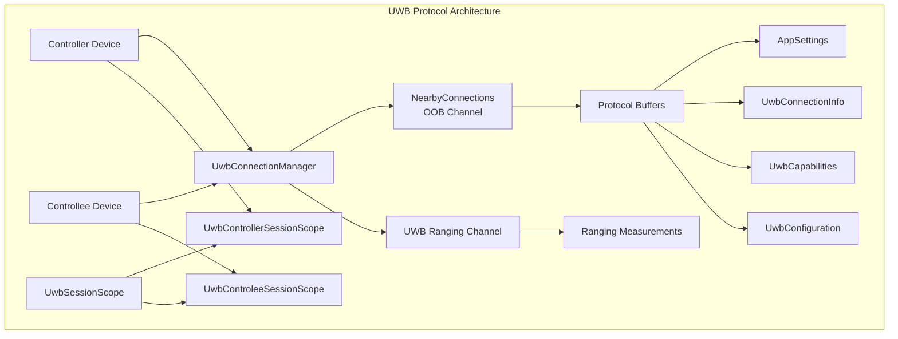
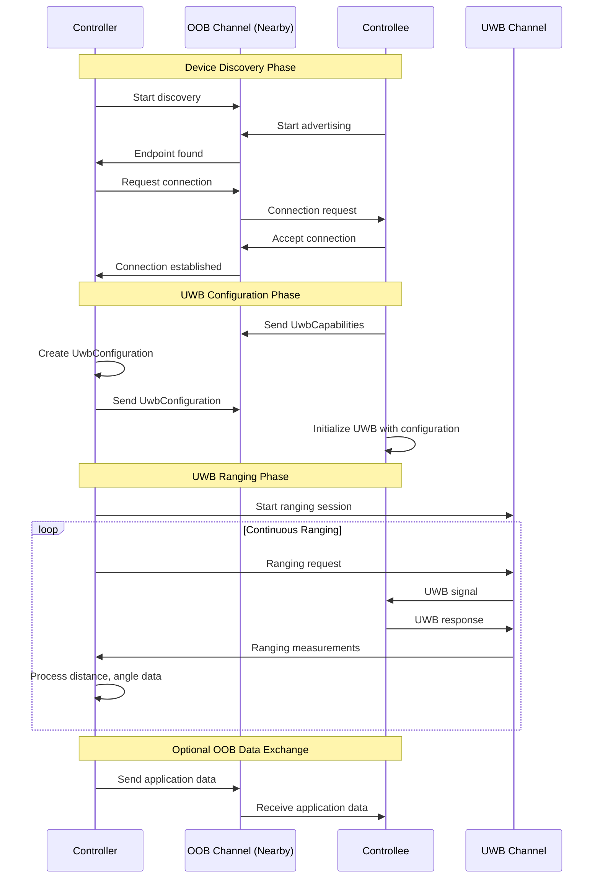
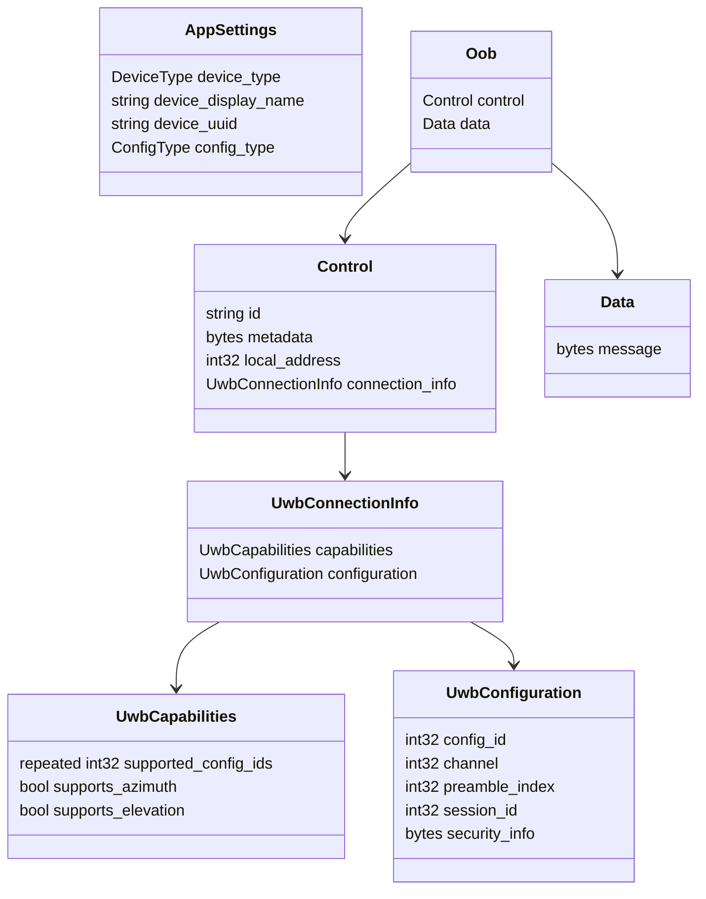
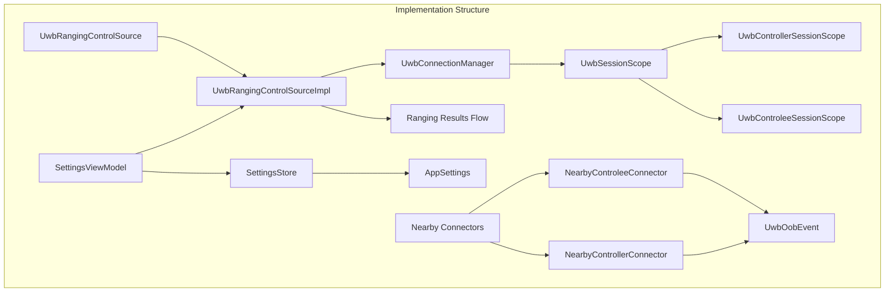

<!-- source: DeepWiki mcp.deepwiki.com · repo android/connectivity-samples · page 2.2 UWB Protocol and Data Structures · fetched 2026-10-23 -->

# UWB Protocol and Data Structures

<details>
<summary>Relevant source files</summary>

The following files were used as context for generating this wiki page:

- [UwbRanging/app/build.gradle](UwbRanging/app/build.gradle)
- [UwbRanging/app/src/main/java/com/google/apps/hellouwb/data/SettingsStore.kt](UwbRanging/app/src/main/java/com/google/apps/hellouwb/data/SettingsStore.kt)
- [UwbRanging/app/src/main/java/com/google/apps/hellouwb/data/SettingsStoreImpl.kt](UwbRanging/app/src/main/java/com/google/apps/hellouwb/data/SettingsStoreImpl.kt)
- [UwbRanging/app/src/main/java/com/google/apps/hellouwb/data/UwbRangingControlSource.kt](UwbRanging/app/src/main/java/com/google/apps/hellouwb/data/UwbRangingControlSource.kt)
- [UwbRanging/app/src/main/java/com/google/apps/hellouwb/data/UwbRangingControlSourceImpl.kt](UwbRanging/app/src/main/java/com/google/apps/hellouwb/data/UwbRangingControlSourceImpl.kt)
- [UwbRanging/app/src/main/java/com/google/apps/hellouwb/ui/settings/SettingsRoute.kt](UwbRanging/app/src/main/java/com/google/apps/hellouwb/ui/settings/SettingsRoute.kt)
- [UwbRanging/app/src/main/java/com/google/apps/hellouwb/ui/settings/SettingsScreen.kt](UwbRanging/app/src/main/java/com/google/apps/hellouwb/ui/settings/SettingsScreen.kt)
- [UwbRanging/app/src/main/java/com/google/apps/hellouwb/ui/settings/SettingsViewModel.kt](UwbRanging/app/src/main/java/com/google/apps/hellouwb/ui/settings/SettingsViewModel.kt)
- [UwbRanging/app/src/main/proto/appsetttings.proto](UwbRanging/app/src/main/proto/appsetttings.proto)
- [UwbRanging/app/src/main/res/drawable-v24/ic_launcher_foreground.xml](UwbRanging/app/src/main/res/drawable-v24/ic_launcher_foreground.xml)
- [UwbRanging/app/src/main/res/drawable/ic_launcher_background.xml](UwbRanging/app/src/main/res/drawable/ic_launcher_background.xml)
- [UwbRanging/app/src/main/res/mipmap-anydpi-v26/ic_launcher.xml](UwbRanging/app/src/main/res/mipmap-anydpi-v26/ic_launcher.xml)
- [UwbRanging/app/src/main/res/mipmap-anydpi-v26/ic_launcher_round.xml](UwbRanging/app/src/main/res/mipmap-anydpi-v26/ic_launcher_round.xml)
- [UwbRanging/app/src/main/res/values/colors.xml](UwbRanging/app/src/main/res/values/colors.xml)
- [UwbRanging/app/src/main/res/values/strings.xml](UwbRanging/app/src/main/res/values/strings.xml)
- [UwbRanging/app/src/main/res/values/themes.xml](UwbRanging/app/src/main/res/values/themes.xml)
- [UwbRanging/app/src/main/res/xml/backup_rules.xml](UwbRanging/app/src/main/res/xml/backup_rules.xml)
- [UwbRanging/app/src/main/res/xml/data_extraction_rules.xml](UwbRanging/app/src/main/res/xml/data_extraction_rules.xml)
- [UwbRanging/build.gradle](UwbRanging/build.gradle)
- [UwbRanging/uwbranging/build.gradle](UwbRanging/uwbranging/build.gradle)
- [UwbRanging/uwbranging/src/main/AndroidManifest.xml](UwbRanging/uwbranging/src/main/AndroidManifest.xml)
- [UwbRanging/uwbranging/src/main/java/com/google/apps/uwbranging/impl/NearbyControleeConnector.kt](UwbRanging/uwbranging/src/main/java/com/google/apps/uwbranging/impl/NearbyControleeConnector.kt)
- [UwbRanging/uwbranging/src/main/proto/uwbinfo.proto](UwbRanging/uwbranging/src/main/proto/uwbinfo.proto)

</details>


This document provides a technical overview of the Ultra-Wideband (UWB) protocol and data structures used in the UWB Ranging sample application. It covers the core protocol communication patterns, message formats, and data structures essential for implementing UWB-based distance measurement between devices. For information about the overall UWB Ranging architecture, see [UWB Ranging Architecture](#2.1).

## UWB Device Roles and Configuration Types

The UWB Ranging implementation follows a controller-controllee architecture with specific configuration types that determine the ranging methodology.

### Device Roles

Two distinct device roles exist in the UWB protocol implementation:

| Role | Description | Responsibilities |
|------|-------------|------------------|
| Controller | Initiates and manages ranging sessions | Creates configuration, initiates ranging, processes measurements |
| Controlee | Responds to ranging requests | Advertises capabilities, responds to ranging requests |

These roles are defined in the protocol buffer enumerations and used throughout the codebase:

```proto
enum DeviceType {
  CONTROLLER = 0;
  CONTROLEE = 1;
}
```

### Configuration Types

The UWB Ranging implementation supports two ranging configuration types:

| Configuration Type | Description | Use Case |
|--------------------|-------------|----------|
| CONFIG_UNICAST_DS_TWR | Double-Sided Two-Way Ranging with a single controllee | One-to-one precise distance measurement |
| CONFIG_MULTICAST_DS_TWR | Double-Sided Two-Way Ranging with multiple controlees | One-to-many distance measurement |

These configuration types are defined in protocol buffers and mapped to the corresponding Android UWB ranging parameters:

```proto
enum ConfigType {
  CONFIG_UNICAST_DS_TWR = 0;
  CONFIG_MULTICAST_DS_TWR = 1;
}
```

Sources: [UwbRanging/app/src/main/proto/appsetttings.proto:23-31](), [UwbRanging/app/src/main/java/com/google/apps/hellouwb/data/UwbRangingControlSourceImpl.kt:60-71]()

## UWB Protocol Components and Flow

The UWB protocol implementation consists of several interconnected components that work together to enable precise distance measurement between devices.

### Protocol Architecture



Sources: [UwbRanging/app/src/main/java/com/google/apps/hellouwb/data/UwbRangingControlSourceImpl.kt:35-47](), [UwbRanging/uwbranging/src/main/java/com/google/apps/uwbranging/impl/NearbyControleeConnector.kt:42-56]()

### UWB Protocol Flow

The UWB protocol follows a specific sequence of operations for establishing a ranging session, as illustrated below:



Sources: [UwbRanging/app/src/main/java/com/google/apps/hellouwb/data/UwbRangingControlSourceImpl.kt:101-118](), [UwbRanging/uwbranging/src/main/java/com/google/apps/uwbranging/impl/NearbyControleeConnector.kt:50-83]()

## UWB Data Structures

The UWB implementation uses Protocol Buffers to define structured message formats for communication between devices.

### Protocol Buffer Schema

The key data structures for UWB protocol communication are defined in two protocol buffer files:

1. `appsetttings.proto` - Application-level settings
2. `uwbinfo.proto` - UWB protocol messages



Sources: [UwbRanging/app/src/main/proto/appsetttings.proto:18-38](), [UwbRanging/uwbranging/src/main/proto/uwbinfo.proto:18-67]()

### Key Data Structures and Their Purposes

| Data Structure | Purpose | Key Fields |
|----------------|---------|------------|
| AppSettings | Stores application configuration | device_type, device_display_name, device_uuid, config_type |
| UwbCapabilities | Represents controllee device capabilities | supported_config_ids, supports_azimuth, supports_elevation |
| UwbConfiguration | Defines UWB session configuration | config_id, channel, preamble_index, session_id, security_info |
| UwbConnectionInfo | Wrapper for capabilities or configuration | capabilities, configuration (oneof) |
| Control | Control message for session setup | id, metadata, local_address, connection_info |
| Data | Data message for application communication | message (bytes) |
| Oob | Wrapper for OOB messages | control, data (oneof) |

Sources: [UwbRanging/uwbranging/src/main/proto/uwbinfo.proto:26-67]()

## UWB Protocol Implementation

### Code Structure and API Integration



Sources: [UwbRanging/app/src/main/java/com/google/apps/hellouwb/data/UwbRangingControlSource.kt:26-43](), [UwbRanging/app/src/main/java/com/google/apps/hellouwb/data/UwbRangingControlSourceImpl.kt:35-47](), [UwbRanging/uwbranging/src/main/java/com/google/apps/uwbranging/impl/NearbyControleeConnector.kt:42-56]()

### Device Type and Configuration Selection

The application allows users to configure their device role (controller or controllee) and the ranging configuration type through the settings interface:

```kotlin
// In UwbRangingControlSourceImpl:
override var deviceType: DeviceType by
Delegates.observable(DeviceType.CONTROLLER) { _, oldValue, newValue ->
  if (oldValue != newValue) {
    stop()
    uwbSessionScope = getSessionScope(newValue, configType)
  }
}

override var configType: ConfigType by
Delegates.observable(ConfigType.CONFIG_UNICAST_DS_TWR) { _, oldValue, newValue ->
  if (oldValue != newValue) {
    stop()
    uwbSessionScope = getSessionScope(deviceType, newValue)
  }
}

private fun getSessionScope(deviceType: DeviceType, configType: ConfigType): UwbSessionScope {
  return when (deviceType) {
    DeviceType.CONTROLEE -> uwbConnectionManager.controleeUwbScope(uwbEndpoint)
    DeviceType.CONTROLLER ->
      uwbConnectionManager.controllerUwbScope(uwbEndpoint, when (configType) {
        ConfigType.CONFIG_UNICAST_DS_TWR -> RangingParameters.CONFIG_UNICAST_DS_TWR
        ConfigType.CONFIG_MULTICAST_DS_TWR -> RangingParameters.CONFIG_MULTICAST_DS_TWR
        else -> throw java.lang.IllegalStateException()
      })
    else -> throw IllegalStateException()
  }
}
```

Sources: [UwbRanging/app/src/main/java/com/google/apps/hellouwb/data/UwbRangingControlSourceImpl.kt:60-71](), [UwbRanging/app/src/main/java/com/google/apps/hellouwb/data/UwbRangingControlSourceImpl.kt:77-91]()

### OOB Communication with Nearby Connections

The UWB implementation uses Google's Nearby Connections API as an out-of-band (OOB) channel for:

1. Initial device discovery
2. Exchanging UWB capabilities
3. Transferring UWB configuration
4. Optional application data exchange

The `NearbyControleeConnector` class demonstrates how the controllee device:
- Advertises its presence through Nearby Connections
- Sends UWB capabilities to the controller
- Processes UWB configuration received from the controller
- Establishes a UWB ranging session

```kotlin
// In NearbyControleeConnector:
override fun prepareEventFlow(): Flow<NearbyEvent> {
  return connections.startAdvertising()
}

override suspend fun processEndpointConnected(endpointId: String) {
  val sessionScope = sessionScopeCreator()
  sessionMap[endpointId] = sessionScope
  connections.sendPayload(
    endpointId,
    Oob.newBuilder().setControl(uwbSessionInfo(sessionScope)).build().toByteArray()
  )
}
```

Sources: [UwbRanging/uwbranging/src/main/java/com/google/apps/uwbranging/impl/NearbyControleeConnector.kt:50-62]()

## UWB Session Management

### Session Initialization

To establish a UWB ranging session, the application follows these steps:

1. Check UWB hardware compatibility
2. Create appropriate session scope based on device role
3. Prepare and start the session
4. Collect ranging measurements through Kotlin Flow

```kotlin
// In UwbRangingControlSourceImpl:
override fun start() {
  if (rangingJob == null) {
    rangingJob =
      coroutineScope.launch {
        uwbSessionScope.prepareSession().collect {
          resultFlow.tryEmit(it)
        }
      }
    runningStateFlow.update { true }
  }
}
```

Sources: [UwbRanging/app/src/main/java/com/google/apps/hellouwb/data/UwbRangingControlSourceImpl.kt:101-118]()

### Session Configuration

The UWB configuration is defined through the `UwbConfiguration` protocol buffer message, with key parameters including:

| Parameter | Description |
|-----------|-------------|
| config_id | Configuration identifier (unicast or multicast) |
| channel | UWB radio channel |
| preamble_index | UWB preamble code index |
| session_id | Unique session identifier |
| security_info | Security-related information for the session |

When a controller creates a configuration, it is serialized and sent to the controllee over the OOB channel:

```proto
message UwbConfiguration {
  int32 config_id = 1;
  int32 channel = 2;
  int32 preamble_index = 3;
  int32 session_id = 4;
  bytes security_info = 5;
}
```

Sources: [UwbRanging/uwbranging/src/main/proto/uwbinfo.proto:32-39]()

## Conclusion

The UWB protocol and data structures in the UWB Ranging sample enable precise distance measurement between UWB-capable Android devices. The implementation uses:

1. Protocol Buffers for structured message exchange
2. Nearby Connections API for out-of-band communication
3. Android UWB Jetpack Library for UWB functionality
4. Controller-Controllee architecture for ranging operations
5. Support for both unicast and multicast ranging configurations

The protocol flow combines OOB communication for setup and UWB communication for precise ranging, with clearly defined data structures enabling interoperability between devices.

---

