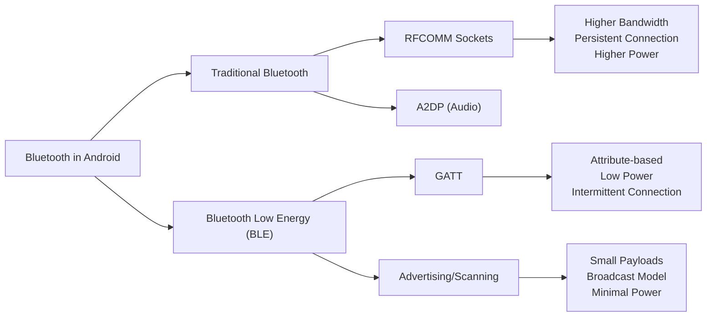
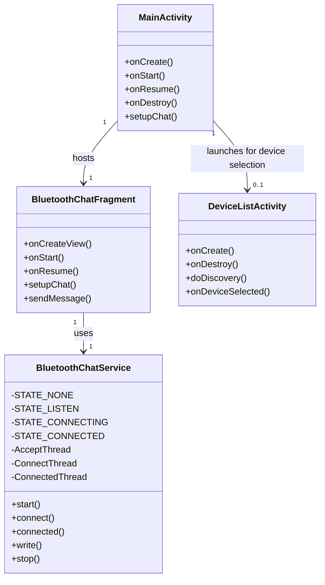
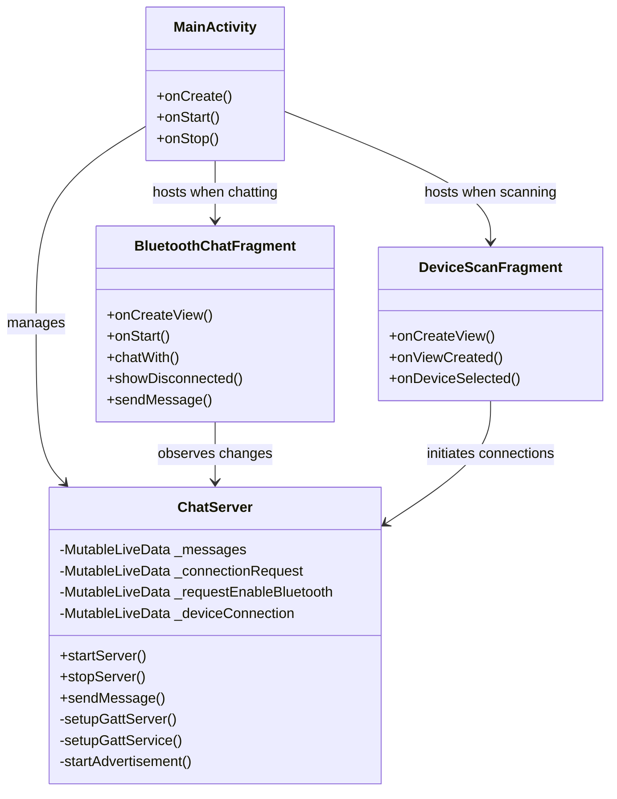
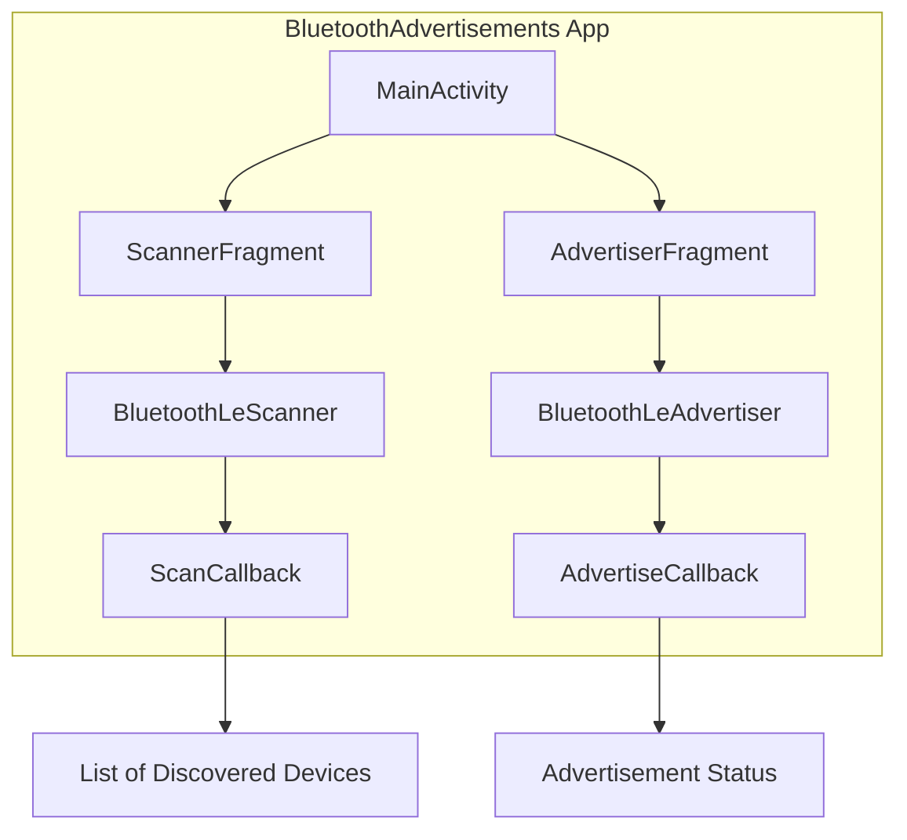
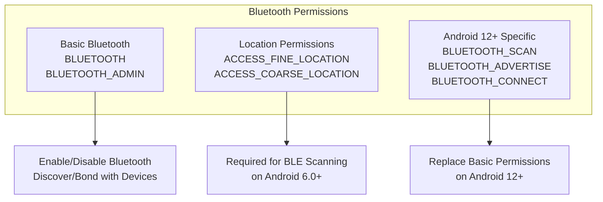

<!-- source: DeepWiki mcp.deepwiki.com · repo android/connectivity-samples · page 3 Bluetooth Samples · fetched 2026-10-23 -->

# Bluetooth Samples

<details>
<summary>Relevant source files</summary>

The following files were used as context for generating this wiki page:

- [BluetoothAdvertisements/README.md](BluetoothAdvertisements/README.md)
- [BluetoothAdvertisementsKotlin/README.md](BluetoothAdvertisementsKotlin/README.md)
- [BluetoothAdvertisementsKotlin/screenshots/1-main.png](BluetoothAdvertisementsKotlin/screenshots/1-main.png)
- [BluetoothAdvertisementsKotlin/screenshots/icon-web.png](BluetoothAdvertisementsKotlin/screenshots/icon-web.png)
- [BluetoothChat/Application/build.gradle](BluetoothChat/Application/build.gradle)
- [BluetoothChat/Application/src/main/AndroidManifest.xml](BluetoothChat/Application/src/main/AndroidManifest.xml)
- [BluetoothChat/README.md](BluetoothChat/README.md)
- [BluetoothChat/build.gradle](BluetoothChat/build.gradle)
- [BluetoothChat/gradle/wrapper/gradle-wrapper.properties](BluetoothChat/gradle/wrapper/gradle-wrapper.properties)
- [BluetoothChat/settings.gradle](BluetoothChat/settings.gradle)
- [BluetoothLeChat/README.md](BluetoothLeChat/README.md)
- [BluetoothLeGatt/README.md](BluetoothLeGatt/README.md)
- [README.md](README.md)
- [UwbRanging/settings.gradle](UwbRanging/settings.gradle)
- [UwbRanging/uwbranging/src/main/java/com/google/apps/uwbranging/impl/NearbyConnections.kt](UwbRanging/uwbranging/src/main/java/com/google/apps/uwbranging/impl/NearbyConnections.kt)

</details>


This document provides an overview of the various Bluetooth-related sample applications in the Android Connectivity Samples repository. These samples demonstrate different Bluetooth technologies and APIs for device-to-device communication on Android. Note that these samples have been deprecated and migrated to the new [platform-samples repository](https://github.com/android/platform-samples/tree/main/samples/connectivity/bluetooth), but are documented here for reference.

## Overview of Bluetooth Technologies

Android supports several Bluetooth technologies, each suited to different use cases:



Sources: [BluetoothChat/README.md](), [BluetoothLeChat/README.md](), [BluetoothAdvertisementsKotlin/README.md](), [BluetoothLeGatt/README.md]()

## Sample Applications Comparison

The repository includes four Bluetooth sample applications:

| Sample | Technology | Communication Pattern | Power Usage | Use Case |
|--------|------------|----------------------|------------|----------|
| BluetoothChat | Traditional Bluetooth | RFCOMM sockets | Higher | Two-way text chat with higher throughput |
| BluetoothLeChat | Bluetooth Low Energy | GATT services | Lower | Two-way text chat with power efficiency |
| BluetoothAdvertisements | Bluetooth Low Energy | BLE advertising/scanning | Lowest | Broadcasting small amounts of data |
| BluetoothLeGatt | Bluetooth Low Energy | GATT client/server | Lower | Reading/writing characteristics from BLE devices |

Sources: [BluetoothChat/README.md](), [BluetoothLeChat/README.md](), [BluetoothAdvertisementsKotlin/README.md](), [BluetoothLeGatt/README.md]()

## BluetoothChat Sample

The BluetoothChat sample demonstrates two-way text messaging using traditional Bluetooth technology with RFCOMM sockets.

### Key Features

- Uses the Bluetooth API to establish direct connections between devices
- Demonstrates both server and client connection modes
- Implements text-based chat over standard Bluetooth
- Shows how to handle Bluetooth permissions and device setup

### Architecture



Sources: [BluetoothChat/README.md](), [BluetoothChat/Application/build.gradle](), [BluetoothChat/Application/src/main/AndroidManifest.xml]()

### Implementation Details

The sample uses a service-based architecture with three main components:

1. **BluetoothChatService**: Manages the Bluetooth connections through three nested thread classes:
   - **AcceptThread**: Listens for incoming connections (server mode)
   - **ConnectThread**: Attempts to make outgoing connections (client mode)
   - **ConnectedThread**: Manages active connections and data transfer

2. **BluetoothChatFragment**: Provides the UI for the chat and interfaces with the service

3. **DeviceListActivity**: Shows available Bluetooth devices for connection

The app requires Bluetooth permissions as specified in the manifest:

```xml
<uses-permission android:name="android.permission.BLUETOOTH" />
<uses-permission android:name="android.permission.BLUETOOTH_SCAN" />
<uses-permission android:name="android.permission.BLUETOOTH_ADVERTISE" />
<uses-permission android:name="android.permission.BLUETOOTH_CONNECT" />
<uses-permission android:name="android.permission.BLUETOOTH_ADMIN" />
```

Sources: [BluetoothChat/Application/src/main/AndroidManifest.xml]()

## BluetoothLeChat Sample

The BluetoothLeChat sample demonstrates a two-way chat application using Bluetooth Low Energy (BLE) technology, optimized for power efficiency compared to traditional Bluetooth.

### Key Features

- Implements chat using BLE GATT profile
- Demonstrates efficient power usage through BLE
- Shows both central (client) and peripheral (server) role implementation
- Provides a modern approach to Bluetooth communication

### Architecture



Sources: [BluetoothLeChat/README.md]()

### Implementation Details

The BluetoothLeChat sample uses a GATT-based approach:

1. **ChatServer**: The core component that:
   - Creates and manages a GATT service with a characteristic for message exchange
   - Handles BLE advertising as a peripheral
   - Manages connections with remote devices
   - Processes read/write requests to the message characteristic

2. **Device Roles**:
   - **Peripheral Role**: Advertises availability and hosts the GATT service
   - **Central Role**: Scans for advertising devices and connects to them

3. **Data Flow**:
   - Messages are exchanged by writing to and reading from the GATT characteristic
   - LiveData objects provide reactivity to connection and message events

Sources: [BluetoothLeChat/README.md]()

## BluetoothAdvertisements Sample

The BluetoothAdvertisements sample demonstrates how to advertise small amounts of data using Bluetooth Low Energy (BLE) and how to scan for these advertisements.

### Key Features

- Shows BLE advertising to broadcast device information
- Demonstrates BLE scanning to discover nearby advertising devices
- Implements filters for specific device types
- Illustrates how to handle the BLE scanning lifecycle

### Architecture



Sources: [BluetoothAdvertisementsKotlin/README.md](), [BluetoothAdvertisementsKotlin/screenshots/1-main.png]()

### Implementation Details

The app is split into two main fragments:

1. **AdvertiserFragment**:
   - Allows users to toggle BLE advertising
   - Broadcasts basic device information and a UUID specific to the app
   - Configures advertisement settings (power level, connectable status, etc.)

2. **ScannerFragment**:
   - Activates BLE scanning for 5 seconds
   - Displays a list of found devices that are advertising using this sample
   - Shows device type, Bluetooth address, and when the device was last seen
   - Allows users to refresh to scan again and update the list

Note: A device cannot detect its own BLE advertisements, so two devices are required to see the full functionality.

Sources: [BluetoothAdvertisementsKotlin/README.md]()

## BluetoothLeGatt Sample

The BluetoothLeGatt sample demonstrates how to use the Bluetooth LE Generic Attribute Profile (GATT) to transmit arbitrary data between devices.

### Key Features

- Shows how to connect to a GATT server on a BLE device
- Displays the available GATT services and characteristics
- Demonstrates reading and writing characteristic values
- Illustrates handling notifications from BLE devices

### Architecture

```mermaid
classDiagram
    class DeviceScanActivity {
        +onCreateView()
        +scanLeDevice()
        +onListItemClick()
    }
    class DeviceControlActivity {
        +onCreate()
        +onResume()
        +displayGattServices()
        +setCharacteristicNotification()
    }
    class BluetoothLeService {
        +connect()
        +disconnect()
        +readCharacteristic()
        +writeCharacteristic()
        +setCharacteristicNotification()
        +getSupportedGattServices()
        -BluetoothGattCallback
    }
    
    DeviceScanActivity --> DeviceControlActivity: launches with device address
    DeviceControlActivity --> BluetoothLeService: binds to service
    BluetoothLeService --> "BluetoothGatt": manages GATT client
```

Sources: [BluetoothLeGatt/README.md]()

### Implementation Details

The BluetoothLeGatt sample implements a client that connects to a GATT server:

1. **DeviceScanActivity**:
   - Scans for available BLE devices
   - Displays a list of devices for the user to select

2. **DeviceControlActivity**:
   - Connects to the selected device via the BluetoothLeService
   - Displays the device's data and GATT services/characteristics
   - Allows interaction with the characteristics

3. **BluetoothLeService**:
   - A bound service that manages the connection with the GATT server
   - Handles the BluetoothGatt callbacks for connection states and data operations
   - Provides methods to read/write characteristics and subscribe to notifications

This sample is useful for developing applications that need to interact with BLE peripherals like health sensors, fitness trackers, or custom BLE hardware.

Sources: [BluetoothLeGatt/README.md]()

## Bluetooth Permissions

All Bluetooth samples require specific permissions to function properly. The required permissions vary depending on the Android version and the specific Bluetooth features used:



Sources: [BluetoothChat/Application/src/main/AndroidManifest.xml]()

### Permission Requirements

Depending on the Android version and Bluetooth feature, different permissions are needed:

- For basic Bluetooth operations:
  ```xml
  <uses-permission android:name="android.permission.BLUETOOTH" />
  <uses-permission android:name="android.permission.BLUETOOTH_ADMIN" />
  ```

- For BLE scanning (Android 6.0+):
  ```xml
  <uses-permission android:name="android.permission.ACCESS_COARSE_LOCATION" />
  <!-- or -->
  <uses-permission android:name="android.permission.ACCESS_FINE_LOCATION" />
  ```

- For Android 12+:
  ```xml
  <uses-permission android:name="android.permission.BLUETOOTH_SCAN" />
  <uses-permission android:name="android.permission.BLUETOOTH_ADVERTISE" />
  <uses-permission android:name="android.permission.BLUETOOTH_CONNECT" />
  ```

All samples include runtime permission checks and requests as needed for their specific functionality.

Sources: [BluetoothChat/Application/src/main/AndroidManifest.xml]()

## Common Bluetooth Patterns in the Samples

Despite their differences, the Bluetooth samples share some common patterns:

1. **Device Discovery**:
   - All samples include some form of device discovery or scanning
   - BluetoothChat uses the traditional discovery mechanism
   - The BLE samples use BLE scanning with various filters

2. **Connection Management**:
   - All samples demonstrate how to establish and maintain connections
   - Error handling and reconnection logic are implemented
   - Connection states are communicated to the UI

3. **Data Exchange**:
   - Each sample has a specific mechanism for data exchange:
     - BluetoothChat: Direct socket communication
     - BluetoothLeChat: GATT characteristic read/write
     - BluetoothLeGatt: Reading/writing to various characteristics
     - BluetoothAdvertisements: One-way data broadcasting

4. **UI Integration**:
   - All samples provide user interfaces for their functionality
   - Status updates and connection states are reflected in the UI
   - User controls for initiating connections and sending data

Sources: [BluetoothChat/README.md](), [BluetoothLeChat/README.md](), [BluetoothAdvertisementsKotlin/README.md](), [BluetoothLeGatt/README.md]()

## Conclusion

The Bluetooth samples in the Android Connectivity Samples repository demonstrate various approaches to Bluetooth communication on Android. From traditional Bluetooth to Bluetooth Low Energy, these samples provide working examples of different Bluetooth technologies suited for different use cases.

While these samples have been deprecated and migrated to the new platform-samples repository, they still serve as valuable references for understanding the fundamentals of Bluetooth communication on Android.

For more information about other connectivity samples in the repository, see the [Overview](#1).

---

