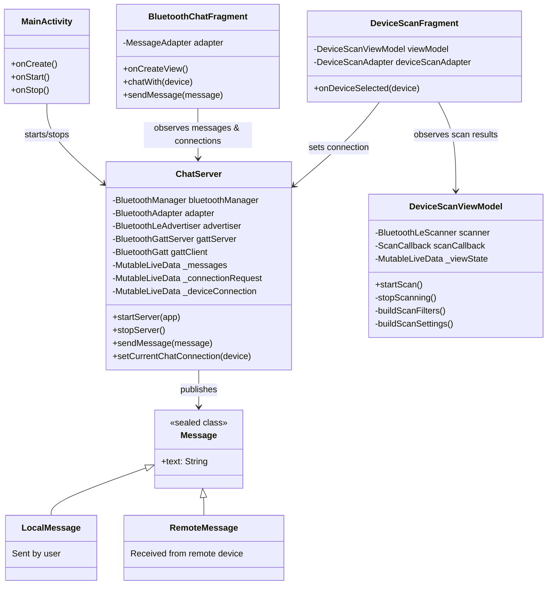
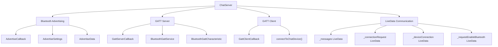
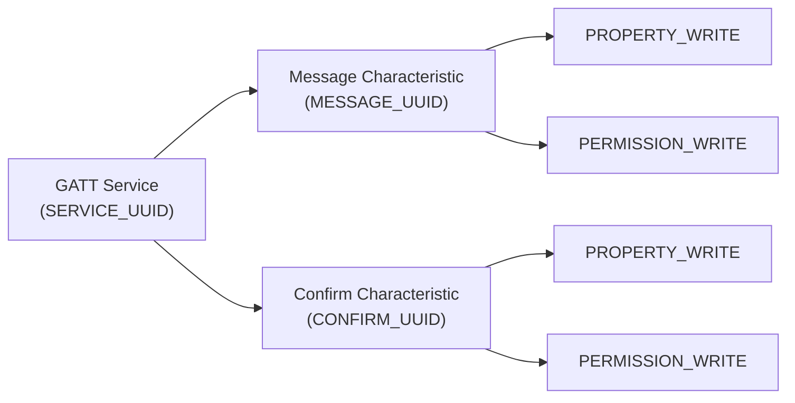
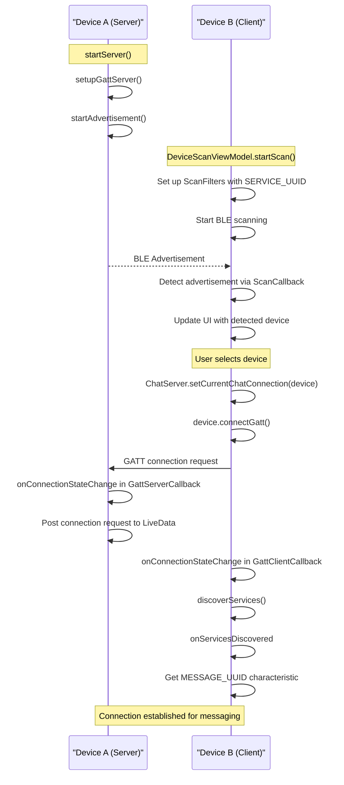
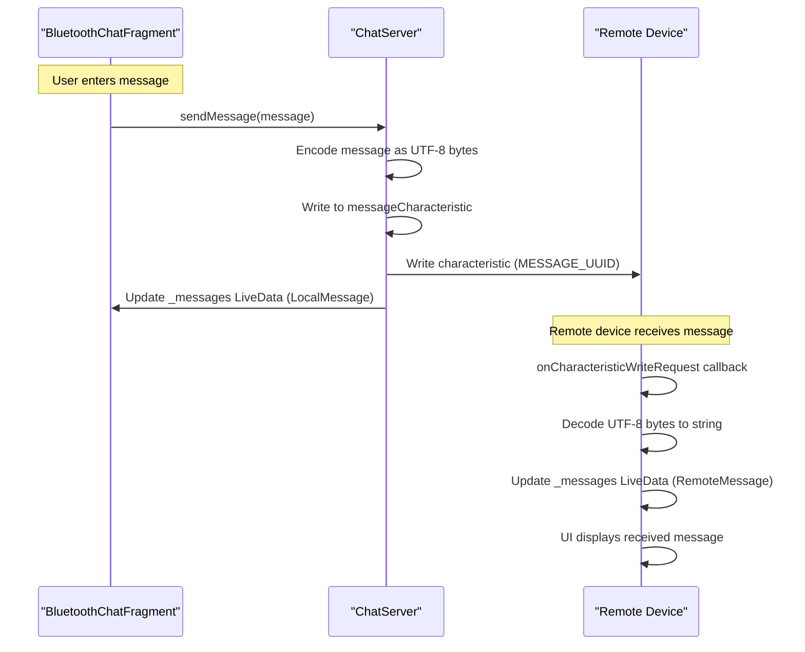

<!-- source: DeepWiki mcp.deepwiki.com · repo android/connectivity-samples · page 3.1 BluetoothLeChat Implementation · fetched 2026-10-23 -->

# BluetoothLeChat Implementation

<details>
<summary>Relevant source files</summary>

The following files were used as context for generating this wiki page:

- [BluetoothLeChat/.gitignore](BluetoothLeChat/.gitignore)
- [BluetoothLeChat/app/.gitignore](BluetoothLeChat/app/.gitignore)
- [BluetoothLeChat/app/build.gradle](BluetoothLeChat/app/build.gradle)
- [BluetoothLeChat/app/proguard-rules.pro](BluetoothLeChat/app/proguard-rules.pro)
- [BluetoothLeChat/app/src/main/AndroidManifest.xml](BluetoothLeChat/app/src/main/AndroidManifest.xml)
- [BluetoothLeChat/app/src/main/java/com/example/bluetoothlechat/Extensions.kt](BluetoothLeChat/app/src/main/java/com/example/bluetoothlechat/Extensions.kt)
- [BluetoothLeChat/app/src/main/java/com/example/bluetoothlechat/MainActivity.kt](BluetoothLeChat/app/src/main/java/com/example/bluetoothlechat/MainActivity.kt)
- [BluetoothLeChat/app/src/main/java/com/example/bluetoothlechat/bluetooth/ChatServer.kt](BluetoothLeChat/app/src/main/java/com/example/bluetoothlechat/bluetooth/ChatServer.kt)
- [BluetoothLeChat/app/src/main/java/com/example/bluetoothlechat/bluetooth/Constants.kt](BluetoothLeChat/app/src/main/java/com/example/bluetoothlechat/bluetooth/Constants.kt)
- [BluetoothLeChat/app/src/main/java/com/example/bluetoothlechat/bluetooth/EnableBluetoothFragment.kt](BluetoothLeChat/app/src/main/java/com/example/bluetoothlechat/bluetooth/EnableBluetoothFragment.kt)
- [BluetoothLeChat/app/src/main/java/com/example/bluetoothlechat/bluetooth/LocationRequiredFragment.kt](BluetoothLeChat/app/src/main/java/com/example/bluetoothlechat/bluetooth/LocationRequiredFragment.kt)
- [BluetoothLeChat/app/src/main/java/com/example/bluetoothlechat/bluetooth/Message.kt](BluetoothLeChat/app/src/main/java/com/example/bluetoothlechat/bluetooth/Message.kt)
- [BluetoothLeChat/app/src/main/java/com/example/bluetoothlechat/chat/BluetoothChatFragment.kt](BluetoothLeChat/app/src/main/java/com/example/bluetoothlechat/chat/BluetoothChatFragment.kt)
- [BluetoothLeChat/app/src/main/java/com/example/bluetoothlechat/chat/DeviceConnectionState.kt](BluetoothLeChat/app/src/main/java/com/example/bluetoothlechat/chat/DeviceConnectionState.kt)
- [BluetoothLeChat/app/src/main/java/com/example/bluetoothlechat/chat/LocalMessageViewHolder.kt](BluetoothLeChat/app/src/main/java/com/example/bluetoothlechat/chat/LocalMessageViewHolder.kt)
- [BluetoothLeChat/app/src/main/java/com/example/bluetoothlechat/chat/MessageAdapter.kt](BluetoothLeChat/app/src/main/java/com/example/bluetoothlechat/chat/MessageAdapter.kt)
- [BluetoothLeChat/app/src/main/java/com/example/bluetoothlechat/scan/DeviceScanFragment.kt](BluetoothLeChat/app/src/main/java/com/example/bluetoothlechat/scan/DeviceScanFragment.kt)
- [BluetoothLeChat/app/src/main/java/com/example/bluetoothlechat/scan/DeviceScanViewModel.kt](BluetoothLeChat/app/src/main/java/com/example/bluetoothlechat/scan/DeviceScanViewModel.kt)
- [BluetoothLeChat/app/src/main/res/layout/fragment_device_scan.xml](BluetoothLeChat/app/src/main/res/layout/fragment_device_scan.xml)
- [BluetoothLeChat/app/src/main/res/values/strings.xml](BluetoothLeChat/app/src/main/res/values/strings.xml)
- [BluetoothLeChat/build.gradle](BluetoothLeChat/build.gradle)
- [BluetoothLeChat/gradle/wrapper/gradle-wrapper.properties](BluetoothLeChat/gradle/wrapper/gradle-wrapper.properties)

</details>


This document details the implementation of the BluetoothLeChat sample application, which demonstrates how to create a chat application using Bluetooth Low Energy (BLE) technology. Unlike traditional Bluetooth chat applications that use RFCOMM sockets, this implementation leverages BLE's GATT (Generic Attribute Profile) services and characteristics for power-efficient messaging between devices.

## Overview

BluetoothLeChat demonstrates a complete BLE communication pattern where each device can:
1. Advertise its presence to be discovered
2. Scan for other BLE devices
3. Establish connections
4. Exchange text messages through GATT characteristics

This sample is designed to show best practices for implementing BLE communication in Android applications while maintaining a simple user interface.

## System Architecture

### BLE Chat Architecture



Sources: [BluetoothLeChat/app/src/main/java/com/example/bluetoothlechat/bluetooth/ChatServer.kt](), [BluetoothLeChat/app/src/main/java/com/example/bluetoothlechat/MainActivity.kt](), [BluetoothLeChat/app/src/main/java/com/example/bluetoothlechat/scan/DeviceScanViewModel.kt](), [BluetoothLeChat/app/src/main/java/com/example/bluetoothlechat/scan/DeviceScanFragment.kt](), [BluetoothLeChat/app/src/main/java/com/example/bluetoothlechat/chat/BluetoothChatFragment.kt](), [BluetoothLeChat/app/src/main/java/com/example/bluetoothlechat/bluetooth/Message.kt]()

## Key Components

### ChatServer

The `ChatServer` singleton is the central component that manages all Bluetooth operations in the application.

Key responsibilities:
- Managing BLE advertising to make the device discoverable
- Setting up a GATT server with the appropriate service and characteristics
- Handling connections with remote devices
- Sending and receiving messages through BLE characteristics
- Notifying the UI about connection events and messages via LiveData



Sources: [BluetoothLeChat/app/src/main/java/com/example/bluetoothlechat/bluetooth/ChatServer.kt:34-315]()

### GATT Service Setup

The `ChatServer` creates a GATT service with specific characteristics for message exchange:



Sources: [BluetoothLeChat/app/src/main/java/com/example/bluetoothlechat/bluetooth/ChatServer.kt:154-172](), [BluetoothLeChat/app/src/main/java/com/example/bluetoothlechat/bluetooth/Constants.kt:30-40]()

The service and characteristics are defined with these UUIDs:
- Service UUID: `0000b81d-0000-1000-8000-00805f9b34fb`
- Message UUID: `7db3e235-3608-41f3-a03c-955fcbd2ea4b`
- Confirm UUID: `36d4dc5c-814b-4097-a5a6-b93b39085928`

The GATT service is set up in the `setupGattService()` method, which creates a primary service with two characteristics: one for messages and one for confirmation.

## Connection Process

### Connection Flow Between Devices



Sources: [BluetoothLeChat/app/src/main/java/com/example/bluetoothlechat/bluetooth/ChatServer.kt:77-87](), [BluetoothLeChat/app/src/main/java/com/example/bluetoothlechat/bluetooth/ChatServer.kt:110-112](), [BluetoothLeChat/app/src/main/java/com/example/bluetoothlechat/scan/DeviceScanViewModel.kt:69-92](), [BluetoothLeChat/app/src/main/java/com/example/bluetoothlechat/scan/DeviceScanFragment.kt:63-67]()

### Advertisement Setup

The `ChatServer` sets up BLE advertising to make the device discoverable by other devices:

```kotlin
private fun startAdvertisement() {
    advertiser = adapter.bluetoothLeAdvertiser
    advertiseCallback = DeviceAdvertiseCallback()
    advertiser?.startAdvertising(advertiseSettings, advertiseData, advertiseCallback)
}
```

The advertisement includes:
- Service UUID to identify the chat application
- Device name for easier identification

The advertisement settings are optimized for low power consumption.

Sources: [BluetoothLeChat/app/src/main/java/com/example/bluetoothlechat/bluetooth/ChatServer.kt:177-185](), [BluetoothLeChat/app/src/main/java/com/example/bluetoothlechat/bluetooth/ChatServer.kt:200-219](), [BluetoothLeChat/app/src/main/java/com/example/bluetoothlechat/bluetooth/ChatServer.kt:226-230]()

### Device Scanning

The `DeviceScanViewModel` is responsible for scanning for nearby BLE devices that are advertising the chat service:

```kotlin
fun startScan() {
    scanner = adapter.bluetoothLeScanner
    scanCallback = DeviceScanCallback()
    scanner?.startScan(scanFilters, scanSettings, scanCallback)
}
```

The scan is set up with:
- Filters to only detect devices advertising the specific service UUID
- Low power scan settings to preserve battery
- A 30-second timeout to limit battery usage

Sources: [BluetoothLeChat/app/src/main/java/com/example/bluetoothlechat/scan/DeviceScanViewModel.kt:69-92](), [BluetoothLeChat/app/src/main/java/com/example/bluetoothlechat/scan/DeviceScanViewModel.kt:105-111](), [BluetoothLeChat/app/src/main/java/com/example/bluetoothlechat/scan/DeviceScanViewModel.kt:116-119]()

## Message Exchange Protocol

### Message Flow



Sources: [BluetoothLeChat/app/src/main/java/com/example/bluetoothlechat/bluetooth/ChatServer.kt:115-133](), [BluetoothLeChat/app/src/main/java/com/example/bluetoothlechat/bluetooth/ChatServer.kt:252-270](), [BluetoothLeChat/app/src/main/java/com/example/bluetoothlechat/chat/BluetoothChatFragment.kt:115-123]()

### Message Data Structure

The `Message` sealed class represents chat messages:

```kotlin
sealed class Message(val text: String) {
    class RemoteMessage(text: String) : Message(text)
    class LocalMessage(text: String) : Message(text)
}
```

The two subtypes distinguish between:
- `LocalMessage`: Messages sent by the local user
- `RemoteMessage`: Messages received from the remote device

This distinction allows the UI to display messages differently based on their source.

Sources: [BluetoothLeChat/app/src/main/java/com/example/bluetoothlechat/bluetooth/Message.kt:25-28]()

## User Interface Components

### BluetoothChatFragment

This fragment displays the chat interface and handles:
- Showing connection status (connected/disconnected)
- Displaying messages from both the local user and remote device
- Sending messages to the remote device

It observes three LiveData objects from `ChatServer`:
- `connectionRequest`: For incoming connection requests
- `deviceConnection`: For connection state changes
- `messages`: For incoming and outgoing messages

Sources: [BluetoothLeChat/app/src/main/java/com/example/bluetoothlechat/chat/BluetoothChatFragment.kt:39-135]()

### DeviceScanFragment

This fragment allows users to:
- View their own device address
- See a list of nearby BLE devices advertising the chat service
- Select a device to connect to

When a device is selected, it calls `ChatServer.setCurrentChatConnection(device)` to initiate the connection.

Sources: [BluetoothLeChat/app/src/main/java/com/example/bluetoothlechat/scan/DeviceScanFragment.kt:40-143]()

## Permissions and Requirements

The application requires several permissions for BLE operation:

| Permission | Purpose | Android Version |
|------------|---------|----------------|
| `BLUETOOTH` | Basic Bluetooth functionality | Pre-Android 12 |
| `BLUETOOTH_ADMIN` | Control Bluetooth settings | Pre-Android 12 |
| `ACCESS_FINE_LOCATION` | Required for BLE scanning | Pre-Android 12 |
| `BLUETOOTH_SCAN` | Scan for BLE devices | Android 12+ |
| `BLUETOOTH_ADVERTISE` | Advertise BLE services | Android 12+ |
| `BLUETOOTH_CONNECT` | Connect to BLE devices | Android 12+ |

The permissions are declared in the AndroidManifest.xml file and requested at runtime in MainActivity.

Sources: [BluetoothLeChat/app/src/main/AndroidManifest.xml:5-13](), [BluetoothLeChat/app/src/main/java/com/example/bluetoothlechat/MainActivity.kt:32-41]()

## Lifecycle Management

The `ChatServer` is started and stopped based on the activity lifecycle:

```kotlin
// In MainActivity.kt
override fun onStart() {
    super.onStart()
    ChatServer.startServer(application)
}

override fun onStop() {
    super.onStop()
    ChatServer.stopServer()
}
```

This ensures that BLE advertising and GATT server operations only run when the app is in the foreground, conserving battery life.

Sources: [BluetoothLeChat/app/src/main/java/com/example/bluetoothlechat/MainActivity.kt:44-52]()

## Limitations and Considerations

1. **BLE Data Size**: The BLE advertisement packet has a 31-byte limit, as mentioned in the code comments. This affects what data can be included in advertisements.

2. **Service Discovery**: The implementation filters devices by service UUID during scanning, ensuring only compatible devices are shown to the user.

3. **Error Handling**: The implementation includes error handling for various scenarios:
   - Bluetooth not enabled
   - BLE advertising not supported on the device
   - Connection failures

4. **Permissions**: The application handles both pre-Android 12 and Android 12+ permission models for Bluetooth operations.

Sources: [BluetoothLeChat/app/src/main/java/com/example/bluetoothlechat/bluetooth/ChatServer.kt:200-211](), [BluetoothLeChat/app/src/main/AndroidManifest.xml:5-13]()

---

