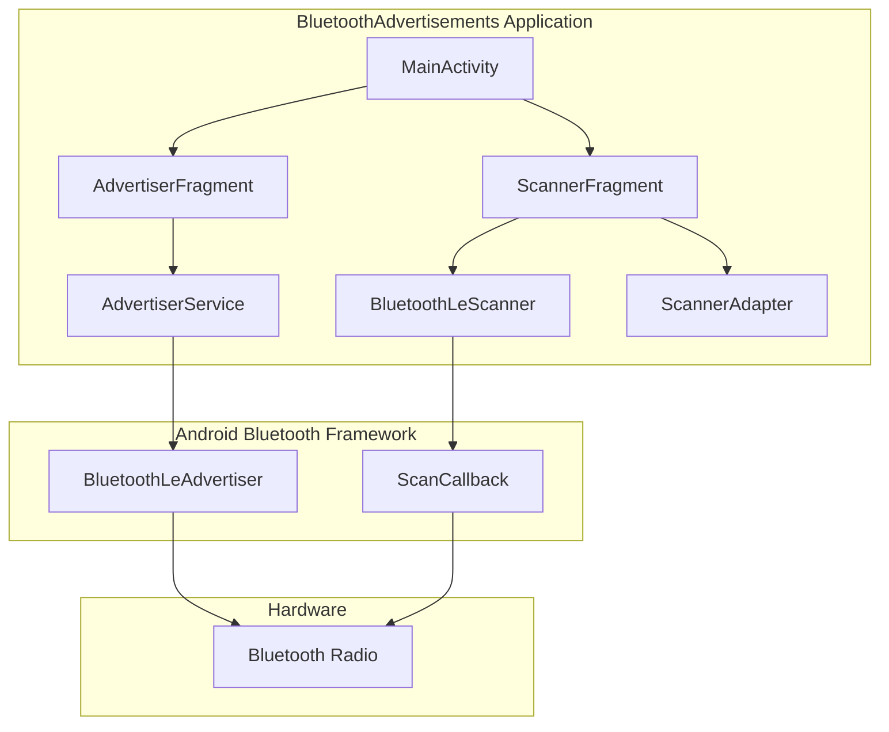
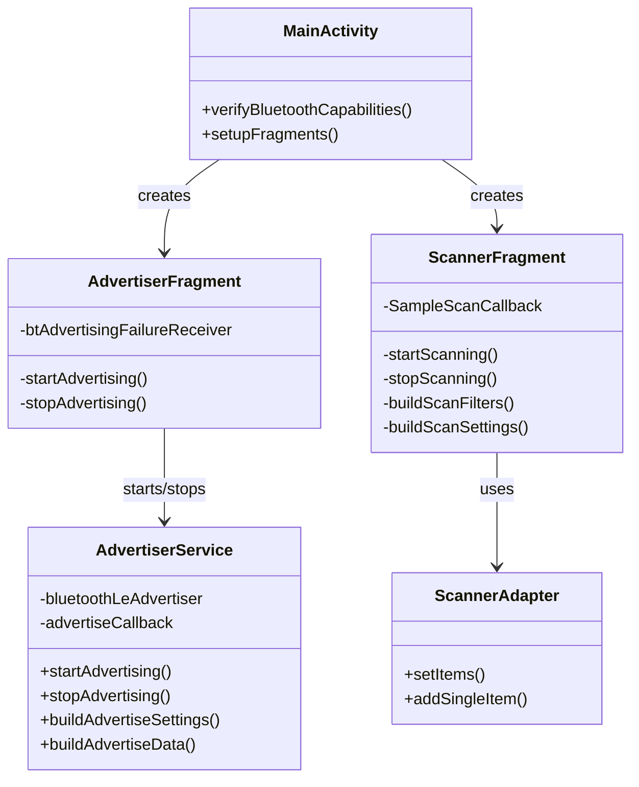
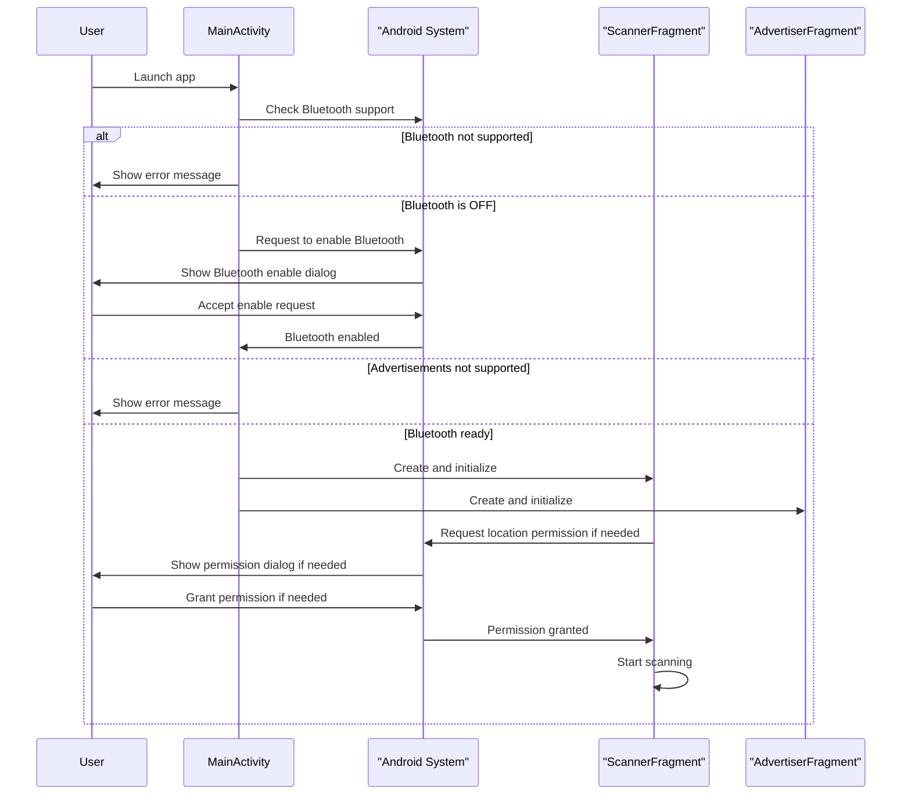
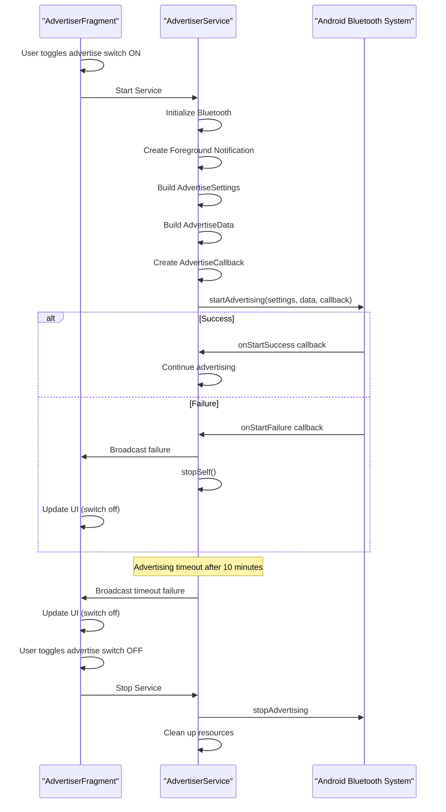
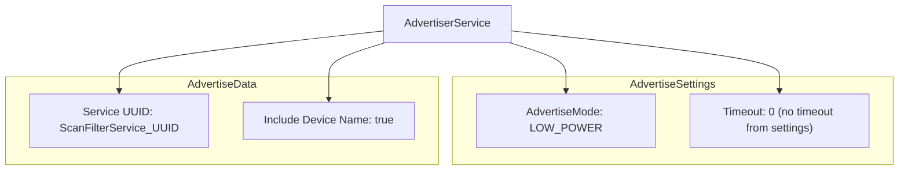
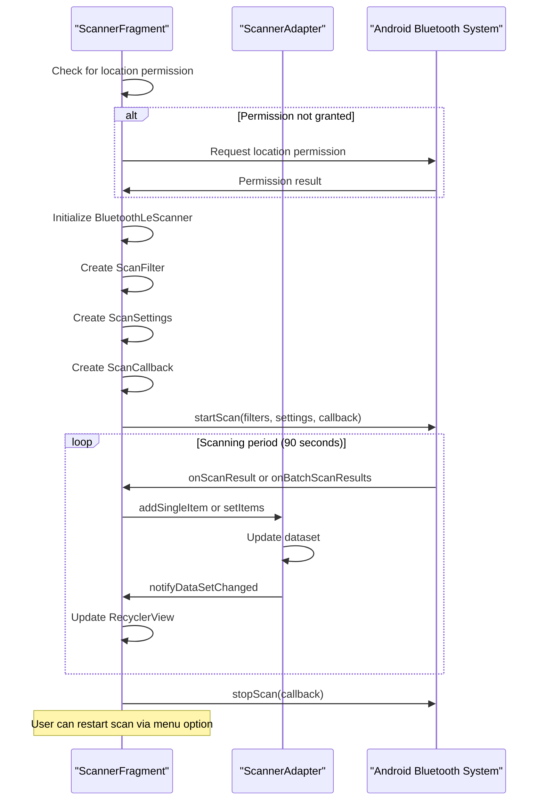
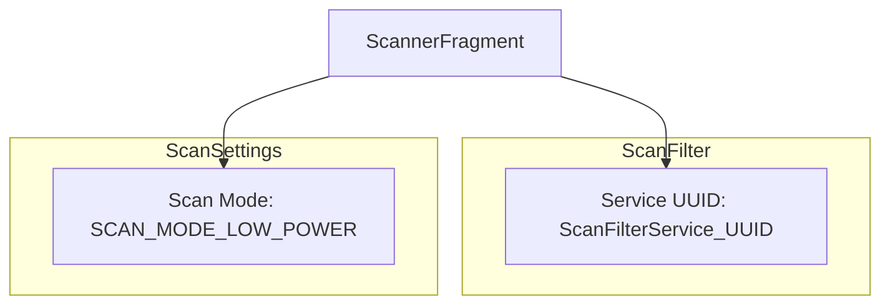
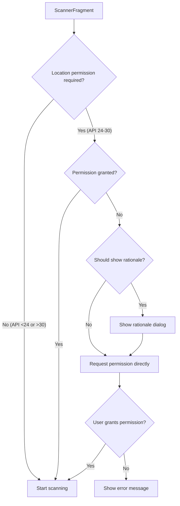
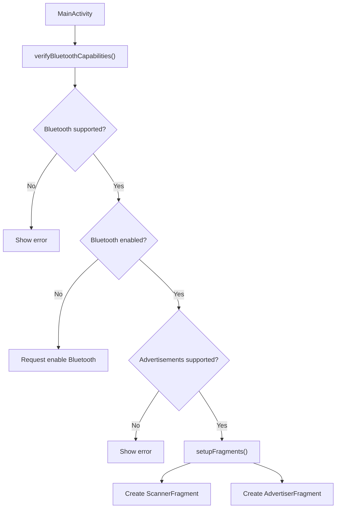

<!-- source: DeepWiki mcp.deepwiki.com · repo android/connectivity-samples · page 3.2 Bluetooth Advertisements Implementation · fetched 2026-10-23 -->

# Bluetooth Advertisements Implementation

<details>
<summary>Relevant source files</summary>

The following files were used as context for generating this wiki page:

- [BluetoothAdvertisementsKotlin/app/build.gradle](BluetoothAdvertisementsKotlin/app/build.gradle)
- [BluetoothAdvertisementsKotlin/app/src/main/AndroidManifest.xml](BluetoothAdvertisementsKotlin/app/src/main/AndroidManifest.xml)
- [BluetoothAdvertisementsKotlin/app/src/main/java/com/example/bluetoothadvertisements/AdvertiserFragment.kt](BluetoothAdvertisementsKotlin/app/src/main/java/com/example/bluetoothadvertisements/AdvertiserFragment.kt)
- [BluetoothAdvertisementsKotlin/app/src/main/java/com/example/bluetoothadvertisements/Constants.kt](BluetoothAdvertisementsKotlin/app/src/main/java/com/example/bluetoothadvertisements/Constants.kt)
- [BluetoothAdvertisementsKotlin/app/src/main/java/com/example/bluetoothadvertisements/MainActivity.kt](BluetoothAdvertisementsKotlin/app/src/main/java/com/example/bluetoothadvertisements/MainActivity.kt)
- [BluetoothAdvertisementsKotlin/app/src/main/java/com/example/bluetoothadvertisements/ScannerFragment.kt](BluetoothAdvertisementsKotlin/app/src/main/java/com/example/bluetoothadvertisements/ScannerFragment.kt)
- [BluetoothAdvertisementsKotlin/app/src/main/java/com/example/bluetoothadvertisements/adapter/ScannerAdapter.kt](BluetoothAdvertisementsKotlin/app/src/main/java/com/example/bluetoothadvertisements/adapter/ScannerAdapter.kt)
- [BluetoothAdvertisementsKotlin/app/src/main/java/com/example/bluetoothadvertisements/service/AdvertiserService.kt](BluetoothAdvertisementsKotlin/app/src/main/java/com/example/bluetoothadvertisements/service/AdvertiserService.kt)
- [BluetoothAdvertisementsKotlin/app/src/main/res/layout/activity_main.xml](BluetoothAdvertisementsKotlin/app/src/main/res/layout/activity_main.xml)
- [BluetoothAdvertisementsKotlin/app/src/main/res/layout/fragment_advertiser.xml](BluetoothAdvertisementsKotlin/app/src/main/res/layout/fragment_advertiser.xml)
- [BluetoothAdvertisementsKotlin/app/src/main/res/layout/fragment_scanner.xml](BluetoothAdvertisementsKotlin/app/src/main/res/layout/fragment_scanner.xml)
- [BluetoothAdvertisementsKotlin/app/src/main/res/layout/vh_scan_result.xml](BluetoothAdvertisementsKotlin/app/src/main/res/layout/vh_scan_result.xml)
- [BluetoothAdvertisementsKotlin/build.gradle](BluetoothAdvertisementsKotlin/build.gradle)
- [BluetoothAdvertisementsKotlin/gradle/wrapper/gradle-wrapper.properties](BluetoothAdvertisementsKotlin/gradle/wrapper/gradle-wrapper.properties)

</details>


## Purpose and Scope

This document provides a detailed technical explanation of the Bluetooth Low Energy (BLE) Advertisements implementation in the Android Connectivity Samples repository. It covers the architecture, components, and processes involved in both advertising a Bluetooth device and scanning for nearby advertising devices. This implementation demonstrates how to use Android's BLE APIs to broadcast a device's presence and discover nearby devices. For information about direct Bluetooth communication using GATT services, see [BluetoothLeChat Implementation](#3.1).

## System Architecture

The Bluetooth Advertisements sample demonstrates two key capabilities of Bluetooth Low Energy:
1. **Advertising** - Broadcasting a device's presence to nearby devices
2. **Scanning** - Discovering nearby devices that are advertising

### High-Level Architecture



Sources: [BluetoothAdvertisementsKotlin/app/src/main/java/com/example/bluetoothadvertisements/MainActivity.kt:33-88](), [BluetoothAdvertisementsKotlin/app/src/main/java/com/example/bluetoothadvertisements/AdvertiserFragment.kt:38-105](), [BluetoothAdvertisementsKotlin/app/src/main/java/com/example/bluetoothadvertisements/ScannerFragment.kt:40-217]()

### Component Relationships



Sources: [BluetoothAdvertisementsKotlin/app/src/main/java/com/example/bluetoothadvertisements/MainActivity.kt:33-88](), [BluetoothAdvertisementsKotlin/app/src/main/java/com/example/bluetoothadvertisements/AdvertiserFragment.kt:38-105](), [BluetoothAdvertisementsKotlin/app/src/main/java/com/example/bluetoothadvertisements/service/AdvertiserService.kt:39-167]()

## Application Initialization Flow

When the application starts, it performs a series of checks to ensure that Bluetooth is supported and properly configured before setting up the UI components.



Sources: [BluetoothAdvertisementsKotlin/app/src/main/java/com/example/bluetoothadvertisements/MainActivity.kt:46-63]()

## Bluetooth Advertising Implementation

The advertising component broadcasts the device's presence to nearby devices. This is implemented as a foreground service to allow it to run even when the app is in the background.

### Advertising Components

| Component | Description |
|-----------|-------------|
| `AdvertiserFragment` | UI component that provides a switch to toggle advertising |
| `AdvertiserService` | Foreground service that handles the actual advertising |
| `BluetoothLeAdvertiser` | Android system class that provides the advertising API |
| `AdvertiseCallback` | Callback interface for advertising results |

Sources: [BluetoothAdvertisementsKotlin/app/src/main/java/com/example/bluetoothadvertisements/AdvertiserFragment.kt:38-105](), [BluetoothAdvertisementsKotlin/app/src/main/java/com/example/bluetoothadvertisements/service/AdvertiserService.kt:39-167]()

### Advertising Process Flow



Sources: [BluetoothAdvertisementsKotlin/app/src/main/java/com/example/bluetoothadvertisements/AdvertiserFragment.kt:78-102](), [BluetoothAdvertisementsKotlin/app/src/main/java/com/example/bluetoothadvertisements/service/AdvertiserService.kt:79-155]()

### Advertising Settings and Data

The advertising settings and data are configured in the `AdvertiserService` class:



Sources: [BluetoothAdvertisementsKotlin/app/src/main/java/com/example/bluetoothadvertisements/service/AdvertiserService.kt:117-122](), [BluetoothAdvertisementsKotlin/app/src/main/java/com/example/bluetoothadvertisements/Constants.kt:35]()

The `AdvertiserService` creates a 10-minute timeout by using a Handler to post a delayed runnable, even though the advertise settings have no timeout. This ensures the device doesn't advertise indefinitely, which could drain the battery.

Key implementation details:
- The service runs in the foreground with a persistent notification
- A UUID is included in the advertisement data to help filtering during scanning
- The device name is included in the advertisements
- Advertising is automatically stopped after 10 minutes

## Bluetooth Scanning Implementation

The scanning component allows the device to discover nearby devices that are advertising.

### Scanning Components

| Component | Description |
|-----------|-------------|
| `ScannerFragment` | UI component that displays a list of discovered devices |
| `ScannerAdapter` | RecyclerView adapter for displaying scan results |
| `BluetoothLeScanner` | Android system class that provides the scanning API |
| `ScanCallback` | Callback interface for scan results |
| `ScanFilter` | Filters scan results based on criteria |
| `ScanSettings` | Configures how scanning should be performed |

Sources: [BluetoothAdvertisementsKotlin/app/src/main/java/com/example/bluetoothadvertisements/ScannerFragment.kt:40-217](), [BluetoothAdvertisementsKotlin/app/src/main/java/com/example/bluetoothadvertisements/adapter/ScannerAdapter.kt:31-81]()

### Scanning Process Flow



Sources: [BluetoothAdvertisementsKotlin/app/src/main/java/com/example/bluetoothadvertisements/ScannerFragment.kt:146-165](), [BluetoothAdvertisementsKotlin/app/src/main/java/com/example/bluetoothadvertisements/ScannerFragment.kt:193-216]()

### Scan Filter and Settings

The scanning filter and settings are configured to optimize for power and specificity:



Sources: [BluetoothAdvertisementsKotlin/app/src/main/java/com/example/bluetoothadvertisements/ScannerFragment.kt:167-176](), [BluetoothAdvertisementsKotlin/app/src/main/java/com/example/bluetoothadvertisements/Constants.kt:35]()

Key implementation details:
- Scanning is filtered to only show devices advertising with a specific service UUID
- Low power scan mode is used to conserve battery
- Scanning automatically stops after 90 seconds
- Duplicate results are handled by the adapter to keep the list clean
- The scanner displays device name, address, and timestamp information

## Permission Handling

BLE scanning requires location permission on Android N through R devices. The implementation includes proper permission handling:



Sources: [BluetoothAdvertisementsKotlin/app/src/main/java/com/example/bluetoothadvertisements/ScannerFragment.kt:77-127]()

## Error Handling

The implementation includes robust error handling for both advertising and scanning:

### Advertising Errors

The `AdvertiserFragment` registers a broadcast receiver to handle advertising failures:

| Error Code | Description |
|------------|-------------|
| `ADVERTISE_FAILED_ALREADY_STARTED` | Advertising is already started |
| `ADVERTISE_FAILED_DATA_TOO_LARGE` | Advertisement data is too large |
| `ADVERTISE_FAILED_FEATURE_UNSUPPORTED` | Advertising not supported on this device |
| `ADVERTISE_FAILED_INTERNAL_ERROR` | Internal error in Bluetooth stack |
| `ADVERTISE_FAILED_TOO_MANY_ADVERTISERS` | Too many advertisers |
| `ADVERTISING_TIMED_OUT` | Custom timeout (10 minutes) reached |

Sources: [BluetoothAdvertisementsKotlin/app/src/main/java/com/example/bluetoothadvertisements/AdvertiserFragment.kt:47-64]()

### Scanning Errors

The `ScannerFragment.SampleScanCallback` handles scanning errors and displays appropriate error messages:

```java
override fun onScanFailed(errorCode: Int) {
    super.onScanFailed(errorCode)
    Log.d(TAG, "onScanFailed: errorCode $errorCode")
    Toast.makeText(
            requireContext(),
            "Scan failed with error code $errorCode",
            Toast.LENGTH_LONG
    ).show()
}
```

Sources: [BluetoothAdvertisementsKotlin/app/src/main/java/com/example/bluetoothadvertisements/ScannerFragment.kt:207-215]()

## Integration in the MainActivity

The main activity serves as the entry point and integrates both the advertising and scanning functionality:



Sources: [BluetoothAdvertisementsKotlin/app/src/main/java/com/example/bluetoothadvertisements/MainActivity.kt:46-83]()

## Key Technical Considerations

1. **Service UUID**: Both the advertiser and scanner use the same UUID (`ScanFilterService_UUID`) to ensure compatibility.

2. **Foreground Service**: Advertising is implemented as a foreground service to allow it to run when the app is in the background.

3. **Location Permission**: BLE scanning requires location permission on Android N through R.

4. **Battery Optimization**: Both advertising and scanning use low power modes and have timeouts to prevent battery drain.

5. **Android Manifest Configuration**: The application requires Bluetooth and location permissions declared in the manifest.

Sources: [BluetoothAdvertisementsKotlin/app/src/main/AndroidManifest.xml:22-28]()

## Conclusion

The Bluetooth Advertisements implementation demonstrates a complete system for BLE advertising and scanning on Android. It includes best practices for permission handling, battery optimization, and user experience. This implementation can be used as a template for applications that need to discover nearby devices or broadcast a device's presence using Bluetooth Low Energy.

---

