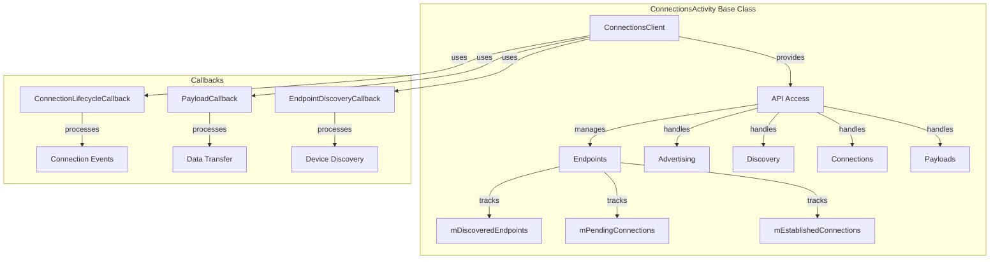
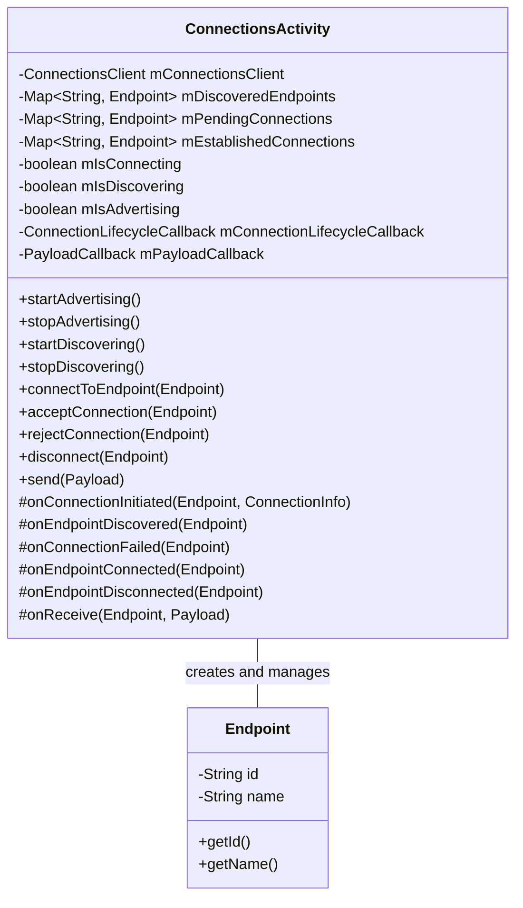
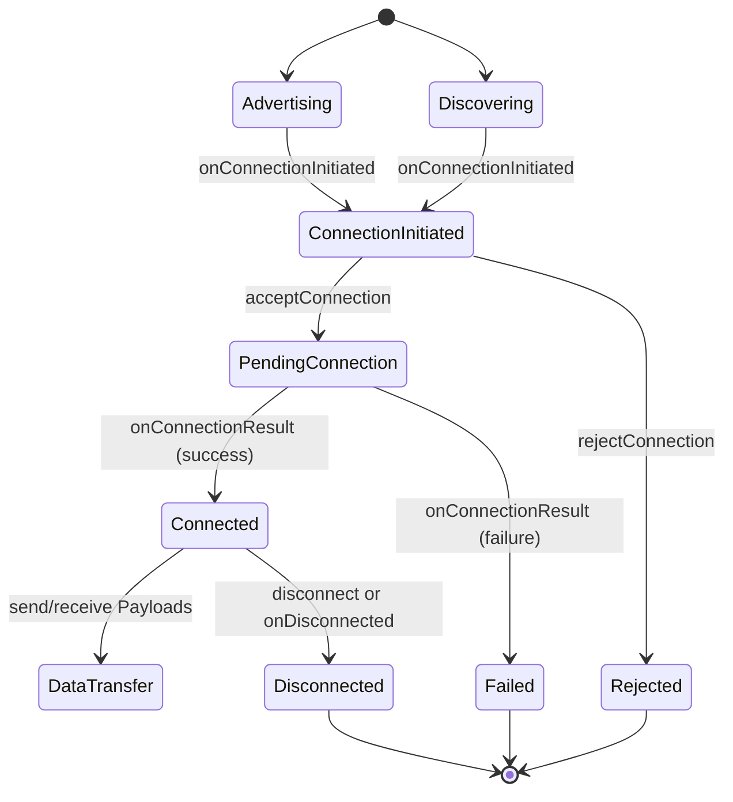
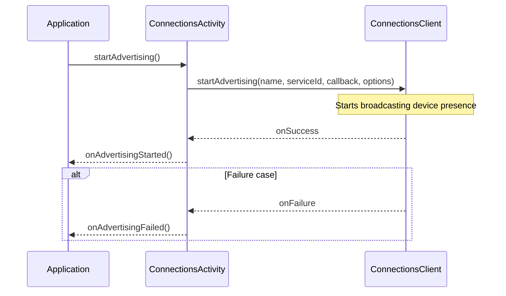
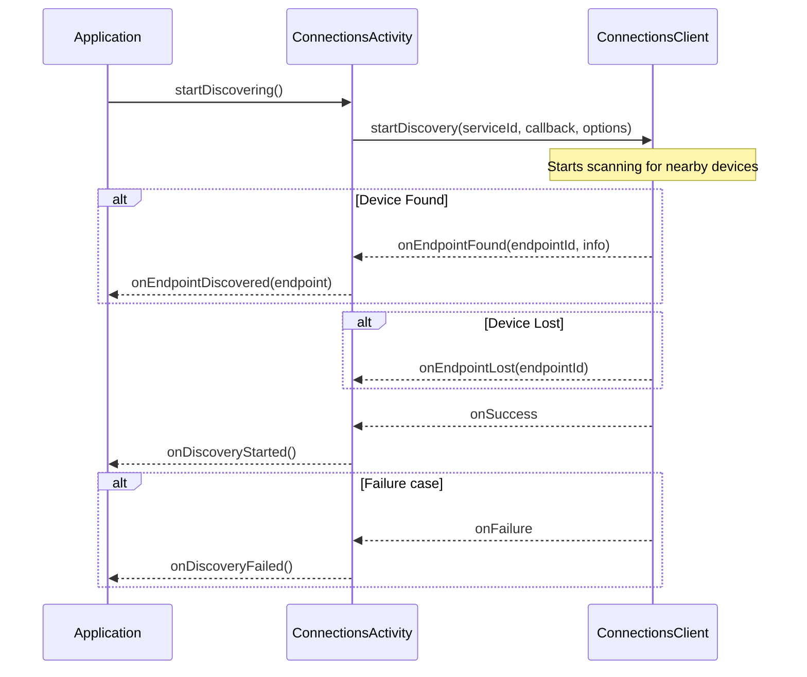
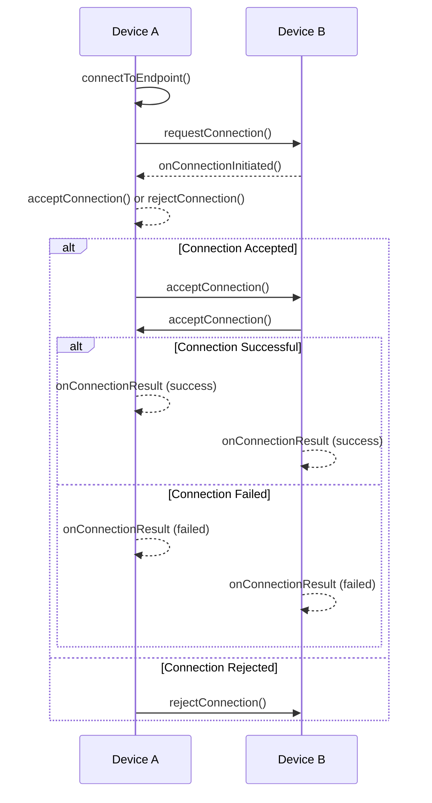
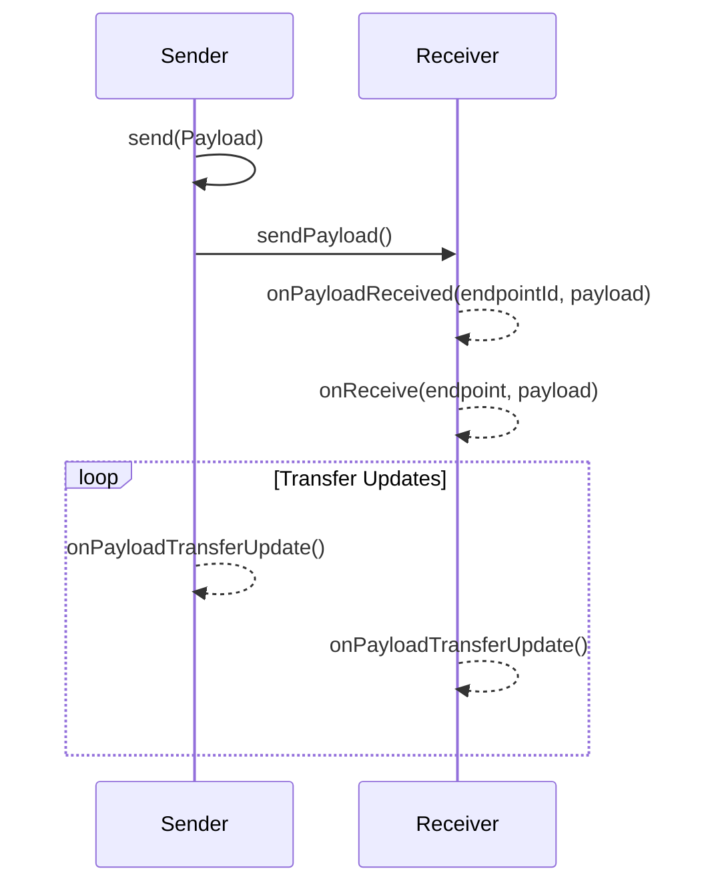
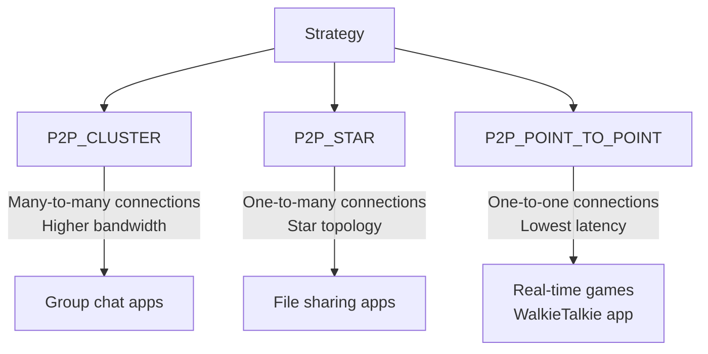

<!-- source: DeepWiki mcp.deepwiki.com · repo android/connectivity-samples · page 4 Nearby Connections · fetched 2026-10-23 -->

# Nearby Connections

<details>
<summary>Relevant source files</summary>

The following files were used as context for generating this wiki page:

- [NearbyConnectionsWalkieTalkie/app/build.gradle.kts](NearbyConnectionsWalkieTalkie/app/build.gradle.kts)
- [NearbyConnectionsWalkieTalkie/app/src/main/AndroidManifest.xml](NearbyConnectionsWalkieTalkie/app/src/main/AndroidManifest.xml)
- [NearbyConnectionsWalkieTalkie/app/src/main/java/com/google/location/nearby/apps/walkietalkie/ConnectionsActivity.java](NearbyConnectionsWalkieTalkie/app/src/main/java/com/google/location/nearby/apps/walkietalkie/ConnectionsActivity.java)
- [NearbyConnectionsWalkieTalkie/build.gradle.kts](NearbyConnectionsWalkieTalkie/build.gradle.kts)
- [NearbyConnectionsWalkieTalkie/gradle.properties](NearbyConnectionsWalkieTalkie/gradle.properties)
- [NearbyConnectionsWalkieTalkie/gradle/wrapper/gradle-wrapper.jar](NearbyConnectionsWalkieTalkie/gradle/wrapper/gradle-wrapper.jar)
- [NearbyConnectionsWalkieTalkie/gradle/wrapper/gradle-wrapper.properties](NearbyConnectionsWalkieTalkie/gradle/wrapper/gradle-wrapper.properties)
- [NearbyConnectionsWalkieTalkie/gradlew](NearbyConnectionsWalkieTalkie/gradlew)
- [NearbyConnectionsWalkieTalkie/gradlew.bat](NearbyConnectionsWalkieTalkie/gradlew.bat)
- [NearbyConnectionsWalkieTalkie/settings.gradle.kts](NearbyConnectionsWalkieTalkie/settings.gradle.kts)

</details>


This document provides a comprehensive overview of the Nearby Connections API implementation in the Android Connectivity Samples repository. It covers the architecture, key components, and usage patterns of the API as demonstrated in the NearbyConnectionsWalkieTalkie sample application.

For information about UWB Ranging which sometimes uses Nearby Connections as an out-of-band discovery mechanism, see [UWB Ranging](#2).

## Overview of Nearby Connections API

The Nearby Connections API is a peer-to-peer networking API that allows Android devices to discover nearby devices, establish connections, and transfer data without an internet connection. It uses a combination of Bluetooth, Bluetooth Low Energy (BLE), and Wi-Fi technologies for device discovery and communication.

The NearbyConnectionsWalkieTalkie sample demonstrates real-time audio communication between devices using this API. It showcases the following key features:

- Advertising device presence
- Discovering nearby devices
- Establishing connections between devices
- Transferring audio data (payloads) between connected devices

Sources: [NearbyConnectionsWalkieTalkie/app/src/main/AndroidManifest.xml:1-46](), [NearbyConnectionsWalkieTalkie/app/src/main/java/com/google/location/nearby/apps/walkietalkie/ConnectionsActivity.java:1-45]()

## Architecture Overview

The Nearby Connections implementation in the sample follows a client-server model where devices can advertise their presence, discover other devices, and establish connections.

### Nearby Connections Component Architecture



Sources: [NearbyConnectionsWalkieTalkie/app/src/main/java/com/google/location/nearby/apps/walkietalkie/ConnectionsActivity.java:97-185]()

## ConnectionsActivity Framework

The ConnectionsActivity class provides a framework for interacting with the Nearby Connections API. It abstracts many of the complexities of the API and provides a simplified interface for applications to use.

### Key Components

1. **ConnectionsClient**: The main client for interacting with the Nearby Connections API
2. **Endpoint Management**: Three collections to track endpoints in different states:
   - `mDiscoveredEndpoints`: Endpoints that have been discovered but not connected
   - `mPendingConnections`: Endpoints with pending connection requests
   - `mEstablishedConnections`: Endpoints with established connections
3. **Callbacks**:
   - `ConnectionLifecycleCallback`: Handles connection events (initiation, results, disconnection)
   - `PayloadCallback`: Handles received payloads and transfer updates
   - `EndpointDiscoveryCallback`: Handles endpoint discovery events

### ConnectionsActivity Class Structure



Sources: [NearbyConnectionsWalkieTalkie/app/src/main/java/com/google/location/nearby/apps/walkietalkie/ConnectionsActivity.java:45-629]()

## Connection Lifecycle

The Nearby Connections API follows a specific lifecycle for establishing and maintaining connections between devices.

### Connection State Diagram



Sources: [NearbyConnectionsWalkieTalkie/app/src/main/java/com/google/location/nearby/apps/walkietalkie/ConnectionsActivity.java:128-167](), [NearbyConnectionsWalkieTalkie/app/src/main/java/com/google/location/nearby/apps/walkietalkie/ConnectionsActivity.java:292-315]()

## Advertising and Discovery

Advertising and discovery are the two primary mechanisms for initiating connections between devices:

1. **Advertising**: A device broadcasts its presence to nearby devices
2. **Discovery**: A device scans for nearby advertising devices

### Advertising Process

The `startAdvertising()` method initializes the advertising process:



Sources: [NearbyConnectionsWalkieTalkie/app/src/main/java/com/google/location/nearby/apps/walkietalkie/ConnectionsActivity.java:234-264]()

### Discovery Process

The `startDiscovering()` method initializes the discovery process:



Sources: [NearbyConnectionsWalkieTalkie/app/src/main/java/com/google/location/nearby/apps/walkietalkie/ConnectionsActivity.java:322-367]()

## Connection Management

Once devices discover each other, they can establish connections:

### Connection Establishment Process



Sources: [NearbyConnectionsWalkieTalkie/app/src/main/java/com/google/location/nearby/apps/walkietalkie/ConnectionsActivity.java:422-438](), [NearbyConnectionsWalkieTalkie/app/src/main/java/com/google/location/nearby/apps/walkietalkie/ConnectionsActivity.java:292-315]()

## Payload Transmission

After establishing a connection, devices can exchange data through payloads:

### Payload Exchange Process



Sources: [NearbyConnectionsWalkieTalkie/app/src/main/java/com/google/location/nearby/apps/walkietalkie/ConnectionsActivity.java:485-499](), [NearbyConnectionsWalkieTalkie/app/src/main/java/com/google/location/nearby/apps/walkietalkie/ConnectionsActivity.java:170-184]()

## Required Permissions

The Nearby Connections API requires several permissions to function correctly:

| Permission | Purpose | Android Version |
|------------|---------|----------------|
| `BLUETOOTH` | Required for device discovery and communication via Bluetooth | ≤ Android 11 |
| `BLUETOOTH_ADMIN` | Required for controlling Bluetooth functions | ≤ Android 11 |
| `BLUETOOTH_SCAN` | Required for scanning for devices via Bluetooth | Android 12+ |
| `BLUETOOTH_ADVERTISE` | Required for advertising device presence via Bluetooth | Android 12+ |
| `BLUETOOTH_CONNECT` | Required for establishing Bluetooth connections | Android 12+ |
| `ACCESS_WIFI_STATE` | Required for WiFi-based device discovery | All versions |
| `CHANGE_WIFI_STATE` | Required for controlling WiFi functions | All versions |
| `ACCESS_COARSE_LOCATION` | Required for nearby device discovery | ≤ Android 12 |
| `ACCESS_FINE_LOCATION` | Required for more precise device discovery | ≤ Android 12 |
| `NEARBY_WIFI_DEVICES` | Required for WiFi-based device discovery | Android 13+ |

The code automatically handles permission requirements based on the Android version:

```java
private static final String[] REQUIRED_PERMISSIONS;
static {
  if (Build.VERSION.SDK_INT >= Build.VERSION_CODES.TIRAMISU) {
    // Android 13+ permissions
  } else if (Build.VERSION.SDK_INT >= Build.VERSION_CODES.S) {
    // Android 12 permissions
  } else if (Build.VERSION.SDK_INT >= Build.VERSION_CODES.Q) {
    // Android 10+ permissions
  } else {
    // Pre-Android 10 permissions
  }
}
```

Sources: [NearbyConnectionsWalkieTalkie/app/src/main/AndroidManifest.xml:7-19](), [NearbyConnectionsWalkieTalkie/app/src/main/java/com/google/location/nearby/apps/walkietalkie/ConnectionsActivity.java:49-93]()

## Key Abstractions and Classes

### Endpoint Class

The `Endpoint` class represents a remote device that can be connected to:

```java
protected static class Endpoint {
  @NonNull private final String id;
  @NonNull private final String name;
  
  private Endpoint(@NonNull String id, @NonNull String name) {
    this.id = id;
    this.name = name;
  }
  
  @NonNull
  public String getId() {
    return id;
  }
  
  @NonNull
  public String getName() {
    return name;
  }
  
  // equals, hashCode, and toString implementations
}
```

Sources: [NearbyConnectionsWalkieTalkie/app/src/main/java/com/google/location/nearby/apps/walkietalkie/ConnectionsActivity.java:591-628]()

### Strategy Selection

The Nearby Connections API provides different connection strategies for different use cases:



The strategy is defined by implementing the `getStrategy()` method in a subclass of `ConnectionsActivity`.

Sources: [NearbyConnectionsWalkieTalkie/app/src/main/java/com/google/location/nearby/apps/walkietalkie/ConnectionsActivity.java:528-533]()

## Implementation Steps

To use the Nearby Connections API with the ConnectionsActivity framework:

1. **Extend ConnectionsActivity**:
   ```java
   public class MyActivity extends ConnectionsActivity {
       @Override
       protected String getName() {
           return "Device Name";
       }
       
       @Override
       protected String getServiceId() {
           return "com.example.app.SERVICE_ID";
       }
       
       @Override
       protected Strategy getStrategy() {
           return Strategy.P2P_POINT_TO_POINT;
       }
   }
   ```

2. **Override callback methods** to handle connection events:
   ```java
   @Override
   protected void onEndpointDiscovered(Endpoint endpoint) {
       // Handle discovered endpoint
   }
   
   @Override
   protected void onConnectionInitiated(Endpoint endpoint, ConnectionInfo connectionInfo) {
       // Handle connection initiation
   }
   
   @Override
   protected void onEndpointConnected(Endpoint endpoint) {
       // Handle successful connection
   }
   
   @Override
   protected void onReceive(Endpoint endpoint, Payload payload) {
       // Handle received data
   }
   ```

3. **Start advertising or discovery** based on the device's role:
   ```java
   // To advertise (as a host)
   startAdvertising();
   
   // To discover (as a client)
   startDiscovering();
   ```

4. **Connect to endpoints** when discovered:
   ```java
   @Override
   protected void onEndpointDiscovered(Endpoint endpoint) {
       connectToEndpoint(endpoint);
   }
   ```

5. **Send data** to connected endpoints:
   ```java
   // Create and send a byte payload
   Payload bytesPayload = Payload.fromBytes(bytes);
   send(bytesPayload);
   
   // Or create and send a file payload
   Payload filePayload = Payload.fromFile(file);
   send(filePayload);
   
   // Or create and send a stream payload
   Payload streamPayload = Payload.fromStream(inputStream);
   send(streamPayload);
   ```

Sources: [NearbyConnectionsWalkieTalkie/app/src/main/java/com/google/location/nearby/apps/walkietalkie/ConnectionsActivity.java:519-533](), [NearbyConnectionsWalkieTalkie/app/src/main/java/com/google/location/nearby/apps/walkietalkie/ConnectionsActivity.java:234-264](), [NearbyConnectionsWalkieTalkie/app/src/main/java/com/google/location/nearby/apps/walkietalkie/ConnectionsActivity.java:322-367]()

## Best Practices

1. **Permission Handling**: Always check for and request required permissions before using Nearby Connections.
   
2. **Connection Strategy**: Choose the appropriate connection strategy based on your app's requirements:
   - `P2P_CLUSTER` for many-to-many connections
   - `P2P_STAR` for one-to-many connections
   - `P2P_POINT_TO_POINT` for one-to-one connections with lowest latency

3. **Resource Management**: Always stop advertising, discovery, and disconnect from endpoints when they're no longer needed to save battery.

4. **Error Handling**: Implement proper error handling for connection failures and disconnections.

5. **UI Feedback**: Provide clear feedback to users during the discovery and connection process.

6. **Service ID**: Use a unique service ID for your application to prevent interference with other apps using Nearby Connections.

7. **Testing**: Test your implementation on different Android versions and device models for compatibility.

Sources: [NearbyConnectionsWalkieTalkie/app/src/main/java/com/google/location/nearby/apps/walkietalkie/ConnectionsActivity.java:405-415](), [NearbyConnectionsWalkieTalkie/app/src/main/java/com/google/location/nearby/apps/walkietalkie/ConnectionsActivity.java:234-264](), [NearbyConnectionsWalkieTalkie/app/src/main/java/com/google/location/nearby/apps/walkietalkie/ConnectionsActivity.java:322-367](), [NearbyConnectionsWalkieTalkie/app/src/main/java/com/google/location/nearby/apps/walkietalkie/ConnectionsActivity.java:519-533]()

---

