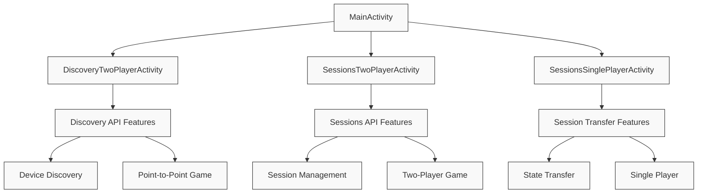
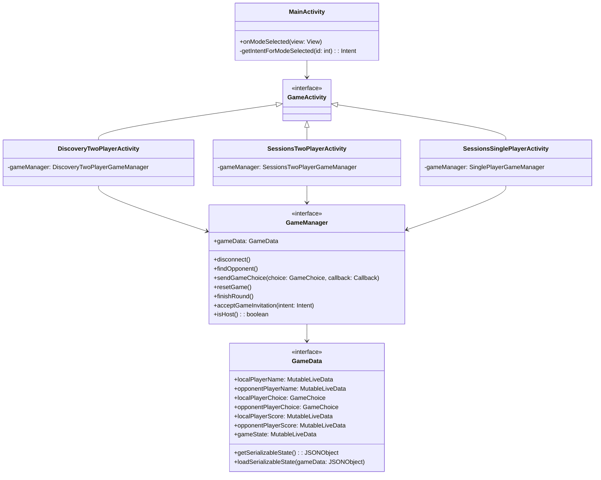
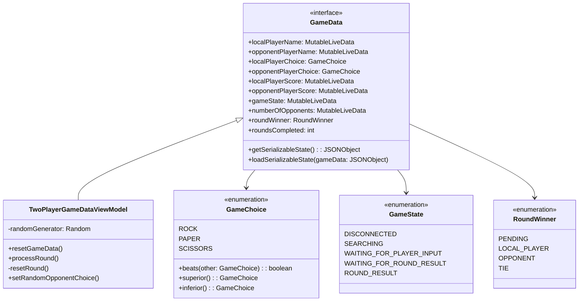
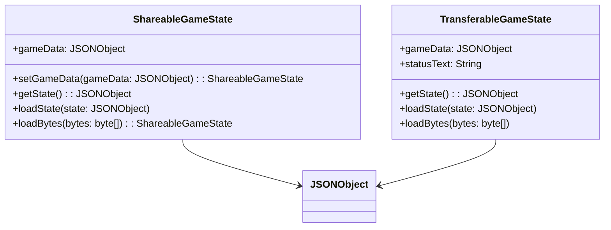
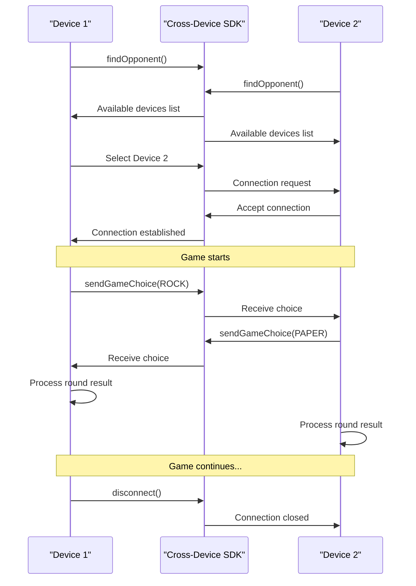
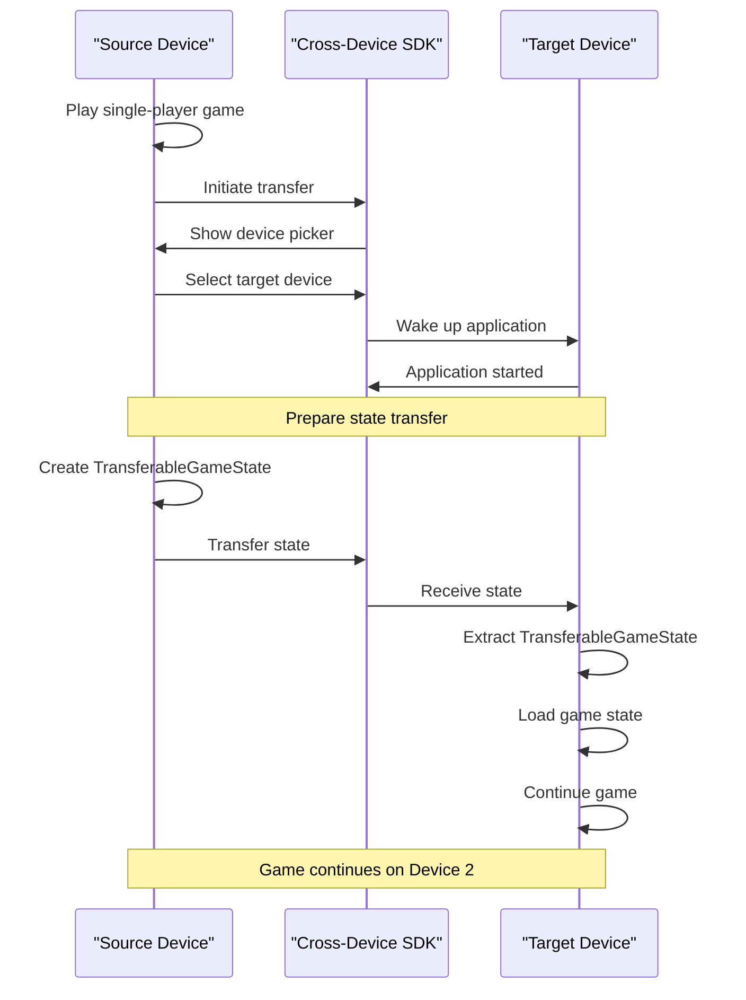

<!-- source: DeepWiki mcp.deepwiki.com · repo android/connectivity-samples · page 5 Cross-Device SDK Samples · fetched 2026-10-23 -->

# Cross-Device SDK Samples

<details>
<summary>Relevant source files</summary>

The following files were used as context for generating this wiki page:

- [CrossDeviceRockPaperScissors/app/build.gradle](CrossDeviceRockPaperScissors/app/build.gradle)
- [CrossDeviceRockPaperScissors/app/src/main/AndroidManifest.xml](CrossDeviceRockPaperScissors/app/src/main/AndroidManifest.xml)
- [CrossDeviceRockPaperScissors/app/src/main/java/com/google/crossdevice/sample/rps/model/CodenameGenerator.java](CrossDeviceRockPaperScissors/app/src/main/java/com/google/crossdevice/sample/rps/model/CodenameGenerator.java)
- [CrossDeviceRockPaperScissors/app/src/main/java/com/google/crossdevice/sample/rps/model/GameChoice.java](CrossDeviceRockPaperScissors/app/src/main/java/com/google/crossdevice/sample/rps/model/GameChoice.java)
- [CrossDeviceRockPaperScissors/app/src/main/java/com/google/crossdevice/sample/rps/model/ShareableGameState.java](CrossDeviceRockPaperScissors/app/src/main/java/com/google/crossdevice/sample/rps/model/ShareableGameState.java)
- [CrossDeviceRockPaperScissors/app/src/main/java/com/google/crossdevice/sample/rps/model/TransferableGameState.java](CrossDeviceRockPaperScissors/app/src/main/java/com/google/crossdevice/sample/rps/model/TransferableGameState.java)
- [CrossDeviceRockPaperScissors/app/src/main/java/com/google/crossdevice/sample/rps/ui/MainActivity.java](CrossDeviceRockPaperScissors/app/src/main/java/com/google/crossdevice/sample/rps/ui/MainActivity.java)
- [CrossDeviceRockPaperScissors/app/src/main/res/layout/activity_main.xml](CrossDeviceRockPaperScissors/app/src/main/res/layout/activity_main.xml)
- [CrossDeviceRockPaperScissors/app/src/main/res/values/strings.xml](CrossDeviceRockPaperScissors/app/src/main/res/values/strings.xml)
- [CrossDeviceRockPaperScissorsKotlin/app/build.gradle](CrossDeviceRockPaperScissorsKotlin/app/build.gradle)
- [CrossDeviceRockPaperScissorsKotlin/app/src/main/AndroidManifest.xml](CrossDeviceRockPaperScissorsKotlin/app/src/main/AndroidManifest.xml)
- [CrossDeviceRockPaperScissorsKotlin/app/src/main/java/com/google/crossdevice/sample/rps/model/CodenameGenerator.kt](CrossDeviceRockPaperScissorsKotlin/app/src/main/java/com/google/crossdevice/sample/rps/model/CodenameGenerator.kt)
- [CrossDeviceRockPaperScissorsKotlin/app/src/main/java/com/google/crossdevice/sample/rps/model/GameChoice.kt](CrossDeviceRockPaperScissorsKotlin/app/src/main/java/com/google/crossdevice/sample/rps/model/GameChoice.kt)
- [CrossDeviceRockPaperScissorsKotlin/app/src/main/java/com/google/crossdevice/sample/rps/model/GameData.kt](CrossDeviceRockPaperScissorsKotlin/app/src/main/java/com/google/crossdevice/sample/rps/model/GameData.kt)
- [CrossDeviceRockPaperScissorsKotlin/app/src/main/java/com/google/crossdevice/sample/rps/model/ShareableGameState.kt](CrossDeviceRockPaperScissorsKotlin/app/src/main/java/com/google/crossdevice/sample/rps/model/ShareableGameState.kt)
- [CrossDeviceRockPaperScissorsKotlin/app/src/main/java/com/google/crossdevice/sample/rps/model/TransferableGameState.kt](CrossDeviceRockPaperScissorsKotlin/app/src/main/java/com/google/crossdevice/sample/rps/model/TransferableGameState.kt)
- [CrossDeviceRockPaperScissorsKotlin/app/src/main/java/com/google/crossdevice/sample/rps/model/TwoPlayerGameDataViewModel.kt](CrossDeviceRockPaperScissorsKotlin/app/src/main/java/com/google/crossdevice/sample/rps/model/TwoPlayerGameDataViewModel.kt)
- [CrossDeviceRockPaperScissorsKotlin/app/src/main/java/com/google/crossdevice/sample/rps/service/GameManager.kt](CrossDeviceRockPaperScissorsKotlin/app/src/main/java/com/google/crossdevice/sample/rps/service/GameManager.kt)
- [CrossDeviceRockPaperScissorsKotlin/app/src/main/res/layout/activity_main.xml](CrossDeviceRockPaperScissorsKotlin/app/src/main/res/layout/activity_main.xml)
- [CrossDeviceRockPaperScissorsKotlin/app/src/main/res/values/strings.xml](CrossDeviceRockPaperScissorsKotlin/app/src/main/res/values/strings.xml)

</details>


## Overview

This document provides a technical explanation of the Cross-Device SDK samples in the Android Connectivity Samples repository. The Cross-Device SDK enables developers to build multi-device experiences that work seamlessly across Android devices. The samples demonstrate how to use the SDK's APIs to create applications that can discover nearby devices, establish connections, share data, and transfer application state between devices.

The current implementation includes a Rock Paper Scissors game sample with multiple gameplay modes showcasing different features of the Cross-Device SDK. The sample is available in both Java and Kotlin implementations with identical functionality.

## Sample Application: Cross-Device Rock Paper Scissors

The Rock Paper Scissors sample demonstrates how to use Google's Cross-Device SDK to create a game that can be played across multiple devices. The game includes several modes that showcase different capabilities of the SDK:



Sources:
- [CrossDeviceRockPaperScissors/app/src/main/java/com/google/crossdevice/sample/rps/ui/MainActivity.java:27-53]()
- [CrossDeviceRockPaperScissors/app/src/main/AndroidManifest.xml:34-76]()
- [CrossDeviceRockPaperScissorsKotlin/app/src/main/AndroidManifest.xml:34-76]()

### Game Modes

The sample includes three main gameplay modes:

1. **Two Player (Discovery API)**: Uses the Discovery API to find nearby devices and establish a direct peer-to-peer connection for playing the game.

2. **Two Player (Sessions API)**: Uses the Sessions API to create a shared session between two devices for gameplay, with more robust connection management.

3. **Single Player (Sessions API)**: Demonstrates how to transfer an ongoing game session from one device to another, preserving the game state.

The main screen provides buttons to launch each of these modes, with a placeholder for a future multiplayer mode.

Sources:
- [CrossDeviceRockPaperScissors/app/src/main/res/layout/activity_main.xml:24-55]()
- [CrossDeviceRockPaperScissors/app/src/main/res/values/strings.xml:44-47]()

## Architecture

The Cross-Device Rock Paper Scissors sample is built using a modular architecture that separates the game logic from the communication layer.



Sources:
- [CrossDeviceRockPaperScissors/app/src/main/java/com/google/crossdevice/sample/rps/ui/MainActivity.java:27-53]()
- [CrossDeviceRockPaperScissorsKotlin/app/src/main/java/com/google/crossdevice/sample/rps/service/GameManager.kt:24-60]()
- [CrossDeviceRockPaperScissorsKotlin/app/src/main/java/com/google/crossdevice/sample/rps/model/GameData.kt:23-79]()

### Core Components

1. **Activity Layer**:
   - `MainActivity`: Entry point to select game modes
   - Game activity implementations for each mode:
     - `DiscoveryTwoPlayerActivity`
     - `SessionsTwoPlayerActivity`
     - `SessionsSinglePlayerActivity`

2. **Game Management Layer**:
   - `GameManager` interface: Common interface for game managers
   - Implementation-specific game managers for each mode:
     - `DiscoveryTwoPlayerGameManager`
     - `SessionsTwoPlayerGameManager`
     - `SinglePlayerGameManager`

3. **Data Layer**:
   - `GameData` interface: Defines the game state data structure
   - `TwoPlayerGameDataViewModel`: Implementation for two-player games
   - Game state transfer objects:
     - `ShareableGameState`: For sharing game state between devices
     - `TransferableGameState`: For transferring games between devices

4. **Model Layer**:
   - `GameChoice`: Enumeration of rock, paper, scissors choices
   - `CodenameGenerator`: Utility for generating player names

Sources:
- [CrossDeviceRockPaperScissorsKotlin/app/src/main/java/com/google/crossdevice/sample/rps/model/GameData.kt:23-79]()
- [CrossDeviceRockPaperScissorsKotlin/app/src/main/java/com/google/crossdevice/sample/rps/service/GameManager.kt:24-60]()
- [CrossDeviceRockPaperScissorsKotlin/app/src/main/java/com/google/crossdevice/sample/rps/model/GameChoice.kt:20-44]()
- [CrossDeviceRockPaperScissorsKotlin/app/src/main/java/com/google/crossdevice/sample/rps/model/CodenameGenerator.kt:22-68]()

### Game Data Model

The game data model is centered around the `GameData` interface, which defines the structure for maintaining game state:



Sources:
- [CrossDeviceRockPaperScissorsKotlin/app/src/main/java/com/google/crossdevice/sample/rps/model/GameData.kt:23-79]()
- [CrossDeviceRockPaperScissorsKotlin/app/src/main/java/com/google/crossdevice/sample/rps/model/TwoPlayerGameDataViewModel.kt:33-183]()
- [CrossDeviceRockPaperScissorsKotlin/app/src/main/java/com/google/crossdevice/sample/rps/model/GameChoice.kt:20-44]()

### State Transfer Model

For transferring game state between devices, the sample implements two state container classes:



Sources:
- [CrossDeviceRockPaperScissors/app/src/main/java/com/google/crossdevice/sample/rps/model/ShareableGameState.java:24-65]()
- [CrossDeviceRockPaperScissors/app/src/main/java/com/google/crossdevice/sample/rps/model/TransferableGameState.java:24-67]()
- [CrossDeviceRockPaperScissorsKotlin/app/src/main/java/com/google/crossdevice/sample/rps/model/ShareableGameState.kt:24-66]()
- [CrossDeviceRockPaperScissorsKotlin/app/src/main/java/com/google/crossdevice/sample/rps/model/TransferableGameState.kt:24-67]()

## Cross-Device SDK Integration

### API Dependencies

The Cross-Device SDK is included in the project as a dependency in the build.gradle files:

```
implementation "com.google.ambient.crossdevice:crossdevice:${crossdeviceVersion}"
```

By default, the SDK version used is `0.1.0-preview01`, indicating this is a preview release of the SDK.

Sources:
- [CrossDeviceRockPaperScissors/app/build.gradle:31-39]()
- [CrossDeviceRockPaperScissorsKotlin/app/build.gradle:34-42]()

### Discovery API Usage

The Discovery API is used in the `DiscoveryTwoPlayerActivity` to:

1. Discover nearby devices that are also running the application
2. Display available devices to the user
3. Establish a connection with a selected device
4. Send and receive game choices during gameplay

The game flow with the Discovery API follows this sequence:



Sources:
- [CrossDeviceRockPaperScissorsKotlin/app/src/main/java/com/google/crossdevice/sample/rps/service/GameManager.kt:24-60]()
- [CrossDeviceRockPaperScissors/app/src/main/AndroidManifest.xml:45-54]()

### Sessions API Usage

The Sessions API provides more robust session management capabilities and is used in two different modes:

1. **Two Player Mode** (`SessionsTwoPlayerActivity`):
   - Creates a shared session between two devices
   - Manages the connection through the session
   - Handles session lifecycle events
   - Provides reliable messaging between devices

2. **Single Player with Transfer** (`SessionsSinglePlayerActivity`):
   - Demonstrates transferring a game from one device to another
   - Preserves game state during transfer
   - Uses the `TransferableGameState` class to package the state

The session transfer workflow:



Sources:
- [CrossDeviceRockPaperScissors/app/src/main/java/com/google/crossdevice/sample/rps/model/TransferableGameState.java:24-67]()
- [CrossDeviceRockPaperScissors/app/src/main/AndroidManifest.xml:56-76]()
- [CrossDeviceRockPaperScissors/app/src/main/res/values/strings.xml:62-66]()

## Game Logic Implementation

The core game logic is independent of the cross-device functionality and is implemented in the model classes:

1. **Game Choices and Rules**:
   - The `GameChoice` enum defines the three possible choices (ROCK, PAPER, SCISSORS)
   - Each choice has methods to determine if it beats another choice
   - The logic follows standard Rock Paper Scissors rules:
     - Rock beats Scissors
     - Scissors beats Paper
     - Paper beats Rock

2. **Round Processing**:
   - When both players have made their choices, the `processRound()` method in `TwoPlayerGameDataViewModel` determines the winner
   - The appropriate player's score is incremented
   - Game state is updated to show the result
   - After viewing the result, a new round begins

3. **Player Identification**:
   - Players are assigned random codenames using the `CodenameGenerator` class
   - Codenames combine a color and an Android version treat name (e.g., "Blue Marshmallow")

Sources:
- [CrossDeviceRockPaperScissors/app/src/main/java/com/google/crossdevice/sample/rps/model/GameChoice.java:20-52]()
- [CrossDeviceRockPaperScissorsKotlin/app/src/main/java/com/google/crossdevice/sample/rps/model/GameChoice.kt:20-44]()
- [CrossDeviceRockPaperScissorsKotlin/app/src/main/java/com/google/crossdevice/sample/rps/model/TwoPlayerGameDataViewModel.kt:97-111]()
- [CrossDeviceRockPaperScissors/app/src/main/java/com/google/crossdevice/sample/rps/model/CodenameGenerator.java:22-70]()
- [CrossDeviceRockPaperScissorsKotlin/app/src/main/java/com/google/crossdevice/sample/rps/model/CodenameGenerator.kt:22-68]()

## Manifest Configuration

The AndroidManifest.xml files include important configurations for enabling cross-device functionality:

1. **Activity Export and Intent Filters**:
   - Activities are exported to allow them to be launched by the SDK
   - Custom intent actions are defined for each activity:
     - `com.google.crossdevice.sample.rps.DISCOVERY_TWO_PLAYER_WAKEUP`
     - `com.google.crossdevice.sample.rps.SESSIONS_TWO_PLAYER_WAKEUP`
     - `com.google.crossdevice.sample.rps.SESSIONS_TRANSFER`

2. **Launch Modes**:
   - Activities use `singleTop` launch mode to ensure proper navigation
   - This prevents duplicate instances when the app is launched by the SDK

Sources:
- [CrossDeviceRockPaperScissors/app/src/main/AndroidManifest.xml:34-76]()
- [CrossDeviceRockPaperScissorsKotlin/app/src/main/AndroidManifest.xml:34-76]()

## Conclusion

The Cross-Device SDK samples demonstrate how to build applications that can discover nearby devices, establish connections, share data, and transfer application state between devices. The Rock Paper Scissors game showcases these capabilities through its different game modes:

1. Two Player mode using the Discovery API for device discovery and direct connections
2. Two Player mode using the Sessions API for more robust session management
3. Single Player mode demonstrating game session transfer between devices

The sample's modular architecture separates the game logic from the cross-device communication, making it easier to understand how the Cross-Device SDK can be integrated into existing applications.

For information about implementing the specific game modes, see [Rock Paper Scissors Game Implementation](#5.1) and [Cross-Device Game Architecture](#5.2).

---

