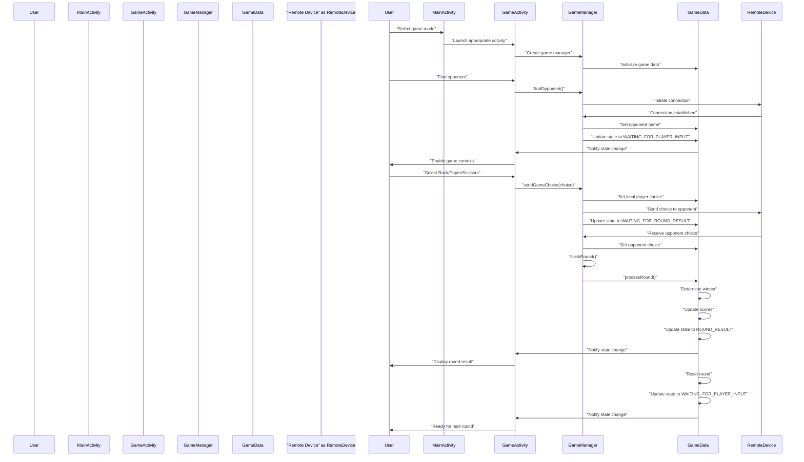
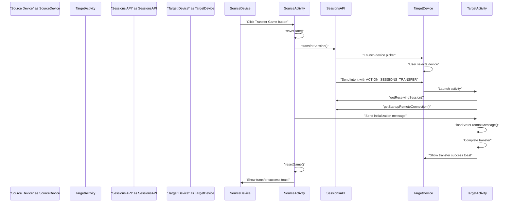

<!-- source: DeepWiki mcp.deepwiki.com · repo android/connectivity-samples · page 5.1 Rock Paper Scissors Game Implementation · fetched 2026-10-23 -->

# Rock Paper Scissors Game Implementation

<details>
<summary>Relevant source files</summary>

The following files were used as context for generating this wiki page:

- [CrossDeviceRockPaperScissors/app/src/main/java/com/google/crossdevice/sample/rps/model/GameData.java](CrossDeviceRockPaperScissors/app/src/main/java/com/google/crossdevice/sample/rps/model/GameData.java)
- [CrossDeviceRockPaperScissors/app/src/main/java/com/google/crossdevice/sample/rps/model/TwoPlayerGameDataViewModel.java](CrossDeviceRockPaperScissors/app/src/main/java/com/google/crossdevice/sample/rps/model/TwoPlayerGameDataViewModel.java)
- [CrossDeviceRockPaperScissors/app/src/main/java/com/google/crossdevice/sample/rps/service/DiscoveryTwoPlayerGameManager.java](CrossDeviceRockPaperScissors/app/src/main/java/com/google/crossdevice/sample/rps/service/DiscoveryTwoPlayerGameManager.java)
- [CrossDeviceRockPaperScissors/app/src/main/java/com/google/crossdevice/sample/rps/service/GameManager.java](CrossDeviceRockPaperScissors/app/src/main/java/com/google/crossdevice/sample/rps/service/GameManager.java)
- [CrossDeviceRockPaperScissors/app/src/main/java/com/google/crossdevice/sample/rps/service/SessionsTwoPlayerGameManager.java](CrossDeviceRockPaperScissors/app/src/main/java/com/google/crossdevice/sample/rps/service/SessionsTwoPlayerGameManager.java)
- [CrossDeviceRockPaperScissors/app/src/main/java/com/google/crossdevice/sample/rps/service/SinglePlayerGameManager.java](CrossDeviceRockPaperScissors/app/src/main/java/com/google/crossdevice/sample/rps/service/SinglePlayerGameManager.java)
- [CrossDeviceRockPaperScissors/app/src/main/java/com/google/crossdevice/sample/rps/ui/DiscoveryTwoPlayerActivity.java](CrossDeviceRockPaperScissors/app/src/main/java/com/google/crossdevice/sample/rps/ui/DiscoveryTwoPlayerActivity.java)
- [CrossDeviceRockPaperScissors/app/src/main/java/com/google/crossdevice/sample/rps/ui/SessionsSinglePlayerActivity.java](CrossDeviceRockPaperScissors/app/src/main/java/com/google/crossdevice/sample/rps/ui/SessionsSinglePlayerActivity.java)
- [CrossDeviceRockPaperScissors/app/src/main/java/com/google/crossdevice/sample/rps/ui/SessionsTwoPlayerActivity.java](CrossDeviceRockPaperScissors/app/src/main/java/com/google/crossdevice/sample/rps/ui/SessionsTwoPlayerActivity.java)
- [CrossDeviceRockPaperScissorsKotlin/app/src/main/java/com/google/crossdevice/sample/rps/service/DiscoveryTwoPlayerGameManager.kt](CrossDeviceRockPaperScissorsKotlin/app/src/main/java/com/google/crossdevice/sample/rps/service/DiscoveryTwoPlayerGameManager.kt)
- [CrossDeviceRockPaperScissorsKotlin/app/src/main/java/com/google/crossdevice/sample/rps/service/SessionsTwoPlayerGameManager.kt](CrossDeviceRockPaperScissorsKotlin/app/src/main/java/com/google/crossdevice/sample/rps/service/SessionsTwoPlayerGameManager.kt)
- [CrossDeviceRockPaperScissorsKotlin/app/src/main/java/com/google/crossdevice/sample/rps/ui/DiscoveryTwoPlayerActivity.kt](CrossDeviceRockPaperScissorsKotlin/app/src/main/java/com/google/crossdevice/sample/rps/ui/DiscoveryTwoPlayerActivity.kt)
- [CrossDeviceRockPaperScissorsKotlin/app/src/main/java/com/google/crossdevice/sample/rps/ui/MainActivity.kt](CrossDeviceRockPaperScissorsKotlin/app/src/main/java/com/google/crossdevice/sample/rps/ui/MainActivity.kt)
- [CrossDeviceRockPaperScissorsKotlin/app/src/main/java/com/google/crossdevice/sample/rps/ui/SessionsSinglePlayerActivity.kt](CrossDeviceRockPaperScissorsKotlin/app/src/main/java/com/google/crossdevice/sample/rps/ui/SessionsSinglePlayerActivity.kt)
- [CrossDeviceRockPaperScissorsKotlin/app/src/main/java/com/google/crossdevice/sample/rps/ui/SessionsTwoPlayerActivity.kt](CrossDeviceRockPaperScissorsKotlin/app/src/main/java/com/google/crossdevice/sample/rps/ui/SessionsTwoPlayerActivity.kt)

</details>


This page details the technical implementation of the Cross-Device Rock Paper Scissors game within the Android Connectivity Samples repository. The game demonstrates Google's Cross-Device SDK capabilities for creating multi-device experiences based on the classic Rock Paper Scissors game. For information about the overall cross-device architecture, see [Cross-Device Game Architecture](#5.2).

## Game Overview

The Rock Paper Scissors implementation provides three game modes:

1. **Single-Player Mode**: Play against the device with AI opponent
2. **Two-Player Mode using Discovery API**: Play against another device using Discovery API for connection
3. **Two-Player Mode using Sessions API**: Play against another device using Sessions API with session transfer capabilities

### System Architecture

```mermaid
classDiagram
    class "GameManager" {
        <<interface>>
        +getGameData()
        +disconnect()
        +findOpponent()
        +sendGameChoice()
        +resetGame()
        +finishRound()
        +acceptGameInvitation()
        +isHost()
    }

    class "GameData" {
        <<interface>>
        +getLocalPlayerName()
        +getOpponentPlayerName()
        +getLocalPlayerChoice()
        +getOpponentPlayerChoice()
        +getLocalPlayerScore()
        +getOpponentPlayerScore()
        +getGameState()
        +getRoundWinner()
        +getRoundsCompleted()
    }

    class "TwoPlayerGameDataViewModel" {
        -localPlayerName: MutableLiveData
        -opponentPlayerName: MutableLiveData
        -localPlayerScore: MutableLiveData
        -opponentPlayerScore: MutableLiveData
        -gameState: MutableLiveData
        -localPlayerChoice: GameChoice
        -opponentPlayerChoice: GameChoice
        +processRound()
        +resetGameData()
    }

    class "SinglePlayerGameManager" {
        -gameData
        +findOpponent()
        +sendGameChoice()
        -generateOpponentChoice()
    }

    class "DiscoveryTwoPlayerGameManager" {
        -gameData
        -discovery
        -remotePlayer
        +findOpponent()
        +sendGameChoice()
        -openRemoteConnection()
        -sendPayloadToRemoteConnection()
    }

    class "SessionsTwoPlayerGameManager" {
        -gameData
        -sessions
        -primarySession
        -secondarySession
        +findOpponent()
        +sendGameChoice()
        -broadcastGameChoice()
        -handleMessageReceived()
    }

    "GameManager" <|-- "SinglePlayerGameManager"
    "GameManager" <|-- "DiscoveryTwoPlayerGameManager"
    "GameManager" <|-- "SessionsTwoPlayerGameManager"
    "GameData" <|-- "TwoPlayerGameDataViewModel"
    "SinglePlayerGameManager" --> "TwoPlayerGameDataViewModel"
    "DiscoveryTwoPlayerGameManager" --> "TwoPlayerGameDataViewModel"
    "SessionsTwoPlayerGameManager" --> "TwoPlayerGameDataViewModel"
```

Sources:
- [CrossDeviceRockPaperScissors/app/src/main/java/com/google/crossdevice/sample/rps/service/GameManager.java]()
- [CrossDeviceRockPaperScissors/app/src/main/java/com/google/crossdevice/sample/rps/model/GameData.java]()
- [CrossDeviceRockPaperScissors/app/src/main/java/com/google/crossdevice/sample/rps/model/TwoPlayerGameDataViewModel.java]()
- [CrossDeviceRockPaperScissors/app/src/main/java/com/google/crossdevice/sample/rps/service/SinglePlayerGameManager.java]()
- [CrossDeviceRockPaperScissors/app/src/main/java/com/google/crossdevice/sample/rps/service/DiscoveryTwoPlayerGameManager.java]()
- [CrossDeviceRockPaperScissors/app/src/main/java/com/google/crossdevice/sample/rps/service/SessionsTwoPlayerGameManager.java]()

## Core Components

### Game Manager Interface

The `GameManager` interface defines the core functionality for all game implementations:

```
public interface GameManager {
  GameData getGameData();
  void disconnect();
  void findOpponent();
  void sendGameChoice(GameChoice choice, @Nullable Callback callback);
  void resetGame();
  void finishRound();
  void acceptGameInvitation(Intent intent);
  boolean isHost();
}
```

The interface establishes a uniform way to interact with different game implementations, allowing the UI to work with any of the game modes without knowing the specific implementation details.

Sources:
- [CrossDeviceRockPaperScissors/app/src/main/java/com/google/crossdevice/sample/rps/service/GameManager.java:24-62]()

### Game Data Model

The `GameData` interface and its implementation `TwoPlayerGameDataViewModel` manage the game state using Android's LiveData components for reactive UI updates. Key components include:

| Component | Purpose |
|-----------|---------|
| `GameState` enum | Tracks the current game state (DISCONNECTED, SEARCHING, WAITING_FOR_PLAYER_INPUT, etc.) |
| `RoundWinner` enum | Indicates the winner of a round (LOCAL_PLAYER, OPPONENT, TIE) |
| `localPlayerName` | Name of the local player |
| `opponentPlayerName` | Name of the opponent player |
| `localPlayerChoice` | The local player's game choice (Rock, Paper, or Scissors) |
| `opponentPlayerChoice` | The opponent's game choice |
| `localPlayerScore` | Score of the local player |
| `opponentPlayerScore` | Score of the opponent |

The data model is implemented as a ViewModel for lifecycle management and data persistence during configuration changes.

Sources:
- [CrossDeviceRockPaperScissors/app/src/main/java/com/google/crossdevice/sample/rps/model/GameData.java:24-79]()
- [CrossDeviceRockPaperScissors/app/src/main/java/com/google/crossdevice/sample/rps/model/TwoPlayerGameDataViewModel.java:34-246]()

## Game Implementation Variants

### Single-Player Game Manager

The `SinglePlayerGameManager` implements a simple game against the device:

1. Generates a random name for the AI opponent
2. When the player makes a choice, the AI generates a random choice
3. Determines the winner of the round and updates the score

```java
@Override
public void findOpponent() {
  generateOpponentName();
  gameData.getGameState().setValue(GameData.GameState.WAITING_FOR_PLAYER_INPUT);
}

@Override
public void sendGameChoice(GameChoice choice, Callback callback) {
  gameData.setLocalPlayerChoice(choice);
  finishRound();
}

@Override
public void finishRound() {
  generateOpponentChoice();
  gameData.processRound();
}
```

Sources:
- [CrossDeviceRockPaperScissors/app/src/main/java/com/google/crossdevice/sample/rps/service/SinglePlayerGameManager.java:27-94]()

### Discovery-Based Two-Player Game Manager

The `DiscoveryTwoPlayerGameManager` uses Google's Discovery API for device-to-device communication:

1. Launches a device picker dialog for the user to select an opponent
2. Establishes a connection using the Discovery API
3. Sends and receives game choices over the connection
4. Processes the round when both choices are available

Key methods include:

```java
@Override
public void findOpponent() {
  gameData.getGameState().setValue(GameData.GameState.SEARCHING);
  devicePickerLauncher.launchDevicePickerFuture(...);
}

@Override
public void sendGameChoice(GameChoice choice, @Nullable Callback callback) {
  gameData.setLocalPlayerChoice(choice);
  gameData.getGameState().setValue(GameData.GameState.WAITING_FOR_ROUND_RESULT);
  sendPayloadToRemoteConnection(remotePlayer, callback);
}
```

Sources:
- [CrossDeviceRockPaperScissors/app/src/main/java/com/google/crossdevice/sample/rps/service/DiscoveryTwoPlayerGameManager.java:44-349]()
- [CrossDeviceRockPaperScissorsKotlin/app/src/main/java/com/google/crossdevice/sample/rps/service/DiscoveryTwoPlayerGameManager.kt:38-253]()

### Sessions-Based Two-Player Game Manager

The `SessionsTwoPlayerGameManager` leverages Google's Sessions API for device-to-device communication:

1. Creates a session and shares it with another device
2. Establishes primary and secondary session roles
3. Uses session remote connections to exchange game choices
4. Supports session cleanup on disconnection

The implementation differs from the Discovery-based version in its connection establishment and messaging:

```java
@Override
public void findOpponent() {
  gameData.getGameState().setValue(GameData.GameState.SEARCHING);
  sessions.shareSessionFuture(...);
}

private ListenableFuture<Void> getSendMessageFuture() {
  byte[] message = gameData.getLocalPlayerChoice().name().getBytes(StandardCharsets.UTF_8);

  if (primarySession != null) {
    return primarySession.broadcastToSecondariesFuture(message);
  } else if (secondaryConnection != null) {
    return secondaryConnection.sendFuture(message);
  }
  return null;
}
```

Sources:
- [CrossDeviceRockPaperScissors/app/src/main/java/com/google/crossdevice/sample/rps/service/SessionsTwoPlayerGameManager.java:50-378]()
- [CrossDeviceRockPaperScissorsKotlin/app/src/main/java/com/google/crossdevice/sample/rps/service/SessionsTwoPlayerGameManager.kt:34-268]()

## Game Flow

### Game Initialization and Play Flow



Sources:
- [CrossDeviceRockPaperScissorsKotlin/app/src/main/java/com/google/crossdevice/sample/rps/ui/MainActivity.kt:25-38]()
- [CrossDeviceRockPaperScissorsKotlin/app/src/main/java/com/google/crossdevice/sample/rps/ui/DiscoveryTwoPlayerActivity.kt:40-263]()
- [CrossDeviceRockPaperScissorsKotlin/app/src/main/java/com/google/crossdevice/sample/rps/ui/SessionsTwoPlayerActivity.kt:40-263]()

### Session Transfer Flow

The Single-Player Sessions implementation supports transferring a game session between devices:



The session transfer mechanism follows these steps:

1. Source device saves the current game state
2. Sessions API initiates a transfer to the target device
3. Target device launches with an intent containing ACTION_SESSIONS_TRANSFER
4. Target device gets the receiving session and registers a connection receiver
5. Source device sends the game state to the target device
6. Target device loads the state and completes the transfer
7. Source device resets its game state

Sources:
- [CrossDeviceRockPaperScissorsKotlin/app/src/main/java/com/google/crossdevice/sample/rps/ui/SessionsSinglePlayerActivity.kt:45-421]()
- [CrossDeviceRockPaperScissors/app/src/main/java/com/google/crossdevice/sample/rps/ui/SessionsSinglePlayerActivity.java:58-519]()

## UI Implementation

Each game mode has a dedicated Activity class that handles the UI interaction:

| Activity | Purpose |
|----------|---------|
| `MainActivity` | Entry point that allows selecting the game mode |
| `DiscoveryTwoPlayerActivity` | UI for two-player mode using Discovery API |
| `SessionsTwoPlayerActivity` | UI for two-player mode using Sessions API |
| `SessionsSinglePlayerActivity` | UI for single-player mode with session transfer capability |

The activities follow a common pattern:

1. Create the appropriate `GameManager` implementation
2. Observe the `GameData` LiveData fields for state changes
3. Update the UI in response to state changes
4. Handle user interactions and forward them to the `GameManager`

### Game State Observer Pattern

All game activities implement observers for the game state:

```java
val gameStateObserver = Observer { gameState: GameData.GameState? ->
  when (gameState) {
    GameData.GameState.DISCONNECTED -> {
      setButtonState(false)
      setStatusText(getString(R.string.status_disconnected))
      updateScore(...)
    }
    GameData.GameState.SEARCHING -> 
      setStatusText(getString(R.string.status_searching))
    GameData.GameState.WAITING_FOR_PLAYER_INPUT -> {
      setButtonState(true)
      if (gameManager.gameData.roundsCompleted == 0) {
        setStatusText(getString(R.string.status_connected))
      }
    }
    GameData.GameState.WAITING_FOR_ROUND_RESULT -> {
      setStatusText(getString(R.string.game_choice, gameManager.gameData.localPlayerChoice))
      setGameChoicesEnabled(false)
    }
    GameData.GameState.ROUND_RESULT -> {
      // Display round result based on the winner
    }
  }
}
gameManager.gameData.gameState.observe(this, gameStateObserver)
```

This pattern allows the UI to react to game state changes without direct coupling to the game logic implementation.

Sources:
- [CrossDeviceRockPaperScissorsKotlin/app/src/main/java/com/google/crossdevice/sample/rps/ui/DiscoveryTwoPlayerActivity.kt:150-206]()
- [CrossDeviceRockPaperScissorsKotlin/app/src/main/java/com/google/crossdevice/sample/rps/ui/SessionsTwoPlayerActivity.kt:150-206]()
- [CrossDeviceRockPaperScissorsKotlin/app/src/main/java/com/google/crossdevice/sample/rps/ui/SessionsSinglePlayerActivity.kt:172-210]()

## Implementation Challenges and Solutions

### Cross-Device Communication

The implementation addresses several challenges in cross-device communication:

1. **Connection Establishment**: Uses either Discovery API or Sessions API to establish connections
2. **Message Exchange**: Sends and receives game choices as serialized strings
3. **Connection Loss Handling**: Monitors connection status and resets the game on disconnection
4. **Session Transfer**: Serializes and transfers game state between devices

### Game State Management

The implementation uses Android's ViewModel and LiveData components to manage game state:

1. **ViewModel**: Ensures game data survives configuration changes
2. **LiveData**: Provides a reactive pattern for UI updates
3. **Observer Pattern**: Decouples UI updates from game logic
4. **State Machine**: Uses the `GameState` enum to track and transition between game states

Sources:
- [CrossDeviceRockPaperScissors/app/src/main/java/com/google/crossdevice/sample/rps/model/TwoPlayerGameDataViewModel.java:34-246]()

## Conclusion

The Rock Paper Scissors implementation demonstrates the Cross-Device SDK's capabilities for creating multi-device experiences. The code is organized using MVVM architecture and follows a modular design with clear separation between:

1. Game logic (GameManager implementations)
2. Data model (GameData and TwoPlayerGameDataViewModel)
3. User interface (Activity classes)

This separation allows for easy extension with new game modes or connection technologies while maintaining a consistent user experience.

Sources:
- [CrossDeviceRockPaperScissorsKotlin/app/src/main/java/com/google/crossdevice/sample/rps/ui/MainActivity.kt:25-38]()
- [CrossDeviceRockPaperScissors/app/src/main/java/com/google/crossdevice/sample/rps/service/GameManager.java:24-62]()
- [CrossDeviceRockPaperScissors/app/src/main/java/com/google/crossdevice/sample/rps/model/GameData.java:24-79]()

---

