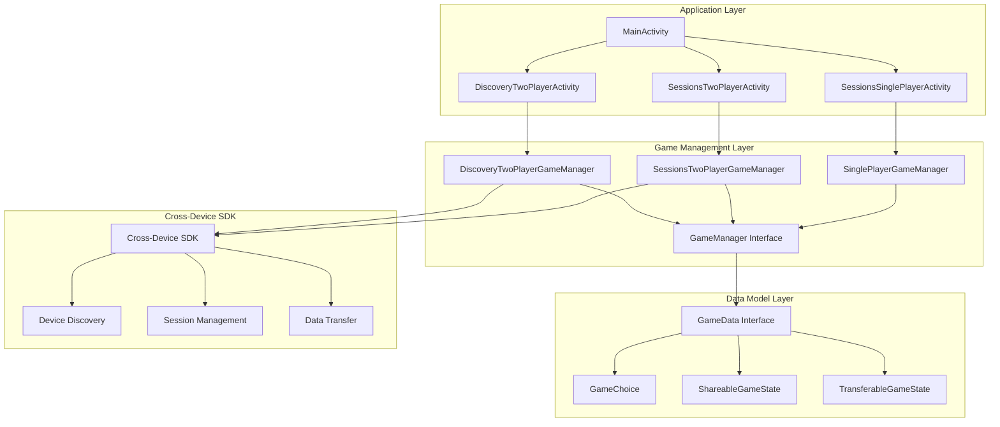
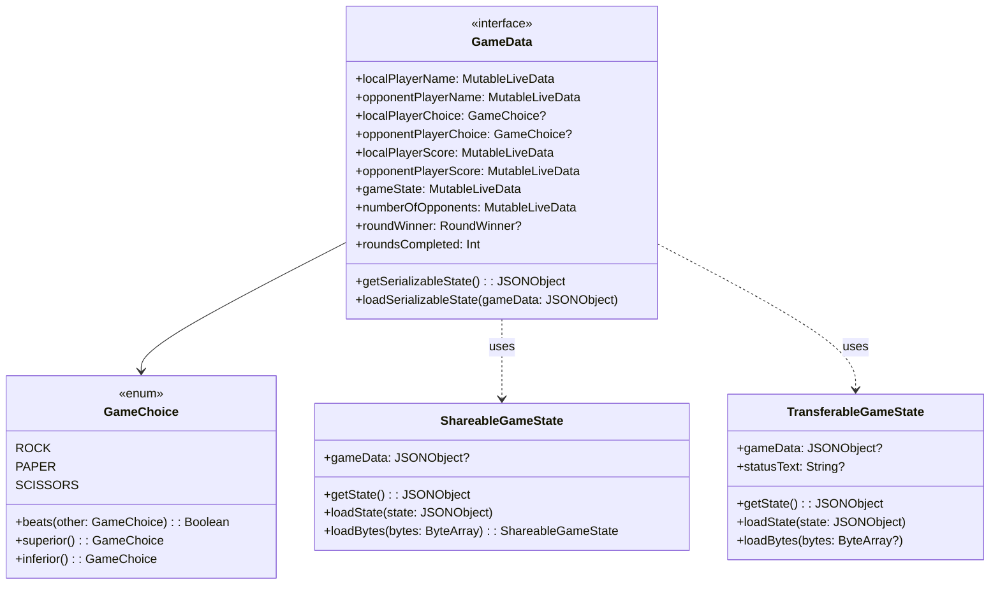
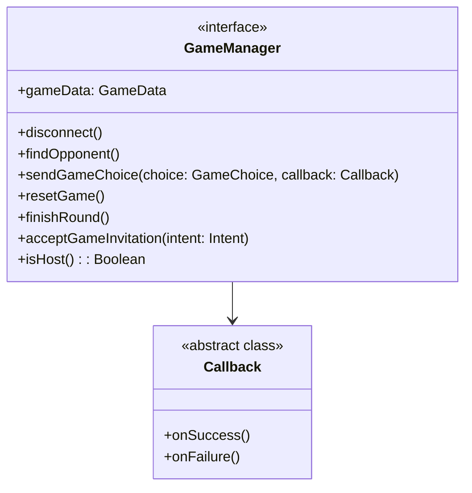
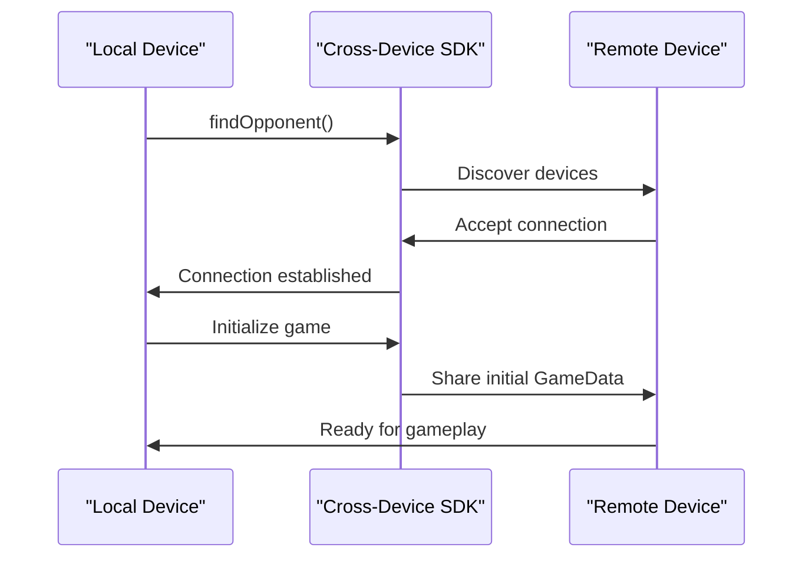
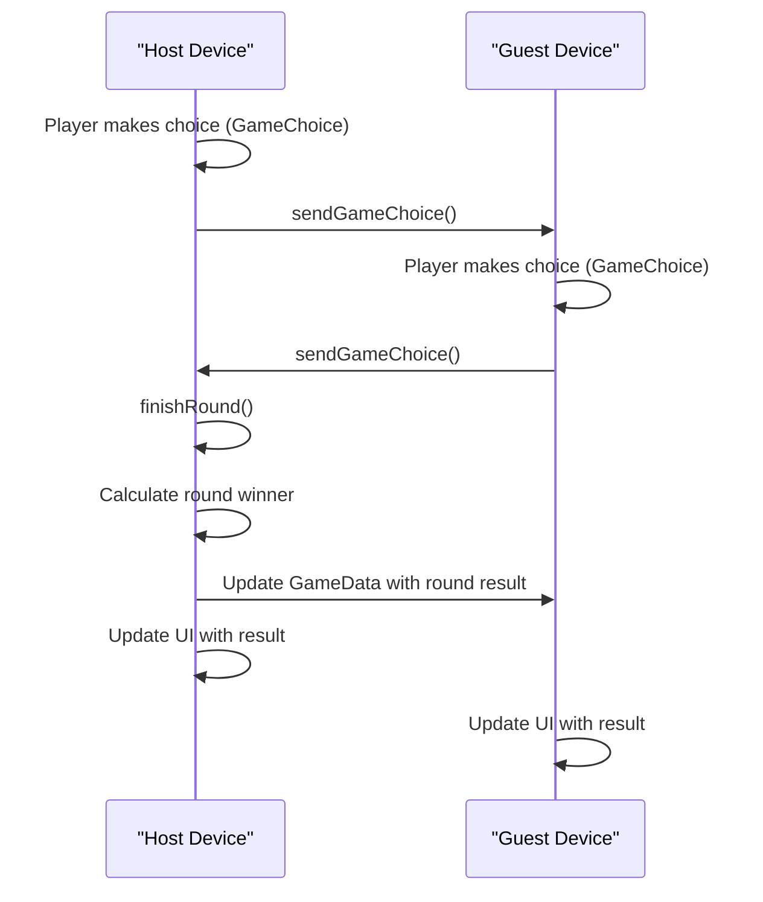
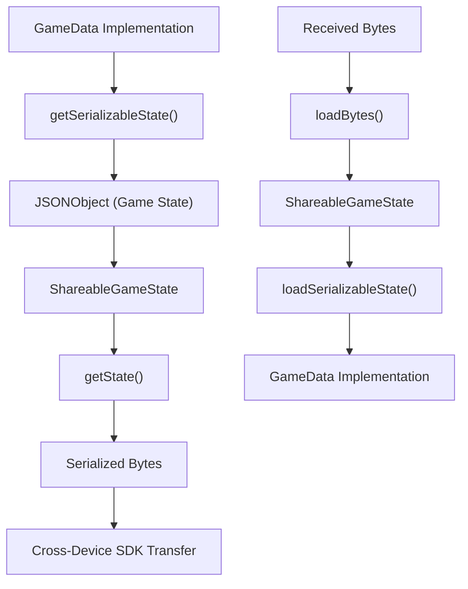
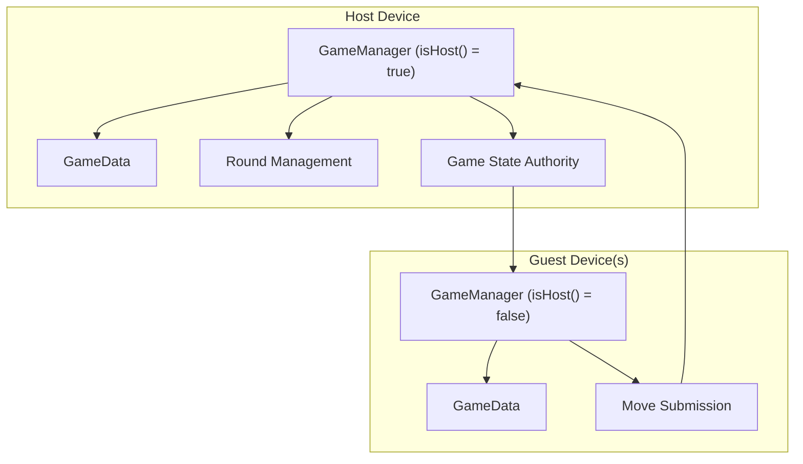
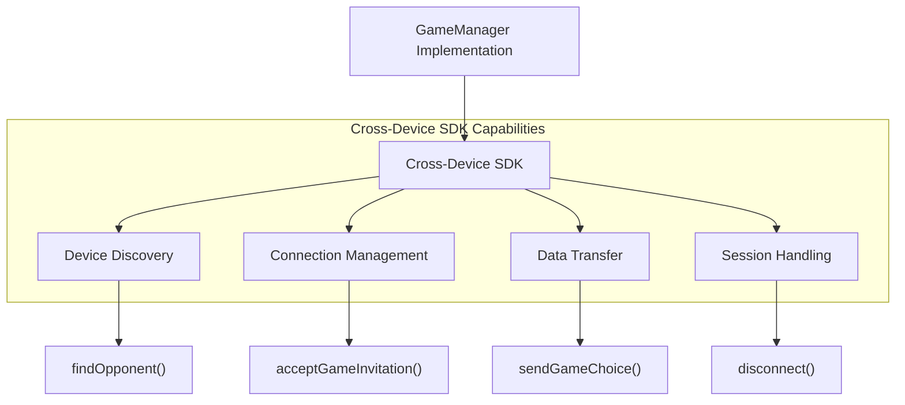
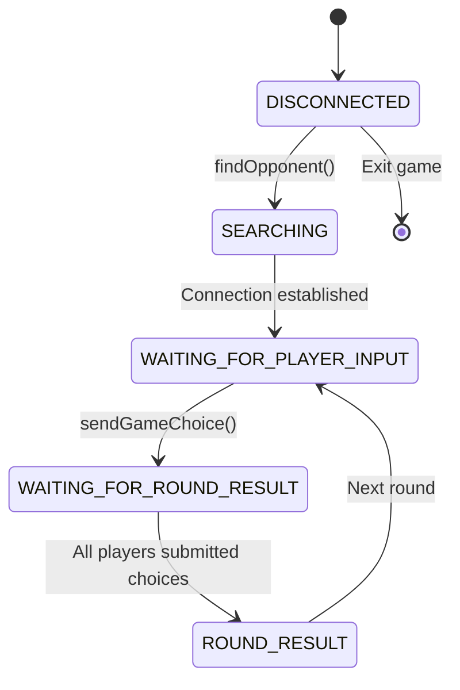

<!-- source: DeepWiki mcp.deepwiki.com · repo android/connectivity-samples · page 5.2 Cross-Device Game Architecture · fetched 2026-10-23 -->

# Cross-Device Game Architecture

Relevant source files

The following files were used as context for generating this wiki page:

- [CrossDeviceRockPaperScissors/.gitignore](CrossDeviceRockPaperScissors/.gitignore)
- [CrossDeviceRockPaperScissors/app/build.gradle](CrossDeviceRockPaperScissors/app/build.gradle)
- [CrossDeviceRockPaperScissors/app/proguard-rules.pro](CrossDeviceRockPaperScissors/app/proguard-rules.pro)
- [CrossDeviceRockPaperScissors/gradlew.bat](CrossDeviceRockPaperScissors/gradlew.bat)
- [CrossDeviceRockPaperScissorsKotlin/.gitignore](CrossDeviceRockPaperScissorsKotlin/.gitignore)
- [CrossDeviceRockPaperScissorsKotlin/app/build.gradle](CrossDeviceRockPaperScissorsKotlin/app/build.gradle)
- [CrossDeviceRockPaperScissorsKotlin/app/proguard-rules.pro](CrossDeviceRockPaperScissorsKotlin/app/proguard-rules.pro)
- [CrossDeviceRockPaperScissorsKotlin/app/src/main/java/com/google/crossdevice/sample/rps/model/CodenameGenerator.kt](CrossDeviceRockPaperScissorsKotlin/app/src/main/java/com/google/crossdevice/sample/rps/model/CodenameGenerator.kt)
- [CrossDeviceRockPaperScissorsKotlin/app/src/main/java/com/google/crossdevice/sample/rps/model/GameChoice.kt](CrossDeviceRockPaperScissorsKotlin/app/src/main/java/com/google/crossdevice/sample/rps/model/GameChoice.kt)
- [CrossDeviceRockPaperScissorsKotlin/app/src/main/java/com/google/crossdevice/sample/rps/model/GameData.kt](CrossDeviceRockPaperScissorsKotlin/app/src/main/java/com/google/crossdevice/sample/rps/model/GameData.kt)
- [CrossDeviceRockPaperScissorsKotlin/app/src/main/java/com/google/crossdevice/sample/rps/model/ShareableGameState.kt](CrossDeviceRockPaperScissorsKotlin/app/src/main/java/com/google/crossdevice/sample/rps/model/ShareableGameState.kt)
- [CrossDeviceRockPaperScissorsKotlin/app/src/main/java/com/google/crossdevice/sample/rps/model/TransferableGameState.kt](CrossDeviceRockPaperScissorsKotlin/app/src/main/java/com/google/crossdevice/sample/rps/model/TransferableGameState.kt)
- [CrossDeviceRockPaperScissorsKotlin/app/src/main/java/com/google/crossdevice/sample/rps/service/GameManager.kt](CrossDeviceRockPaperScissorsKotlin/app/src/main/java/com/google/crossdevice/sample/rps/service/GameManager.kt)
- [CrossDeviceRockPaperScissorsKotlin/build.gradle](CrossDeviceRockPaperScissorsKotlin/build.gradle)
- [CrossDeviceRockPaperScissorsKotlin/gradle/wrapper/gradle-wrapper.properties](CrossDeviceRockPaperScissorsKotlin/gradle/wrapper/gradle-wrapper.properties)
- [CrossDeviceRockPaperScissorsKotlin/gradlew.bat](CrossDeviceRockPaperScissorsKotlin/gradlew.bat)

This document provides a technical overview of the architecture used for cross-device functionality in the Rock Paper Scissors sample game. It focuses specifically on how the game is structured to enable cross-device communication, state synchronization, and gameplay between multiple devices.

For information about the user interface and game logic implementation, see [Rock Paper Scissors Game Implementation](#5.1).

## 1. Architectural Overview

The Cross-Device Rock Paper Scissors game is built using Google's Cross-Device SDK to enable seamless gameplay across multiple Android devices. The architecture follows a modular design that separates game logic, data models, and cross-device communication.

### High-Level Architecture

Sources: [CrossDeviceRockPaperScissorsKotlin/app/src/main/java/com/google/crossdevice/sample/rps/service/GameManager.kt](), [CrossDeviceRockPaperScissorsKotlin/app/src/main/java/com/google/crossdevice/sample/rps/model/GameData.kt](), [CrossDeviceRockPaperScissorsKotlin/app/build.gradle]()

## 2. Core Components

### 2.1 Game Data Model

The game uses several data model classes to represent the game state and facilitate cross-device communication:

Sources: [CrossDeviceRockPaperScissorsKotlin/app/src/main/java/com/google/crossdevice/sample/rps/model/GameData.kt](), [CrossDeviceRockPaperScissorsKotlin/app/src/main/java/com/google/crossdevice/sample/rps/model/GameChoice.kt](), [CrossDeviceRockPaperScissorsKotlin/app/src/main/java/com/google/crossdevice/sample/rps/model/ShareableGameState.kt](), [CrossDeviceRockPaperScissorsKotlin/app/src/main/java/com/google/crossdevice/sample/rps/model/TransferableGameState.kt]()

#### Key Data Model Responsibilities:

| Component | Responsibility |
|-----------|----------------|
| `GameData` | Core interface that defines the game state variables and operations |
| `GameChoice` | Enum representing player choices (ROCK, PAPER, SCISSORS) with game logic methods |
| `ShareableGameState` | Handles serialization and deserialization of game data for sharing between devices |
| `TransferableGameState` | Similar to ShareableGameState but includes additional status information for transferring games |

### 2.2 Game Management

The `GameManager` interface defines the core operations for managing the game:

Sources: [CrossDeviceRockPaperScissorsKotlin/app/src/main/java/com/google/crossdevice/sample/rps/service/GameManager.kt]()

The `GameManager` implementations handle different modes of operation:

| Implementation | Purpose |
|----------------|---------|
| `DiscoveryTwoPlayerGameManager` | Manages game state for two-player games using the discovery API |
| `SessionsTwoPlayerGameManager` | Manages game state for two-player games using the sessions API |
| `SinglePlayerGameManager` | Manages game state for single-player mode against an AI opponent |

## 3. Cross-Device Communication Flow

### 3.1 Game Session Establishment

Sources: [CrossDeviceRockPaperScissorsKotlin/app/src/main/java/com/google/crossdevice/sample/rps/service/GameManager.kt]()

### 3.2 Game State Synchronization

Sources: [CrossDeviceRockPaperScissorsKotlin/app/src/main/java/com/google/crossdevice/sample/rps/service/GameManager.kt](), [CrossDeviceRockPaperScissorsKotlin/app/src/main/java/com/google/crossdevice/sample/rps/model/GameData.kt]()

## 4. State Management and Serialization

The game architecture employs JSON-based serialization for cross-device state sharing:

Sources: [CrossDeviceRockPaperScissorsKotlin/app/src/main/java/com/google/crossdevice/sample/rps/model/ShareableGameState.kt](), [CrossDeviceRockPaperScissorsKotlin/app/src/main/java/com/google/crossdevice/sample/rps/model/GameData.kt]()

### Key serialization patterns:

1. Game state is serialized to JSON using `getSerializableState()` method
2. Serialized state is wrapped in `ShareableGameState` or `TransferableGameState`
3. These wrapper classes handle additional metadata and serialization processes
4. The Cross-Device SDK handles the actual data transfer between devices
5. Received data is deserialized and loaded back into the receiving device's game state

## 5. Host-Guest Relationship

The architecture follows a host-guest pattern, where one device acts as the host (or game coordinator):

Sources: [CrossDeviceRockPaperScissorsKotlin/app/src/main/java/com/google/crossdevice/sample/rps/service/GameManager.kt]()

The host device has authority over:
- Game state coordination
- Determining round winners
- Game reset operations
- Tracking scores
- Managing connections

Guest devices:
- Submit player moves
- Receive state updates from host
- Present synchronized game state

## 6. Integration with Cross-Device SDK

The Cross-Device SDK provides the fundamental communication infrastructure:

Sources: [CrossDeviceRockPaperScissorsKotlin/app/build.gradle](), [CrossDeviceRockPaperScissorsKotlin/app/src/main/java/com/google/crossdevice/sample/rps/service/GameManager.kt]()

### SDK Integration Points:

| GameManager Method | Cross-Device SDK Feature |
|--------------------|--------------------------|
| `findOpponent()` | Device discovery and advertising |
| `acceptGameInvitation()` | Connection establishment |
| `sendGameChoice()` | Data transfer between devices |
| `disconnect()` | Session termination |

The implementation uses version 0.1.0-preview01 of the Cross-Device SDK as specified in the build configuration.

## 7. Game State Management

The game state is managed through the `GameState` enum in the `GameData` interface:

Sources: [CrossDeviceRockPaperScissorsKotlin/app/src/main/java/com/google/crossdevice/sample/rps/model/GameData.kt]()

### State Transitions:

| From State | To State | Trigger |
|------------|----------|---------|
| DISCONNECTED | SEARCHING | Player initiates opponent search |
| SEARCHING | WAITING_FOR_PLAYER_INPUT | Connection established with opponent |
| WAITING_FOR_PLAYER_INPUT | WAITING_FOR_ROUND_RESULT | Local player makes a choice |
| WAITING_FOR_ROUND_RESULT | ROUND_RESULT | All player choices received |
| ROUND_RESULT | WAITING_FOR_PLAYER_INPUT | Next round begins |
| Any state | DISCONNECTED | Connection lost or game ended |

The state machine governs the UI updates and allowed player actions throughout the game lifecycle.

---

