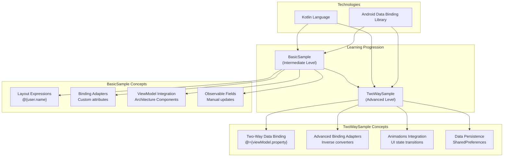
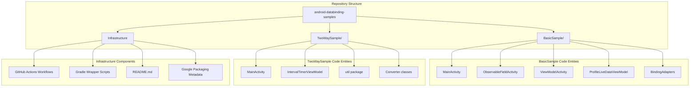
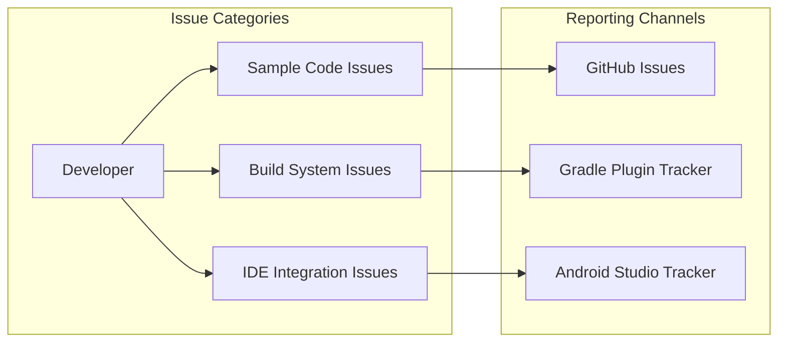

<!-- source: DeepWiki mcp.deepwiki.com · repo android/databinding-samples · page 1 Overview · fetched 2026-10-23 -->

# Overview

Relevant source files

The following files were used as context for generating this wiki page:

- [BasicSample/.google/packaging.yaml](BasicSample/.google/packaging.yaml)
- [README.md](README.md)

This document provides an overview of the Android Data Binding samples repository, which contains educational Android applications demonstrating the Android Data Binding Library. The repository consists of two progressively complex sample applications: BasicSample for foundational concepts and TwoWaySample for advanced patterns. For detailed information about the repository structure and setup, see [Repository Structure](#1.1) and [Getting Started](#1.2).

## Purpose and Educational Progression

The repository serves as a comprehensive educational resource for Android developers learning data binding concepts. The samples are designed with a clear progression from basic to advanced implementations, providing practical examples of data binding patterns and anti-patterns.

**Educational Progression Diagram**

Sources: [README.md:4-9](), [BasicSample/.google/packaging.yaml:28-37]()

## Repository Architecture

The repository contains two main sample applications with comprehensive build and testing infrastructure. Each sample targets different learning objectives and demonstrates specific data binding patterns.

| Sample | Level | Primary Focus | Key Demonstrations |
|--------|-------|---------------|-------------------|
| BasicSample | Intermediate | Foundation concepts | `ObservableFieldActivity`, `ViewModelActivity`, binding adapters |
| TwoWaySample | Advanced | Two-way binding | `IntervalTimerViewModel`, inverse binding, persistence |

**Repository Architecture with Code Entities**

Sources: [README.md:8-9](), [BasicSample/.google/packaging.yaml:16-42]()

## Sample Application Characteristics

### BasicSample
- **Status**: Published (`PUBLISHED`)
- **Level**: Intermediate
- **Language**: Kotlin
- **Focus**: Layout expressions, binding adapters, ViewModel integration
- **Key Classes**: Activities demonstrating different data binding approaches

### TwoWaySample  
- **Level**: Advanced
- **Language**: Kotlin
- **Focus**: Two-way data binding, animations, converters, inverse converters
- **Key Classes**: Complex ViewModel implementations with bidirectional data flow

## Integration with Android Ecosystem

The repository references additional official Android samples that demonstrate data binding in production contexts:

- **Android Architecture Blueprints**: Data binding with architecture best practices
- **Android Architecture Components Samples**: Advanced patterns with Dagger and GitHub API
- **Android Sunflower**: Data binding within Android Jetpack ecosystem

## Issue Reporting and Support

Issues are categorized by component:

| Issue Type | Reporting Location |
|------------|-------------------|
| Sample code issues | GitHub repository issues |
| Build-related issues | Gradle Plugin issue tracker |
| Android Studio integration | Android Studio issue tracker |

**Issue Reporting Flow**

Sources: [README.md:17-19]()

The repository serves as both a learning resource and a reference implementation for Android Data Binding Library usage patterns, with comprehensive infrastructure supporting continuous integration and educational content delivery.

Sources: [README.md:1-40](), [BasicSample/.google/packaging.yaml:1-42]()

---

