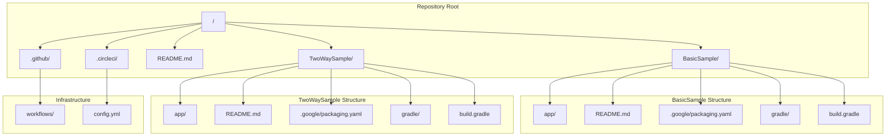
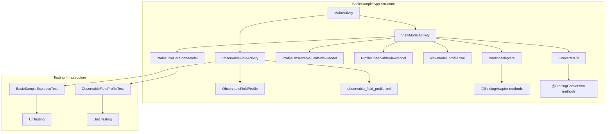
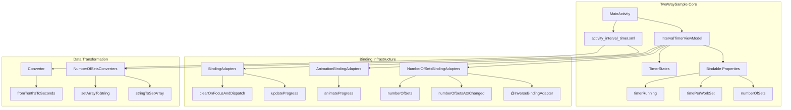
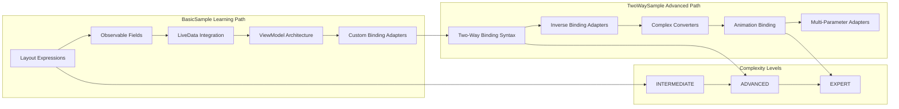
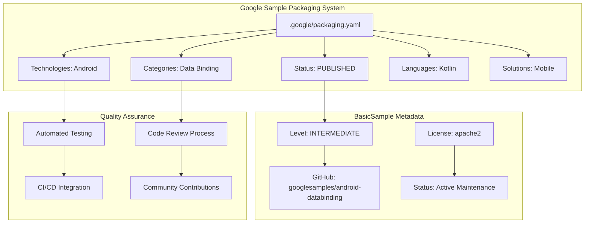

<!-- source: DeepWiki mcp.deepwiki.com · repo android/databinding-samples · page 1.1 Repository Structure · fetched 2026-10-23 -->

# Repository Structure

Relevant source files

The following files were used as context for generating this wiki page:

- [BasicSample/.google/packaging.yaml](BasicSample/.google/packaging.yaml)
- [BasicSample/README.md](BasicSample/README.md)
- [README.md](README.md)
- [TwoWaySample/README.md](TwoWaySample/README.md)

This document explains the organization of the Android Data Binding samples repository, detailing the structure and purpose of the two main sample applications and their educational progression. For information about getting started with the samples, see [Getting Started](#1.2). For details about the CI/CD infrastructure supporting these samples, see [CI/CD Pipelines](#4.2).

## Repository Organization

The repository is structured as an educational resource containing two distinct Android applications that demonstrate different aspects of the Android Data Binding Library. Each sample serves a specific learning purpose and targets different experience levels with data binding concepts.

**Repository Structure Overview**

Sources: [README.md:1-40](), [BasicSample/.google/packaging.yaml:16-42]()

## BasicSample Application

BasicSample serves as the foundational learning resource for Android Data Binding, targeting developers with intermediate Android experience who are new to data binding concepts. The sample demonstrates core data binding features through a user profile interface.

### Educational Purpose and Scope

BasicSample teaches fundamental data binding concepts including layout variables, observability mechanisms, and integration with Android Architecture Components. The sample explicitly shows both problematic approaches and their improved solutions to guide developers away from common anti-patterns.

| Feature | Implementation | Purpose |
|---------|---------------|---------|
| Layout Variables | `@{user.name}` expressions | Replace findViewById calls |
| Observable Fields | `ObservableInt`, `ObservableField` | Automatic UI updates |
| LiveData Integration | `ProfileLiveDataViewModel` | Lifecycle-aware observability |
| ViewModel Architecture | `ViewModelActivity` | Best practice demonstration |
| Binding Adapters | `@BindingAdapter` annotations | Custom attribute creation |

### Code Structure Mapping

**BasicSample Code Organization**

The sample implements a progression from basic data binding to architectural best practices, with each activity demonstrating increasingly sophisticated approaches to data binding implementation.

Sources: [BasicSample/README.md:1-42](), [BasicSample/README.md:258-279]()

## TwoWaySample Application

TwoWaySample represents the advanced tier of data binding education, demonstrating complex two-way data binding patterns through an interval timer application. This sample targets developers who have mastered basic data binding concepts and need to implement sophisticated binding scenarios.

### Advanced Feature Demonstration

TwoWaySample focuses on complex binding patterns that require deep understanding of the data binding library's advanced capabilities, including custom binding adapters, inverse binding adapters, and complex data transformations.

| Advanced Feature | Implementation | Complexity Level |
|------------------|---------------|------------------|
| Two-Way Binding | `@={}` syntax with `@Bindable` properties | High |
| Inverse Binding | `@InverseBindingAdapter` with converters | Expert |
| Animation Binding | Custom adapters for view animations | Advanced |
| Multi-Parameter Adapters | `requireAll = true` binding adapters | Intermediate |
| Complex Converters | Bidirectional data transformation | Advanced |

### Application Architecture

**TwoWaySample Architecture Mapping**

Sources: [TwoWaySample/README.md:1-42](), [TwoWaySample/README.md:172-195]()

## Learning Progression Design

The repository implements a deliberate educational progression from basic concepts to advanced implementation patterns. This structure allows developers to build competency incrementally while understanding both the theoretical foundations and practical applications of data binding.

### Skill Development Path

**Educational Progression Architecture**

| Sample | Target Level | Key Learning Outcomes |
|--------|-------------|----------------------|
| BasicSample | Intermediate | Foundation concepts, anti-pattern awareness, ViewModel integration |
| TwoWaySample | Advanced to Expert | Complex binding scenarios, custom adapter creation, performance optimization |

Sources: [BasicSample/.google/packaging.yaml:36-37](), [BasicSample/README.md:12-13](), [TwoWaySample/README.md:8-15]()

## Project Metadata and Packaging

Both samples include Google's internal packaging metadata system, indicating their status as officially maintained educational resources within the Android development ecosystem.

### Sample Classification

**Sample Packaging and Maintenance Structure**

The packaging metadata indicates these samples are maintained as part of Google's official sample repository system, with standardized categorization and quality assurance processes.

Sources: [BasicSample/.google/packaging.yaml:16-42]()

## Infrastructure Integration

The repository structure supports comprehensive development and maintenance workflows through integrated build systems, testing frameworks, and continuous integration pipelines. Each sample maintains independent build configurations while sharing common infrastructure patterns.

### Build System Architecture

| Component | BasicSample | TwoWaySample | Purpose |
|-----------|-------------|--------------|---------|
| Gradle Wrapper | Version 8.4 | Version 7.5 | Build reproducibility |
| Android Gradle Plugin | Current stable | Legacy stable | Compatibility testing |
| Data Binding | Enabled | Enabled | Core functionality |
| Testing Framework | Espresso + JUnit | Espresso + JUnit | Quality assurance |

The repository structure demonstrates production-ready Android development practices while maintaining educational clarity and progressive complexity in data binding implementation patterns.

Sources: [README.md:1-19](), [BasicSample/README.md:258-279](), [TwoWaySample/README.md:183-200]()

---

