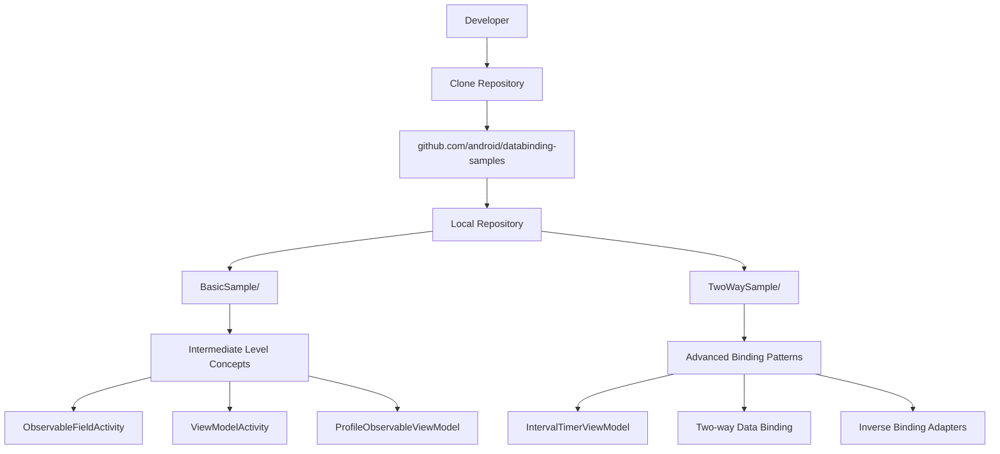
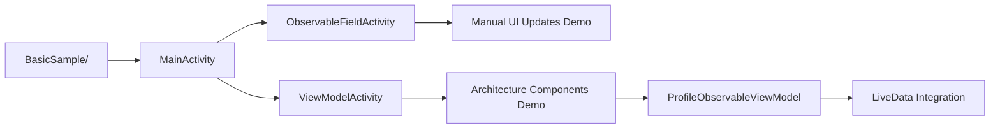
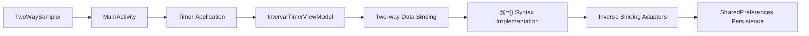
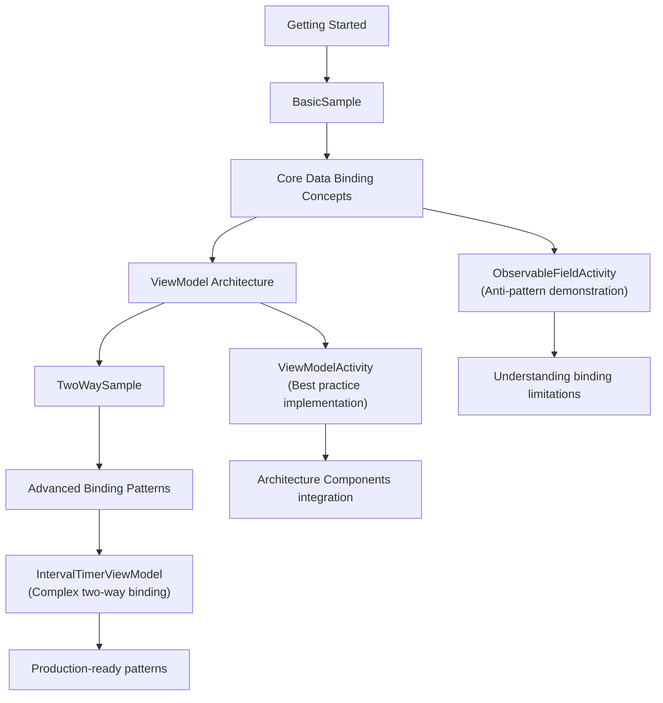

<!-- source: DeepWiki mcp.deepwiki.com · repo android/databinding-samples · page 1.2 Getting Started · fetched 2026-10-23 -->

# Getting Started

Relevant source files

The following files were used as context for generating this wiki page:

- [BasicSample/.google/packaging.yaml](BasicSample/.google/packaging.yaml)
- [CONTRIBUTING.md](CONTRIBUTING.md)
- [LICENSE](LICENSE)
- [README.md](README.md)

This document provides the essential setup and configuration steps needed to run the Android Data Binding sample applications. It covers prerequisites, repository setup, and the initial steps to explore both BasicSample and TwoWaySample applications.

For detailed information about the repository structure and sample progression, see [Repository Structure](#1.1). For specific implementation details of each sample, see [BasicSample Application](#2) and [TwoWaySample Application](#3).

## Prerequisites

Before working with the Android Data Binding samples, ensure your development environment meets the following requirements:

### Development Environment
- **Android Studio**: Latest stable version with Android Data Binding support
- **Android SDK**: Compatible SDK versions as specified in each sample's build configuration
- **Kotlin**: Runtime support (samples are implemented in Kotlin)
- **Git**: For repository cloning and version control

### Android Data Binding Knowledge
The samples assume familiarity with basic Android development concepts. BasicSample is designed for intermediate developers, while TwoWaySample demonstrates advanced patterns.

**Sources:** [BasicSample/.google/packaging.yaml:36-37](), [README.md:8-9]()

## Repository Setup

### Initial Repository Access

The repository contains two primary sample applications organized as separate Android projects within the main repository structure.

### Project Structure Overview

| Sample Application | Technology Stack | Complexity Level | Primary Focus |
|-------------------|------------------|------------------|---------------|
| BasicSample | Kotlin, Android Data Binding | Intermediate | Layout expressions, binding adapters, ViewModels |
| TwoWaySample | Kotlin, Android Data Binding | Advanced | Two-way binding, converters, animations |

**Sources:** [README.md:6-9](), [BasicSample/.google/packaging.yaml:28-37]()

## Running the Sample Applications

### BasicSample Execution

BasicSample demonstrates foundational data binding concepts through multiple activity implementations. The application provides entry points to different binding approaches, from basic observable fields to architecture component integration.

### TwoWaySample Execution

TwoWaySample implements a complete interval timer application showcasing advanced two-way data binding patterns with state persistence and complex ViewModel interactions.

**Sources:** [README.md:8-9]()

## Development Environment Configuration

### Android Studio Setup

1. **Import Projects**: Each sample can be imported as a separate Android Studio project
2. **Data Binding Enable**: Verify data binding is enabled in module build configurations
3. **Kotlin Support**: Ensure Kotlin plugin is active and properly configured

### Build System Requirements

The samples utilize standard Android Gradle build configurations with data binding enabled. Each sample maintains its own build setup optimized for demonstrating specific data binding features.

### Testing Environment

Both samples include comprehensive testing frameworks:
- **Espresso UI Tests**: For data binding interface validation
- **Unit Tests**: For ViewModel and data layer testing

**Sources:** [README.md:8-9]()

## Sample Application Navigation

### Learning Path Progression

The samples are designed with educational progression in mind. Start with BasicSample to understand fundamental concepts, then advance to TwoWaySample for complex implementation patterns.

### Next Steps

After completing the initial setup:

1. **Explore BasicSample**: Begin with `MainActivity` to understand the sample structure
2. **Study Binding Implementations**: Examine different activity implementations for various binding approaches
3. **Advance to TwoWaySample**: Progress to advanced patterns after mastering basic concepts
4. **Review Testing Strategies**: Examine the testing frameworks implemented in both samples

For detailed implementation analysis, proceed to [BasicSample Application](#2) documentation.

**Sources:** [README.md:1-15](), [BasicSample/.google/packaging.yaml:21-41]()

---

