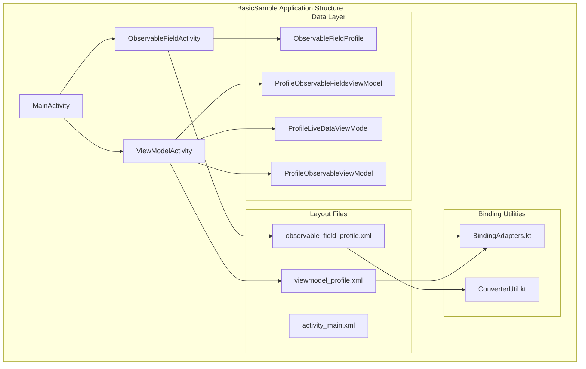
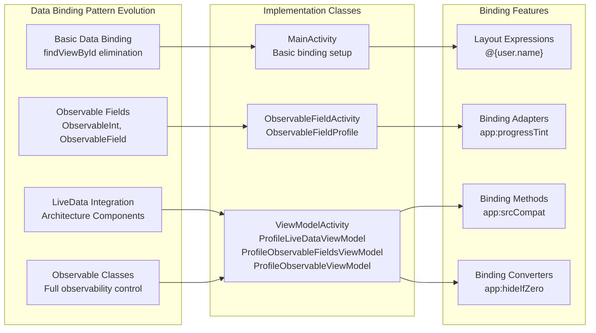
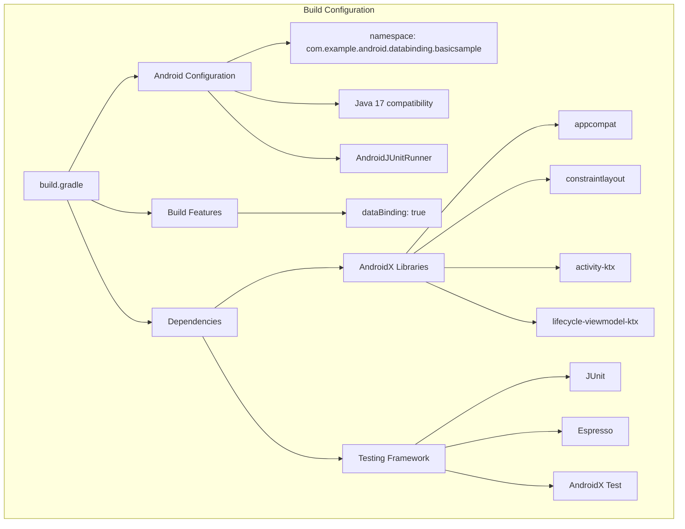

<!-- source: DeepWiki mcp.deepwiki.com · repo android/databinding-samples · page 2 BasicSample Application · fetched 2026-10-23 -->

# BasicSample Application

Relevant source files

The following files were used as context for generating this wiki page:

- [BasicSample/README.md](BasicSample/README.md)
- [BasicSample/app/build.gradle](BasicSample/app/build.gradle)

This document provides a comprehensive overview of the BasicSample application, which serves as the foundational learning module for Android Data Binding concepts. The BasicSample demonstrates core data binding features including layout expressions, observability patterns, and binding adapters through practical examples that progress from anti-patterns to best practices.

For advanced two-way data binding patterns, see [TwoWaySample Application](#3). For detailed build system configuration, see [Build System and Infrastructure](#4).

## Application Overview

The BasicSample application is an educational Android project that demonstrates fundamental data binding concepts through three distinct activity implementations. Each activity showcases different approaches to data binding, allowing developers to understand the evolution from basic implementations to architecture-compliant solutions.

The application presents a user profile interface where users can interact with profile data, demonstrating how data binding reduces boilerplate code and improves UI-data synchronization. The sample intentionally includes both recommended practices and documented anti-patterns to provide comprehensive learning opportunities.

### Application Architecture

Sources: [BasicSample/README.md:1-299]()

### Data Binding Patterns Demonstrated

The BasicSample implements three distinct data binding approaches, each representing different levels of architectural sophistication:

Sources: [BasicSample/README.md:19-257]()

## Application Structure

The BasicSample follows a clear progression from basic to advanced data binding concepts:

| Component | Purpose | Implementation Pattern |
|-----------|---------|----------------------|
| `MainActivity` | Entry point demonstrating basic data binding | findViewById elimination |
| `ObservableFieldActivity` | Shows reactive UI with observable fields | Anti-pattern demonstration |
| `ViewModelActivity` | Architecture Components integration | Best practice implementation |
| `ObservableFieldProfile` | Simple data model with observable fields | Direct field observation |
| `ProfileLiveDataViewModel` | Lifecycle-aware data management | LiveData integration |
| `ProfileObservableFieldsViewModel` | Observable field management | ViewModel pattern |
| `ProfileObservableViewModel` | Full observability control | Custom observable implementation |

### Build Configuration

The BasicSample application uses modern Android development practices with specific build configurations:

Sources: [BasicSample/app/build.gradle:23-65]()

Key build configuration elements:

- **Data Binding Enabled**: [BasicSample/app/build.gradle:42]() enables the data binding feature
- **Kotlin Support**: [BasicSample/app/build.gradle:19-21]() includes Kotlin Android plugin and kapt
- **Java 17 Compatibility**: [BasicSample/app/build.gradle:45-47]() sets source and target compatibility
- **Architecture Components**: [BasicSample/app/build.gradle:54-55]() includes lifecycle and activity dependencies
- **Testing Infrastructure**: [BasicSample/app/build.gradle:60-63]() provides comprehensive testing support

## Navigation to Detailed Documentation

The BasicSample application is documented across several specialized pages:

- **Core Data Binding Concepts** [#2.1](#2.1): Detailed analysis of `ObservableFieldActivity` implementation, including documented anti-patterns and the transition to better practices
- **ViewModel Architecture** [#2.2](#2.2): Comprehensive coverage of `ViewModelActivity` and the three ViewModel implementations showing Android Architecture Components integration  
- **Binding Utilities and Adapters** [#2.3](#2.3): Documentation of custom binding adapters, binding methods, and binding converters that extend data binding functionality
- **Testing Framework** [#2.4](#2.4): Espresso-based testing approach and strategies for testing data binding implementations
- **Application Configuration** [#2.5](#2.5): Android manifest structure and application-level configuration details

Sources: [BasicSample/README.md:1-299](), [BasicSample/app/build.gradle:1-66]()

---

