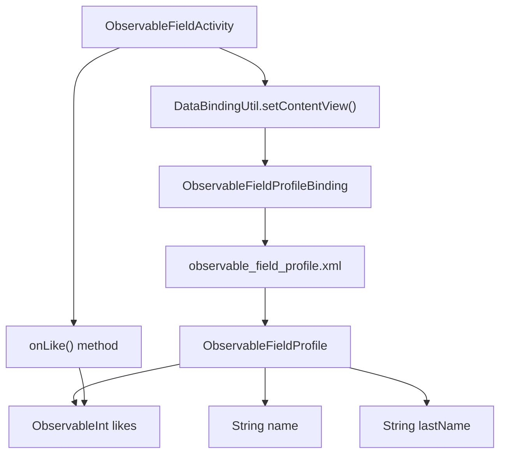
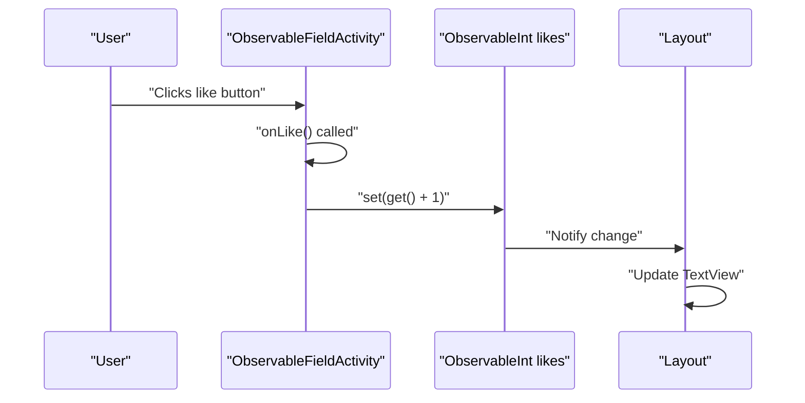
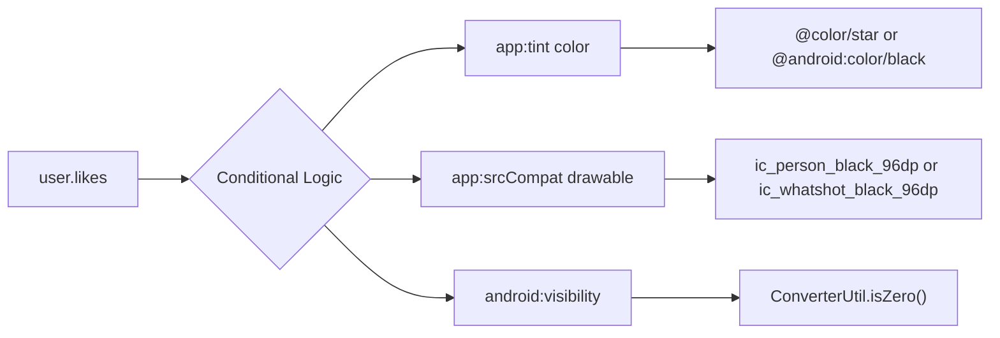
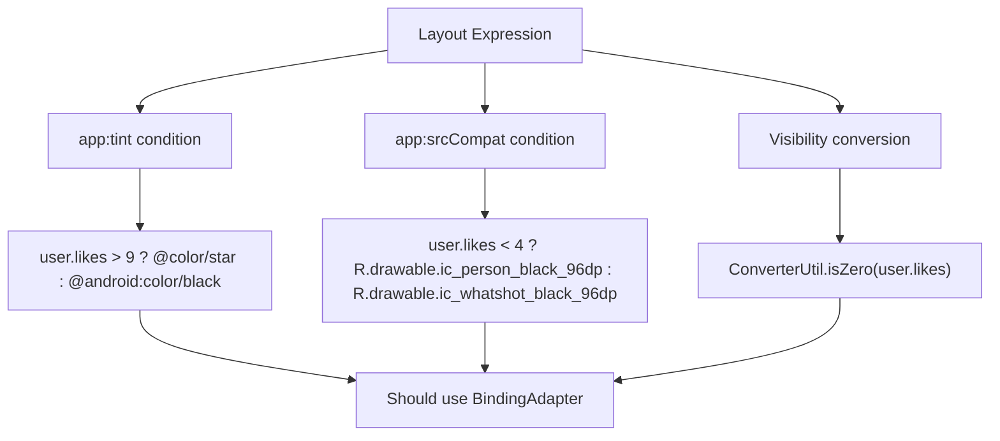
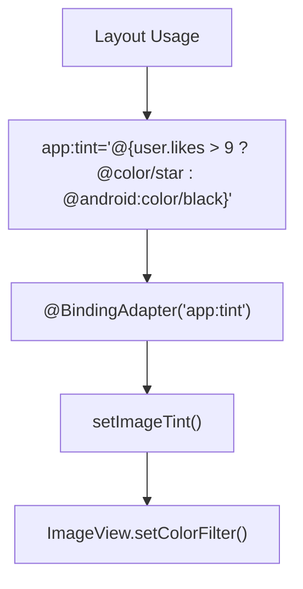
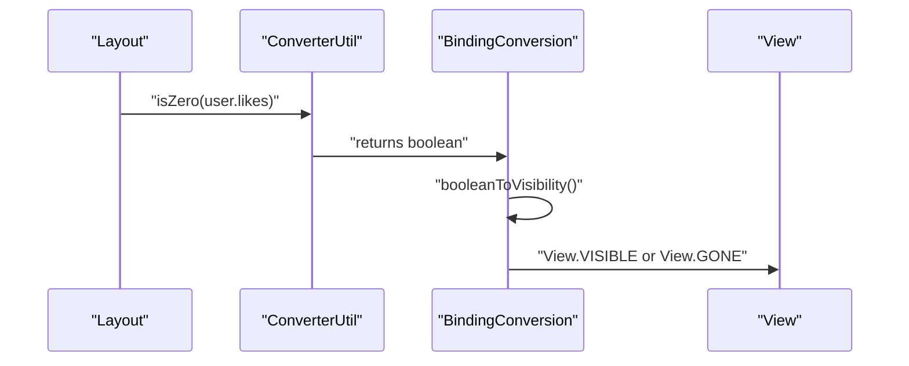
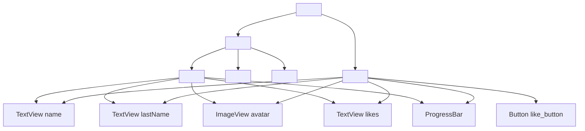

<!-- source: DeepWiki mcp.deepwiki.com · repo android/databinding-samples · page 2.1 Core Data Binding Concepts · fetched 2026-10-23 -->

# Core Data Binding Concepts

Relevant source files

The following files were used as context for generating this wiki page:

- [BasicSample/README.md](BasicSample/README.md)
- [BasicSample/app/src/main/java/com/example/android/databinding/basicsample/ui/ObservableFieldActivity.kt](BasicSample/app/src/main/java/com/example/android/databinding/basicsample/ui/ObservableFieldActivity.kt)
- [BasicSample/app/src/main/res/layout/observable_field_profile.xml](BasicSample/app/src/main/res/layout/observable_field_profile.xml)

This document covers the foundational data binding concepts demonstrated in the `ObservableFieldActivity`, including basic binding syntax, observable fields, and layout expressions. This activity intentionally showcases anti-patterns that are corrected in the ViewModel-based implementation. For information about proper ViewModel architecture and best practices, see [ViewModel Architecture](#2.2).

## Basic Data Binding Setup

The `ObservableFieldActivity` demonstrates the minimal setup required for Android Data Binding. The activity creates a binding instance and associates it with a data object containing observable fields.

The activity follows this pattern:
1. Creates an `ObservableFieldProfile` instance with hardcoded data
2. Uses `DataBindingUtil.setContentView()` to inflate the layout and create the binding
3. Assigns the profile object to the binding's `user` variable

Sources: [BasicSample/app/src/main/java/com/example/android/databinding/basicsample/ui/ObservableFieldActivity.kt:37-44]()

## Observable Fields Pattern

The `ObservableFieldActivity` uses `ObservableInt` to automatically update the UI when the likes count changes. This demonstrates the core reactivity pattern in data binding.

| Observable Type | Purpose | Usage in Activity |
|----------------|---------|-------------------|
| `ObservableInt` | Tracks likes count | `ObservableInt(0)` |
| `String` | Static name data | `"Ada"` |
| `String` | Static lastName data | `"Lovelace"` |

The observable field automatically notifies the UI when its value changes through the `set()` method:

Sources: [BasicSample/app/src/main/java/com/example/android/databinding/basicsample/ui/ObservableFieldActivity.kt:37](), [BasicSample/app/src/main/java/com/example/android/databinding/basicsample/ui/ObservableFieldActivity.kt:52-54]()

## Layout Expressions and Binding Syntax

The layout demonstrates various data binding expression patterns, from simple property access to complex conditional logic.

### Basic Property Binding
Simple expressions bind data properties directly to view attributes:
- `android:text="@{user.name}"` - Direct property access
- `android:text="@{user.lastName}"` - Another property access
- `android:text="@{Integer.toString(user.likes)}"` - Type conversion

### Complex Conditional Expressions
The layout contains more complex expressions that demonstrate binding capabilities but represent anti-patterns:

Sources: [BasicSample/app/src/main/res/layout/observable_field_profile.xml:44](), [BasicSample/app/src/main/res/layout/observable_field_profile.xml:57](), [BasicSample/app/src/main/res/layout/observable_field_profile.xml:82-83](), [BasicSample/app/src/main/res/layout/observable_field_profile.xml:91]()

## Anti-patterns Demonstrated

The `ObservableFieldActivity` intentionally demonstrates several anti-patterns that should be avoided in production code:

### Business Logic in Activity
The `onLike()` method places business logic directly in the activity:

| Anti-pattern | Location | Problem |
|-------------|----------|---------|
| Click handling | `android:onClick="onLike"` | Couples layout to activity |
| State manipulation | `onLike()` method | Business logic in UI layer |
| Data creation | `onCreate()` | Hardcoded data in activity |

### Complex Layout Expressions
The layout contains view logic that should be handled elsewhere:

Sources: [BasicSample/app/src/main/res/layout/observable_field_profile.xml:63-67](), [BasicSample/app/src/main/res/layout/observable_field_profile.xml:99-101](), [BasicSample/app/src/main/res/layout/observable_field_profile.xml:82-83]()

## Binding Adapters and Custom Attributes

The activity includes a `BindingAdapter` that demonstrates how to extend data binding with custom attributes:

### ImageView Tint Binding Adapter
The `setImageTint()` function creates a custom `app:tint` attribute:

This binding adapter:
- Takes a `@ColorInt` parameter
- Applies the color using `setColorFilter()`
- Addresses compatibility issues with `AppCompatImageView`

Sources: [BasicSample/app/src/main/java/com/example/android/databinding/basicsample/ui/ObservableFieldActivity.kt:61-64](), [BasicSample/app/src/main/res/layout/observable_field_profile.xml:82]()

## BindingConverters and View Logic

The layout demonstrates `BindingConverters` through the `ConverterUtil.isZero()` method, which converts the likes count to a visibility boolean:

### Conversion Chain

This pattern is identified as problematic because:
- `BindingConversions` apply globally to all boolean-to-int conversions
- Complex view logic should be handled by `BindingAdapters`
- The recommended solution uses a custom `app:hideIfZero` attribute

Sources: [BasicSample/app/src/main/res/layout/observable_field_profile.xml:164](), [BasicSample/app/src/main/res/layout/observable_field_profile.xml:150-154]()

## Data Binding Layout Structure

The layout file structure shows the essential components of a data binding layout:

The layout demonstrates:
- Import statements for utility classes and resources
- Variable declarations that connect to data objects
- Expression syntax using `@{}` for one-way binding
- Multiple view types with different binding patterns

Sources: [BasicSample/app/src/main/res/layout/observable_field_profile.xml:20-31](), [BasicSample/app/src/main/res/layout/observable_field_profile.xml:33-172]()

---

