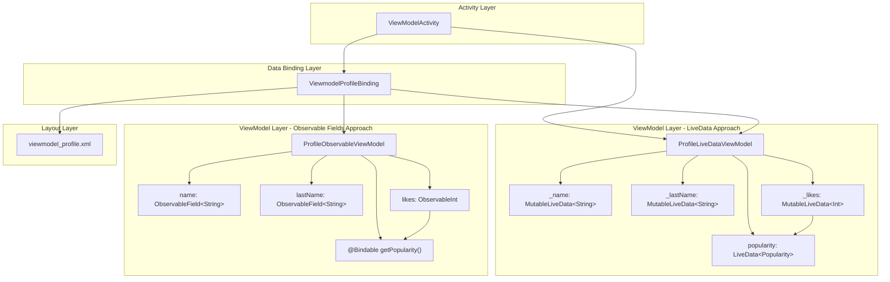
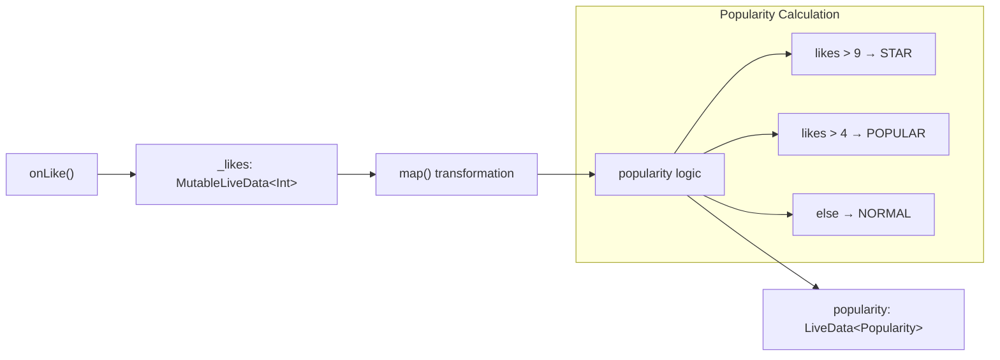
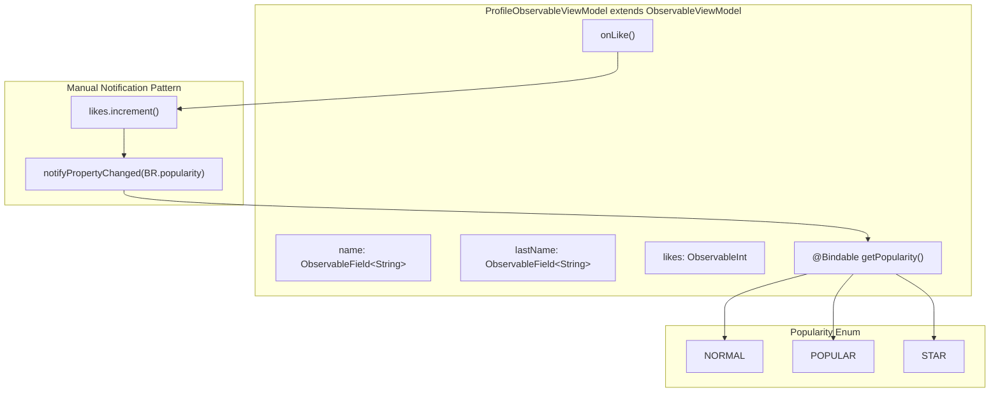
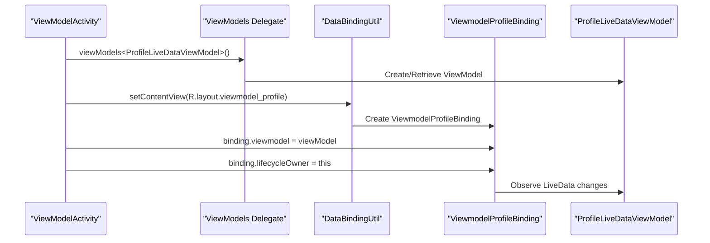

<!-- source: DeepWiki mcp.deepwiki.com · repo android/databinding-samples · page 2.2 ViewModel Architecture · fetched 2026-10-23 -->

# ViewModel Architecture

Relevant source files

The following files were used as context for generating this wiki page:

- [BasicSample/app/src/main/java/com/example/android/databinding/basicsample/data/ProfileObservableViewModel.kt](BasicSample/app/src/main/java/com/example/android/databinding/basicsample/data/ProfileObservableViewModel.kt)
- [BasicSample/app/src/main/java/com/example/android/databinding/basicsample/ui/ViewModelActivity.kt](BasicSample/app/src/main/java/com/example/android/databinding/basicsample/ui/ViewModelActivity.kt)

## Purpose and Scope

This document covers the ViewModel architecture patterns demonstrated in the BasicSample application, specifically focusing on the integration of Android Architecture Components with Data Binding. The page details two distinct approaches for implementing ViewModels with data binding: the recommended LiveData approach and the alternative Observable fields approach.

For information about basic data binding concepts and observable patterns, see [Core Data Binding Concepts](#2.1). For details about binding utilities and custom adapters used with these ViewModels, see [Binding Utilities and Adapters](#2.3).

## ViewModel Architecture Overview

The BasicSample application demonstrates two distinct ViewModel architecture patterns that integrate with Android Data Binding, each with different approaches to state management and UI updates.

### ViewModel Architecture Patterns

**Sources:** [BasicSample/app/src/main/java/com/example/android/databinding/basicsample/data/ProfileObservableViewModel.kt:1-95](), [BasicSample/app/src/main/java/com/example/android/databinding/basicsample/ui/ViewModelActivity.kt:1-55]()

## LiveData ViewModel Implementation

The `ProfileLiveDataViewModel` class demonstrates the recommended approach using Android Architecture Components with LiveData for lifecycle-aware data binding.

### ProfileLiveDataViewModel Structure

| Component | Type | Purpose |
|-----------|------|---------|
| `_name` | `MutableLiveData<String>` | Private mutable name field |
| `_lastName` | `MutableLiveData<String>` | Private mutable last name field |
| `_likes` | `MutableLiveData<Int>` | Private mutable likes counter |
| `name` | `LiveData<String>` | Public immutable name exposure |
| `lastName` | `LiveData<String>` | Public immutable last name exposure |
| `likes` | `LiveData<Int>` | Public immutable likes exposure |
| `popularity` | `LiveData<Popularity>` | Computed property using transformation |

### LiveData Transformation Pattern

The `ProfileLiveDataViewModel` uses LiveData transformations to automatically compute derived properties. The `popularity` field is calculated using the `map()` transformation function [BasicSample/app/src/main/java/com/example/android/databinding/basicsample/data/ProfileObservableViewModel.kt:44-50](), which automatically updates when the underlying `_likes` value changes.

**Sources:** [BasicSample/app/src/main/java/com/example/android/databinding/basicsample/data/ProfileObservableViewModel.kt:34-55]()

## Observable Fields ViewModel Implementation

The `ProfileObservableViewModel` class demonstrates an alternative approach using Observable fields with manual change notifications.

### ProfileObservableViewModel Structure

### Key Implementation Details

The `ProfileObservableViewModel` requires manual change notifications using `notifyPropertyChanged(BR.popularity)` [BasicSample/app/src/main/java/com/example/android/databinding/basicsample/data/ProfileObservableViewModel.kt:71](). This is necessary because the `@Bindable` `getPopularity()` method depends on the `likes` field, but Data Binding cannot automatically detect this dependency.

| Method | Purpose | Implementation |
|--------|---------|----------------|
| `onLike()` | Increment likes counter | Calls `likes.increment()` and `notifyPropertyChanged(BR.popularity)` |
| `getPopularity()` | Calculate popularity level | Uses conditional logic based on likes count |
| `increment()` extension | Helper for ObservableInt | Extension function to increment value |

**Sources:** [BasicSample/app/src/main/java/com/example/android/databinding/basicsample/data/ProfileObservableViewModel.kt:63-84](), [BasicSample/app/src/main/java/com/example/android/databinding/basicsample/data/ProfileObservableViewModel.kt:92-94]()

## Activity Integration

The `ViewModelActivity` class demonstrates how to integrate ViewModels with Data Binding in an Activity.

### ViewModel Setup Process

### Critical Integration Steps

1. **ViewModel Acquisition**: Uses the `viewModels<ProfileLiveDataViewModel>()` delegate [BasicSample/app/src/main/java/com/example/android/databinding/basicsample/ui/ViewModelActivity.kt:39]()
2. **Data Binding Setup**: Creates binding using `DataBindingUtil.setContentView()` [BasicSample/app/src/main/java/com/example/android/databinding/basicsample/ui/ViewModelActivity.kt:45-46]()
3. **ViewModel Binding**: Assigns ViewModel to binding variable [BasicSample/app/src/main/java/com/example/android/databinding/basicsample/ui/ViewModelActivity.kt:49]()
4. **Lifecycle Owner**: Sets lifecycle owner for LiveData observation [BasicSample/app/src/main/java/com/example/android/databinding/basicsample/ui/ViewModelActivity.kt:52]()

The Activity includes a commented alternative showing how to use `ProfileObservableViewModel` instead [BasicSample/app/src/main/java/com/example/android/databinding/basicsample/ui/ViewModelActivity.kt:41-42]().

**Sources:** [BasicSample/app/src/main/java/com/example/android/databinding/basicsample/ui/ViewModelActivity.kt:34-54]()

## Architectural Comparison

### LiveData vs Observable Fields Approaches

| Aspect | ProfileLiveDataViewModel | ProfileObservableViewModel |
|--------|--------------------------|----------------------------|
| **Base Class** | `ViewModel()` | `ObservableViewModel()` |
| **State Management** | `MutableLiveData` / `LiveData` | `ObservableField` / `ObservableInt` |
| **Change Notifications** | Automatic via LiveData | Manual via `notifyPropertyChanged()` |
| **Lifecycle Awareness** | Built-in with LiveData | Requires lifecycle owner setup |
| **Derived Properties** | Automatic via `map()` transformations | Manual calculation with `@Bindable` |
| **Memory Leaks** | Prevented by lifecycle awareness | Requires careful lifecycle management |
| **Boilerplate Code** | Minimal | Higher due to manual notifications |

### Implementation Pattern Differences

```mermaid
graph TB
    subgraph "LiveData Pattern (Recommended)"
        LiveData_MutableLiveData["MutableLiveData (private)"]
        LiveData_LiveData["LiveData (public)"]
        LiveData_Transformation["Transformation.map()"]
        LiveData_AutoUpdate["Automatic UI Updates"]
        
        LiveData_MutableLiveData --> LiveData_LiveData
        LiveData_LiveData --> LiveData_Transformation
        LiveData_Transformation --> LiveData_AutoUpdate
    end
    
    subgraph "Observable Fields Pattern (Alternative)"
        Observable_ObservableField["ObservableField"]
        Observable_Bindable["@Bindable getter"]
        Observable_Manual["notifyPropertyChanged()"]
        Observable_ManualUpdate["Manual UI Updates"]
        
        Observable_ObservableField --> Observable_Bindable
        Observable_Bindable --> Observable_Manual
        Observable_Manual --> Observable_ManualUpdate
    end
```

The LiveData approach is recommended for new development because it provides automatic lifecycle awareness, reduces boilerplate code, and prevents common memory leak issues. The Observable fields approach is maintained for backwards compatibility and scenarios where more granular control over change notifications is required.

**Sources:** [BasicSample/app/src/main/java/com/example/android/databinding/basicsample/data/ProfileObservableViewModel.kt:30-84](), [BasicSample/app/src/main/java/com/example/android/databinding/basicsample/ui/ViewModelActivity.kt:27-32]()

---

