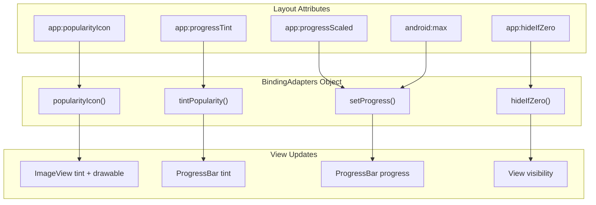
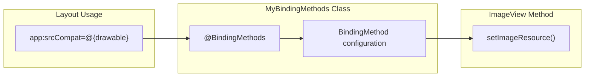
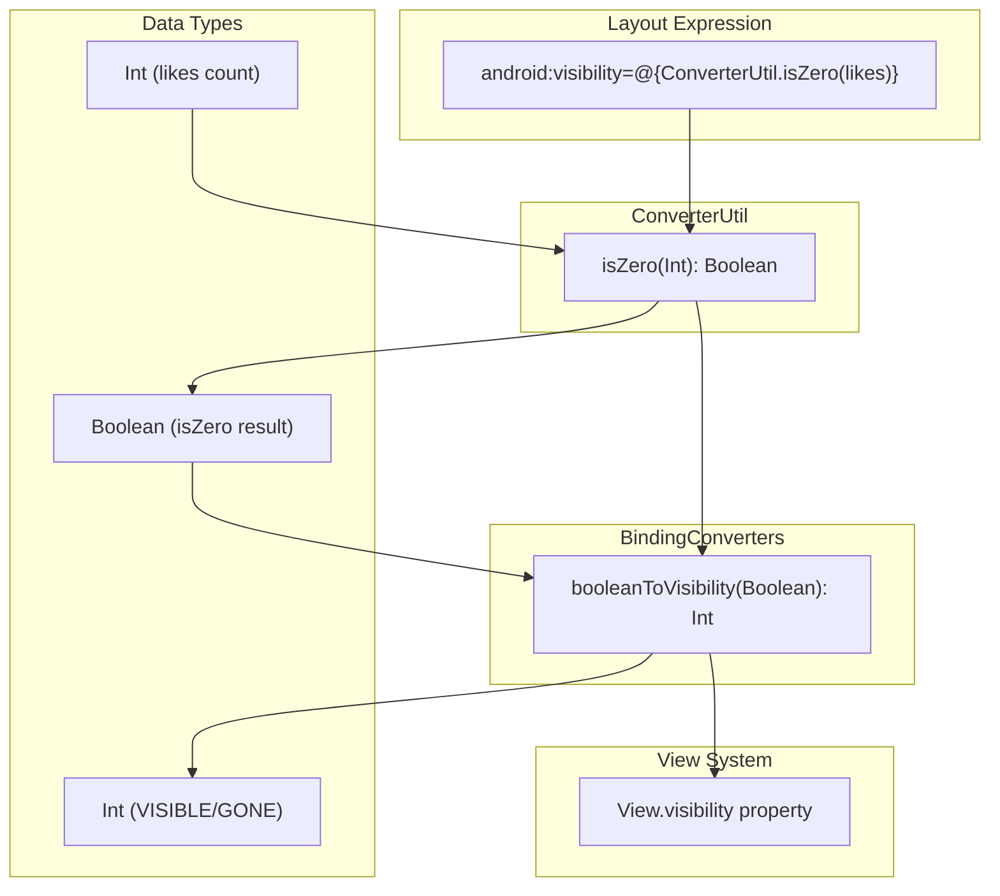
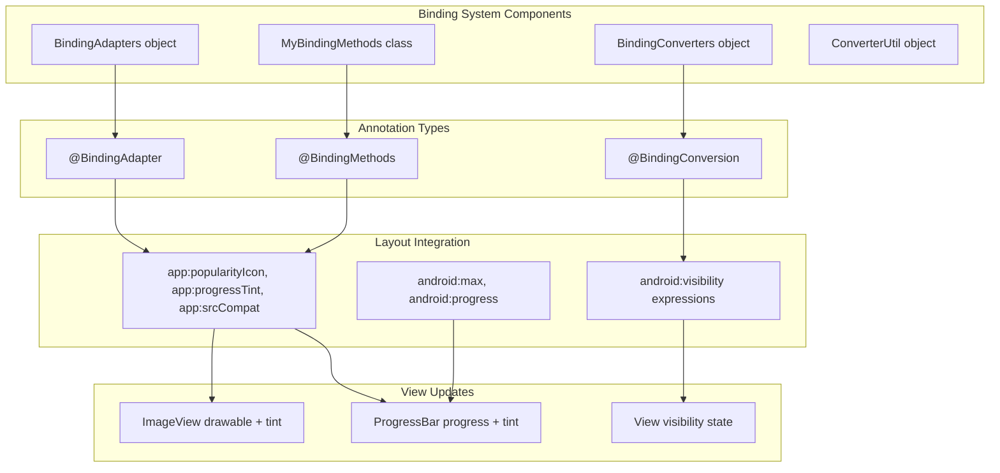

<!-- source: DeepWiki mcp.deepwiki.com · repo android/databinding-samples · page 2.3 Binding Utilities and Adapters · fetched 2026-10-23 -->

# Binding Utilities and Adapters

<details>
<summary>Relevant source files</summary>

The following files were used as context for generating this wiki page:

- [BasicSample/app/src/main/java/com/example/android/databinding/basicsample/data/ObservableFieldProfile.kt](BasicSample/app/src/main/java/com/example/android/databinding/basicsample/data/ObservableFieldProfile.kt)
- [BasicSample/app/src/main/java/com/example/android/databinding/basicsample/ui/MainActivity.kt](BasicSample/app/src/main/java/com/example/android/databinding/basicsample/ui/MainActivity.kt)
- [BasicSample/app/src/main/java/com/example/android/databinding/basicsample/util/BindingAdapters.kt](BasicSample/app/src/main/java/com/example/android/databinding/basicsample/util/BindingAdapters.kt)
- [BasicSample/app/src/main/java/com/example/android/databinding/basicsample/util/BindingConverters.kt](BasicSample/app/src/main/java/com/example/android/databinding/basicsample/util/BindingConverters.kt)
- [BasicSample/app/src/main/java/com/example/android/databinding/basicsample/util/BindingMethods.kt](BasicSample/app/src/main/java/com/example/android/databinding/basicsample/util/BindingMethods.kt)

</details>


This document covers the custom binding utilities and adapters implemented in the BasicSample application that extend Android Data Binding functionality beyond the built-in capabilities. These utilities demonstrate three key extension mechanisms: Binding Adapters, Binding Methods, and Binding Converters.

For information about the core data binding concepts and observable fields, see [Core Data Binding Concepts](#2.1). For ViewModel integration patterns, see [ViewModel Architecture](#2.2).

## Overview

The BasicSample implements three types of binding utilities that extend data binding functionality:

| Utility Type | Purpose | Implementation Location |
|---|---|---|
| Binding Adapters | Custom attributes for complex view logic | `BindingAdapters` object |
| Binding Methods | Map custom attributes to existing methods | `MyBindingMethods` class |
| Binding Converters | Automatic type conversions | `BindingConverters` object |

These utilities are located in the `com.example.android.databinding.basicsample.util` package and provide reusable functionality across multiple activities in the application.

## Binding Adapters

### Custom Attribute Implementations

The `BindingAdapters` object defines several custom attributes that handle complex view state management. The most comprehensive example is the `popularityIcon` adapter:

```kotlin
@BindingAdapter("app:popularityIcon")
@JvmStatic fun popularityIcon(view: ImageView, popularity: Popularity)
```

This adapter accepts a `Popularity` enum value and automatically sets both the image drawable and tint color based on the popularity level. The implementation demonstrates how binding adapters can encapsulate complex view logic that would otherwise require multiple lines of imperative code.

### Multi-Attribute Binding Adapters

The `setProgress` adapter showcases binding adapters that depend on multiple attributes:

```kotlin
@BindingAdapter(value = ["app:progressScaled", "android:max"], requireAll = true)
@JvmStatic fun setProgress(progressBar: ProgressBar, likes: Int, max: Int)
```

This adapter is called whenever either `app:progressScaled` or `android:max` changes, demonstrating how binding adapters can coordinate multiple attribute values to produce a single view update.

### Alternative to Binding Converters

The `hideIfZero` adapter provides an alternative approach to the binding converter pattern:

```kotlin
@BindingAdapter("app:hideIfZero")
@JvmStatic fun hideIfZero(view: View, number: Int)
```

This adapter is marked as "unused" in the code comments, illustrating how binding adapters can replace binding converters when more explicit control is preferred.

**Binding Adapters Architecture**



Sources: [BasicSample/app/src/main/java/com/example/android/databinding/basicsample/util/BindingAdapters.kt:33-104]()

## Binding Methods

### Attribute Mapping

The `MyBindingMethods` class demonstrates how to map custom attributes to existing view methods without writing custom adapter logic:

```kotlin
@BindingMethods(
    BindingMethod(type = ImageView::class,
                  attribute = "app:srcCompat",
                  method = "setImageResource"))
class MyBindingMethods
```

This binding method maps the `app:srcCompat` attribute (used by the support library for vector drawable compatibility) directly to the `setImageResource` method on `ImageView`. The code comments note that this is equivalent to writing a full binding adapter but with significantly less boilerplate.

### Binding Method vs Binding Adapter Trade-offs

The implementation includes comprehensive documentation explaining when to use binding methods versus binding adapters:

- **Binding Methods**: Use when mapping a custom attribute to an existing method with compatible parameter types
- **Binding Adapters**: Use when custom logic, type conversion, or multi-attribute coordination is required

**Binding Methods Flow**



Sources: [BasicSample/app/src/main/java/com/example/android/databinding/basicsample/util/BindingMethods.kt:24-43]()

## Binding Converters

### Automatic Type Conversion

The `BindingConverters` object implements automatic type conversion using the `@BindingConversion` annotation:

```kotlin
@BindingConversion
@JvmStatic fun booleanToVisibility(isNotVisible: Boolean): Int
```

This converter automatically transforms `Boolean` values to Android visibility constants (`View.VISIBLE` or `View.GONE`). The data binding system applies this conversion automatically whenever a boolean expression is bound to a visibility attribute.

### Converter Utility Functions

The `ConverterUtil` object provides utility functions that work in conjunction with binding converters:

```kotlin
@JvmStatic fun isZero(number: Int): Boolean
```

This utility function converts integer values to boolean, which then gets automatically converted to visibility through the binding converter chain. The typical usage pattern combines both utilities:

```
android:visibility="@{ConverterUtil.isZero(viewmodel.likes)}"
```

### Converter Chain Processing

The implementation demonstrates a two-step conversion process:
1. `Int` → `Boolean` (via `ConverterUtil.isZero`)
2. `Boolean` → `Int` (via `BindingConverters.booleanToVisibility`)

This chain allows complex expressions in layout files while maintaining clean separation of concerns.

**Binding Converters Data Flow**



Sources: [BasicSample/app/src/main/java/com/example/android/databinding/basicsample/util/BindingConverters.kt:31-50]()

## Integration with Data Binding System

### Automatic Registration

All three binding utility types are automatically discovered and registered by the data binding annotation processor. No explicit registration is required - the presence of the appropriate annotations (`@BindingAdapter`, `@BindingMethods`, `@BindingConversion`) in the classpath is sufficient.

### Usage in Layout Files

The binding utilities enable declarative expressions in layout XML that would otherwise require imperative code in activities or fragments. For example, the popularity icon binding adapter allows:

```xml
app:popularityIcon="@{viewmodel.popularity}"
```

Instead of requiring manual drawable and tint management in the activity code.

### Scope and Lifecycle

These binding utilities are stateless and thread-safe, designed to be called from the main thread during data binding evaluation. They receive the current attribute values and produce immediate view updates without maintaining internal state.

**Complete Binding Utilities System**



Sources: [BasicSample/app/src/main/java/com/example/android/databinding/basicsample/util/BindingAdapters.kt:33-104](), [BasicSample/app/src/main/java/com/example/android/databinding/basicsample/util/BindingMethods.kt:24-43](), [BasicSample/app/src/main/java/com/example/android/databinding/basicsample/util/BindingConverters.kt:31-50]()

---

