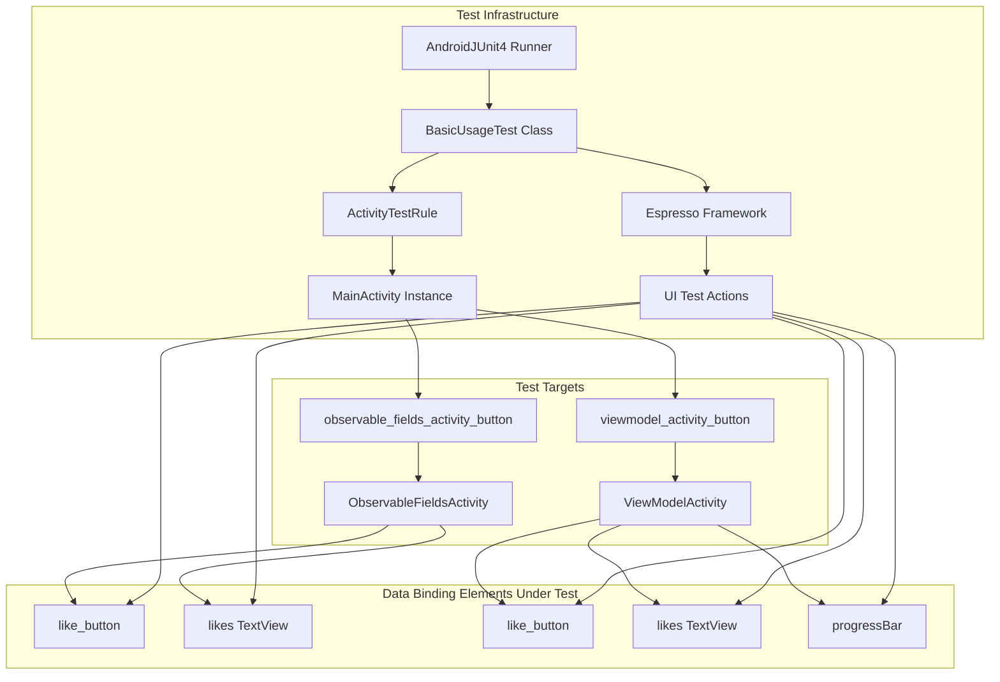
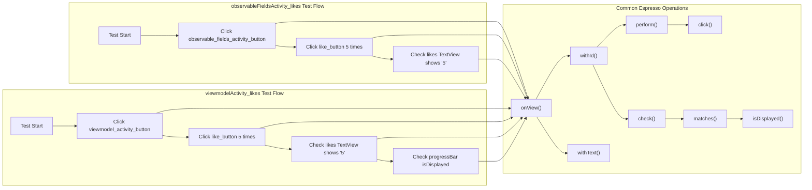
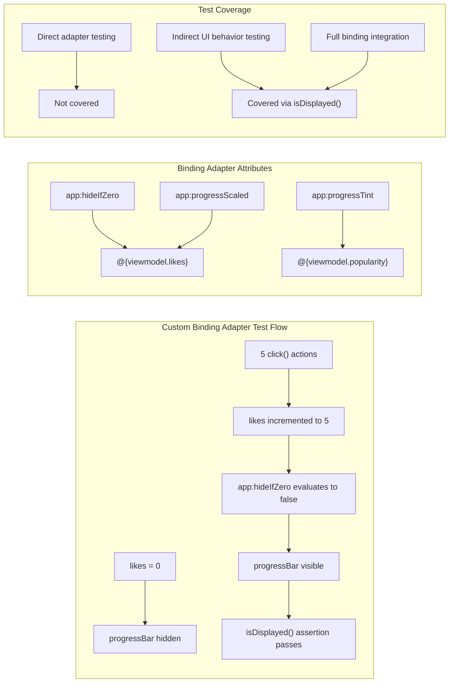

<!-- source: DeepWiki mcp.deepwiki.com · repo android/databinding-samples · page 2.4 Testing Framework · fetched 2026-10-23 -->

# Testing Framework

<details>
<summary>Relevant source files</summary>

The following files were used as context for generating this wiki page:

- [BasicSample/app/src/androidTest/java/com/example/android/databinding/basicsample/BasicUsageTest.kt](BasicSample/app/src/androidTest/java/com/example/android/databinding/basicsample/BasicUsageTest.kt)
- [BasicSample/app/src/main/res/layout/viewmodel_profile.xml](BasicSample/app/src/main/res/layout/viewmodel_profile.xml)

</details>


This document covers the testing infrastructure and patterns used in the BasicSample application for validating Android Data Binding implementations. The testing framework demonstrates how to write instrumented tests that verify data binding functionality, UI interactions, and ViewModel integrations using Espresso and AndroidJUnit4.

For information about the core data binding concepts being tested, see [Core Data Binding Concepts](#2.1). For details about the ViewModel architecture patterns validated by these tests, see [ViewModel Architecture](#2.2).

## Test Architecture and Setup

The BasicSample testing framework uses a standard Android instrumented testing approach with specific adaptations for data binding validation. The primary test class `BasicUsageTest` is configured with AndroidJUnit4 runner and uses Espresso for UI automation.



The test setup uses `ActivityTestRule` to manage the lifecycle of `MainActivity`, providing a controlled environment for testing data binding interactions across different activity implementations.

**Sources:** [BasicSample/app/src/androidTest/java/com/example/android/databinding/basicsample/BasicUsageTest.kt:25-42]()

## Test Method Implementation Patterns

The testing framework implements two primary test scenarios that validate different data binding approaches: `observableFieldsActivity_likes()` and `viewmodelActivity_likes()`. Both tests follow a consistent pattern but verify different architectural implementations.



The key difference between the two test methods is that `viewmodelActivity_likes()` includes an additional assertion to verify that the `progressBar` becomes visible, demonstrating the enhanced UI behavior available in the ViewModel-based implementation.

**Sources:** [BasicSample/app/src/androidTest/java/com/example/android/databinding/basicsample/BasicUsageTest.kt:44-71]()

## Data Binding Test Validation Patterns

The tests specifically validate data binding functionality by interacting with UI elements that are bound to observable data sources. The testing approach focuses on end-to-end validation rather than isolated unit testing of binding expressions.

| Test Scenario | Data Binding Element | Validation Approach | Expected Behavior |
|---------------|---------------------|-------------------|------------------|
| Observable Fields | `@{user.likes}` in TextView | Text content assertion | Manual observable updates |
| ViewModel Integration | `@{Integer.toString(viewmodel.likes)}` | Text content + visibility | Automatic UI updates via LiveData |
| Custom Binding Adapters | `app:hideIfZero="@{viewmodel.likes}"` | View visibility check | Progressive disclosure pattern |
| Click Handlers | `@{() -> viewmodel.onLike()}` | Button interaction | Lambda expression handling |

```mermaid
graph TB
    subgraph "Data Binding Test Targets"
        LikesBinding["likes TextView"] --> IntegerToString["Integer.toString(viewmodel.likes)"]
        LikeButton["like_button"] --> OnClickLambda["@{() -> viewmodel.onLike()}"]
        ProgressBarVisibility["progressBar"] --> HideIfZero["app:hideIfZero binding adapter"]
    end
    
    subgraph "Test Validation Methods"
        EspressoMatchers["Espresso ViewMatchers"] --> withText["withText('5')"]
        EspressoMatchers --> isDisplayed["isDisplayed()"]
        EspressoActions["Espresso ViewActions"] --> click["click()"]
        TestAssertions["Test Assertions"] --> matches["matches()"]
    end
    
    subgraph "Binding Expression Validation"
        IntegerToString --> withText
        OnClickLambda --> click
        HideIfZero --> isDisplayed
        withText --> matches
        isDisplayed --> matches
    end
    
    subgraph "Test Execution Pattern"
        repeat["repeat(5)"] --> click
        click --> DataBindingUpdate["Data Binding Updates UI"]
        DataBindingUpdate --> matches
    end
```

The tests use the `repeat(5)` construct to simulate multiple user interactions, ensuring that data binding expressions correctly update the UI state. This pattern validates that observable properties propagate changes through the binding system to the display layer.

**Sources:** [BasicSample/app/src/androidTest/java/com/example/android/databinding/basicsample/BasicUsageTest.kt:49-70](), [BasicSample/app/src/main/res/layout/viewmodel_profile.xml:83-164]()

## Custom Binding Adapter Testing

The testing framework indirectly validates custom binding adapters through UI behavior verification. The `progressBar` visibility test specifically validates the `app:hideIfZero` binding adapter, demonstrating how complex binding logic can be tested through observable UI changes.



The testing approach focuses on integration-level validation rather than isolated binding adapter testing. This ensures that the complete data binding pipeline functions correctly from ViewModel state changes through custom adapters to final UI presentation.

**Sources:** [BasicSample/app/src/main/res/layout/viewmodel_profile.xml:147-164](), [BasicSample/app/src/androidTest/java/com/example/android/databinding/basicsample/BasicUsageTest.kt:70]()

---

