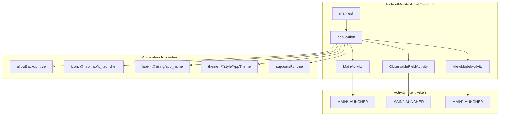
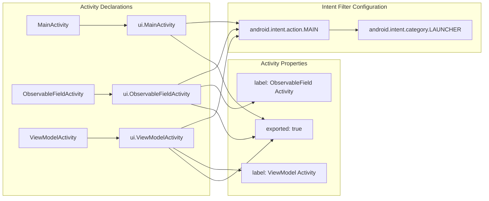
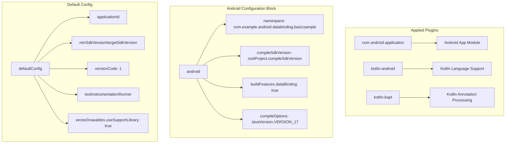
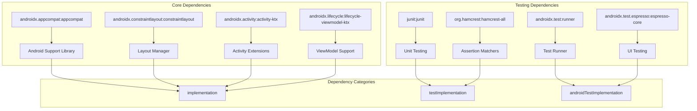

<!-- source: DeepWiki mcp.deepwiki.com · repo android/databinding-samples · page 2.5 Application Configuration · fetched 2026-10-23 -->

# Application Configuration

Relevant source files

The following files were used as context for generating this wiki page:

- [BasicSample/app/build.gradle](BasicSample/app/build.gradle)
- [BasicSample/app/src/main/AndroidManifest.xml](BasicSample/app/src/main/AndroidManifest.xml)
- [TwoWaySample/app/src/main/AndroidManifest.xml](TwoWaySample/app/src/main/AndroidManifest.xml)

This document details the Android application configuration for BasicSample, including the Android manifest structure, build configuration, and application-level setup required for data binding functionality. This covers the foundational configuration that enables the data binding demonstrations discussed in other sections.

For information about the actual data binding implementations, see [Core Data Binding Concepts](#2.1) and [ViewModel Architecture](#2.2). For build system infrastructure details, see [Gradle Configuration](#4.1).

## Android Manifest Structure

The BasicSample application manifest defines three distinct activity entry points, each demonstrating different data binding approaches. The manifest configuration enables multiple launcher activities for educational purposes.

### Application Configuration

**Application Element Configuration**

The application element [BasicSample/app/src/main/AndroidManifest.xml:21-27]() defines standard Android application properties that support the data binding samples:

| Property | Value | Purpose |
|----------|-------|---------|
| `android:allowBackup` | `true` | Enables automatic backup of application data |
| `android:icon` | `@mipmap/ic_launcher` | Standard launcher icon reference |
| `android:label` | `@string/app_name` | Application name displayed in launcher |
| `android:roundIcon` | `@mipmap/ic_launcher_round` | Round icon for adaptive launchers |
| `android:supportsRtl` | `true` | Enables right-to-left layout support |
| `android:theme` | `@style/AppTheme` | Application-wide theme resource |

Sources: [BasicSample/app/src/main/AndroidManifest.xml:21-27]()

### Activity Declarations

The manifest declares three activities, each with identical `MAIN`/`LAUNCHER` intent filters to provide multiple entry points for testing different data binding patterns:

**Activity Registration Details**

- **MainActivity** [BasicSample/app/src/main/AndroidManifest.xml:28-35](): Primary entry point using relative class path `.ui.MainActivity`
- **ObservableFieldActivity** [BasicSample/app/src/main/AndroidManifest.xml:36-44](): Demonstrates `ObservableField` pattern with custom label
- **ViewModelActivity** [BasicSample/app/src/main/AndroidManifest.xml:45-53](): Demonstrates `ViewModel` architecture pattern with custom label

All activities include `android:exported="true"` to enable launching from external applications and testing frameworks.

Sources: [BasicSample/app/src/main/AndroidManifest.xml:28-53]()

## Build Configuration

The Gradle build configuration enables data binding functionality and manages dependencies required for the sample demonstrations.

### Gradle Plugin Configuration

**Critical Configuration Elements**

The build configuration [BasicSample/app/build.gradle:17-48]() establishes the foundation for data binding functionality:

| Configuration | Value | Purpose |
|---------------|-------|---------|
| `namespace` | `com.example.android.databinding.basicsample` | Package namespace for generated code |
| `applicationId` | `"com.example.android.databinding.basicsample"` | Unique application identifier |
| `buildFeatures.dataBinding` | `true` | Enables Android Data Binding library |
| `testInstrumentationRunner` | `"androidx.test.runner.AndroidJUnitRunner"` | Test runner for UI testing |
| `vectorDrawables.useSupportLibrary` | `true` | Vector drawable support for older API levels |

Sources: [BasicSample/app/build.gradle:17-48]()

### Dependency Management

The dependency configuration supports both data binding functionality and comprehensive testing:

**Dependency Configuration**

The dependency block [BasicSample/app/build.gradle:50-65]() includes:

- **Core Android Dependencies**: AppCompat, ConstraintLayout, Activity KTX, and Lifecycle ViewModel for modern Android development
- **Unit Testing**: JUnit and Hamcrest for local unit tests
- **UI Testing**: AndroidX Test framework with Espresso for instrumented tests

All dependency versions are managed through root project properties for consistency across the repository.

Sources: [BasicSample/app/build.gradle:50-65]()

## Data Binding Configuration Integration

The application configuration specifically supports data binding through several coordinated settings:

### Build Feature Enablement

The `buildFeatures.dataBinding = true` setting [BasicSample/app/build.gradle:42]() activates the Android Data Binding compiler, which:

- Generates binding classes for layouts containing `<layout>` tags
- Processes binding expressions in XML layouts
- Creates observable field binding infrastructure
- Enables two-way data binding syntax

### Annotation Processing Setup

The `kotlin-kapt` plugin [BasicSample/app/build.gradle:21]() enables Kotlin annotation processing required for:

- Data binding class generation
- ViewModel integration
- Lifecycle-aware component processing

Sources: [BasicSample/app/build.gradle:21](), [BasicSample/app/build.gradle:42]()

---

