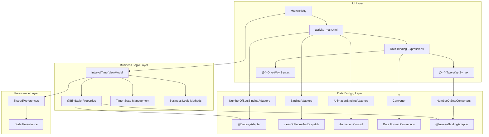
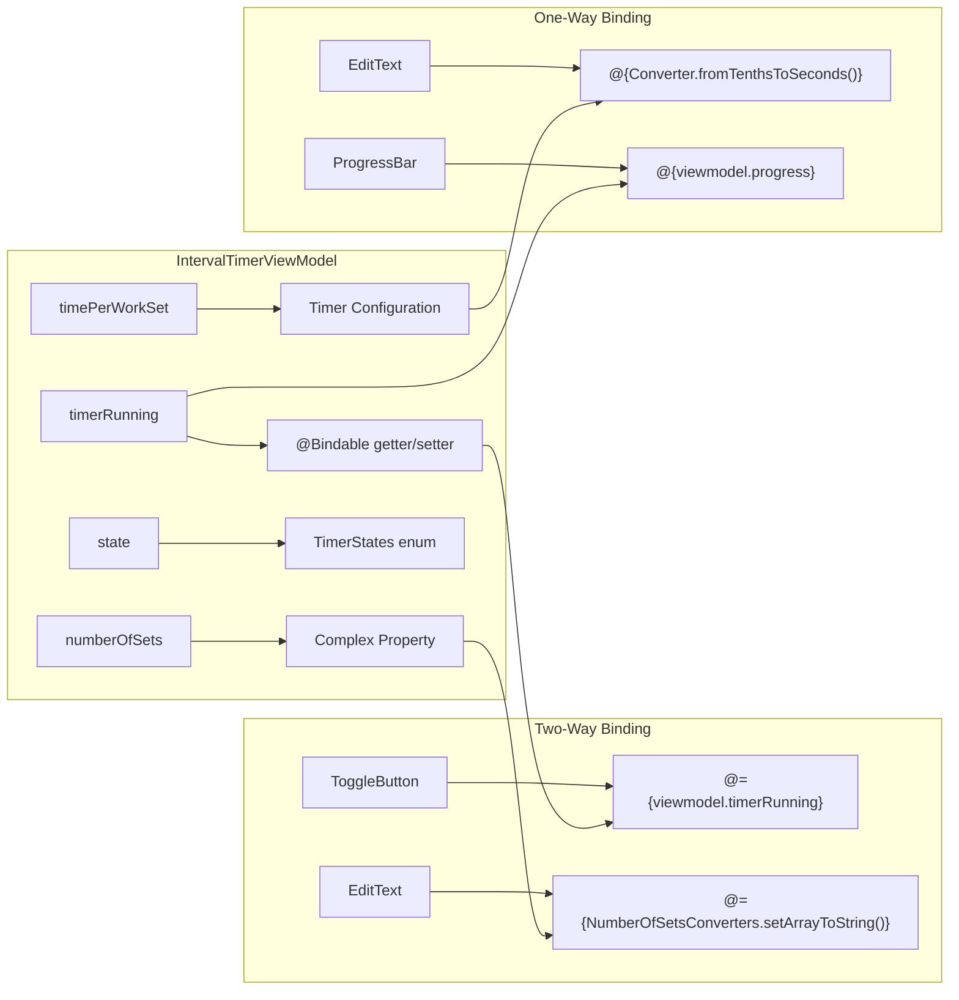
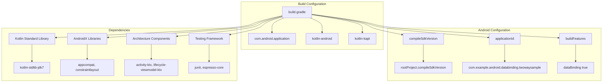
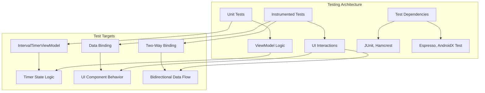

<!-- source: DeepWiki mcp.deepwiki.com · repo android/databinding-samples · page 3 TwoWaySample Application · fetched 2026-10-23 -->

# TwoWaySample Application

Relevant source files

The following files were used as context for generating this wiki page:

- [TwoWaySample/README.md](TwoWaySample/README.md)
- [TwoWaySample/app/build.gradle](TwoWaySample/app/build.gradle)

The TwoWaySample application demonstrates advanced Android Data Binding concepts through a workout interval timer implementation. This application serves as the second educational component in the repository, showcasing complex two-way data binding patterns, custom binding adapters, and sophisticated ViewModel architecture. For foundational data binding concepts, see [BasicSample Application](#2).

## Application Overview

TwoWaySample implements a workout timer that allows users to configure work and rest intervals with visual feedback and state persistence. The application demonstrates practical use cases for two-way data binding in a real-world scenario, moving beyond basic examples to show complex interactions between UI components and data models.

The application package is `com.example.android.databinding.twowaysample` and targets modern Android development practices with Kotlin as the primary language and data binding enabled throughout the UI layer.

**Sources:** [TwoWaySample/app/build.gradle:26](), [TwoWaySample/README.md:1-16]()

## Core Architecture

The TwoWaySample application follows a clean architecture pattern with clear separation between UI, data binding, and business logic layers:

The architecture demonstrates how two-way data binding creates a bidirectional flow between UI components and the ViewModel, with custom binding adapters handling complex data transformations and UI behavior.

**Sources:** [TwoWaySample/README.md:172-195](), [TwoWaySample/README.md:183-189]()

## Key Components

### IntervalTimerViewModel

The `IntervalTimerViewModel` serves as the central state management component, exposing `@Bindable` properties for two-way data binding and implementing the timer logic:

The ViewModel implements the `@Bindable` annotation pattern where getters compute derived state and setters trigger business logic methods while ensuring proper change notifications.

**Sources:** [TwoWaySample/README.md:45-62](), [TwoWaySample/README.md:172-195]()

### Binding Adapters System

The application employs multiple binding adapter classes to handle complex UI interactions:

| Adapter Class | Purpose | Key Methods |
|---------------|---------|-------------|
| `NumberOfSetsBindingAdapters` | Handle complex two-way binding for set count input | `setNumberOfSets`, `setListener`, `getNumberOfSets` |
| `BindingAdapters` | General UI bindings and custom attributes | `clearOnFocusAndDispatch`, `updateProgress` |
| `AnimationBindingAdapters` | Animation control via data binding | Background color animations, ConstraintLayout parameter changes |
| `Converter` | One-way data format conversion | `fromTenthsToSeconds` |
| `NumberOfSetsConverters` | Two-way data conversion for set count | `setArrayToString` |

**Sources:** [TwoWaySample/README.md:77-119](), [TwoWaySample/README.md:139-140](), [TwoWaySample/README.md:155-163]()

## Build Configuration

The TwoWaySample build configuration enables data binding and includes dependencies for modern Android development:

The configuration uses Kotlin annotation processing (`kotlin-kapt`) to generate data binding code and includes lifecycle-aware components for robust ViewModel integration.

**Sources:** [TwoWaySample/app/build.gradle:17-22](), [TwoWaySample/app/build.gradle:40-42](), [TwoWaySample/app/build.gradle:45-61]()

## Testing Framework

TwoWaySample includes comprehensive testing support for both UI interactions and business logic:

The testing approach validates that data binding expressions work correctly and that the ViewModel properly manages timer state without requiring UI framework calls in the activity.

**Sources:** [TwoWaySample/README.md:196-201](), [TwoWaySample/app/build.gradle:53-59]()

## Advanced Features Demonstrated

TwoWaySample showcases several advanced data binding patterns:

- **Two-Way Data Binding**: Uses `@={}` syntax for properties like `timerRunning` that need bidirectional synchronization
- **Custom Binding Adapters**: Implements complex UI behavior through binding adapters with multiple parameters
- **Inverse Binding Adapters**: Handles data conversion from UI back to ViewModel using `@InverseBindingAdapter`
- **Animation Integration**: Demonstrates how animations can be controlled through data binding expressions
- **State Persistence**: Integrates SharedPreferences for maintaining timer state across configuration changes

The application represents a practical implementation of data binding in a real-world scenario, providing developers with concrete examples of advanced patterns and best practices.

**Sources:** [TwoWaySample/README.md:4-15](), [TwoWaySample/README.md:22-119](), [TwoWaySample/README.md:155-170]()

---

