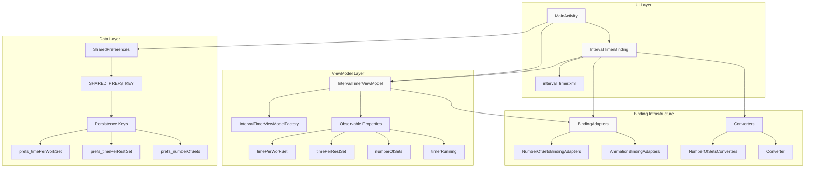
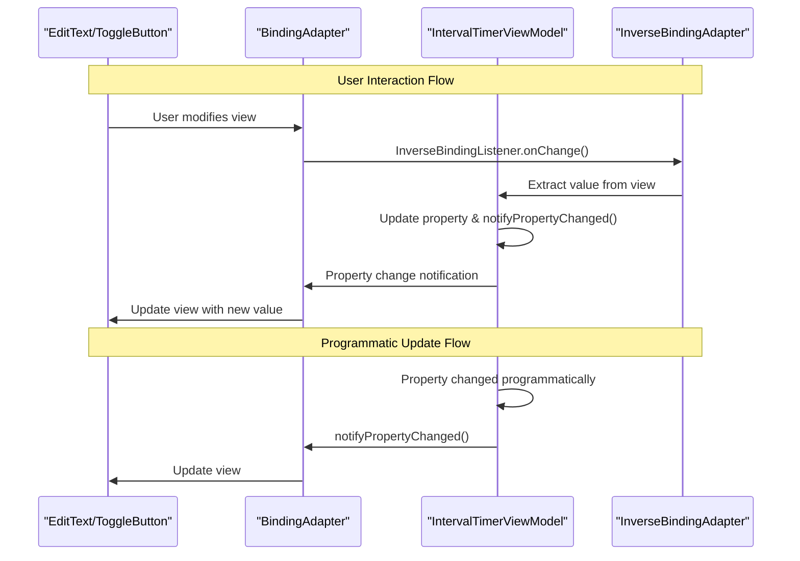
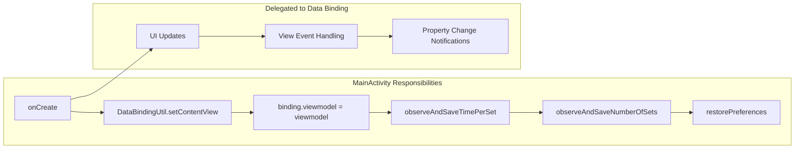
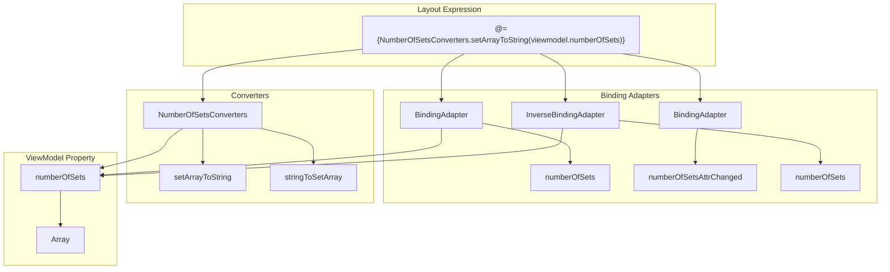
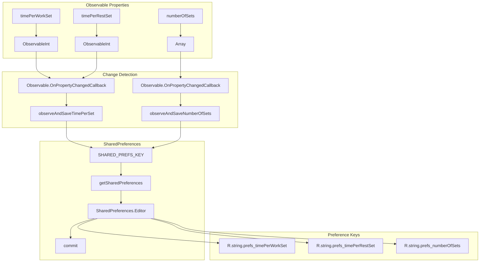
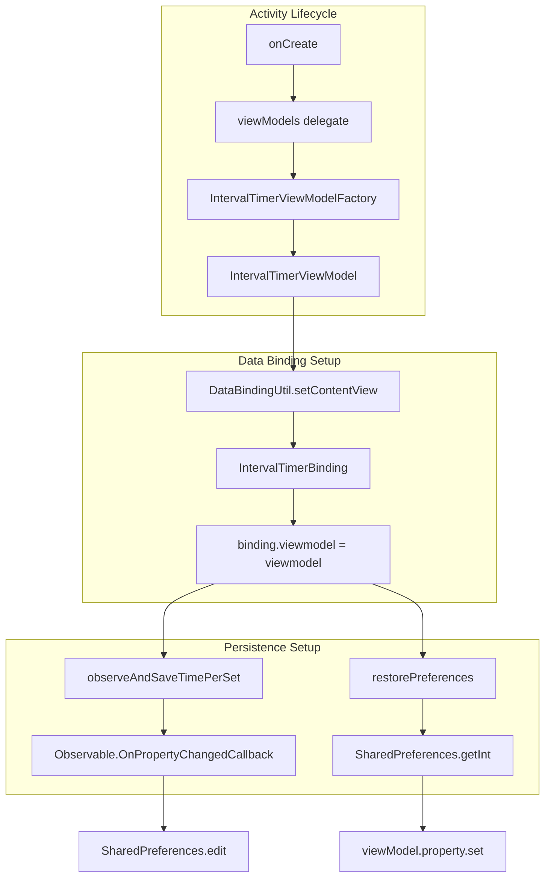

<!-- source: DeepWiki mcp.deepwiki.com · repo android/databinding-samples · page 3.1 Two-Way Data Binding Implementation · fetched 2026-10-23 -->

# Two-Way Data Binding Implementation

<details>
<summary>Relevant source files</summary>

The following files were used as context for generating this wiki page:

- [TwoWaySample/README.md](TwoWaySample/README.md)
- [TwoWaySample/app/src/main/java/com/example/android/databinding/twowaysample/ui/MainActivity.kt](TwoWaySample/app/src/main/java/com/example/android/databinding/twowaysample/ui/MainActivity.kt)

</details>


This document provides a detailed explanation of the interval timer implementation in the TwoWaySample application, focusing on advanced two-way binding patterns and ViewModel integration. It covers the core two-way data binding mechanisms, binding adapters, inverse binding adapters, and data persistence strategies used in the workout timer application.

For foundational data binding concepts and basic patterns, see [Core Data Binding Concepts](#2.1). For advanced persistence and binding converter patterns, see [Advanced Patterns and Persistence](#3.2).

## Architecture Overview

The TwoWaySample application implements a sophisticated interval timer using two-way data binding to demonstrate advanced binding patterns. The architecture centers around the `MainActivity` activity that coordinates between the UI layer and the `IntervalTimerViewModel` business logic.



**Two-Way Data Binding Flow**


Sources: [TwoWaySample/app/src/main/java/com/example/android/databinding/twowaysample/ui/MainActivity.kt:1-131](), [TwoWaySample/README.md:1-221]()

## MainActivity Implementation

The `MainActivity` class serves as the primary entry point and orchestrates the two-way data binding setup. It follows the principle of minimal UI framework calls, delegating most UI operations to the Data Binding library and Binding Adapters.

### Core Components

| Component | Purpose | Key Methods |
|-----------|---------|-------------|
| `intervalTimerViewModel` | Business logic and state management | Property getters/setters with `@Bindable` |
| `IntervalTimerBinding` | Generated binding class | Connects layout to ViewModel |
| `SharedPreferences` | Data persistence | `observeAndSaveTimePerSet()`, `restorePreferences()` |

The activity implements a clean separation of concerns:



Sources: [TwoWaySample/app/src/main/java/com/example/android/databinding/twowaysample/ui/MainActivity.kt:43-73]()

## Simple Two-Way Binding: Timer Toggle

The simplest two-way binding implementation uses the `@={}` syntax to bind a `ToggleButton`'s checked state directly to the ViewModel's `timerRunning` property.

### Layout Binding Syntax

```xml
<ToggleButton
    android:checked="@={viewmodel.timerRunning}" />
```

The `@={}` syntax indicates bidirectional data flow:
- **View → ViewModel**: User taps toggle → `timerRunning` setter called
- **ViewModel → View**: `timerRunning` changes → UI updates automatically

### ViewModel Property Implementation

The `timerRunning` property requires specific implementation patterns:

```kotlin
var timerRunning: Boolean
    @Bindable get() {
        return state == TimerStates.STARTED
    }
    set(value) {
        // These methods take care of calling notifyPropertyChanged()
        if (value) startButtonClicked() else pauseButtonClicked()
    }
```

**Key Requirements:**
- `@Bindable` annotation on getter
- Setter calls `notifyPropertyChanged()` when state changes
- Getter derives value from underlying state
- Setter delegates to business logic methods

Sources: [TwoWaySample/README.md:22-63]()

## Complex Two-Way Binding: NumberOfSets Input

The `numberOfSets` input demonstrates advanced two-way binding with custom attributes, binding adapters, and converters. This pattern handles the complexity of text input with formatted display.

### Binding Infrastructure Components



### Binding Adapter Implementation

The custom `numberOfSets` attribute requires three coordinated binding adapters:

**1. Forward Binding Adapter**
```kotlin
@BindingAdapter("numberOfSets")
@JvmStatic fun setNumberOfSets(view: EditText, value: String) {
    view.setText(value)
}
```

**2. Change Listener Adapter**
```kotlin
@BindingAdapter(value = ["numberOfSetsAttrChanged"])
@JvmStatic fun setListener(view: EditText, listener: InverseBindingListener?) {
    view.onFocusChangeListener = View.OnFocusChangeListener { focusedView, hasFocus ->
        val textView = focusedView as TextView
        if (hasFocus) {
            // Delete contents of the EditText if the focus entered.
            textView.text = ""
        } else {
            // If the focus left, update the listener
            listener?.onChange()
        }
    }
}
```

**3. Inverse Binding Adapter**
```kotlin
@InverseBindingAdapter(attribute = "numberOfSets")
@JvmStatic fun getNumberOfSets(editText: EditText): String {
    return editText.text.toString()
}
```

### Two-Way Binding Execution Flow

| Step | Component | Action |
|------|-----------|--------|
| 1 | User | Focuses EditText, enters text |
| 2 | `numberOfSetsAttrChanged` | Detects focus change |
| 3 | `InverseBindingListener` | Calls `onChange()` |
| 4 | `InverseBindingAdapter` | Extracts `editText.text.toString()` |
| 5 | `NumberOfSetsConverters` | Converts string to Array<Int> |
| 6 | `ViewModel` | Updates `numberOfSets` property |
| 7 | `ViewModel` | Calls `notifyPropertyChanged()` |
| 8 | `BindingAdapter` | Updates view with formatted text |

Sources: [TwoWaySample/README.md:64-120]()

## Alternative Two-Way Binding Approaches

For developers who find two-way binding complex, the sample demonstrates alternative approaches using one-way binding with explicit listeners.

### One-Way Binding with Custom Listeners

```xml
<EditText
    android:text="@{Converter.fromTenthsToSeconds(viewmodel.timePerWorkSet)}"
    clearOnFocusAndDispatch="@{() -> viewmodel.timePerWorkSetChanged(setWorkTime.getText())}"
    />
```

This approach provides:
- **Explicit control** over when updates occur
- **Clearer debugging** with visible event handlers
- **Simpler mental model** for beginners
- **Custom logic** in the listener lambda

### Comparison: Two-Way vs One-Way Alternatives

| Aspect | Two-Way (`@={}`) | One-Way Alternative |
|--------|------------------|-------------------|
| Syntax | `@={property}` | `@{property}` + custom listener |
| Boilerplate | Minimal in layout | More verbose in layout |
| Binding Adapters | Requires 3 adapters | Requires 2 adapters |
| Control | Automatic | Explicit |
| Debugging | Complex call stack | Clear event flow |

Sources: [TwoWaySample/README.md:121-141]()

## Data Persistence Integration

The `MainActivity` implements sophisticated data persistence using `SharedPreferences` with `Observable.OnPropertyChangedCallback` to automatically save user preferences.

### Persistence Architecture



### Persistence Implementation Patterns

**ObservableInt Properties**
The `observeAndSaveTimePerSet()` method implements a generic pattern for persisting `ObservableInt` values:

```kotlin
private fun observeAndSaveTimePerSet(timePerWorkSet: ObservableInt, prefsKey: Int) {
    timePerWorkSet.addOnPropertyChangedCallback(
            object : Observable.OnPropertyChangedCallback() {
        @SuppressLint("CommitPrefEdits")
        override fun onPropertyChanged(observable: Observable?, p1: Int) {
            Log.d("saveTimePerWorkSet", "Saving time-per-set preference")
            val sharedPref =
                    getSharedPreferences(SHARED_PREFS_KEY, Context.MODE_PRIVATE) ?: return
            sharedPref.edit().apply {
                putInt(getString(prefsKey), (observable as ObservableInt).get())
                commit()
            }
        }
    })
}
```

**Complex Property Observation**
The `observeAndSaveNumberOfSets()` method demonstrates handling complex properties using the `BR` class for property identification:

```kotlin
private fun observeAndSaveNumberOfSets(viewModel: IntervalTimerViewModel) {
    viewModel.addOnPropertyChangedCallback(object : Observable.OnPropertyChangedCallback() {
        @SuppressLint("CommitPrefEdits")
        override fun onPropertyChanged(observable: Observable?, p1: Int) {
            if (p1 == BR.numberOfSets) {
                // Save only when numberOfSets property changes
                val sharedPref = getSharedPreferences(SHARED_PREFS_KEY, Context.MODE_PRIVATE) ?: return
                sharedPref.edit().apply {
                    putInt(getString(R.string.prefs_numberOfSets), viewModel.numberOfSets[1])
                    commit()
                }
            }
        }
    })
}
```

### Preference Restoration

The `restorePreferences()` method implements the reverse operation, loading saved values back into the ViewModel:

| Preference Key | ViewModel Property | Default Value |
|---------------|-------------------|---------------|
| `prefs_timePerWorkSet` | `timePerWorkSet` | 100 |
| `prefs_timePerRestSet` | `timePerRestSet` | 50 |
| `prefs_numberOfSets` | `numberOfSets` | 5 |

Sources: [TwoWaySample/app/src/main/java/com/example/android/databinding/twowaysample/ui/MainActivity.kt:75-129]()

## ViewModel Integration Patterns

The two-way data binding implementation relies on proper ViewModel integration to maintain state consistency and handle configuration changes.

### ViewModel Lifecycle Management



### Property Change Notification Strategy

The ViewModel must properly implement property change notifications to maintain two-way binding consistency:

**Key Principles:**
- All `@Bindable` properties must call `notifyPropertyChanged()` when changed
- Use `BR.propertyName` constants for type-safe property identification  
- Avoid infinite loops by checking state before notifications
- Delegate UI logic to binding adapters, not the ViewModel

**Implementation Pattern:**
```kotlin
// In ViewModel
var someProperty: SomeType
    @Bindable get() = backingField
    set(value) {
        if (backingField != value) {
            backingField = value
            notifyPropertyChanged(BR.someProperty)
        }
    }
```

Sources: [TwoWaySample/app/src/main/java/com/example/android/databinding/twowaysample/ui/MainActivity.kt:45-58](), [TwoWaySample/README.md:172-195]()

---

