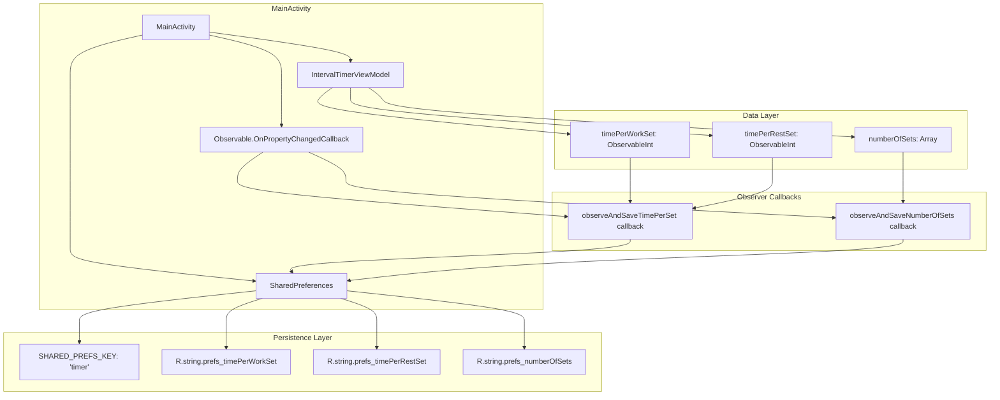
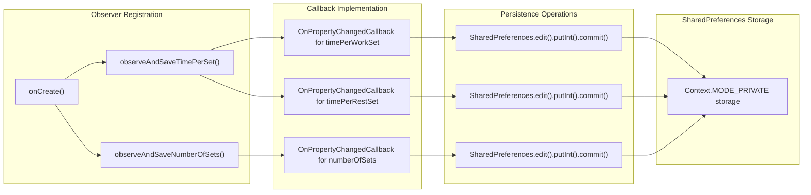
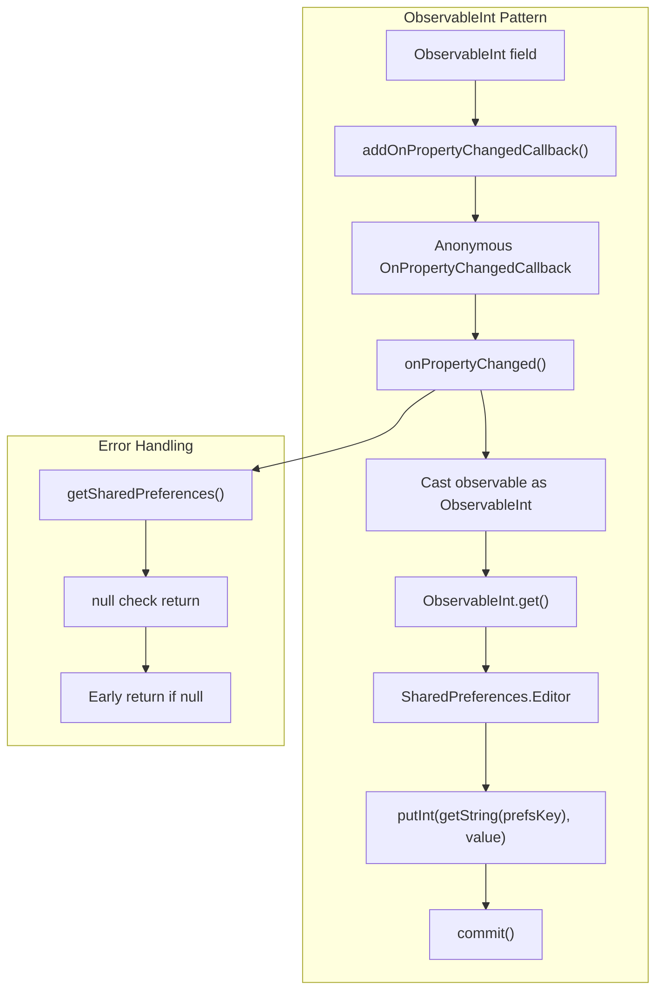
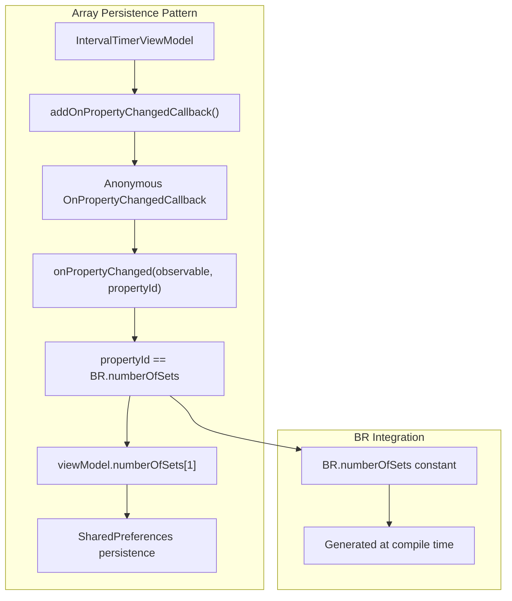
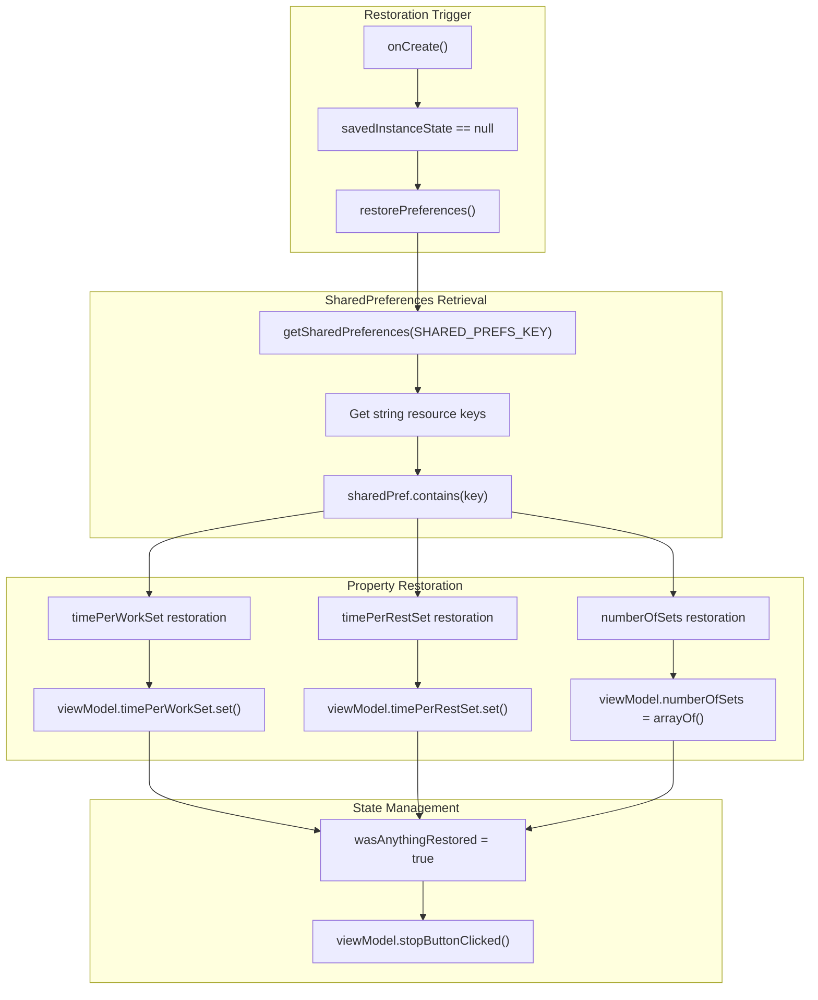

<!-- source: DeepWiki mcp.deepwiki.com · repo android/databinding-samples · page 3.2 Advanced Patterns and Persistence · fetched 2026-10-23 -->

# Advanced Patterns and Persistence

Relevant source files

The following files were used as context for generating this wiki page:

- [TwoWaySample/.google/packaging.yaml](TwoWaySample/.google/packaging.yaml)
- [TwoWaySample/app/src/main/java/com/example/android/databinding/twowaysample/ui/MainActivity.kt](TwoWaySample/app/src/main/java/com/example/android/databinding/twowaysample/ui/MainActivity.kt)

This document covers the sophisticated data binding patterns and persistence mechanisms demonstrated in the TwoWaySample application. It focuses on the advanced techniques that extend beyond basic data binding concepts, including automatic data persistence, complex observer patterns, and lifecycle-aware state management.

For foundational data binding concepts, see [Two-Way Data Binding Implementation](#3.1). For build system configuration, see [Gradle Configuration](#4.1).

## Data Persistence Architecture

The TwoWaySample application implements a comprehensive persistence layer that automatically saves user preferences using Android's SharedPreferences system. The architecture separates persistence concerns from UI logic while maintaining reactive data updates.

### Persistence Architecture Overview

**Data Persistence Flow**

The persistence system automatically saves user settings whenever observable properties change. The `MainActivity` class establishes observer callbacks that monitor specific `ObservableInt` fields and persist changes immediately to SharedPreferences.

Sources: [TwoWaySample/app/src/main/java/com/example/android/databinding/twowaysample/ui/MainActivity.kt:34-131]()

### Automatic Persistence Implementation

The application implements automatic persistence through the observer pattern, where changes to observable fields trigger immediate persistence operations.

| Component | Persistence Method | Key | Observable Field |
|-----------|-------------------|-----|------------------|
| Work Set Timer | `observeAndSaveTimePerSet` | `prefs_timePerWorkSet` | `timePerWorkSet` |
| Rest Set Timer | `observeAndSaveTimePerSet` | `prefs_timePerRestSet` | `timePerRestSet` |
| Number of Sets | `observeAndSaveNumberOfSets` | `prefs_numberOfSets` | `numberOfSets` |

The persistence callbacks are established during activity creation and remain active throughout the activity lifecycle:

**Implementation Details**

The `observeAndSaveTimePerSet` method creates anonymous `OnPropertyChangedCallback` objects that persist `ObservableInt` values using immediate commit operations. The persistence uses the `commit()` method rather than `apply()` to ensure synchronous writes.

Sources: [TwoWaySample/app/src/main/java/com/example/android/databinding/twowaysample/ui/MainActivity.kt:75-89]()

## Advanced Observer Patterns

The TwoWaySample application demonstrates sophisticated observer pattern implementations that handle different data types and persistence requirements.

### ObservableInt Persistence Pattern

The application uses a reusable pattern for persisting `ObservableInt` values through parameterized observer callbacks:

**Type-Safe Observable Handling**

The pattern includes type-safe casting within the callback to ensure proper value extraction from observable properties.

Sources: [TwoWaySample/app/src/main/java/com/example/android/databinding/twowaysample/ui/MainActivity.kt:76-88]()

### Complex Array Persistence Pattern

For the `numberOfSets` property, which uses an `Array<Int>` structure, the application implements a specialized observer pattern using the BR (Binding Resource) generated class:

**BR-Based Property Identification**

The `BR.numberOfSets` constant provides compile-time safety for identifying specific property changes in complex ViewModels with multiple observable properties.

Sources: [TwoWaySample/app/src/main/java/com/example/android/databinding/twowaysample/ui/MainActivity.kt:114-129]()

## State Restoration Mechanisms

The application implements comprehensive state restoration that handles both initial app launches and activity recreation scenarios.

### Preference Restoration Flow

**Conditional Restoration Logic**

The restoration process only executes on initial activity creation (`savedInstanceState == null`) and includes fallback default values for each preference type.

Sources: [TwoWaySample/app/src/main/java/com/example/android/databinding/twowaysample/ui/MainActivity.kt:91-112]()

### Default Value Management

The restoration system includes intelligent default value management:

| Setting | Preference Key | Default Value | Data Type |
|---------|---------------|---------------|-----------|
| Work Set Time | `prefs_timePerWorkSet` | 100 | `Int` |
| Rest Set Time | `prefs_timePerRestSet` | 50 | `Int` |
| Number of Sets | `prefs_numberOfSets` | 5 | `Int` (stored in `Array<Int>`) |

The system ensures that missing preferences are handled gracefully with sensible defaults while preserving user customizations when available.

Sources: [TwoWaySample/app/src/main/java/com/example/android/databinding/twowaysample/ui/MainActivity.kt:97-108]()

## Integration with Two-Way Data Binding

The persistence layer integrates seamlessly with the two-way data binding system, ensuring that user interface changes automatically trigger persistence operations without requiring explicit save actions.

### Binding and Persistence Coordination

```mermaid
graph LR
    subgraph "UI Layer"
        UI["UI Controls"] --> TDB["Two-Way Data Binding"]
        TDB --> LAYOUT["@={viewmodel.timePerWorkSet}"]
    end
    
    subgraph "ViewModel Layer"
        LAYOUT --> VMFIELD["ViewModel ObservableInt field"]
        VMFIELD --> NOTIFY["notifyPropertyChanged()"]
    end
    
    subgraph "Persistence Layer"
        NOTIFY --> CALLBACK["OnPropertyChangedCallback"]
        CALLBACK --> AUTO["Automatic SharedPreferences save"]
        AUTO --> COMMIT["Immediate commit()"]
    end
    
    subgraph "State Consistency"
        COMMIT --> STORED["Persistent storage"]
        STORED --> RESTORE["Available for restoration"]
    end
```

This architecture ensures that user interactions with UI controls immediately propagate through the data binding system to trigger automatic persistence, creating a seamless user experience where settings are never lost.

Sources: [TwoWaySample/app/src/main/java/com/example/android/databinding/twowaysample/ui/MainActivity.kt:54-73]()

---

