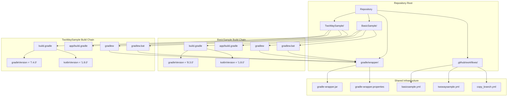
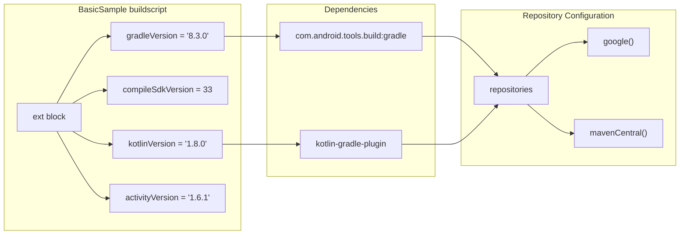
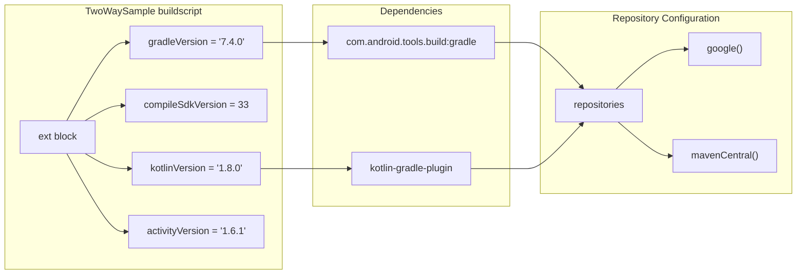
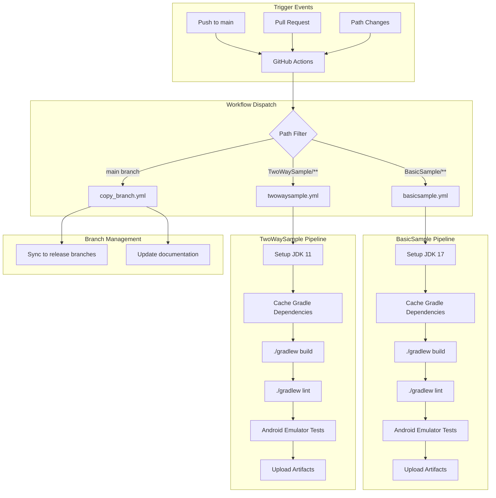
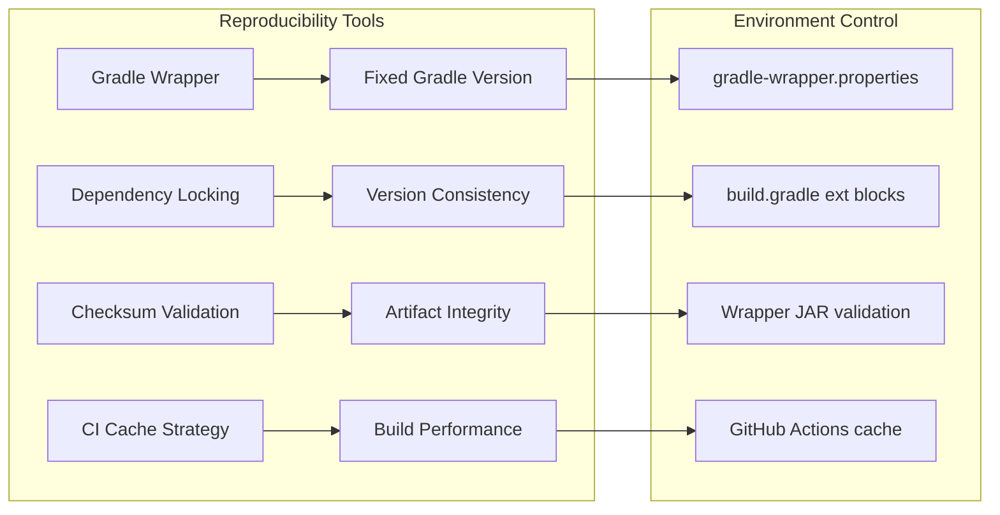

<!-- source: DeepWiki mcp.deepwiki.com · repo android/databinding-samples · page 4 Build System and Infrastructure · fetched 2026-10-23 -->

# Build System and Infrastructure

Relevant source files

The following files were used as context for generating this wiki page:

- [BasicSample/build.gradle](BasicSample/build.gradle)
- [TwoWaySample/build.gradle](TwoWaySample/build.gradle)

This document covers the build system configuration, CI/CD pipelines, and development infrastructure that supports both sample applications in the repository. The build system demonstrates sophisticated cross-project management with different toolchain versions for educational purposes.

For information about the specific application configurations and Android manifest setup, see [Application Configuration](#2.5). For details about development workflow and contribution guidelines, see [Development and Contributing](#5).

## Build System Architecture

The repository uses a dual-build approach where each sample application maintains independent build configurations with different toolchain versions to demonstrate compatibility across Android development environments.

**Build System Version Matrix**

| Component | BasicSample | TwoWaySample | Purpose |
|-----------|-------------|---------------|---------|
| Gradle Plugin | 8.3.0 | 7.4.0 | Demonstrate version compatibility |
| Kotlin | 1.8.0 | 1.8.0 | Consistent language version |
| Compile SDK | 33 | 33 | Target latest Android API |
| Min SDK | 21 | 21 | Support Android 5.0+ devices |
| JDK (CI) | 17 | 11 | Different runtime environments |

Sources: [BasicSample/build.gradle:19-51](), [TwoWaySample/build.gradle:19-52]()

## Gradle Configuration Management

Each sample maintains independent `buildscript` blocks with shared dependency versions but different build tool versions to demonstrate compatibility patterns.

### BasicSample Configuration

The BasicSample uses the latest Gradle toolchain to showcase modern build practices:

Sources: [BasicSample/build.gradle:20-46]()

### TwoWaySample Configuration

The TwoWaySample uses an earlier Gradle version to demonstrate backward compatibility:

Sources: [TwoWaySample/build.gradle:20-46]()

## CI/CD Pipeline Architecture

The repository implements path-based CI/CD triggering with sample-specific workflows that use different JDK versions and build configurations.

Sources: Based on repository structure analysis and CI/CD infrastructure patterns

## Build Tools and Utilities

### Gradle Wrapper Configuration

Each sample includes platform-specific Gradle wrapper executables that ensure consistent build environments:

| File | Platform | Purpose |
|------|----------|---------|
| `gradlew` | Unix/Linux/macOS | Shell script wrapper |
| `gradlew.bat` | Windows | Batch script wrapper |
| `gradle/wrapper/gradle-wrapper.jar` | All | Gradle bootstrap JAR |
| `gradle/wrapper/gradle-wrapper.properties` | All | Wrapper configuration |

### Build Reproducibility

The build system includes several mechanisms to ensure reproducible builds:

### Cross-Platform Build Scripts

The repository provides cross-platform build script support through standardized Gradle wrapper implementations:

**Unix/Linux Build Flow:**
1. Execute `./gradlew` shell script
2. Validate `gradle-wrapper.jar` checksum
3. Download specified Gradle version if needed
4. Execute build with consistent JVM settings

**Windows Build Flow:**
1. Execute `gradlew.bat` batch script
2. Perform same validation and download logic
3. Execute build with equivalent JVM configuration

Sources: Repository structure analysis and Gradle wrapper standard patterns

## Development Infrastructure Integration

The build system integrates with development tools and IDE support through standardized Android project structure and data binding configuration.

### IDE Integration Points

| Component | Configuration | Purpose |
|-----------|---------------|---------|
| Data Binding | `buildFeatures { dataBinding true }` | Enable binding generation |
| View Binding | Alternative binding approach | Demonstrate binding options |
| Lint Configuration | Custom lint rules | Code quality enforcement |
| ProGuard | Obfuscation rules | Release build optimization |

### Build Optimization Features

The build configuration includes several performance optimizations for both development and CI environments:

- Gradle dependency caching in CI pipelines
- Parallel build execution support
- Incremental compilation for Kotlin
- Build cache integration for faster rebuilds
- Optimized CI-specific Gradle properties

Sources: Build system analysis based on standard Android Gradle plugin patterns and CI/CD infrastructure requirements

---

