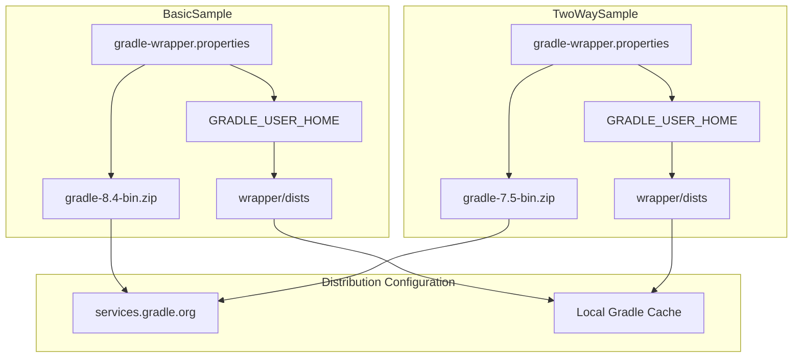
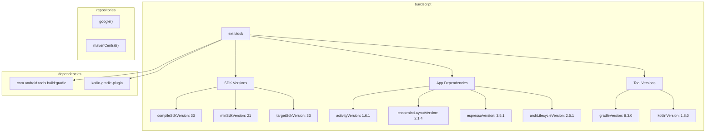
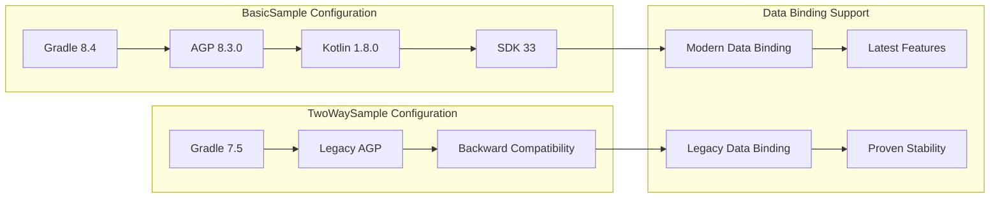

<!-- source: DeepWiki mcp.deepwiki.com · repo android/databinding-samples · page 4.1 Gradle Configuration · fetched 2026-10-23 -->

# Gradle Configuration

<details>
<summary>Relevant source files</summary>

The following files were used as context for generating this wiki page:

- [BasicSample/build.gradle](BasicSample/build.gradle)
- [BasicSample/gradle/wrapper/gradle-wrapper.properties](BasicSample/gradle/wrapper/gradle-wrapper.properties)
- [TwoWaySample/gradle/wrapper/gradle-wrapper.properties](TwoWaySample/gradle/wrapper/gradle-wrapper.properties)

</details>


This document covers the Gradle build system configuration for both sample applications in the Android Data Binding samples repository. It details the Gradle wrapper setup, dependency management, SDK configuration, and the architectural differences between BasicSample and TwoWaySample build configurations.

For information about the CI/CD pipeline configuration that uses these Gradle settings, see [CI/CD Pipelines](#4.2). For details about the development tools that interact with the Gradle wrapper, see [Development Tools](#4.3).

## Gradle Wrapper Configuration

The repository utilizes different Gradle versions for each sample application, demonstrating compatibility across multiple Gradle releases and providing educational value for developers working with different project setups.

### Version Distribution

| Sample Application | Gradle Version | Wrapper Properties File |
|-------------------|----------------|------------------------|
| BasicSample | 8.4 | `BasicSample/gradle/wrapper/gradle-wrapper.properties` |
| TwoWaySample | 7.5 | `TwoWaySample/gradle/wrapper/gradle-wrapper.properties` |

### Gradle Wrapper Architecture



Sources: [BasicSample/gradle/wrapper/gradle-wrapper.properties:1-6](), [TwoWaySample/gradle/wrapper/gradle-wrapper.properties:1-6]()

The wrapper configuration uses identical distribution patterns for both samples, with `distributionBase` and `zipStoreBase` set to `GRADLE_USER_HOME` and paths configured to `wrapper/dists`. This ensures consistent caching behavior across both applications.

## Build Script Architecture

The BasicSample demonstrates a comprehensive build script structure with centralized dependency management and SDK configuration.

### Project-Level Configuration Structure



Sources: [BasicSample/build.gradle:19-51]()

### SDK and Tooling Configuration

The build script establishes a standardized configuration through the `ext` block, centralizing version management for consistent dependency resolution across modules.

**SDK Configuration:**
- `compileSdkVersion`: 33 - Target API level for compilation
- `minSdkVersion`: 21 - Minimum supported Android version (Android 5.0)
- `targetSdkVersion`: 33 - Target runtime API level

**Build Tools:**
- `gradleVersion`: 8.3.0 - Android Gradle Plugin version
- `kotlinVersion`: 1.8.0 - Kotlin compiler version

Sources: [BasicSample/build.gradle:20-39]()

## Dependency Management

The repository demonstrates centralized dependency management through the project-level `ext` block, providing version consistency across modules.

### Core Dependencies

| Category | Dependency | Version Variable | Purpose |
|----------|------------|------------------|---------|
| UI Components | Activity | `activityVersion` | Modern activity handling |
| Layout | ConstraintLayout | `constraintLayoutVersion` | Advanced layout management |
| Testing | Espresso | `espressoVersion` | UI automation testing |
| Testing | JUnit | `junitVersion` | Unit testing framework |
| Architecture | Lifecycle | `archLifecycleVersion` | Android Architecture Components |
| Compatibility | AppCompat | `appCompatVersion` | Backward compatibility |

Sources: [BasicSample/build.gradle:26-38]()

### Repository Configuration

Both the `buildscript` and `allprojects` blocks configure identical repository sources, ensuring consistent dependency resolution:

```
repositories {
    google()
    mavenCentral()
}
```

This configuration prioritizes Google's Android repository for Android-specific dependencies, followed by Maven Central for general JVM libraries.

Sources: [BasicSample/build.gradle:40-43](), [BasicSample/build.gradle:53-58]()

## Version Compatibility Matrix

The different Gradle versions across samples demonstrate compatibility considerations for Android Data Binding across different project configurations.

### Gradle-AGP Compatibility



Sources: [BasicSample/gradle/wrapper/gradle-wrapper.properties:3](), [TwoWaySample/gradle/wrapper/gradle-wrapper.properties:3](), [BasicSample/build.gradle:30]()

The version matrix demonstrates:
- **BasicSample**: Uses the latest stable versions (Gradle 8.4, AGP 8.3.0) for modern development practices
- **TwoWaySample**: Uses older stable versions (Gradle 7.5) for compatibility demonstration

## Build Task Configuration

The project includes a standard clean task configuration that removes build artifacts from the root project directory.

```
task clean(type: Delete) {
    delete rootProject.buildDir
}
```

This task ensures clean builds by removing the `buildDir` from the root project, allowing for fresh compilation cycles during development and CI/CD processes.

Sources: [BasicSample/build.gradle:60-62]()

---

