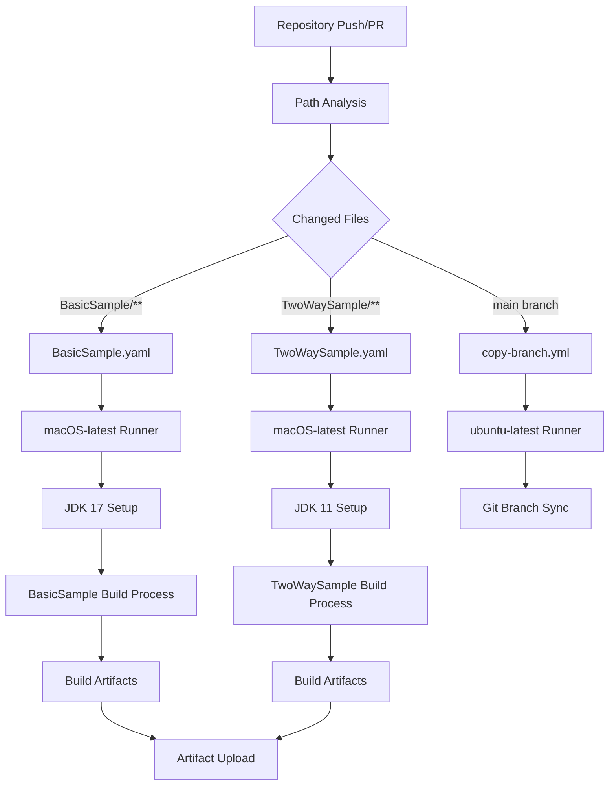
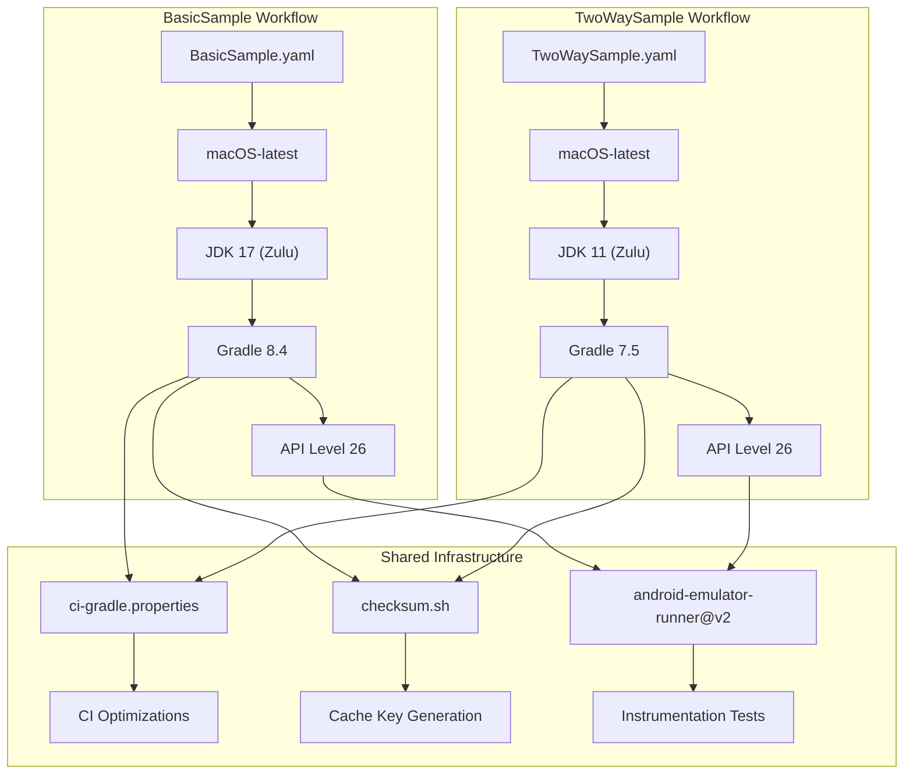
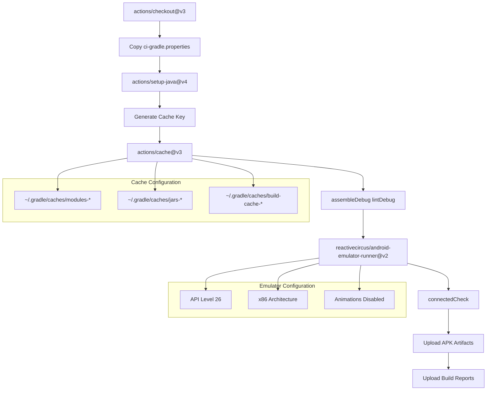
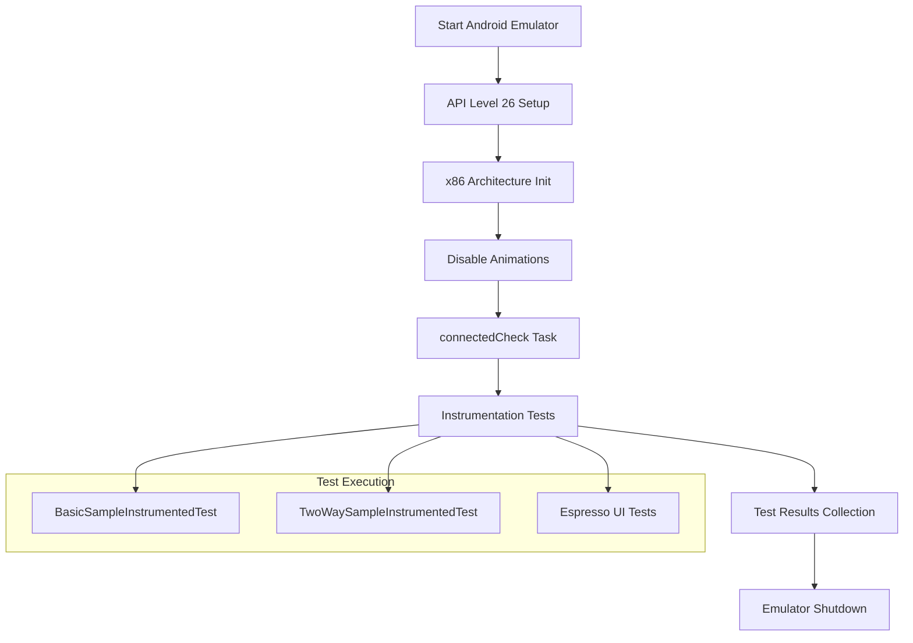
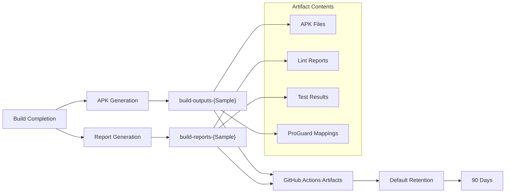
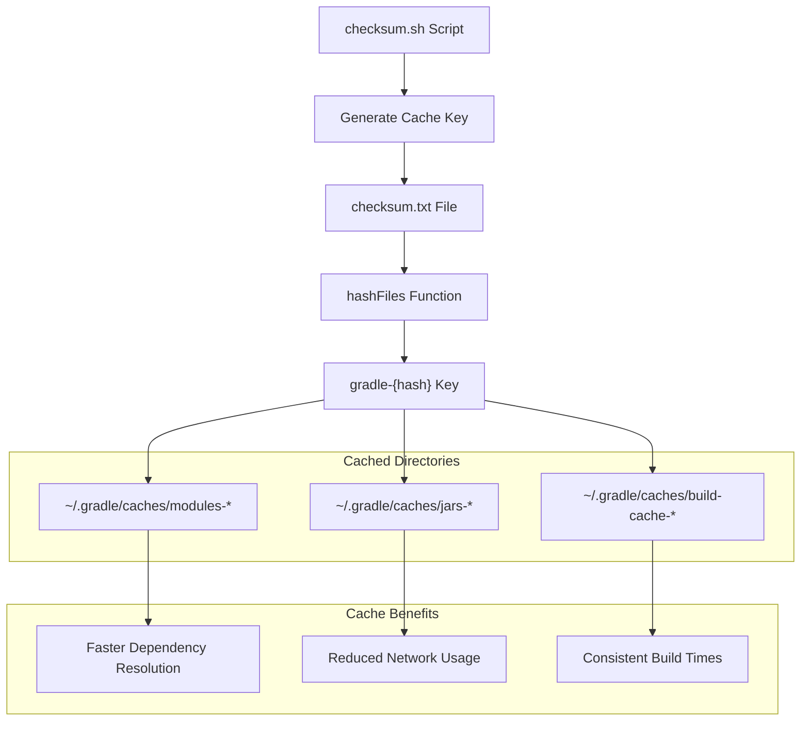
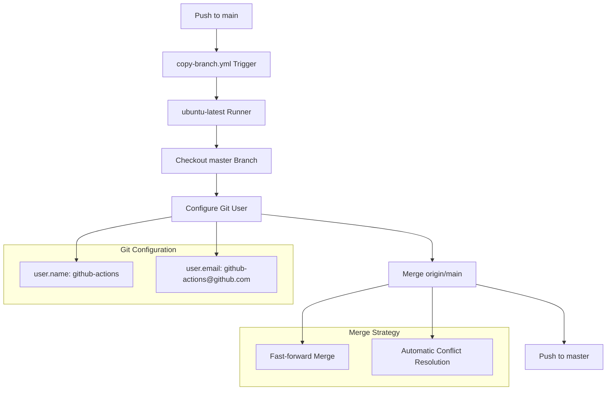

<!-- source: DeepWiki mcp.deepwiki.com · repo android/databinding-samples · page 4.2 CI/CD Pipelines · fetched 2026-10-23 -->

# CI/CD Pipelines

<details>
<summary>Relevant source files</summary>

The following files were used as context for generating this wiki page:

- [.github/ci-gradle.properties](.github/ci-gradle.properties)
- [.github/workflows/BasicSample.yaml](.github/workflows/BasicSample.yaml)
- [.github/workflows/TwoWaySample.yaml](.github/workflows/TwoWaySample.yaml)
- [.github/workflows/copy-branch.yml](.github/workflows/copy-branch.yml)

</details>


This document describes the continuous integration and continuous deployment (CI/CD) infrastructure for the Android Data Binding samples repository. The CI/CD system uses GitHub Actions to provide automated builds, testing, and artifact management for both sample applications, with sophisticated path-based triggering and environment-specific configurations.

For information about the Gradle build system configuration, see [4.1](#4.1). For details about development tools and utilities, see [4.3](#4.3).

## Overview

The CI/CD pipeline consists of three main GitHub Actions workflows that handle different aspects of the repository:

| Workflow | Purpose | Trigger Conditions |
|----------|---------|-------------------|
| `BasicSample.yaml` | Build and test BasicSample application | Changes to `BasicSample/**` or workflow file |
| `TwoWaySample.yaml` | Build and test TwoWaySample application | Changes to `TwoWaySample/**` or workflow file |
| `copy-branch.yml` | Maintain legacy master branch | Changes to main branch |

Each sample application has its own dedicated workflow with environment-specific configurations, ensuring optimal build performance and isolation between samples.

Sources: [.github/workflows/BasicSample.yaml:1-72](), [.github/workflows/TwoWaySample.yaml:1-71](), [.github/workflows/copy-branch.yml:1-32]()

## GitHub Actions Workflow Architecture

The CI/CD system uses a path-based triggering strategy to optimize build performance by only running workflows when relevant code changes occur.

### CI/CD Pipeline Flow



Sources: [.github/workflows/BasicSample.yaml:3-13](), [.github/workflows/TwoWaySample.yaml:3-13](), [.github/workflows/copy-branch.yml:7-9]()

### Sample-Specific Workflow Configuration



Sources: [.github/workflows/BasicSample.yaml:30-34](), [.github/workflows/TwoWaySample.yaml:30-34](), [.github/ci-gradle.properties:17-24]()

## Build Process Workflow

Each sample application follows a standardized build process with environment-specific configurations and comprehensive testing.

### Build Step Sequence



Sources: [.github/workflows/BasicSample.yaml:23-71](), [.github/workflows/TwoWaySample.yaml:23-71]()

### Build Steps Implementation

The build process consists of several key steps that ensure code quality and functionality:

| Step | Purpose | Implementation |
|------|---------|---------------|
| **Checkout** | Retrieve repository code | `actions/checkout@v3` |
| **CI Configuration** | Apply CI-optimized Gradle settings | Copy `.github/ci-gradle.properties` to `~/.gradle/` |
| **Java Setup** | Configure JDK environment | `actions/setup-java@v4` with Zulu distribution |
| **Cache Generation** | Create dependency cache key | Execute `./scripts/checksum.sh` |
| **Dependency Caching** | Cache Gradle dependencies | `actions/cache@v3` with generated key |
| **Build & Lint** | Compile and analyze code | `./gradlew assembleDebug lintDebug --stacktrace` |
| **Instrumentation Tests** | Run Android UI tests | `./gradlew connectedCheck --stacktrace` |
| **Artifact Upload** | Preserve build outputs | Upload APKs and reports |

Sources: [.github/workflows/BasicSample.yaml:47-71](), [.github/workflows/TwoWaySample.yaml:47-71]()

## Testing Infrastructure

The CI/CD system includes comprehensive testing infrastructure that runs both static analysis and instrumentation tests.

### Android Emulator Configuration

Both workflows use identical emulator configurations for consistent testing environments:

```yaml
api-level: 26
arch: x86
disable-animations: true
```

The emulator runs instrumentation tests using the `reactivecircus/android-emulator-runner@v2` action, which provides:
- Automated emulator lifecycle management
- Hardware acceleration support
- Consistent test environment isolation

Sources: [.github/workflows/BasicSample.yaml:52-58](), [.github/workflows/TwoWaySample.yaml:52-58]()

### Test Execution Process



Sources: [.github/workflows/BasicSample.yaml:51-58](), [.github/workflows/TwoWaySample.yaml:51-58]()

## Artifact Management

The CI/CD system preserves build artifacts and reports for debugging and distribution purposes.

### Artifact Upload Strategy

Each workflow uploads two types of artifacts with sample-specific naming:

| Artifact Type | BasicSample Name | TwoWaySample Name | Content |
|---------------|------------------|-------------------|---------|
| **Build Outputs** | `build-outputs-BasicSample` | `build-outputs-TwoWaySample` | APK files from `app/build/outputs` |
| **Build Reports** | `build-reports-BasicSample` | `build-reports-TwoWaySample` | Lint reports from `app/build/reports` |

The build reports are uploaded with the `if: always()` condition, ensuring they're preserved even when builds fail.

Sources: [.github/workflows/BasicSample.yaml:60-71](), [.github/workflows/TwoWaySample.yaml:60-71]()

### Artifact Retention Policy



Sources: [.github/workflows/BasicSample.yaml:60-71](), [.github/workflows/TwoWaySample.yaml:60-71]()

## CI Optimization Configuration

The CI/CD system uses specialized Gradle properties to optimize build performance in continuous integration environments.

### CI Gradle Properties

The [.github/ci-gradle.properties:17-24]() file contains CI-specific optimizations:

```properties
org.gradle.daemon=false
org.gradle.parallel=true
org.gradle.jvmargs=-Xmx5120m
org.gradle.workers.max=2
kotlin.incremental=false
kotlin.compiler.execution.strategy=in-process
```

| Property | Value | Purpose |
|----------|-------|---------|
| `org.gradle.daemon` | `false` | Disable daemon for consistent CI builds |
| `org.gradle.parallel` | `true` | Enable parallel project execution |
| `org.gradle.jvmargs` | `-Xmx5120m` | Allocate 5GB heap memory |
| `org.gradle.workers.max` | `2` | Limit worker threads for macOS runners |
| `kotlin.incremental` | `false` | Disable incremental compilation |
| `kotlin.compiler.execution.strategy` | `in-process` | Use in-process Kotlin compilation |

Sources: [.github/ci-gradle.properties:17-24]()

### Dependency Caching Strategy

The caching strategy uses a custom checksum generation script to create accurate cache keys:



Sources: [.github/workflows/BasicSample.yaml:36-45](), [.github/workflows/TwoWaySample.yaml:36-45]()

## Branch Management Workflow

The repository maintains backward compatibility with legacy tooling through automated branch synchronization.

### Legacy Branch Synchronization

The `copy-branch.yml` workflow maintains the legacy `master` branch by automatically synchronizing it with the `main` branch:



This workflow ensures that:
- Legacy systems referencing the `master` branch continue to work
- The `master` branch remains synchronized with current development
- No manual intervention is required for branch maintenance

Sources: [.github/workflows/copy-branch.yml:1-32]()

## Workflow Execution Environment

Both sample workflows use identical execution environments with 30-minute timeouts and macOS runners for optimal Android development tooling support.

### Environment Specifications

| Configuration | BasicSample | TwoWaySample |
|---------------|-------------|--------------|
| **Runner** | `macOS-latest` | `macOS-latest` |
| **Timeout** | 30 minutes | 30 minutes |
| **JDK Version** | 17 (Zulu) | 11 (Zulu) |
| **Java Action** | `actions/setup-java@v4` | `actions/setup-java@v3` |

The different JDK versions reflect the specific requirements of each sample application, with BasicSample using a more recent JDK version to demonstrate modern Android development practices.

Sources: [.github/workflows/BasicSample.yaml:20-34](), [.github/workflows/TwoWaySample.yaml:20-34]()

---

