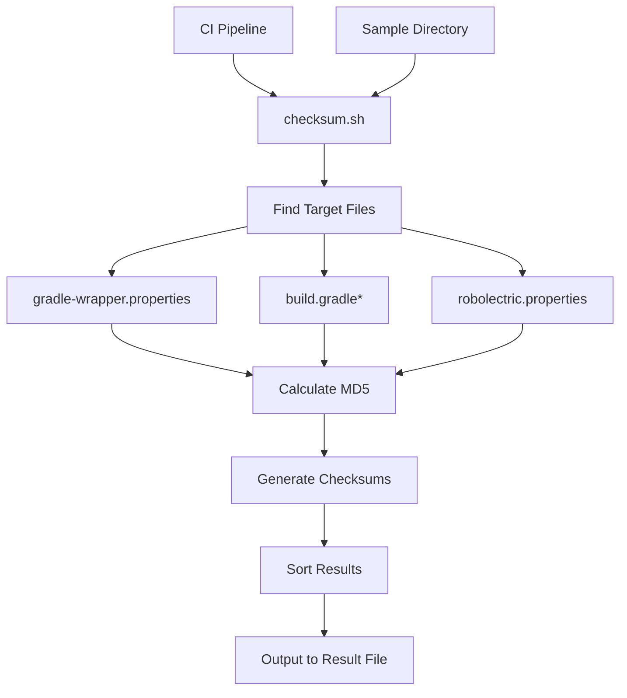
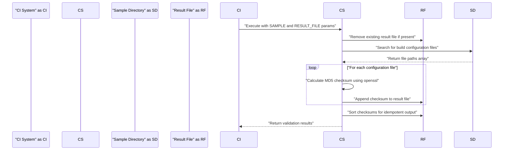
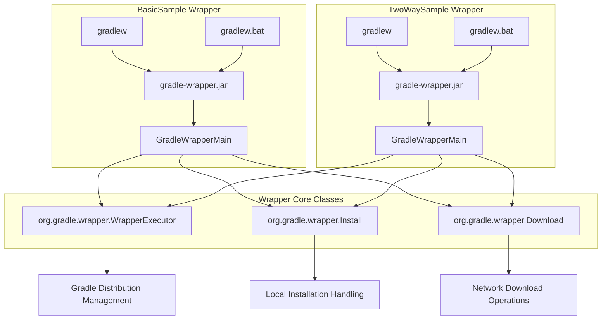
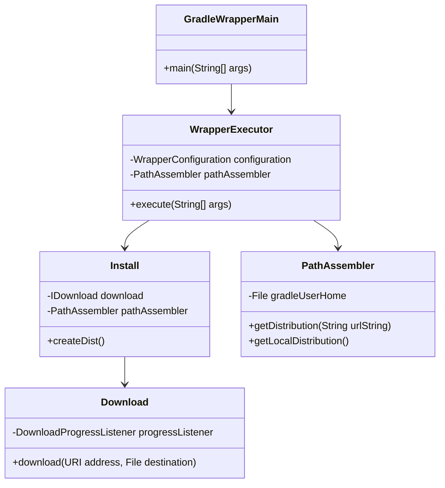
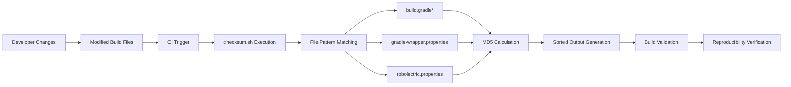
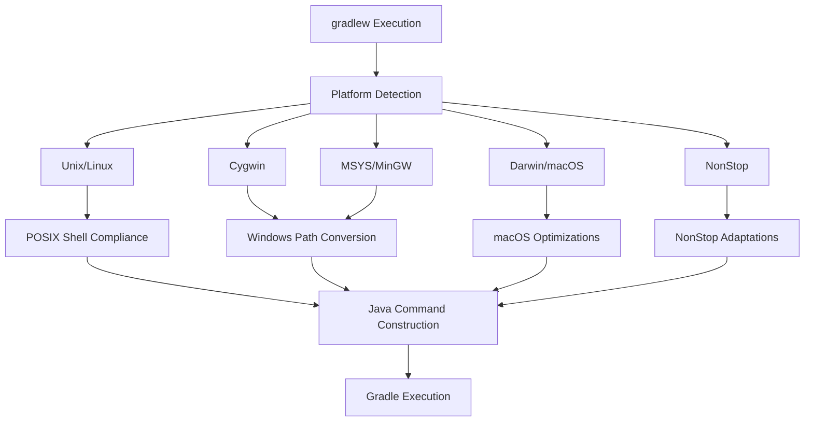

<!-- source: DeepWiki mcp.deepwiki.com · repo android/databinding-samples · page 4.3 Development Tools · fetched 2026-10-23 -->

# Development Tools

Relevant source files

The following files were used as context for generating this wiki page:

- [BasicSample/gradlew](BasicSample/gradlew)
- [TwoWaySample/gradle/wrapper/gradle-wrapper.jar](TwoWaySample/gradle/wrapper/gradle-wrapper.jar)
- [scripts/checksum.sh](scripts/checksum.sh)

This document covers the development utilities and tools that support consistent, reproducible builds across different platforms in the Android Data Binding samples repository. These tools ensure build environment consistency, validate build reproducibility, and provide cross-platform development support.

For information about the overall build system configuration, see [Gradle Configuration](#4.1). For CI/CD pipeline integration, see [CI/CD Pipelines](#4.2).

## Checksum Validation System

The repository includes a comprehensive checksum validation system designed to ensure build reproducibility by tracking changes to critical build configuration files.

### Checksum Script Architecture

The `checksum.sh` script implements a systematic approach to build validation:

- **File Discovery**: Uses `find` with multiple file patterns to locate build-critical files [scripts/checksum.sh:31-33]()
- **Hash Calculation**: Employs OpenSSL MD5 for consistent cross-platform hashing [scripts/checksum.sh:26-28]()
- **Deterministic Output**: Sorts results to ensure idempotent checksum generation [scripts/checksum.sh:39-40]()

### Validation Workflow

**Sources:** [scripts/checksum.sh:1-40]()

## Gradle Wrapper Infrastructure

The repository maintains separate Gradle wrapper configurations for each sample application, providing isolated and versioned build environments.

### Wrapper Component Architecture

### Cross-Platform Execution Scripts

The Unix/Linux wrapper script (`gradlew`) provides comprehensive cross-platform support:

- **Environment Detection**: Identifies operating system variants including Cygwin, MSYS, Darwin, and NonStop [BasicSample/gradlew:110-115]()
- **Java Discovery**: Implements fallback logic for locating Java executables across different system configurations [BasicSample/gradlew:121-140]()
- **Resource Management**: Handles file descriptor limits and system-specific optimizations [BasicSample/gradlew:143-159]()
- **Path Handling**: Converts between Unix and Windows path formats for cross-platform compatibility [BasicSample/gradlew:169-198]()

### Gradle Wrapper Class Hierarchy

**Sources:** [TwoWaySample/gradle/wrapper/gradle-wrapper.jar:1-556](), [BasicSample/gradlew:1-245]()

## Build Reproducibility Tools

The development tools implement multiple layers of build reproducibility to ensure consistent results across different environments and time periods.

### Checksum Integration Workflow

### File Pattern Detection

The checksum system targets specific file types critical for build reproducibility:

- **Gradle Build Scripts**: Captures both `build.gradle` and `build.gradle.kts` variations
- **Wrapper Configuration**: Monitors `gradle-wrapper.properties` for version consistency
- **Testing Configuration**: Tracks `robolectric.properties` for test environment stability

This selective monitoring ensures that only files affecting build determinism trigger validation workflows.

**Sources:** [scripts/checksum.sh:31-40]()

## Cross-Platform Development Support

The repository provides comprehensive cross-platform development support through standardized wrapper scripts and environment detection.

### Platform-Specific Adaptations

### Environment Variable Handling

The wrapper scripts implement sophisticated environment variable processing:

- **JVM Options**: Merges `DEFAULT_JVM_OPTS`, `JAVA_OPTS`, and `GRADLE_OPTS` with proper shell expansion [BasicSample/gradlew:237-242]()
- **Path Resolution**: Handles complex path resolution for different operating systems [BasicSample/gradlew:67-86]()
- **Resource Limits**: Manages system resource constraints like file descriptor limits [BasicSample/gradlew:143-159]()

This comprehensive environment handling ensures consistent build behavior regardless of the development platform or system configuration.

**Sources:** [BasicSample/gradlew:88-244]()

---

