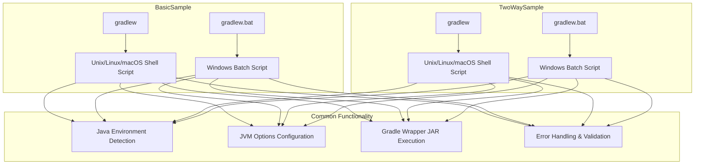
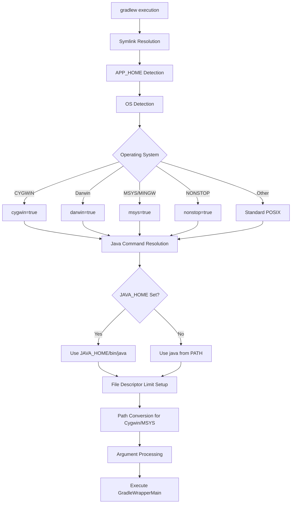
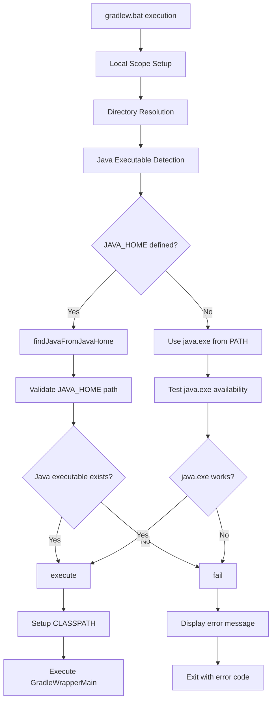

<!-- source: DeepWiki mcp.deepwiki.com · repo android/databinding-samples · page 4.4 Platform-Specific Build Scripts · fetched 2026-10-23 -->

# Platform-Specific Build Scripts

Relevant source files

The following files were used as context for generating this wiki page:

- [BasicSample/gradlew.bat](BasicSample/gradlew.bat)
- [TwoWaySample/gradlew](TwoWaySample/gradlew)
- [TwoWaySample/gradlew.bat](TwoWaySample/gradlew.bat)

This document covers the cross-platform Gradle wrapper scripts that provide consistent build system access across different operating systems. These scripts serve as the primary entry points for building both sample applications and handle platform-specific differences in script execution, path resolution, and Java environment detection.

For information about the underlying Gradle configuration and dependency management, see [Gradle Configuration](#4.1). For details about the broader CI/CD infrastructure that utilizes these scripts, see [CI/CD Pipelines](#4.2).

## Script Architecture Overview

The repository provides platform-specific Gradle wrapper scripts for both sample applications, ensuring consistent build behavior across Unix-like systems and Windows environments. Each sample maintains its own set of wrapper scripts to accommodate different Gradle versions and configurations.

### Gradle Wrapper Script Distribution

Sources: [TwoWaySample/gradlew:1-244](), [TwoWaySample/gradlew.bat:1-93](), [BasicSample/gradlew.bat:1-93]()

## Unix Shell Script Implementation

The Unix shell script implementation provides comprehensive cross-platform support for POSIX-compliant systems with extensive operating system detection and path handling capabilities.

### Shell Script Execution Flow

Sources: [TwoWaySample/gradlew:65-86](), [TwoWaySample/gradlew:110-115](), [TwoWaySample/gradlew:121-140](), [TwoWaySample/gradlew:169-198]()

### Operating System Detection and Handling

The shell script implements sophisticated operating system detection using the `uname` command to handle platform-specific requirements:

| Operating System | Detection Method | Special Handling |
|------------------|------------------|------------------|
| Cygwin | `uname` matches `CYGWIN*` | Path conversion to Windows format |
| macOS | `uname` matches `Darwin*` | File descriptor limit handling |
| MSYS/MinGW | `uname` matches `MSYS*` or `MINGW*` | Path conversion for Windows |
| NonStop | `uname` matches `NONSTOP*` | File descriptor limit exclusion |
| AIX | Java command detection | IBM JDK path handling |

The OS detection logic is implemented in [TwoWaySample/gradlew:110-115]() and drives platform-specific behavior throughout the script execution.

### Java Environment Resolution

The script implements a two-tier approach to Java executable detection:

1. **JAVA_HOME Priority**: If `JAVA_HOME` is set, the script validates the path and uses the Java executable from that location
2. **PATH Fallback**: If `JAVA_HOME` is not available, the script searches for `java` in the system PATH

Special handling for IBM JDK on AIX systems uses the path `$JAVA_HOME/jre/sh/java` instead of the standard `$JAVA_HOME/bin/java` location [TwoWaySample/gradlew:122-124]().

Sources: [TwoWaySample/gradlew:121-140]()

## Windows Batch Script Implementation

The Windows batch script provides equivalent functionality to the Unix shell script using Windows-specific commands and batch file syntax.

### Windows Script Architecture

Sources: [TwoWaySample/gradlew.bat:25-31](), [TwoWaySample/gradlew.bat:40-66](), [TwoWaySample/gradlew.bat:68-75]()

### Windows Path Resolution

The batch script implements Windows-specific path handling using batch file constructs:

- `%~dp0` extracts the drive and path from the script location [TwoWaySample/gradlew.bat:27]()
- `%%~fi` resolves relative paths to absolute paths [TwoWaySample/gradlew.bat:34]()
- Path normalization removes unnecessary `.` and `..` components

### Error Handling and Exit Codes

The Windows script implements comprehensive error handling with specific exit codes:

- **SUCCESS**: `ERRORLEVEL` 0 proceeds to `mainEnd` [TwoWaySample/gradlew.bat:79]()
- **FAILURE**: Sets `EXIT_CODE` to 1 if `ERRORLEVEL` is 0, otherwise preserves the original error code [TwoWaySample/gradlew.bat:84-85]()
- **CONSOLE MODE**: Respects `GRADLE_EXIT_CONSOLE` environment variable for script vs command-line return codes [TwoWaySample/gradlew.bat:86]()

Sources: [TwoWaySample/gradlew.bat:82-87]()

## JVM Configuration and Performance Tuning

Both platform implementations use identical JVM memory settings optimized for Gradle wrapper execution:

### Memory Configuration
- **Heap Size**: 64MB maximum and minimum (`-Xmx64m -Xms64m`)
- **Purpose**: Lightweight memory footprint for wrapper process
- **Location**: [TwoWaySample/gradlew:89](), [TwoWaySample/gradlew.bat:37]()

This configuration ensures the wrapper process itself consumes minimal memory while delegating the actual build execution to the Gradle daemon with its own memory settings.

### Environment Variable Integration

The scripts support standard Gradle environment variables:

| Variable | Purpose | Usage |
|----------|---------|-------|
| `DEFAULT_JVM_OPTS` | Base JVM options for wrapper | Set in script |
| `JAVA_OPTS` | Additional JVM options | User-configurable |
| `GRADLE_OPTS` | Gradle-specific options | User-configurable |

These variables are combined and passed to the Java process executing `org.gradle.wrapper.GradleWrapperMain` [TwoWaySample/gradlew:237-242](), [TwoWaySample/gradlew.bat:75]().

## Cross-Platform Compatibility Features

### Argument Processing and Quoting

The Unix shell script implements sophisticated argument processing to handle shell metacharacters and maintain argument separation:

1. **Quote Handling**: Uses `xargs` to parse quoted arguments while preserving spaces [TwoWaySample/gradlew:213-216]()
2. **Metacharacter Escaping**: Escapes shell metacharacters using `sed` pattern substitution [TwoWaySample/gradlew:240]()
3. **Argument Reconstruction**: Rebuilds the argument list using `eval` for safe execution [TwoWaySample/gradlew:237-242]()

### Path Conversion for Hybrid Environments

Special handling for Cygwin and MSYS environments ensures proper path conversion between Unix and Windows formats:

- **Cygwin Detection**: Converts Unix paths to Windows format using `cygpath` [TwoWaySample/gradlew:171-172]()
- **MSYS Handling**: Similar path conversion for MSYS2 environments [TwoWaySample/gradlew:170]()
- **Argument Conversion**: Selectively converts path-like arguments while preserving options [TwoWaySample/gradlew:177-197]()

Sources: [TwoWaySample/gradlew:169-198]()

---

