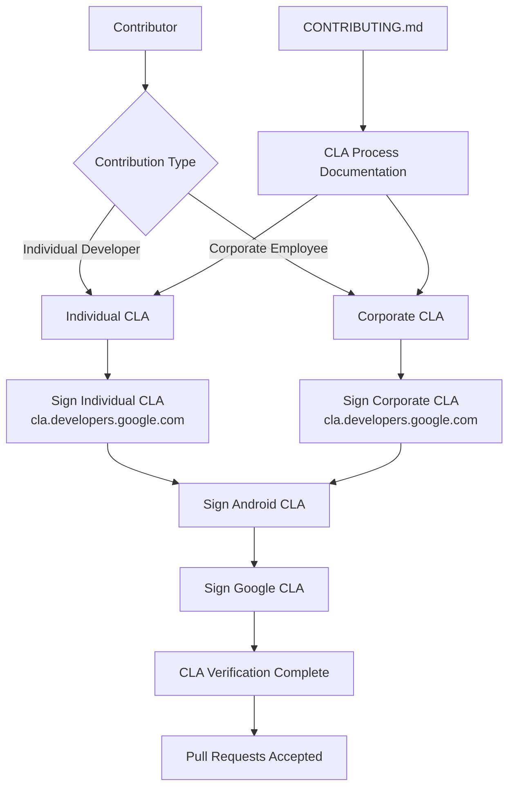
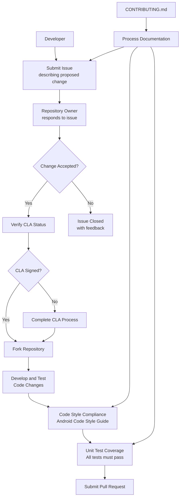
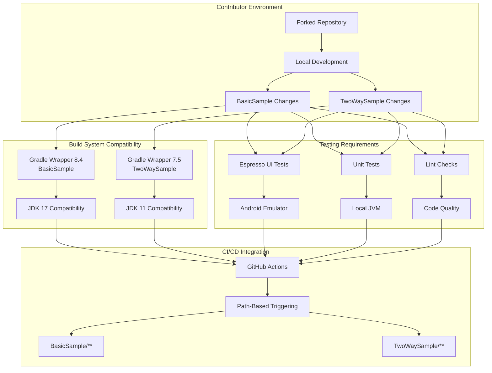
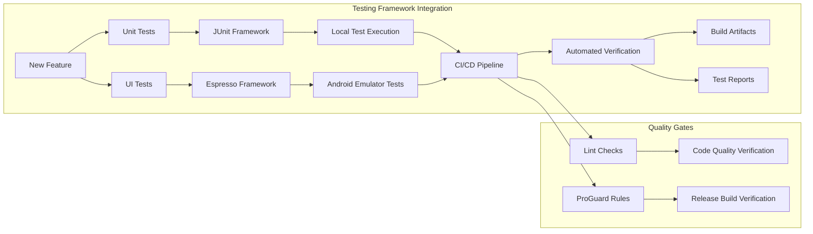
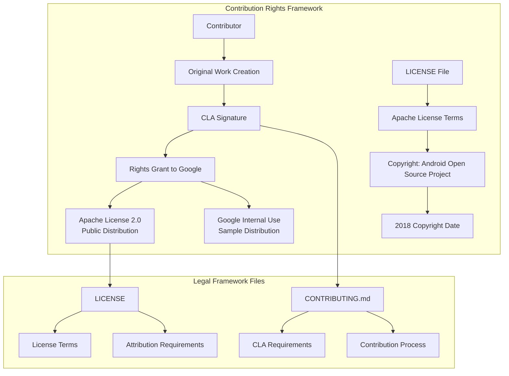
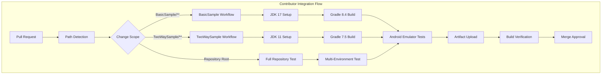

<!-- source: DeepWiki mcp.deepwiki.com · repo android/databinding-samples · page 5 Development and Contributing · fetched 2026-10-23 -->

# Development and Contributing

Relevant source files

The following files were used as context for generating this wiki page:

- [CONTRIBUTING.md](CONTRIBUTING.md)
- [LICENSE](LICENSE)

This document provides comprehensive guidance for developers who want to contribute to the Android Data Binding samples repository. It covers the legal framework, contribution processes, development standards, and integration with the project's CI/CD infrastructure.

This page focuses on the mechanics of contributing code and samples to the repository. For information about the build system infrastructure, see page [4](#4). For details about Google's internal sample packaging system, see page [5.1](#5.1).

## Legal Framework and Licensing

The repository operates under a dual licensing and contributor agreement structure managed by Google. All contributions must comply with both Android and Google Contributor License Agreements before code can be accepted.

### License Structure

The project is licensed under the Apache License 2.0 with Google as the copyright holder. The license provides broad permissions for use, modification, and distribution while maintaining proper attribution requirements.

| License Component | Details |
|------------------|---------|
| License Type | Apache License 2.0 |
| Copyright Holder | The Android Open Source Project (2018) |
| License File | [LICENSE:1-202]() |
| Attribution Requirements | Must retain copyright, patent, trademark notices |
| Redistribution Terms | Source and object form distribution permitted |

### Contributor License Agreement Requirements

Before any contributions can be accepted, contributors must complete the appropriate Contributor License Agreement process. The repository requires dual CLA compliance for both Android and Google projects.

**Sources:** [CONTRIBUTING.md:8-17](), [CONTRIBUTING.md:1-36]()

## Contribution Process Workflow

The contribution process follows a structured workflow that ensures code quality and proper legal compliance before integration into the main repository.

### Issue-Driven Development Process

All contributions must begin with an issue submission to establish communication with the repository maintainers and ensure the proposed changes align with project goals.

**Sources:** [CONTRIBUTING.md:22-35]()

### Code Quality and Style Requirements

The repository enforces strict adherence to Android development standards and requires comprehensive testing for all contributions.

| Requirement | Standard | Verification |
|------------|----------|--------------|
| Code Style | [Android Code Style Guide](https://source.android.com/source/code-style.html) | Manual review during PR |
| Testing Coverage | Unit tests for all functionality | Automated CI/CD verification |
| Existing Style Consistency | Match sample-specific patterns | Manual review |
| Documentation | Inline comments and README updates | Manual review |

**Sources:** [CONTRIBUTING.md:29-34]()

## Development Environment Integration

Contributors must work within the established development environment to ensure consistency with the project's build and testing infrastructure.

### Repository Fork and Development Setup

The development process requires forking the repository and maintaining compatibility with the existing build system configuration.

**Sources:** [CONTRIBUTING.md:28](), CI/CD configuration from system analysis

## Code Contribution Standards

### Sample Application Contribution Guidelines

When contributing to either BasicSample or TwoWaySample, developers must maintain the educational progression and architectural patterns established in each application.

| Sample Application | Contribution Focus | Architecture Requirements |
|-------------------|-------------------|--------------------------|
| BasicSample | Foundational data binding concepts | Observable patterns, ViewModel integration |
| TwoWaySample | Advanced two-way binding | Complex ViewModels, inverse binding adapters |

### Testing Integration Requirements

All contributions must include appropriate test coverage that integrates with the existing testing framework infrastructure.

**Sources:** [CONTRIBUTING.md:34](), Testing infrastructure from system analysis

## Legal Compliance and Attribution

### Apache License 2.0 Compliance

All contributions become part of the Apache License 2.0 licensed codebase and must comply with the license terms for redistribution and modification.

The license grants broad rights while requiring proper attribution and notice preservation:

- **Copyright License**: Perpetual, worldwide, non-exclusive rights to reproduce, modify, and distribute
- **Patent License**: Protection for contributors and users against patent litigation
- **Attribution Requirements**: Preservation of copyright, patent, and trademark notices
- **Redistribution Terms**: Requirements for license inclusion and modification notices

### Contribution Ownership and Rights

Contributors retain ownership of their contributions while granting necessary rights to the project under the Apache License 2.0 framework.

**Sources:** [LICENSE:189-201](), [CONTRIBUTING.md:5-20]()

## Integration with Project Infrastructure

### CI/CD Pipeline Integration

Contributor changes automatically integrate with the sophisticated CI/CD infrastructure that provides automated testing and verification across multiple environments.

The CI/CD system uses path-based triggering to optimize build times and resource usage:

- **BasicSample contributions**: Trigger JDK 17 builds with Gradle 8.4
- **TwoWaySample contributions**: Trigger JDK 11 builds with Gradle 7.5
- **Repository-wide changes**: Trigger comprehensive testing across both samples

### Artifact Generation and Preservation

The CI/CD system generates and preserves build artifacts for debugging and verification purposes, ensuring that contributor changes can be thoroughly tested and validated.

**Sources:** CI/CD configuration analysis, [CONTRIBUTING.md:28-35]()

---

