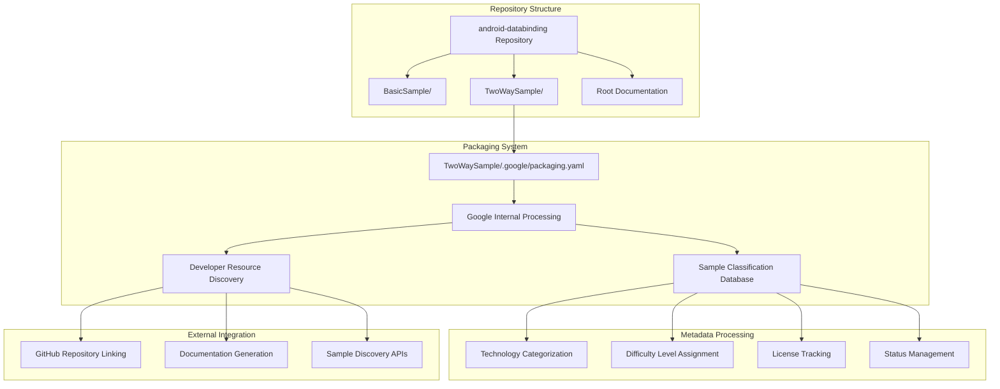
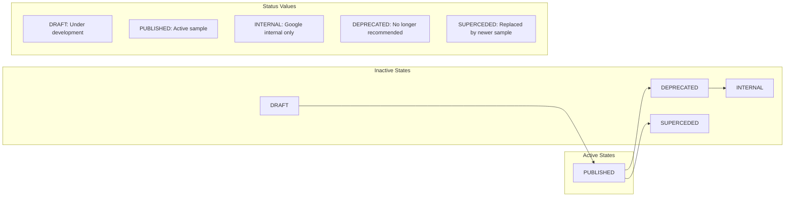
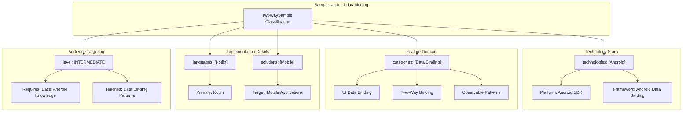
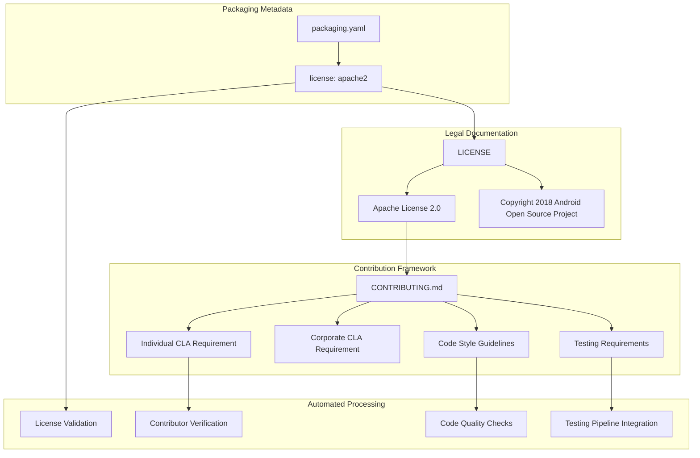
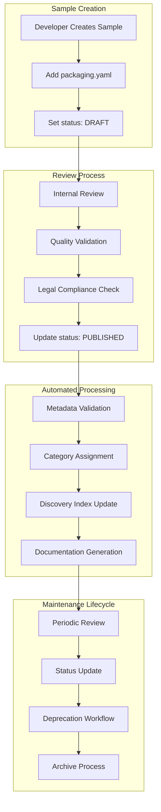

<!-- source: DeepWiki mcp.deepwiki.com · repo android/databinding-samples · page 5.1 Sample Packaging and Metadata · fetched 2026-10-23 -->

# Sample Packaging and Metadata

Relevant source files

The following files were used as context for generating this wiki page:

- [CONTRIBUTING.md](CONTRIBUTING.md)
- [LICENSE](LICENSE)
- [TwoWaySample/.google/packaging.yaml](TwoWaySample/.google/packaging.yaml)

This document explains Google's internal sample packaging system and metadata management framework used for the Android Data Binding samples repository. This system provides structured metadata for sample categorization, lifecycle management, and automated processing within Google's developer resources infrastructure.

For information about the build system and CI/CD infrastructure, see [Build System and Infrastructure](#4). For details about contributing guidelines and legal requirements, see [Development and Contributing](#5).

## Google Sample Packaging System

Google maintains an internal sample packaging system that uses YAML-based metadata files to classify, track, and manage sample code repositories across the developer ecosystem. This system enables automated discovery, categorization, and lifecycle management of educational code samples.

The packaging system operates independently of the sample code itself and serves Google's internal processes for maintaining developer resources. End users and external contributors can safely ignore these files as they have no impact on building or running the sample applications.

### Packaging Metadata Location

The packaging metadata is stored in `.google/packaging.yaml` files within individual sample directories. Currently, only the TwoWaySample application includes this metadata file, indicating it serves as the primary representative sample for the repository's packaging classification.

**Sources:** [TwoWaySample/.google/packaging.yaml:1-41]()

## Packaging Metadata Structure

The packaging YAML file follows a standardized schema with specific fields for sample classification and lifecycle management. Each field serves a distinct purpose in Google's sample management infrastructure.

### Core Metadata Fields

| Field | Purpose | Value Type | Example |
|-------|---------|------------|---------|
| `status` | Lifecycle state | Enum | `PUBLISHED` |
| `technologies` | Technical domains | Array | `[Android]` |
| `categories` | Feature classifications | Array | `[Data Binding]` |
| `languages` | Programming languages | Array | `[Kotlin]` |
| `solutions` | Solution domains | Array | `[Mobile]` |
| `github` | Repository identifier | String | `googlesamples/android-databinding` |
| `level` | Difficulty classification | Enum | `INTERMEDIATE` |
| `license` | Legal framework | Enum | `apache2` |

### Status Lifecycle Management

The `status` field controls the sample's visibility and lifecycle within Google's system:

**Sources:** [TwoWaySample/.google/packaging.yaml:21-25]()

### Classification Taxonomy

The metadata system uses a hierarchical classification approach to organize samples across multiple dimensions:

**Sources:** [TwoWaySample/.google/packaging.yaml:27-40]()

## Repository Integration Framework

The packaging system integrates with the repository's legal and governance framework to provide comprehensive metadata about licensing, contribution requirements, and maintenance status.

### Legal Framework Integration

The packaging metadata references the repository's legal framework through the `license` field, which connects to the formal license documentation:

**Sources:** [TwoWaySample/.google/packaging.yaml:38-40](), [LICENSE:1-202](), [CONTRIBUTING.md:1-36]()

### GitHub Repository Linking

The `github` field establishes the canonical connection between Google's internal sample database and the public repository:

| Metadata Field | Repository Element | Purpose |
|----------------|-------------------|---------|
| `github: googlesamples/android-databinding` | Public repository URL | External access point |
| `status: PUBLISHED` | Public visibility | Accessibility control |
| `level: INTERMEDIATE` | Target audience | Developer skill matching |

This linking enables automated synchronization between Google's internal sample management system and the public GitHub repository, ensuring consistency in sample discovery and documentation generation.

## Sample Management Workflow

The packaging metadata supports automated workflows for sample lifecycle management, quality assurance, and developer resource generation:

**Sources:** [TwoWaySample/.google/packaging.yaml:16-19]()

The packaging system ensures that sample repositories maintain consistent metadata, enabling efficient discovery and management of Google's extensive collection of developer educational resources while providing clear boundaries between internal tooling and public sample code.