# Page: Overview

# Overview

<details>
<summary>Relevant source files</summary>

The following files were used as context for generating this wiki page:

- [BasicSample/.google/packaging.yaml](BasicSample/.google/packaging.yaml)
- [README.md](README.md)

</details>


This document provides an overview of the Android Data Binding samples repository, which contains educational Android applications demonstrating the Android Data Binding Library. The repository consists of two progressively complex sample applications: BasicSample for foundational concepts and TwoWaySample for advanced patterns. For detailed information about the repository structure and setup, see [Repository Structure](#1.1) and [Getting Started](#1.2).

## Purpose and Educational Progression

The repository serves as a comprehensive educational resource for Android developers learning data binding concepts. The samples are designed with a clear progression from basic to advanced implementations, providing practical examples of data binding patterns and anti-patterns.

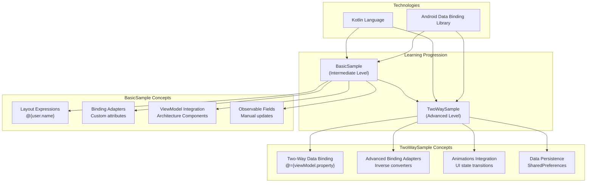

**Educational Progression Diagram**

Sources: [README.md:4-9](), [BasicSample/.google/packaging.yaml:28-37]()

## Repository Architecture

The repository contains two main sample applications with comprehensive build and testing infrastructure. Each sample targets different learning objectives and demonstrates specific data binding patterns.

| Sample | Level | Primary Focus | Key Demonstrations |
|--------|-------|---------------|-------------------|
| BasicSample | Intermediate | Foundation concepts | `ObservableFieldActivity`, `ViewModelActivity`, binding adapters |
| TwoWaySample | Advanced | Two-way binding | `IntervalTimerViewModel`, inverse binding, persistence |

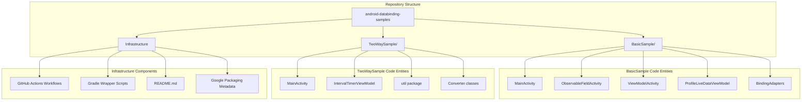

**Repository Architecture with Code Entities**

Sources: [README.md:8-9](), [BasicSample/.google/packaging.yaml:16-42]()

## Sample Application Characteristics

### BasicSample
- **Status**: Published (`PUBLISHED`)
- **Level**: Intermediate
- **Language**: Kotlin
- **Focus**: Layout expressions, binding adapters, ViewModel integration
- **Key Classes**: Activities demonstrating different data binding approaches

### TwoWaySample  
- **Level**: Advanced
- **Language**: Kotlin
- **Focus**: Two-way data binding, animations, converters, inverse converters
- **Key Classes**: Complex ViewModel implementations with bidirectional data flow

## Integration with Android Ecosystem

The repository references additional official Android samples that demonstrate data binding in production contexts:

- **Android Architecture Blueprints**: Data binding with architecture best practices
- **Android Architecture Components Samples**: Advanced patterns with Dagger and GitHub API
- **Android Sunflower**: Data binding within Android Jetpack ecosystem

## Issue Reporting and Support

Issues are categorized by component:

| Issue Type | Reporting Location |
|------------|-------------------|
| Sample code issues | GitHub repository issues |
| Build-related issues | Gradle Plugin issue tracker |
| Android Studio integration | Android Studio issue tracker |

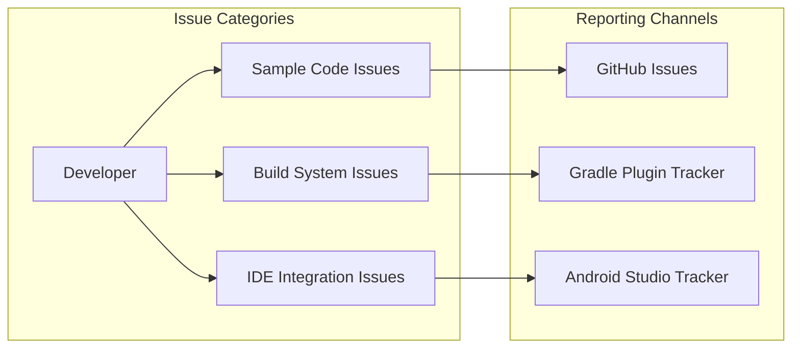

**Issue Reporting Flow**

Sources: [README.md:17-19]()

The repository serves as both a learning resource and a reference implementation for Android Data Binding Library usage patterns, with comprehensive infrastructure supporting continuous integration and educational content delivery.

Sources: [README.md:1-40](), [BasicSample/.google/packaging.yaml:1-42]()

---

# Page: Repository Structure

# Repository Structure

<details>
<summary>Relevant source files</summary>

The following files were used as context for generating this wiki page:

- [BasicSample/.google/packaging.yaml](BasicSample/.google/packaging.yaml)
- [BasicSample/README.md](BasicSample/README.md)
- [README.md](README.md)
- [TwoWaySample/README.md](TwoWaySample/README.md)

</details>


This document explains the organization of the Android Data Binding samples repository, detailing the structure and purpose of the two main sample applications and their educational progression. For information about getting started with the samples, see [Getting Started](#1.2). For details about the CI/CD infrastructure supporting these samples, see [CI/CD Pipelines](#4.2).

## Repository Organization

The repository is structured as an educational resource containing two distinct Android applications that demonstrate different aspects of the Android Data Binding Library. Each sample serves a specific learning purpose and targets different experience levels with data binding concepts.

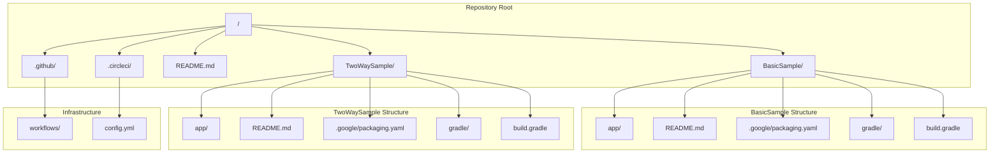

**Repository Structure Overview**

Sources: [README.md:1-40](), [BasicSample/.google/packaging.yaml:16-42]()

## BasicSample Application

BasicSample serves as the foundational learning resource for Android Data Binding, targeting developers with intermediate Android experience who are new to data binding concepts. The sample demonstrates core data binding features through a user profile interface.

### Educational Purpose and Scope

BasicSample teaches fundamental data binding concepts including layout variables, observability mechanisms, and integration with Android Architecture Components. The sample explicitly shows both problematic approaches and their improved solutions to guide developers away from common anti-patterns.

| Feature | Implementation | Purpose |
|---------|---------------|---------|
| Layout Variables | `@{user.name}` expressions | Replace findViewById calls |
| Observable Fields | `ObservableInt`, `ObservableField` | Automatic UI updates |
| LiveData Integration | `ProfileLiveDataViewModel` | Lifecycle-aware observability |
| ViewModel Architecture | `ViewModelActivity` | Best practice demonstration |
| Binding Adapters | `@BindingAdapter` annotations | Custom attribute creation |

### Code Structure Mapping

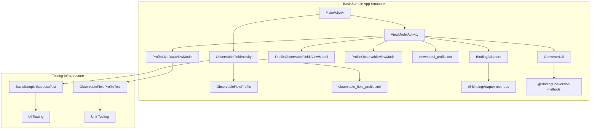

**BasicSample Code Organization**

The sample implements a progression from basic data binding to architectural best practices, with each activity demonstrating increasingly sophisticated approaches to data binding implementation.

Sources: [BasicSample/README.md:1-42](), [BasicSample/README.md:258-279]()

## TwoWaySample Application

TwoWaySample represents the advanced tier of data binding education, demonstrating complex two-way data binding patterns through an interval timer application. This sample targets developers who have mastered basic data binding concepts and need to implement sophisticated binding scenarios.

### Advanced Feature Demonstration

TwoWaySample focuses on complex binding patterns that require deep understanding of the data binding library's advanced capabilities, including custom binding adapters, inverse binding adapters, and complex data transformations.

| Advanced Feature | Implementation | Complexity Level |
|------------------|---------------|------------------|
| Two-Way Binding | `@={}` syntax with `@Bindable` properties | High |
| Inverse Binding | `@InverseBindingAdapter` with converters | Expert |
| Animation Binding | Custom adapters for view animations | Advanced |
| Multi-Parameter Adapters | `requireAll = true` binding adapters | Intermediate |
| Complex Converters | Bidirectional data transformation | Advanced |

### Application Architecture

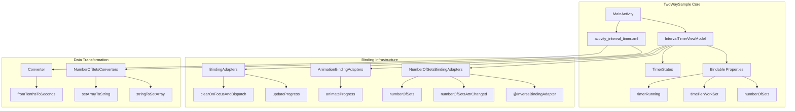

**TwoWaySample Architecture Mapping**

Sources: [TwoWaySample/README.md:1-42](), [TwoWaySample/README.md:172-195]()

## Learning Progression Design

The repository implements a deliberate educational progression from basic concepts to advanced implementation patterns. This structure allows developers to build competency incrementally while understanding both the theoretical foundations and practical applications of data binding.

### Skill Development Path

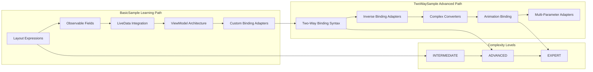

**Educational Progression Architecture**

| Sample | Target Level | Key Learning Outcomes |
|--------|-------------|----------------------|
| BasicSample | Intermediate | Foundation concepts, anti-pattern awareness, ViewModel integration |
| TwoWaySample | Advanced to Expert | Complex binding scenarios, custom adapter creation, performance optimization |

Sources: [BasicSample/.google/packaging.yaml:36-37](), [BasicSample/README.md:12-13](), [TwoWaySample/README.md:8-15]()

## Project Metadata and Packaging

Both samples include Google's internal packaging metadata system, indicating their status as officially maintained educational resources within the Android development ecosystem.

### Sample Classification

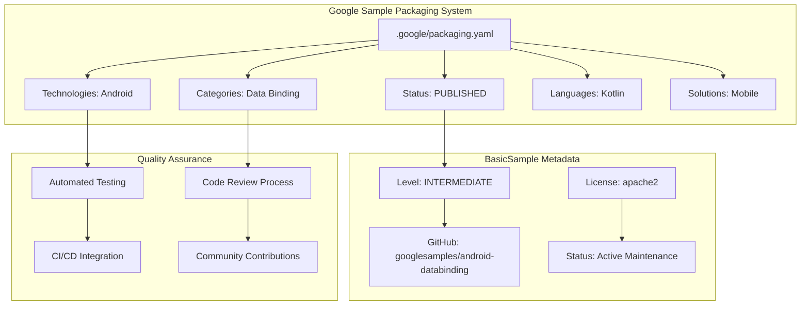

**Sample Packaging and Maintenance Structure**

The packaging metadata indicates these samples are maintained as part of Google's official sample repository system, with standardized categorization and quality assurance processes.

Sources: [BasicSample/.google/packaging.yaml:16-42]()

## Infrastructure Integration

The repository structure supports comprehensive development and maintenance workflows through integrated build systems, testing frameworks, and continuous integration pipelines. Each sample maintains independent build configurations while sharing common infrastructure patterns.

### Build System Architecture

| Component | BasicSample | TwoWaySample | Purpose |
|-----------|-------------|--------------|---------|
| Gradle Wrapper | Version 8.4 | Version 7.5 | Build reproducibility |
| Android Gradle Plugin | Current stable | Legacy stable | Compatibility testing |
| Data Binding | Enabled | Enabled | Core functionality |
| Testing Framework | Espresso + JUnit | Espresso + JUnit | Quality assurance |

The repository structure demonstrates production-ready Android development practices while maintaining educational clarity and progressive complexity in data binding implementation patterns.

Sources: [README.md:1-19](), [BasicSample/README.md:258-279](), [TwoWaySample/README.md:183-200]()

---

# Page: Getting Started

# Getting Started

<details>
<summary>Relevant source files</summary>

The following files were used as context for generating this wiki page:

- [BasicSample/.google/packaging.yaml](BasicSample/.google/packaging.yaml)
- [CONTRIBUTING.md](CONTRIBUTING.md)
- [LICENSE](LICENSE)
- [README.md](README.md)

</details>


This document provides the essential setup and configuration steps needed to run the Android Data Binding sample applications. It covers prerequisites, repository setup, and the initial steps to explore both BasicSample and TwoWaySample applications.

For detailed information about the repository structure and sample progression, see [Repository Structure](#1.1). For specific implementation details of each sample, see [BasicSample Application](#2) and [TwoWaySample Application](#3).

## Prerequisites

Before working with the Android Data Binding samples, ensure your development environment meets the following requirements:

### Development Environment
- **Android Studio**: Latest stable version with Android Data Binding support
- **Android SDK**: Compatible SDK versions as specified in each sample's build configuration
- **Kotlin**: Runtime support (samples are implemented in Kotlin)
- **Git**: For repository cloning and version control

### Android Data Binding Knowledge
The samples assume familiarity with basic Android development concepts. BasicSample is designed for intermediate developers, while TwoWaySample demonstrates advanced patterns.

**Sources:** [BasicSample/.google/packaging.yaml:36-37](), [README.md:8-9]()

## Repository Setup

### Initial Repository Access

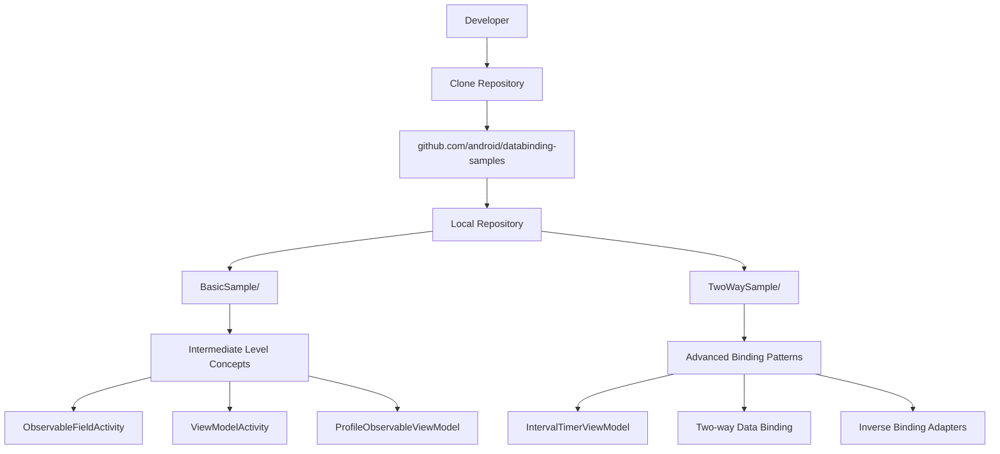

The repository contains two primary sample applications organized as separate Android projects within the main repository structure.

### Project Structure Overview

| Sample Application | Technology Stack | Complexity Level | Primary Focus |
|-------------------|------------------|------------------|---------------|
| BasicSample | Kotlin, Android Data Binding | Intermediate | Layout expressions, binding adapters, ViewModels |
| TwoWaySample | Kotlin, Android Data Binding | Advanced | Two-way binding, converters, animations |

**Sources:** [README.md:6-9](), [BasicSample/.google/packaging.yaml:28-37]()

## Running the Sample Applications

### BasicSample Execution

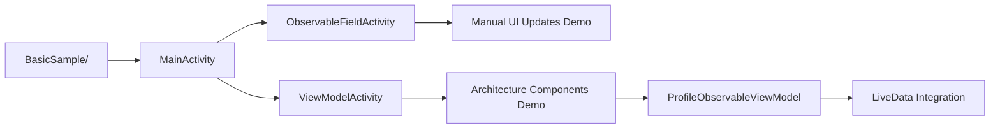

BasicSample demonstrates foundational data binding concepts through multiple activity implementations. The application provides entry points to different binding approaches, from basic observable fields to architecture component integration.

### TwoWaySample Execution

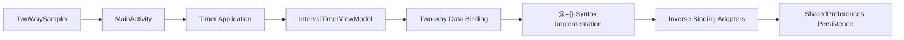

TwoWaySample implements a complete interval timer application showcasing advanced two-way data binding patterns with state persistence and complex ViewModel interactions.

**Sources:** [README.md:8-9]()

## Development Environment Configuration

### Android Studio Setup

1. **Import Projects**: Each sample can be imported as a separate Android Studio project
2. **Data Binding Enable**: Verify data binding is enabled in module build configurations
3. **Kotlin Support**: Ensure Kotlin plugin is active and properly configured

### Build System Requirements

The samples utilize standard Android Gradle build configurations with data binding enabled. Each sample maintains its own build setup optimized for demonstrating specific data binding features.

### Testing Environment

Both samples include comprehensive testing frameworks:
- **Espresso UI Tests**: For data binding interface validation
- **Unit Tests**: For ViewModel and data layer testing

**Sources:** [README.md:8-9]()

## Sample Application Navigation

### Learning Path Progression

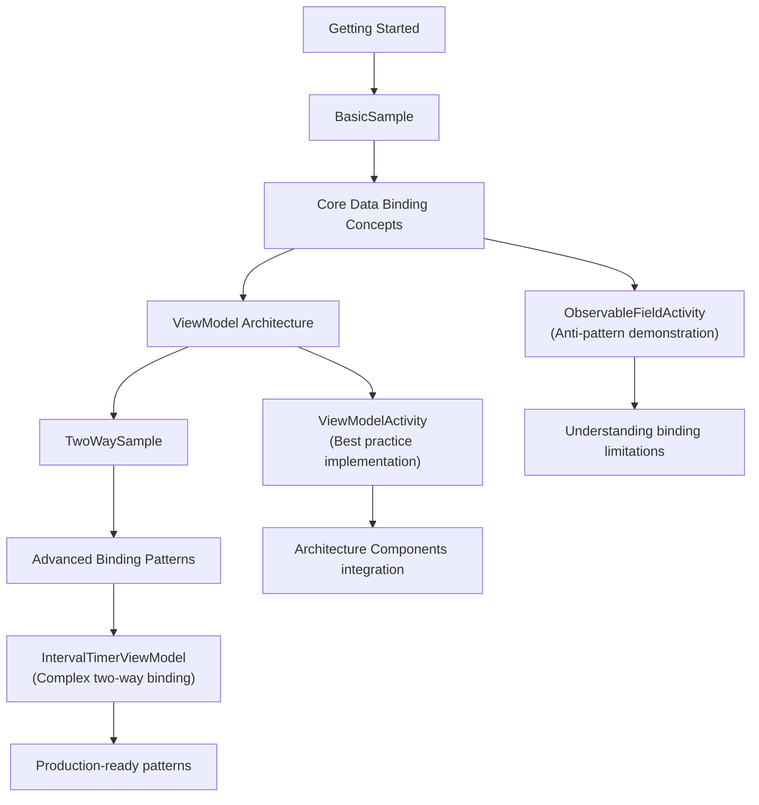

The samples are designed with educational progression in mind. Start with BasicSample to understand fundamental concepts, then advance to TwoWaySample for complex implementation patterns.

### Next Steps

After completing the initial setup:

1. **Explore BasicSample**: Begin with `MainActivity` to understand the sample structure
2. **Study Binding Implementations**: Examine different activity implementations for various binding approaches
3. **Advance to TwoWaySample**: Progress to advanced patterns after mastering basic concepts
4. **Review Testing Strategies**: Examine the testing frameworks implemented in both samples

For detailed implementation analysis, proceed to [BasicSample Application](#2) documentation.

**Sources:** [README.md:1-15](), [BasicSample/.google/packaging.yaml:21-41]()

---

# Page: BasicSample Application

# BasicSample Application

<details>
<summary>Relevant source files</summary>

The following files were used as context for generating this wiki page:

- [BasicSample/README.md](BasicSample/README.md)
- [BasicSample/app/build.gradle](BasicSample/app/build.gradle)

</details>


This document provides a comprehensive overview of the BasicSample application, which serves as the foundational learning module for Android Data Binding concepts. The BasicSample demonstrates core data binding features including layout expressions, observability patterns, and binding adapters through practical examples that progress from anti-patterns to best practices.

For advanced two-way data binding patterns, see [TwoWaySample Application](#3). For detailed build system configuration, see [Build System and Infrastructure](#4).

## Application Overview

The BasicSample application is an educational Android project that demonstrates fundamental data binding concepts through three distinct activity implementations. Each activity showcases different approaches to data binding, allowing developers to understand the evolution from basic implementations to architecture-compliant solutions.

The application presents a user profile interface where users can interact with profile data, demonstrating how data binding reduces boilerplate code and improves UI-data synchronization. The sample intentionally includes both recommended practices and documented anti-patterns to provide comprehensive learning opportunities.

### Application Architecture

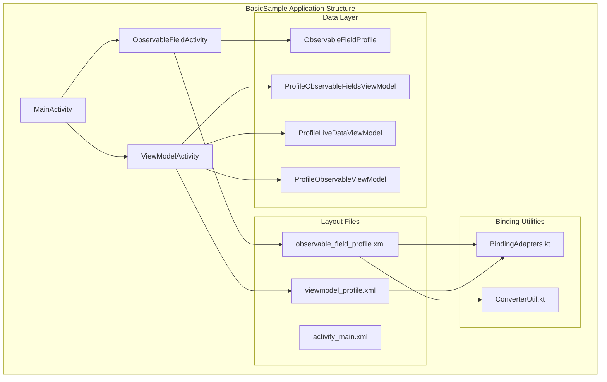

Sources: [BasicSample/README.md:1-299]()

### Data Binding Patterns Demonstrated

The BasicSample implements three distinct data binding approaches, each representing different levels of architectural sophistication:

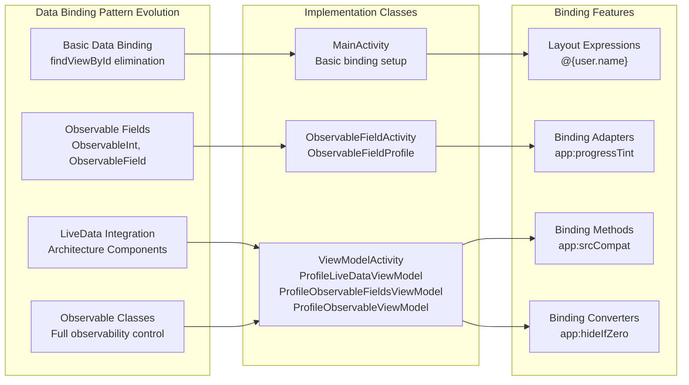

Sources: [BasicSample/README.md:19-257]()

## Application Structure

The BasicSample follows a clear progression from basic to advanced data binding concepts:

| Component | Purpose | Implementation Pattern |
|-----------|---------|----------------------|
| `MainActivity` | Entry point demonstrating basic data binding | findViewById elimination |
| `ObservableFieldActivity` | Shows reactive UI with observable fields | Anti-pattern demonstration |
| `ViewModelActivity` | Architecture Components integration | Best practice implementation |
| `ObservableFieldProfile` | Simple data model with observable fields | Direct field observation |
| `ProfileLiveDataViewModel` | Lifecycle-aware data management | LiveData integration |
| `ProfileObservableFieldsViewModel` | Observable field management | ViewModel pattern |
| `ProfileObservableViewModel` | Full observability control | Custom observable implementation |

### Build Configuration

The BasicSample application uses modern Android development practices with specific build configurations:

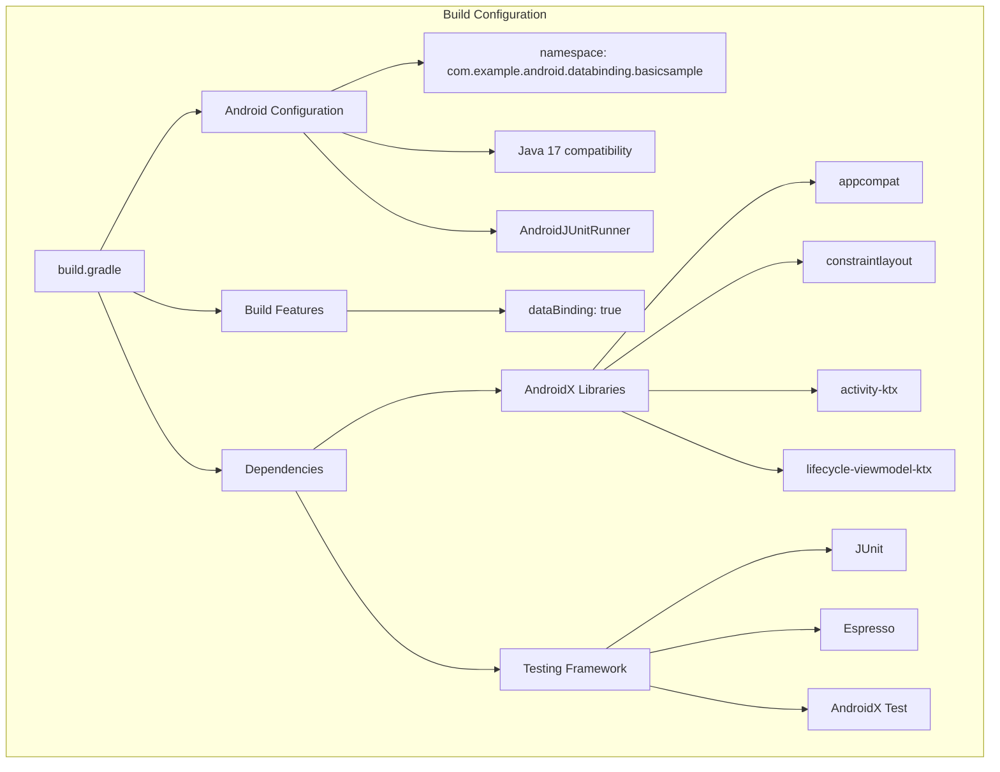

Sources: [BasicSample/app/build.gradle:23-65]()

Key build configuration elements:

- **Data Binding Enabled**: [BasicSample/app/build.gradle:42]() enables the data binding feature
- **Kotlin Support**: [BasicSample/app/build.gradle:19-21]() includes Kotlin Android plugin and kapt
- **Java 17 Compatibility**: [BasicSample/app/build.gradle:45-47]() sets source and target compatibility
- **Architecture Components**: [BasicSample/app/build.gradle:54-55]() includes lifecycle and activity dependencies
- **Testing Infrastructure**: [BasicSample/app/build.gradle:60-63]() provides comprehensive testing support

## Navigation to Detailed Documentation

The BasicSample application is documented across several specialized pages:

- **Core Data Binding Concepts** [#2.1](#2.1): Detailed analysis of `ObservableFieldActivity` implementation, including documented anti-patterns and the transition to better practices
- **ViewModel Architecture** [#2.2](#2.2): Comprehensive coverage of `ViewModelActivity` and the three ViewModel implementations showing Android Architecture Components integration  
- **Binding Utilities and Adapters** [#2.3](#2.3): Documentation of custom binding adapters, binding methods, and binding converters that extend data binding functionality
- **Testing Framework** [#2.4](#2.4): Espresso-based testing approach and strategies for testing data binding implementations
- **Application Configuration** [#2.5](#2.5): Android manifest structure and application-level configuration details

Sources: [BasicSample/README.md:1-299](), [BasicSample/app/build.gradle:1-66]()

---

# Page: Core Data Binding Concepts

# Core Data Binding Concepts

<details>
<summary>Relevant source files</summary>

The following files were used as context for generating this wiki page:

- [BasicSample/README.md](BasicSample/README.md)
- [BasicSample/app/src/main/java/com/example/android/databinding/basicsample/ui/ObservableFieldActivity.kt](BasicSample/app/src/main/java/com/example/android/databinding/basicsample/ui/ObservableFieldActivity.kt)
- [BasicSample/app/src/main/res/layout/observable_field_profile.xml](BasicSample/app/src/main/res/layout/observable_field_profile.xml)

</details>


This document covers the foundational data binding concepts demonstrated in the `ObservableFieldActivity`, including basic binding syntax, observable fields, and layout expressions. This activity intentionally showcases anti-patterns that are corrected in the ViewModel-based implementation. For information about proper ViewModel architecture and best practices, see [ViewModel Architecture](#2.2).

## Basic Data Binding Setup

The `ObservableFieldActivity` demonstrates the minimal setup required for Android Data Binding. The activity creates a binding instance and associates it with a data object containing observable fields.

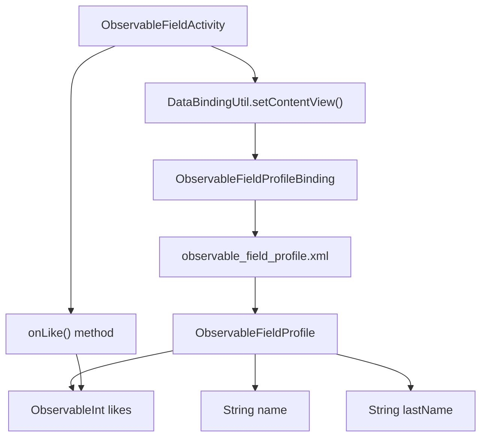

The activity follows this pattern:
1. Creates an `ObservableFieldProfile` instance with hardcoded data
2. Uses `DataBindingUtil.setContentView()` to inflate the layout and create the binding
3. Assigns the profile object to the binding's `user` variable

Sources: [BasicSample/app/src/main/java/com/example/android/databinding/basicsample/ui/ObservableFieldActivity.kt:37-44]()

## Observable Fields Pattern

The `ObservableFieldActivity` uses `ObservableInt` to automatically update the UI when the likes count changes. This demonstrates the core reactivity pattern in data binding.

| Observable Type | Purpose | Usage in Activity |
|----------------|---------|-------------------|
| `ObservableInt` | Tracks likes count | `ObservableInt(0)` |
| `String` | Static name data | `"Ada"` |
| `String` | Static lastName data | `"Lovelace"` |

The observable field automatically notifies the UI when its value changes through the `set()` method:

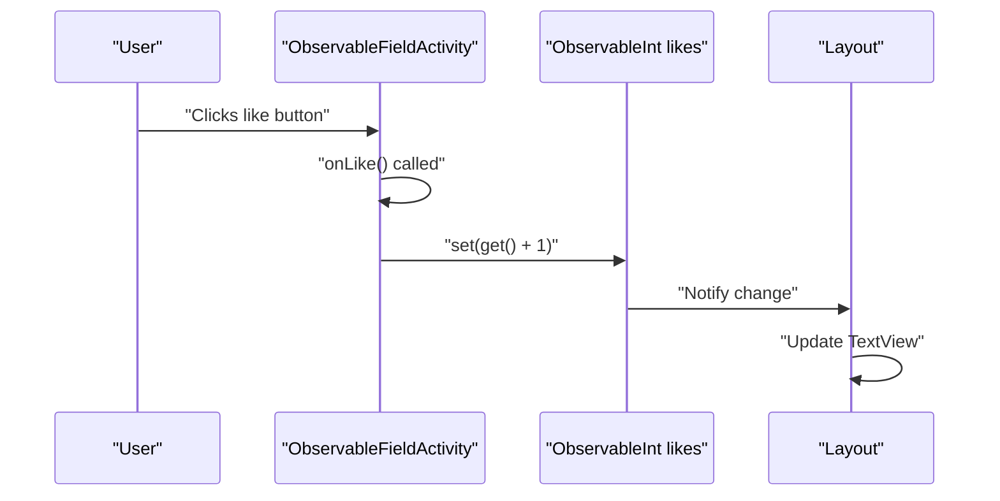

Sources: [BasicSample/app/src/main/java/com/example/android/databinding/basicsample/ui/ObservableFieldActivity.kt:37](), [BasicSample/app/src/main/java/com/example/android/databinding/basicsample/ui/ObservableFieldActivity.kt:52-54]()

## Layout Expressions and Binding Syntax

The layout demonstrates various data binding expression patterns, from simple property access to complex conditional logic.

### Basic Property Binding
Simple expressions bind data properties directly to view attributes:
- `android:text="@{user.name}"` - Direct property access
- `android:text="@{user.lastName}"` - Another property access
- `android:text="@{Integer.toString(user.likes)}"` - Type conversion

### Complex Conditional Expressions
The layout contains more complex expressions that demonstrate binding capabilities but represent anti-patterns:

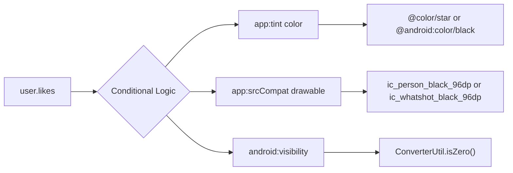

Sources: [BasicSample/app/src/main/res/layout/observable_field_profile.xml:44](), [BasicSample/app/src/main/res/layout/observable_field_profile.xml:57](), [BasicSample/app/src/main/res/layout/observable_field_profile.xml:82-83](), [BasicSample/app/src/main/res/layout/observable_field_profile.xml:91]()

## Anti-patterns Demonstrated

The `ObservableFieldActivity` intentionally demonstrates several anti-patterns that should be avoided in production code:

### Business Logic in Activity
The `onLike()` method places business logic directly in the activity:

| Anti-pattern | Location | Problem |
|-------------|----------|---------|
| Click handling | `android:onClick="onLike"` | Couples layout to activity |
| State manipulation | `onLike()` method | Business logic in UI layer |
| Data creation | `onCreate()` | Hardcoded data in activity |

### Complex Layout Expressions
The layout contains view logic that should be handled elsewhere:

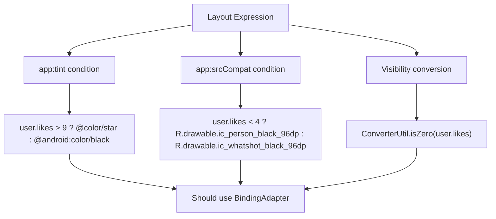

Sources: [BasicSample/app/src/main/res/layout/observable_field_profile.xml:63-67](), [BasicSample/app/src/main/res/layout/observable_field_profile.xml:99-101](), [BasicSample/app/src/main/res/layout/observable_field_profile.xml:82-83]()

## Binding Adapters and Custom Attributes

The activity includes a `BindingAdapter` that demonstrates how to extend data binding with custom attributes:

### ImageView Tint Binding Adapter
The `setImageTint()` function creates a custom `app:tint` attribute:

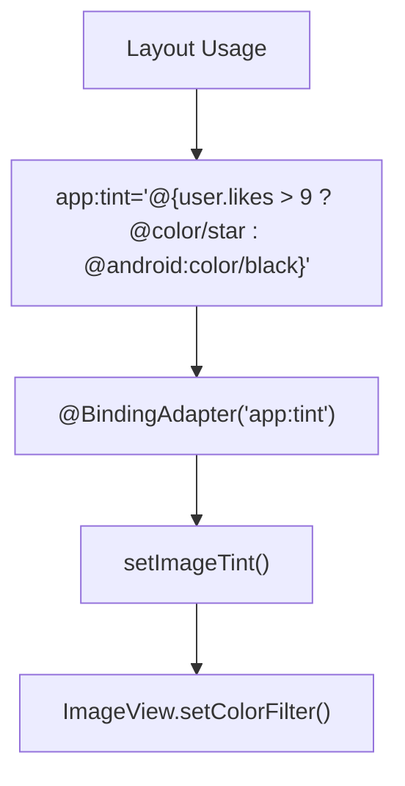

This binding adapter:
- Takes a `@ColorInt` parameter
- Applies the color using `setColorFilter()`
- Addresses compatibility issues with `AppCompatImageView`

Sources: [BasicSample/app/src/main/java/com/example/android/databinding/basicsample/ui/ObservableFieldActivity.kt:61-64](), [BasicSample/app/src/main/res/layout/observable_field_profile.xml:82]()

## BindingConverters and View Logic

The layout demonstrates `BindingConverters` through the `ConverterUtil.isZero()` method, which converts the likes count to a visibility boolean:

### Conversion Chain
```mermaid
sequenceDiagram
    participant L as "Layout"
    participant C as "ConverterUtil"
    participant B as "BindingConversion"
    participant V as "View"
    
    L->>C: "isZero(user.likes)"
    C->>B: "returns boolean"
    B->>B: "booleanToVisibility()"
    B->>V: "View.VISIBLE or View.GONE"
```

This pattern is identified as problematic because:
- `BindingConversions` apply globally to all boolean-to-int conversions
- Complex view logic should be handled by `BindingAdapters`
- The recommended solution uses a custom `app:hideIfZero` attribute

Sources: [BasicSample/app/src/main/res/layout/observable_field_profile.xml:164](), [BasicSample/app/src/main/res/layout/observable_field_profile.xml:150-154]()

## Data Binding Layout Structure

The layout file structure shows the essential components of a data binding layout:

```mermaid
graph TD
    A["<layout>"] --> B["<data>"]
    A --> C["<ConstraintLayout>"]
    
    B --> D["<import ConverterUtil>"]
    B --> E["<import R>"]
    B --> F["<variable user>"]
    
    C --> G["TextView name"]
    C --> H["TextView lastName"]
    C --> I["ImageView avatar"]
    C --> J["TextView likes"]
    C --> K["Button like_button"]
    C --> L["ProgressBar"]
    
    F --> G
    F --> H
    F --> I
    F --> J
    F --> L
```

The layout demonstrates:
- Import statements for utility classes and resources
- Variable declarations that connect to data objects
- Expression syntax using `@{}` for one-way binding
- Multiple view types with different binding patterns

Sources: [BasicSample/app/src/main/res/layout/observable_field_profile.xml:20-31](), [BasicSample/app/src/main/res/layout/observable_field_profile.xml:33-172]()

---

# Page: ViewModel Architecture

# ViewModel Architecture

<details>
<summary>Relevant source files</summary>

The following files were used as context for generating this wiki page:

- [BasicSample/app/src/main/java/com/example/android/databinding/basicsample/data/ProfileObservableViewModel.kt](BasicSample/app/src/main/java/com/example/android/databinding/basicsample/data/ProfileObservableViewModel.kt)
- [BasicSample/app/src/main/java/com/example/android/databinding/basicsample/ui/ViewModelActivity.kt](BasicSample/app/src/main/java/com/example/android/databinding/basicsample/ui/ViewModelActivity.kt)

</details>


## Purpose and Scope

This document covers the ViewModel architecture patterns demonstrated in the BasicSample application, specifically focusing on the integration of Android Architecture Components with Data Binding. The page details two distinct approaches for implementing ViewModels with data binding: the recommended LiveData approach and the alternative Observable fields approach.

For information about basic data binding concepts and observable patterns, see [Core Data Binding Concepts](#2.1). For details about binding utilities and custom adapters used with these ViewModels, see [Binding Utilities and Adapters](#2.3).

## ViewModel Architecture Overview

The BasicSample application demonstrates two distinct ViewModel architecture patterns that integrate with Android Data Binding, each with different approaches to state management and UI updates.

### ViewModel Architecture Patterns

```mermaid
graph TB
    subgraph "Activity Layer"
        ViewModelActivity["ViewModelActivity"]
    end
    
    subgraph "ViewModel Layer - LiveData Approach"
        ProfileLiveDataViewModel["ProfileLiveDataViewModel"]
        ProfileLiveDataViewModel --> MutableLiveData_name["_name: MutableLiveData&lt;String&gt;"]
        ProfileLiveDataViewModel --> MutableLiveData_lastName["_lastName: MutableLiveData&lt;String&gt;"]
        ProfileLiveDataViewModel --> MutableLiveData_likes["_likes: MutableLiveData&lt;Int&gt;"]
        ProfileLiveDataViewModel --> LiveData_popularity["popularity: LiveData&lt;Popularity&gt;"]
    end
    
    subgraph "ViewModel Layer - Observable Fields Approach"
        ProfileObservableViewModel["ProfileObservableViewModel"]
        ProfileObservableViewModel --> ObservableField_name["name: ObservableField&lt;String&gt;"]
        ProfileObservableViewModel --> ObservableField_lastName["lastName: ObservableField&lt;String&gt;"]
        ProfileObservableViewModel --> ObservableInt_likes["likes: ObservableInt"]
        ProfileObservableViewModel --> Bindable_popularity["@Bindable getPopularity()"]
    end
    
    subgraph "Data Binding Layer"
        ViewmodelProfileBinding["ViewmodelProfileBinding"]
    end
    
    subgraph "Layout Layer"
        viewmodel_profile_xml["viewmodel_profile.xml"]
    end
    
    ViewModelActivity --> ProfileLiveDataViewModel
    ViewModelActivity --> ViewmodelProfileBinding
    ViewmodelProfileBinding --> viewmodel_profile_xml
    ViewmodelProfileBinding --> ProfileLiveDataViewModel
    ViewmodelProfileBinding --> ProfileObservableViewModel
    
    MutableLiveData_likes --> LiveData_popularity
    ObservableInt_likes --> Bindable_popularity
```

**Sources:** [BasicSample/app/src/main/java/com/example/android/databinding/basicsample/data/ProfileObservableViewModel.kt:1-95](), [BasicSample/app/src/main/java/com/example/android/databinding/basicsample/ui/ViewModelActivity.kt:1-55]()

## LiveData ViewModel Implementation

The `ProfileLiveDataViewModel` class demonstrates the recommended approach using Android Architecture Components with LiveData for lifecycle-aware data binding.

### ProfileLiveDataViewModel Structure

| Component | Type | Purpose |
|-----------|------|---------|
| `_name` | `MutableLiveData<String>` | Private mutable name field |
| `_lastName` | `MutableLiveData<String>` | Private mutable last name field |
| `_likes` | `MutableLiveData<Int>` | Private mutable likes counter |
| `name` | `LiveData<String>` | Public immutable name exposure |
| `lastName` | `LiveData<String>` | Public immutable last name exposure |
| `likes` | `LiveData<Int>` | Public immutable likes exposure |
| `popularity` | `LiveData<Popularity>` | Computed property using transformation |

### LiveData Transformation Pattern

```mermaid
graph LR
    MutableLiveData_likes["_likes: MutableLiveData&lt;Int&gt;"] --> map_transformation["map() transformation"]
    map_transformation --> popularity_logic["popularity logic"]
    popularity_logic --> LiveData_popularity["popularity: LiveData&lt;Popularity&gt;"]
    
    subgraph "Popularity Calculation"
        popularity_logic --> condition1["likes > 9 → STAR"]
        popularity_logic --> condition2["likes > 4 → POPULAR"]  
        popularity_logic --> condition3["else → NORMAL"]
    end
    
    onLike_method["onLike()"] --> MutableLiveData_likes
```

The `ProfileLiveDataViewModel` uses LiveData transformations to automatically compute derived properties. The `popularity` field is calculated using the `map()` transformation function [BasicSample/app/src/main/java/com/example/android/databinding/basicsample/data/ProfileObservableViewModel.kt:44-50](), which automatically updates when the underlying `_likes` value changes.

**Sources:** [BasicSample/app/src/main/java/com/example/android/databinding/basicsample/data/ProfileObservableViewModel.kt:34-55]()

## Observable Fields ViewModel Implementation

The `ProfileObservableViewModel` class demonstrates an alternative approach using Observable fields with manual change notifications.

### ProfileObservableViewModel Structure

```mermaid
graph TB
    subgraph "ProfileObservableViewModel extends ObservableViewModel"
        ObservableField_name["name: ObservableField&lt;String&gt;"]
        ObservableField_lastName["lastName: ObservableField&lt;String&gt;"]
        ObservableInt_likes["likes: ObservableInt"]
        getPopularity_method["@Bindable getPopularity()"]
        onLike_method["onLike()"]
    end
    
    subgraph "Manual Notification Pattern"
        onLike_method --> increment_likes["likes.increment()"]
        increment_likes --> notifyPropertyChanged["notifyPropertyChanged(BR.popularity)"]
        notifyPropertyChanged --> getPopularity_method
    end
    
    subgraph "Popularity Enum"
        Popularity_NORMAL["NORMAL"]
        Popularity_POPULAR["POPULAR"] 
        Popularity_STAR["STAR"]
    end
    
    getPopularity_method --> Popularity_NORMAL
    getPopularity_method --> Popularity_POPULAR
    getPopularity_method --> Popularity_STAR
```

### Key Implementation Details

The `ProfileObservableViewModel` requires manual change notifications using `notifyPropertyChanged(BR.popularity)` [BasicSample/app/src/main/java/com/example/android/databinding/basicsample/data/ProfileObservableViewModel.kt:71](). This is necessary because the `@Bindable` `getPopularity()` method depends on the `likes` field, but Data Binding cannot automatically detect this dependency.

| Method | Purpose | Implementation |
|--------|---------|----------------|
| `onLike()` | Increment likes counter | Calls `likes.increment()` and `notifyPropertyChanged(BR.popularity)` |
| `getPopularity()` | Calculate popularity level | Uses conditional logic based on likes count |
| `increment()` extension | Helper for ObservableInt | Extension function to increment value |

**Sources:** [BasicSample/app/src/main/java/com/example/android/databinding/basicsample/data/ProfileObservableViewModel.kt:63-84](), [BasicSample/app/src/main/java/com/example/android/databinding/basicsample/data/ProfileObservableViewModel.kt:92-94]()

## Activity Integration

The `ViewModelActivity` class demonstrates how to integrate ViewModels with Data Binding in an Activity.

### ViewModel Setup Process

```mermaid
sequenceDiagram
    participant Activity as "ViewModelActivity"
    participant ViewModelProvider as "ViewModels Delegate"
    participant DataBinding as "DataBindingUtil"
    participant Binding as "ViewmodelProfileBinding"
    participant ViewModel as "ProfileLiveDataViewModel"
    
    Activity->>ViewModelProvider: viewModels<ProfileLiveDataViewModel>()
    ViewModelProvider->>ViewModel: Create/Retrieve ViewModel
    Activity->>DataBinding: setContentView(R.layout.viewmodel_profile)
    DataBinding->>Binding: Create ViewmodelProfileBinding
    Activity->>Binding: binding.viewmodel = viewModel
    Activity->>Binding: binding.lifecycleOwner = this
    Binding->>ViewModel: Observe LiveData changes
```

### Critical Integration Steps

1. **ViewModel Acquisition**: Uses the `viewModels<ProfileLiveDataViewModel>()` delegate [BasicSample/app/src/main/java/com/example/android/databinding/basicsample/ui/ViewModelActivity.kt:39]()
2. **Data Binding Setup**: Creates binding using `DataBindingUtil.setContentView()` [BasicSample/app/src/main/java/com/example/android/databinding/basicsample/ui/ViewModelActivity.kt:45-46]()
3. **ViewModel Binding**: Assigns ViewModel to binding variable [BasicSample/app/src/main/java/com/example/android/databinding/basicsample/ui/ViewModelActivity.kt:49]()
4. **Lifecycle Owner**: Sets lifecycle owner for LiveData observation [BasicSample/app/src/main/java/com/example/android/databinding/basicsample/ui/ViewModelActivity.kt:52]()

The Activity includes a commented alternative showing how to use `ProfileObservableViewModel` instead [BasicSample/app/src/main/java/com/example/android/databinding/basicsample/ui/ViewModelActivity.kt:41-42]().

**Sources:** [BasicSample/app/src/main/java/com/example/android/databinding/basicsample/ui/ViewModelActivity.kt:34-54]()

## Architectural Comparison

### LiveData vs Observable Fields Approaches

| Aspect | ProfileLiveDataViewModel | ProfileObservableViewModel |
|--------|--------------------------|----------------------------|
| **Base Class** | `ViewModel()` | `ObservableViewModel()` |
| **State Management** | `MutableLiveData` / `LiveData` | `ObservableField` / `ObservableInt` |
| **Change Notifications** | Automatic via LiveData | Manual via `notifyPropertyChanged()` |
| **Lifecycle Awareness** | Built-in with LiveData | Requires lifecycle owner setup |
| **Derived Properties** | Automatic via `map()` transformations | Manual calculation with `@Bindable` |
| **Memory Leaks** | Prevented by lifecycle awareness | Requires careful lifecycle management |
| **Boilerplate Code** | Minimal | Higher due to manual notifications |

### Implementation Pattern Differences

```mermaid
graph TB
    subgraph "LiveData Pattern (Recommended)"
        LiveData_MutableLiveData["MutableLiveData (private)"]
        LiveData_LiveData["LiveData (public)"]
        LiveData_Transformation["Transformation.map()"]
        LiveData_AutoUpdate["Automatic UI Updates"]
        
        LiveData_MutableLiveData --> LiveData_LiveData
        LiveData_LiveData --> LiveData_Transformation
        LiveData_Transformation --> LiveData_AutoUpdate
    end
    
    subgraph "Observable Fields Pattern (Alternative)"
        Observable_ObservableField["ObservableField"]
        Observable_Bindable["@Bindable getter"]
        Observable_Manual["notifyPropertyChanged()"]
        Observable_ManualUpdate["Manual UI Updates"]
        
        Observable_ObservableField --> Observable_Bindable
        Observable_Bindable --> Observable_Manual
        Observable_Manual --> Observable_ManualUpdate
    end
```

The LiveData approach is recommended for new development because it provides automatic lifecycle awareness, reduces boilerplate code, and prevents common memory leak issues. The Observable fields approach is maintained for backwards compatibility and scenarios where more granular control over change notifications is required.

**Sources:** [BasicSample/app/src/main/java/com/example/android/databinding/basicsample/data/ProfileObservableViewModel.kt:30-84](), [BasicSample/app/src/main/java/com/example/android/databinding/basicsample/ui/ViewModelActivity.kt:27-32]()

---

# Page: Binding Utilities and Adapters

# Binding Utilities and Adapters

<details>
<summary>Relevant source files</summary>

The following files were used as context for generating this wiki page:

- [BasicSample/app/src/main/java/com/example/android/databinding/basicsample/data/ObservableFieldProfile.kt](BasicSample/app/src/main/java/com/example/android/databinding/basicsample/data/ObservableFieldProfile.kt)
- [BasicSample/app/src/main/java/com/example/android/databinding/basicsample/ui/MainActivity.kt](BasicSample/app/src/main/java/com/example/android/databinding/basicsample/ui/MainActivity.kt)
- [BasicSample/app/src/main/java/com/example/android/databinding/basicsample/util/BindingAdapters.kt](BasicSample/app/src/main/java/com/example/android/databinding/basicsample/util/BindingAdapters.kt)
- [BasicSample/app/src/main/java/com/example/android/databinding/basicsample/util/BindingConverters.kt](BasicSample/app/src/main/java/com/example/android/databinding/basicsample/util/BindingConverters.kt)
- [BasicSample/app/src/main/java/com/example/android/databinding/basicsample/util/BindingMethods.kt](BasicSample/app/src/main/java/com/example/android/databinding/basicsample/util/BindingMethods.kt)

</details>


This document covers the custom binding utilities and adapters implemented in the BasicSample application that extend Android Data Binding functionality beyond the built-in capabilities. These utilities demonstrate three key extension mechanisms: Binding Adapters, Binding Methods, and Binding Converters.

For information about the core data binding concepts and observable fields, see [Core Data Binding Concepts](#2.1). For ViewModel integration patterns, see [ViewModel Architecture](#2.2).

## Overview

The BasicSample implements three types of binding utilities that extend data binding functionality:

| Utility Type | Purpose | Implementation Location |
|---|---|---|
| Binding Adapters | Custom attributes for complex view logic | `BindingAdapters` object |
| Binding Methods | Map custom attributes to existing methods | `MyBindingMethods` class |
| Binding Converters | Automatic type conversions | `BindingConverters` object |

These utilities are located in the `com.example.android.databinding.basicsample.util` package and provide reusable functionality across multiple activities in the application.

## Binding Adapters

### Custom Attribute Implementations

The `BindingAdapters` object defines several custom attributes that handle complex view state management. The most comprehensive example is the `popularityIcon` adapter:

```kotlin
@BindingAdapter("app:popularityIcon")
@JvmStatic fun popularityIcon(view: ImageView, popularity: Popularity)
```

This adapter accepts a `Popularity` enum value and automatically sets both the image drawable and tint color based on the popularity level. The implementation demonstrates how binding adapters can encapsulate complex view logic that would otherwise require multiple lines of imperative code.

### Multi-Attribute Binding Adapters

The `setProgress` adapter showcases binding adapters that depend on multiple attributes:

```kotlin
@BindingAdapter(value = ["app:progressScaled", "android:max"], requireAll = true)
@JvmStatic fun setProgress(progressBar: ProgressBar, likes: Int, max: Int)
```

This adapter is called whenever either `app:progressScaled` or `android:max` changes, demonstrating how binding adapters can coordinate multiple attribute values to produce a single view update.

### Alternative to Binding Converters

The `hideIfZero` adapter provides an alternative approach to the binding converter pattern:

```kotlin
@BindingAdapter("app:hideIfZero")
@JvmStatic fun hideIfZero(view: View, number: Int)
```

This adapter is marked as "unused" in the code comments, illustrating how binding adapters can replace binding converters when more explicit control is preferred.

**Binding Adapters Architecture**

```mermaid
graph TB
    subgraph "BindingAdapters Object"
        PopularityIcon["popularityIcon()"]
        TintPopularity["tintPopularity()"]
        SetProgress["setProgress()"]
        HideIfZero["hideIfZero()"]
    end
    
    subgraph "Layout Attributes"
        AppPopularityIcon["app:popularityIcon"]
        AppProgressTint["app:progressTint"]
        AppProgressScaled["app:progressScaled"]
        AndroidMax["android:max"]
        AppHideIfZero["app:hideIfZero"]
    end
    
    subgraph "View Updates"
        ImageViewTint["ImageView tint + drawable"]
        ProgressBarTint["ProgressBar tint"]
        ProgressBarValue["ProgressBar progress"]
        ViewVisibility["View visibility"]
    end
    
    AppPopularityIcon --> PopularityIcon
    PopularityIcon --> ImageViewTint
    
    AppProgressTint --> TintPopularity
    TintPopularity --> ProgressBarTint
    
    AppProgressScaled --> SetProgress
    AndroidMax --> SetProgress
    SetProgress --> ProgressBarValue
    
    AppHideIfZero --> HideIfZero
    HideIfZero --> ViewVisibility
```

Sources: [BasicSample/app/src/main/java/com/example/android/databinding/basicsample/util/BindingAdapters.kt:33-104]()

## Binding Methods

### Attribute Mapping

The `MyBindingMethods` class demonstrates how to map custom attributes to existing view methods without writing custom adapter logic:

```kotlin
@BindingMethods(
    BindingMethod(type = ImageView::class,
                  attribute = "app:srcCompat",
                  method = "setImageResource"))
class MyBindingMethods
```

This binding method maps the `app:srcCompat` attribute (used by the support library for vector drawable compatibility) directly to the `setImageResource` method on `ImageView`. The code comments note that this is equivalent to writing a full binding adapter but with significantly less boilerplate.

### Binding Method vs Binding Adapter Trade-offs

The implementation includes comprehensive documentation explaining when to use binding methods versus binding adapters:

- **Binding Methods**: Use when mapping a custom attribute to an existing method with compatible parameter types
- **Binding Adapters**: Use when custom logic, type conversion, or multi-attribute coordination is required

**Binding Methods Flow**

```mermaid
graph LR
    subgraph "Layout Usage"
        SrcCompatAttr["app:srcCompat=@{drawable}"]
    end
    
    subgraph "MyBindingMethods Class"
        BindingMethodAnnotation["@BindingMethods"]
        BindingMethodConfig["BindingMethod configuration"]
    end
    
    subgraph "ImageView Method"
        SetImageResource["setImageResource()"]
    end
    
    SrcCompatAttr --> BindingMethodAnnotation
    BindingMethodAnnotation --> BindingMethodConfig
    BindingMethodConfig --> SetImageResource
```

Sources: [BasicSample/app/src/main/java/com/example/android/databinding/basicsample/util/BindingMethods.kt:24-43]()

## Binding Converters

### Automatic Type Conversion

The `BindingConverters` object implements automatic type conversion using the `@BindingConversion` annotation:

```kotlin
@BindingConversion
@JvmStatic fun booleanToVisibility(isNotVisible: Boolean): Int
```

This converter automatically transforms `Boolean` values to Android visibility constants (`View.VISIBLE` or `View.GONE`). The data binding system applies this conversion automatically whenever a boolean expression is bound to a visibility attribute.

### Converter Utility Functions

The `ConverterUtil` object provides utility functions that work in conjunction with binding converters:

```kotlin
@JvmStatic fun isZero(number: Int): Boolean
```

This utility function converts integer values to boolean, which then gets automatically converted to visibility through the binding converter chain. The typical usage pattern combines both utilities:

```
android:visibility="@{ConverterUtil.isZero(viewmodel.likes)}"
```

### Converter Chain Processing

The implementation demonstrates a two-step conversion process:
1. `Int` → `Boolean` (via `ConverterUtil.isZero`)
2. `Boolean` → `Int` (via `BindingConverters.booleanToVisibility`)

This chain allows complex expressions in layout files while maintaining clean separation of concerns.

**Binding Converters Data Flow**

```mermaid
graph TD
    subgraph "Layout Expression"
        LayoutExpr["android:visibility=@{ConverterUtil.isZero(likes)}"]
    end
    
    subgraph "ConverterUtil"
        IsZeroMethod["isZero(Int): Boolean"]
    end
    
    subgraph "BindingConverters"
        BoolToVisibility["booleanToVisibility(Boolean): Int"]
    end
    
    subgraph "View System"
        ViewVisibilityProperty["View.visibility property"]
    end
    
    LayoutExpr --> IsZeroMethod
    IsZeroMethod --> BoolToVisibility
    BoolToVisibility --> ViewVisibilityProperty
    
    subgraph "Data Types"
        IntType["Int (likes count)"]
        BoolType["Boolean (isZero result)"]
        VisibilityInt["Int (VISIBLE/GONE)"]
    end
    
    IntType --> IsZeroMethod
    IsZeroMethod --> BoolType
    BoolType --> BoolToVisibility
    BoolToVisibility --> VisibilityInt
```

Sources: [BasicSample/app/src/main/java/com/example/android/databinding/basicsample/util/BindingConverters.kt:31-50]()

## Integration with Data Binding System

### Automatic Registration

All three binding utility types are automatically discovered and registered by the data binding annotation processor. No explicit registration is required - the presence of the appropriate annotations (`@BindingAdapter`, `@BindingMethods`, `@BindingConversion`) in the classpath is sufficient.

### Usage in Layout Files

The binding utilities enable declarative expressions in layout XML that would otherwise require imperative code in activities or fragments. For example, the popularity icon binding adapter allows:

```xml
app:popularityIcon="@{viewmodel.popularity}"
```

Instead of requiring manual drawable and tint management in the activity code.

### Scope and Lifecycle

These binding utilities are stateless and thread-safe, designed to be called from the main thread during data binding evaluation. They receive the current attribute values and produce immediate view updates without maintaining internal state.

**Complete Binding Utilities System**

```mermaid
graph TB
    subgraph "Binding System Components"
        BindingAdaptersObj["BindingAdapters object"]
        MyBindingMethodsClass["MyBindingMethods class"]
        BindingConvertersObj["BindingConverters object"]
        ConverterUtilObj["ConverterUtil object"]
    end
    
    subgraph "Annotation Types"
        BindingAdapterAnnotation["@BindingAdapter"]
        BindingMethodsAnnotation["@BindingMethods"]
        BindingConversionAnnotation["@BindingConversion"]
    end
    
    subgraph "Layout Integration"
        CustomAttributes["app:popularityIcon, app:progressTint, app:srcCompat"]
        VisibilityExpressions["android:visibility expressions"]
        StandardAttributes["android:max, android:progress"]
    end
    
    subgraph "View Updates"
        ImageViewUpdates["ImageView drawable + tint"]
        ProgressBarUpdates["ProgressBar progress + tint"]
        ViewVisibilityUpdates["View visibility state"]
    end
    
    BindingAdaptersObj --> BindingAdapterAnnotation
    MyBindingMethodsClass --> BindingMethodsAnnotation
    BindingConvertersObj --> BindingConversionAnnotation
    
    BindingAdapterAnnotation --> CustomAttributes
    BindingMethodsAnnotation --> CustomAttributes
    BindingConversionAnnotation --> VisibilityExpressions
    
    CustomAttributes --> ImageViewUpdates
    CustomAttributes --> ProgressBarUpdates
    VisibilityExpressions --> ViewVisibilityUpdates
    StandardAttributes --> ProgressBarUpdates
```

Sources: [BasicSample/app/src/main/java/com/example/android/databinding/basicsample/util/BindingAdapters.kt:33-104](), [BasicSample/app/src/main/java/com/example/android/databinding/basicsample/util/BindingMethods.kt:24-43](), [BasicSample/app/src/main/java/com/example/android/databinding/basicsample/util/BindingConverters.kt:31-50]()

---

# Page: Testing Framework

# Testing Framework

<details>
<summary>Relevant source files</summary>

The following files were used as context for generating this wiki page:

- [BasicSample/app/src/androidTest/java/com/example/android/databinding/basicsample/BasicUsageTest.kt](BasicSample/app/src/androidTest/java/com/example/android/databinding/basicsample/BasicUsageTest.kt)
- [BasicSample/app/src/main/res/layout/viewmodel_profile.xml](BasicSample/app/src/main/res/layout/viewmodel_profile.xml)

</details>


This document covers the testing infrastructure and patterns used in the BasicSample application for validating Android Data Binding implementations. The testing framework demonstrates how to write instrumented tests that verify data binding functionality, UI interactions, and ViewModel integrations using Espresso and AndroidJUnit4.

For information about the core data binding concepts being tested, see [Core Data Binding Concepts](#2.1). For details about the ViewModel architecture patterns validated by these tests, see [ViewModel Architecture](#2.2).

## Test Architecture and Setup

The BasicSample testing framework uses a standard Android instrumented testing approach with specific adaptations for data binding validation. The primary test class `BasicUsageTest` is configured with AndroidJUnit4 runner and uses Espresso for UI automation.

```mermaid
graph TB
    subgraph "Test Infrastructure"
        AndroidJUnit4["AndroidJUnit4 Runner"] --> BasicUsageTest["BasicUsageTest Class"]
        ActivityTestRule["ActivityTestRule"] --> MainActivity["MainActivity Instance"]
        EspressoFramework["Espresso Framework"] --> UIInteractions["UI Test Actions"]
    end
    
    subgraph "Test Targets"
        MainActivity --> ObservableFieldsButton["observable_fields_activity_button"]
        MainActivity --> ViewModelButton["viewmodel_activity_button"]
        ObservableFieldsButton --> ObservableFieldsActivity["ObservableFieldsActivity"]
        ViewModelButton --> ViewModelActivity["ViewModelActivity"]
    end
    
    subgraph "Data Binding Elements Under Test"
        ObservableFieldsActivity --> LikeButton1["like_button"]
        ObservableFieldsActivity --> LikesDisplay1["likes TextView"]
        ViewModelActivity --> LikeButton2["like_button"]
        ViewModelActivity --> LikesDisplay2["likes TextView"]
        ViewModelActivity --> ProgressBar["progressBar"]
    end
    
    BasicUsageTest --> ActivityTestRule
    BasicUsageTest --> EspressoFramework
    UIInteractions --> LikeButton1
    UIInteractions --> LikeButton2
    UIInteractions --> LikesDisplay1
    UIInteractions --> LikesDisplay2
    UIInteractions --> ProgressBar
```

The test setup uses `ActivityTestRule` to manage the lifecycle of `MainActivity`, providing a controlled environment for testing data binding interactions across different activity implementations.

**Sources:** [BasicSample/app/src/androidTest/java/com/example/android/databinding/basicsample/BasicUsageTest.kt:25-42]()

## Test Method Implementation Patterns

The testing framework implements two primary test scenarios that validate different data binding approaches: `observableFieldsActivity_likes()` and `viewmodelActivity_likes()`. Both tests follow a consistent pattern but verify different architectural implementations.

```mermaid
graph LR
    subgraph "observableFieldsActivity_likes Test Flow"
        Start1["Test Start"] --> Navigate1["Click observable_fields_activity_button"]
        Navigate1 --> Interact1["Click like_button 5 times"]
        Interact1 --> Verify1["Check likes TextView shows '5'"]
    end
    
    subgraph "viewmodelActivity_likes Test Flow"
        Start2["Test Start"] --> Navigate2["Click viewmodel_activity_button"]
        Navigate2 --> Interact2["Click like_button 5 times"]
        Interact2 --> Verify2["Check likes TextView shows '5'"]
        Verify2 --> VerifyExtra["Check progressBar isDisplayed"]
    end
    
    subgraph "Common Espresso Operations"
        onView["onView()"] --> withId["withId()"]
        onView --> withText["withText()"]
        withId --> perform["perform()"]
        withId --> check["check()"]
        perform --> click["click()"]
        check --> matches["matches()"]
        matches --> isDisplayed["isDisplayed()"]
    end
    
    Navigate1 --> onView
    Interact1 --> onView
    Verify1 --> onView
    Navigate2 --> onView
    Interact2 --> onView
    Verify2 --> onView
    VerifyExtra --> onView
```

The key difference between the two test methods is that `viewmodelActivity_likes()` includes an additional assertion to verify that the `progressBar` becomes visible, demonstrating the enhanced UI behavior available in the ViewModel-based implementation.

**Sources:** [BasicSample/app/src/androidTest/java/com/example/android/databinding/basicsample/BasicUsageTest.kt:44-71]()

## Data Binding Test Validation Patterns

The tests specifically validate data binding functionality by interacting with UI elements that are bound to observable data sources. The testing approach focuses on end-to-end validation rather than isolated unit testing of binding expressions.

| Test Scenario | Data Binding Element | Validation Approach | Expected Behavior |
|---------------|---------------------|-------------------|------------------|
| Observable Fields | `@{user.likes}` in TextView | Text content assertion | Manual observable updates |
| ViewModel Integration | `@{Integer.toString(viewmodel.likes)}` | Text content + visibility | Automatic UI updates via LiveData |
| Custom Binding Adapters | `app:hideIfZero="@{viewmodel.likes}"` | View visibility check | Progressive disclosure pattern |
| Click Handlers | `@{() -> viewmodel.onLike()}` | Button interaction | Lambda expression handling |

```mermaid
graph TB
    subgraph "Data Binding Test Targets"
        LikesBinding["likes TextView"] --> IntegerToString["Integer.toString(viewmodel.likes)"]
        LikeButton["like_button"] --> OnClickLambda["@{() -> viewmodel.onLike()}"]
        ProgressBarVisibility["progressBar"] --> HideIfZero["app:hideIfZero binding adapter"]
    end
    
    subgraph "Test Validation Methods"
        EspressoMatchers["Espresso ViewMatchers"] --> withText["withText('5')"]
        EspressoMatchers --> isDisplayed["isDisplayed()"]
        EspressoActions["Espresso ViewActions"] --> click["click()"]
        TestAssertions["Test Assertions"] --> matches["matches()"]
    end
    
    subgraph "Binding Expression Validation"
        IntegerToString --> withText
        OnClickLambda --> click
        HideIfZero --> isDisplayed
        withText --> matches
        isDisplayed --> matches
    end
    
    subgraph "Test Execution Pattern"
        repeat["repeat(5)"] --> click
        click --> DataBindingUpdate["Data Binding Updates UI"]
        DataBindingUpdate --> matches
    end
```

The tests use the `repeat(5)` construct to simulate multiple user interactions, ensuring that data binding expressions correctly update the UI state. This pattern validates that observable properties propagate changes through the binding system to the display layer.

**Sources:** [BasicSample/app/src/androidTest/java/com/example/android/databinding/basicsample/BasicUsageTest.kt:49-70](), [BasicSample/app/src/main/res/layout/viewmodel_profile.xml:83-164]()

## Custom Binding Adapter Testing

The testing framework indirectly validates custom binding adapters through UI behavior verification. The `progressBar` visibility test specifically validates the `app:hideIfZero` binding adapter, demonstrating how complex binding logic can be tested through observable UI changes.

```mermaid
graph LR
    subgraph "Custom Binding Adapter Test Flow"
        InitialState["likes = 0"] --> ProgressHidden["progressBar hidden"]
        UserInteraction["5 click() actions"] --> LikesIncrement["likes incremented to 5"]
        LikesIncrement --> BindingAdapter["app:hideIfZero evaluates to false"]
        BindingAdapter --> ProgressVisible["progressBar visible"]
        ProgressVisible --> TestValidation["isDisplayed() assertion passes"]
    end
    
    subgraph "Binding Adapter Attributes"
        HideIfZero["app:hideIfZero"] --> ViewModelLikes["@{viewmodel.likes}"]
        ProgressTint["app:progressTint"] --> ViewModelPopularity["@{viewmodel.popularity}"]
        ProgressScaled["app:progressScaled"] --> ViewModelLikes
    end
    
    subgraph "Test Coverage"
        DirectTesting["Direct adapter testing"] --> NotImplemented["Not covered"]
        IndirectTesting["Indirect UI behavior testing"] --> Implemented["Covered via isDisplayed()"]
        IntegrationTesting["Full binding integration"] --> Implemented
    end
```

The testing approach focuses on integration-level validation rather than isolated binding adapter testing. This ensures that the complete data binding pipeline functions correctly from ViewModel state changes through custom adapters to final UI presentation.

**Sources:** [BasicSample/app/src/main/res/layout/viewmodel_profile.xml:147-164](), [BasicSample/app/src/androidTest/java/com/example/android/databinding/basicsample/BasicUsageTest.kt:70]()

---

# Page: Application Configuration

# Application Configuration

<details>
<summary>Relevant source files</summary>

The following files were used as context for generating this wiki page:

- [BasicSample/app/build.gradle](BasicSample/app/build.gradle)
- [BasicSample/app/src/main/AndroidManifest.xml](BasicSample/app/src/main/AndroidManifest.xml)
- [TwoWaySample/app/src/main/AndroidManifest.xml](TwoWaySample/app/src/main/AndroidManifest.xml)

</details>


This document details the Android application configuration for BasicSample, including the Android manifest structure, build configuration, and application-level setup required for data binding functionality. This covers the foundational configuration that enables the data binding demonstrations discussed in other sections.

For information about the actual data binding implementations, see [Core Data Binding Concepts](#2.1) and [ViewModel Architecture](#2.2). For build system infrastructure details, see [Gradle Configuration](#4.1).

## Android Manifest Structure

The BasicSample application manifest defines three distinct activity entry points, each demonstrating different data binding approaches. The manifest configuration enables multiple launcher activities for educational purposes.

### Application Configuration

```mermaid
graph TB
    subgraph "AndroidManifest.xml Structure"
        A["manifest"] --> B["application"]
        B --> C["MainActivity"]
        B --> D["ObservableFieldActivity"]  
        B --> E["ViewModelActivity"]
    end
    
    subgraph "Application Properties"
        B --> F["allowBackup: true"]
        B --> G["icon: @mipmap/ic_launcher"]
        B --> H["label: @string/app_name"]
        B --> I["theme: @style/AppTheme"]
        B --> J["supportsRtl: true"]
    end
    
    subgraph "Activity Intent Filters"
        C --> K["MAIN/LAUNCHER"]
        D --> L["MAIN/LAUNCHER"]
        E --> M["MAIN/LAUNCHER"]
    end
```

**Application Element Configuration**

The application element [BasicSample/app/src/main/AndroidManifest.xml:21-27]() defines standard Android application properties that support the data binding samples:

| Property | Value | Purpose |
|----------|-------|---------|
| `android:allowBackup` | `true` | Enables automatic backup of application data |
| `android:icon` | `@mipmap/ic_launcher` | Standard launcher icon reference |
| `android:label` | `@string/app_name` | Application name displayed in launcher |
| `android:roundIcon` | `@mipmap/ic_launcher_round` | Round icon for adaptive launchers |
| `android:supportsRtl` | `true` | Enables right-to-left layout support |
| `android:theme` | `@style/AppTheme` | Application-wide theme resource |

Sources: [BasicSample/app/src/main/AndroidManifest.xml:21-27]()

### Activity Declarations

The manifest declares three activities, each with identical `MAIN`/`LAUNCHER` intent filters to provide multiple entry points for testing different data binding patterns:

```mermaid
graph LR
    subgraph "Activity Declarations"
        A["MainActivity"] --> A1["ui.MainActivity"]
        B["ObservableFieldActivity"] --> B1["ui.ObservableFieldActivity"]
        C["ViewModelActivity"] --> C1["ui.ViewModelActivity"]
    end
    
    subgraph "Intent Filter Configuration"
        A1 --> D["android.intent.action.MAIN"]
        B1 --> D
        C1 --> D
        D --> E["android.intent.category.LAUNCHER"]
    end
    
    subgraph "Activity Properties"
        B1 --> F["label: ObservableField Activity"]
        C1 --> G["label: ViewModel Activity"]
        A1 --> H["exported: true"]
        B1 --> H
        C1 --> H
    end
```

**Activity Registration Details**

- **MainActivity** [BasicSample/app/src/main/AndroidManifest.xml:28-35](): Primary entry point using relative class path `.ui.MainActivity`
- **ObservableFieldActivity** [BasicSample/app/src/main/AndroidManifest.xml:36-44](): Demonstrates `ObservableField` pattern with custom label
- **ViewModelActivity** [BasicSample/app/src/main/AndroidManifest.xml:45-53](): Demonstrates `ViewModel` architecture pattern with custom label

All activities include `android:exported="true"` to enable launching from external applications and testing frameworks.

Sources: [BasicSample/app/src/main/AndroidManifest.xml:28-53]()

## Build Configuration

The Gradle build configuration enables data binding functionality and manages dependencies required for the sample demonstrations.

### Gradle Plugin Configuration

```mermaid
graph TB
    subgraph "Applied Plugins"
        A["com.android.application"] --> B["Android App Module"]
        C["kotlin-android"] --> D["Kotlin Language Support"]
        E["kotlin-kapt"] --> F["Kotlin Annotation Processing"]
    end
    
    subgraph "Android Configuration Block"
        G["android"] --> H["namespace: com.example.android.databinding.basicsample"]
        G --> I["compileSdkVersion: rootProject.compileSdkVersion"]
        G --> J["buildFeatures.dataBinding: true"]
        G --> K["compileOptions: JavaVersion.VERSION_17"]
    end
    
    subgraph "Default Config"
        L["defaultConfig"] --> M["applicationId"]
        L --> N["minSdkVersion/targetSdkVersion"]
        L --> O["versionCode: 1"]
        L --> P["testInstrumentationRunner"]
        L --> Q["vectorDrawables.useSupportLibrary: true"]
    end
```

**Critical Configuration Elements**

The build configuration [BasicSample/app/build.gradle:17-48]() establishes the foundation for data binding functionality:

| Configuration | Value | Purpose |
|---------------|-------|---------|
| `namespace` | `com.example.android.databinding.basicsample` | Package namespace for generated code |
| `applicationId` | `"com.example.android.databinding.basicsample"` | Unique application identifier |
| `buildFeatures.dataBinding` | `true` | Enables Android Data Binding library |
| `testInstrumentationRunner` | `"androidx.test.runner.AndroidJUnitRunner"` | Test runner for UI testing |
| `vectorDrawables.useSupportLibrary` | `true` | Vector drawable support for older API levels |

Sources: [BasicSample/app/build.gradle:17-48]()

### Dependency Management

The dependency configuration supports both data binding functionality and comprehensive testing:

```mermaid
graph TB
    subgraph "Core Dependencies"
        A["androidx.appcompat:appcompat"] --> B["Android Support Library"]
        C["androidx.constraintlayout:constraintlayout"] --> D["Layout Manager"]
        E["androidx.activity:activity-ktx"] --> F["Activity Extensions"]
        G["androidx.lifecycle:lifecycle-viewmodel-ktx"] --> H["ViewModel Support"]
    end
    
    subgraph "Testing Dependencies"
        I["junit:junit"] --> J["Unit Testing"]
        K["org.hamcrest:hamcrest-all"] --> L["Assertion Matchers"]
        M["androidx.test:runner"] --> N["Test Runner"]
        O["androidx.test.espresso:espresso-core"] --> P["UI Testing"]
    end
    
    subgraph "Dependency Categories"
        B --> Q["implementation"]
        D --> Q
        F --> Q
        H --> Q
        J --> R["testImplementation"]
        L --> R
        N --> S["androidTestImplementation"]
        P --> S
    end
```

**Dependency Configuration**

The dependency block [BasicSample/app/build.gradle:50-65]() includes:

- **Core Android Dependencies**: AppCompat, ConstraintLayout, Activity KTX, and Lifecycle ViewModel for modern Android development
- **Unit Testing**: JUnit and Hamcrest for local unit tests
- **UI Testing**: AndroidX Test framework with Espresso for instrumented tests

All dependency versions are managed through root project properties for consistency across the repository.

Sources: [BasicSample/app/build.gradle:50-65]()

## Data Binding Configuration Integration

The application configuration specifically supports data binding through several coordinated settings:

### Build Feature Enablement

The `buildFeatures.dataBinding = true` setting [BasicSample/app/build.gradle:42]() activates the Android Data Binding compiler, which:

- Generates binding classes for layouts containing `<layout>` tags
- Processes binding expressions in XML layouts
- Creates observable field binding infrastructure
- Enables two-way data binding syntax

### Annotation Processing Setup

The `kotlin-kapt` plugin [BasicSample/app/build.gradle:21]() enables Kotlin annotation processing required for:

- Data binding class generation
- ViewModel integration
- Lifecycle-aware component processing

Sources: [BasicSample/app/build.gradle:21](), [BasicSample/app/build.gradle:42]()

---

# Page: TwoWaySample Application

# TwoWaySample Application

<details>
<summary>Relevant source files</summary>

The following files were used as context for generating this wiki page:

- [TwoWaySample/README.md](TwoWaySample/README.md)
- [TwoWaySample/app/build.gradle](TwoWaySample/app/build.gradle)

</details>


The TwoWaySample application demonstrates advanced Android Data Binding concepts through a workout interval timer implementation. This application serves as the second educational component in the repository, showcasing complex two-way data binding patterns, custom binding adapters, and sophisticated ViewModel architecture. For foundational data binding concepts, see [BasicSample Application](#2).

## Application Overview

TwoWaySample implements a workout timer that allows users to configure work and rest intervals with visual feedback and state persistence. The application demonstrates practical use cases for two-way data binding in a real-world scenario, moving beyond basic examples to show complex interactions between UI components and data models.

The application package is `com.example.android.databinding.twowaysample` and targets modern Android development practices with Kotlin as the primary language and data binding enabled throughout the UI layer.

**Sources:** [TwoWaySample/app/build.gradle:26](), [TwoWaySample/README.md:1-16]()

## Core Architecture

The TwoWaySample application follows a clean architecture pattern with clear separation between UI, data binding, and business logic layers:

```mermaid
graph TB
    subgraph "UI Layer"
        A["MainActivity"] --> B["activity_main.xml"]
        B --> C["Data Binding Expressions"]
        C --> D["@={} Two-Way Syntax"]
        C --> E["@{} One-Way Syntax"]
    end
    
    subgraph "Data Binding Layer"
        F["NumberOfSetsBindingAdapters"] --> G["@BindingAdapter"]
        H["BindingAdapters"] --> I["clearOnFocusAndDispatch"]
        J["AnimationBindingAdapters"] --> K["Animation Control"]
        L["Converter"] --> M["Data Format Conversion"]
        N["NumberOfSetsConverters"] --> O["@InverseBindingAdapter"]
    end
    
    subgraph "Business Logic Layer"
        P["IntervalTimerViewModel"] --> Q["@Bindable Properties"]
        P --> R["Timer State Management"]
        P --> S["Business Logic Methods"]
    end
    
    subgraph "Persistence Layer"
        T["SharedPreferences"] --> U["State Persistence"]
    end
    
    A --> P
    B --> F
    B --> H
    B --> J
    C --> L
    D --> N
    P --> T
    
    Q --> G
    Q --> O
```

The architecture demonstrates how two-way data binding creates a bidirectional flow between UI components and the ViewModel, with custom binding adapters handling complex data transformations and UI behavior.

**Sources:** [TwoWaySample/README.md:172-195](), [TwoWaySample/README.md:183-189]()

## Key Components

### IntervalTimerViewModel

The `IntervalTimerViewModel` serves as the central state management component, exposing `@Bindable` properties for two-way data binding and implementing the timer logic:

```mermaid
graph LR
    subgraph "IntervalTimerViewModel"
        A["timerRunning"] --> B["@Bindable getter/setter"]
        C["numberOfSets"] --> D["Complex Property"]
        E["timePerWorkSet"] --> F["Timer Configuration"]
        G["state"] --> H["TimerStates enum"]
    end
    
    subgraph "Two-Way Binding"
        I["ToggleButton"] --> J["@={viewmodel.timerRunning}"]
        K["EditText"] --> L["@={NumberOfSetsConverters.setArrayToString()}"]
    end
    
    subgraph "One-Way Binding"
        M["EditText"] --> N["@{Converter.fromTenthsToSeconds()}"]
        O["ProgressBar"] --> P["@{viewmodel.progress}"]
    end
    
    B --> J
    D --> L
    F --> N
    A --> P
```

The ViewModel implements the `@Bindable` annotation pattern where getters compute derived state and setters trigger business logic methods while ensuring proper change notifications.

**Sources:** [TwoWaySample/README.md:45-62](), [TwoWaySample/README.md:172-195]()

### Binding Adapters System

The application employs multiple binding adapter classes to handle complex UI interactions:

| Adapter Class | Purpose | Key Methods |
|---------------|---------|-------------|
| `NumberOfSetsBindingAdapters` | Handle complex two-way binding for set count input | `setNumberOfSets`, `setListener`, `getNumberOfSets` |
| `BindingAdapters` | General UI bindings and custom attributes | `clearOnFocusAndDispatch`, `updateProgress` |
| `AnimationBindingAdapters` | Animation control via data binding | Background color animations, ConstraintLayout parameter changes |
| `Converter` | One-way data format conversion | `fromTenthsToSeconds` |
| `NumberOfSetsConverters` | Two-way data conversion for set count | `setArrayToString` |

**Sources:** [TwoWaySample/README.md:77-119](), [TwoWaySample/README.md:139-140](), [TwoWaySample/README.md:155-163]()

## Build Configuration

The TwoWaySample build configuration enables data binding and includes dependencies for modern Android development:

```mermaid
graph TB
    subgraph "Build Configuration"
        A["build.gradle"] --> B["com.android.application"]
        A --> C["kotlin-android"]
        A --> D["kotlin-kapt"]
    end
    
    subgraph "Android Configuration"
        E["compileSdkVersion"] --> F["rootProject.compileSdkVersion"]
        G["applicationId"] --> H["com.example.android.databinding.twowaysample"]
        I["buildFeatures"] --> J["dataBinding true"]
    end
    
    subgraph "Dependencies"
        K["Kotlin Standard Library"] --> L["kotlin-stdlib-jdk7"]
        M["AndroidX Libraries"] --> N["appcompat, constraintlayout"]
        O["Architecture Components"] --> P["activity-ktx, lifecycle-viewmodel-ktx"]
        Q["Testing Framework"] --> R["junit, espresso-core"]
    end
    
    A --> E
    A --> G
    A --> I
    A --> K
    A --> M
    A --> O
    A --> Q
```

The configuration uses Kotlin annotation processing (`kotlin-kapt`) to generate data binding code and includes lifecycle-aware components for robust ViewModel integration.

**Sources:** [TwoWaySample/app/build.gradle:17-22](), [TwoWaySample/app/build.gradle:40-42](), [TwoWaySample/app/build.gradle:45-61]()

## Testing Framework

TwoWaySample includes comprehensive testing support for both UI interactions and business logic:

```mermaid
graph TB
    subgraph "Testing Architecture"
        A["Unit Tests"] --> B["ViewModel Logic"]
        C["Instrumented Tests"] --> D["UI Interactions"]
        E["Test Dependencies"] --> F["JUnit, Hamcrest"]
        E --> G["Espresso, AndroidX Test"]
    end
    
    subgraph "Test Targets"
        H["IntervalTimerViewModel"] --> I["Timer State Logic"]
        J["Data Binding"] --> K["UI Component Behavior"]
        L["Two-Way Binding"] --> M["Bidirectional Data Flow"]
    end
    
    A --> H
    C --> J
    C --> L
    B --> I
    D --> K
    D --> M
```

The testing approach validates that data binding expressions work correctly and that the ViewModel properly manages timer state without requiring UI framework calls in the activity.

**Sources:** [TwoWaySample/README.md:196-201](), [TwoWaySample/app/build.gradle:53-59]()

## Advanced Features Demonstrated

TwoWaySample showcases several advanced data binding patterns:

- **Two-Way Data Binding**: Uses `@={}` syntax for properties like `timerRunning` that need bidirectional synchronization
- **Custom Binding Adapters**: Implements complex UI behavior through binding adapters with multiple parameters
- **Inverse Binding Adapters**: Handles data conversion from UI back to ViewModel using `@InverseBindingAdapter`
- **Animation Integration**: Demonstrates how animations can be controlled through data binding expressions
- **State Persistence**: Integrates SharedPreferences for maintaining timer state across configuration changes

The application represents a practical implementation of data binding in a real-world scenario, providing developers with concrete examples of advanced patterns and best practices.

**Sources:** [TwoWaySample/README.md:4-15](), [TwoWaySample/README.md:22-119](), [TwoWaySample/README.md:155-170]()

---

# Page: Two-Way Data Binding Implementation

# Two-Way Data Binding Implementation

<details>
<summary>Relevant source files</summary>

The following files were used as context for generating this wiki page:

- [TwoWaySample/README.md](TwoWaySample/README.md)
- [TwoWaySample/app/src/main/java/com/example/android/databinding/twowaysample/ui/MainActivity.kt](TwoWaySample/app/src/main/java/com/example/android/databinding/twowaysample/ui/MainActivity.kt)

</details>


This document provides a detailed explanation of the interval timer implementation in the TwoWaySample application, focusing on advanced two-way binding patterns and ViewModel integration. It covers the core two-way data binding mechanisms, binding adapters, inverse binding adapters, and data persistence strategies used in the workout timer application.

For foundational data binding concepts and basic patterns, see [Core Data Binding Concepts](#2.1). For advanced persistence and binding converter patterns, see [Advanced Patterns and Persistence](#3.2).

## Architecture Overview

The TwoWaySample application implements a sophisticated interval timer using two-way data binding to demonstrate advanced binding patterns. The architecture centers around the `MainActivity` activity that coordinates between the UI layer and the `IntervalTimerViewModel` business logic.

```mermaid
graph TB
    subgraph "UI Layer"
        A[MainActivity] --> B[IntervalTimerBinding]
        B --> C["interval_timer.xml"]
    end
    
    subgraph "ViewModel Layer"
        D[IntervalTimerViewModel] --> E[IntervalTimerViewModelFactory]
        D --> F["Observable Properties"]
        F --> F1[timePerWorkSet]
        F --> F2[timePerRestSet] 
        F --> F3[numberOfSets]
        F --> F4[timerRunning]
    end
    
    subgraph "Data Layer"
        G[SharedPreferences] --> H[SHARED_PREFS_KEY]
        H --> I["Persistence Keys"]
        I --> I1[prefs_timePerWorkSet]
        I --> I2[prefs_timePerRestSet]
        I --> I3[prefs_numberOfSets]
    end
    
    subgraph "Binding Infrastructure"
        J[BindingAdapters] --> K[NumberOfSetsBindingAdapters]
        J --> L[AnimationBindingAdapters]
        M[Converters] --> N[NumberOfSetsConverters]
        M --> O[Converter]
    end
    
    A --> D
    B --> D
    A --> G
    D --> J
    B --> J
    B --> M
    
    style A fill:#f9f9f9
    style D fill:#f9f9f9
    style B fill:#f9f9f9
    style J fill:#f9f9f9
```

**Two-Way Data Binding Flow**
```mermaid
sequenceDiagram
    participant UI as "EditText/ToggleButton"
    participant BA as "BindingAdapter"
    participant VM as "IntervalTimerViewModel"
    participant IBA as "InverseBindingAdapter"
    
    Note over UI,IBA: User Interaction Flow
    UI->>BA: User modifies view
    BA->>IBA: InverseBindingListener.onChange()
    IBA->>VM: Extract value from view
    VM->>VM: Update property & notifyPropertyChanged()
    VM->>BA: Property change notification
    BA->>UI: Update view with new value
    
    Note over UI,IBA: Programmatic Update Flow  
    VM->>VM: Property changed programmatically
    VM->>BA: notifyPropertyChanged()
    BA->>UI: Update view
```

Sources: [TwoWaySample/app/src/main/java/com/example/android/databinding/twowaysample/ui/MainActivity.kt:1-131](), [TwoWaySample/README.md:1-221]()

## MainActivity Implementation

The `MainActivity` class serves as the primary entry point and orchestrates the two-way data binding setup. It follows the principle of minimal UI framework calls, delegating most UI operations to the Data Binding library and Binding Adapters.

### Core Components

| Component | Purpose | Key Methods |
|-----------|---------|-------------|
| `intervalTimerViewModel` | Business logic and state management | Property getters/setters with `@Bindable` |
| `IntervalTimerBinding` | Generated binding class | Connects layout to ViewModel |
| `SharedPreferences` | Data persistence | `observeAndSaveTimePerSet()`, `restorePreferences()` |

The activity implements a clean separation of concerns:

```mermaid
graph LR
    subgraph "MainActivity Responsibilities"
        A[onCreate] --> B[DataBindingUtil.setContentView]
        B --> C[binding.viewmodel = viewmodel]
        C --> D[observeAndSaveTimePerSet]
        D --> E[observeAndSaveNumberOfSets]
        E --> F[restorePreferences]
    end
    
    subgraph "Delegated to Data Binding"
        G["UI Updates"] --> H["View Event Handling"]
        H --> I["Property Change Notifications"]
    end
    
    A --> G
```

Sources: [TwoWaySample/app/src/main/java/com/example/android/databinding/twowaysample/ui/MainActivity.kt:43-73]()

## Simple Two-Way Binding: Timer Toggle

The simplest two-way binding implementation uses the `@={}` syntax to bind a `ToggleButton`'s checked state directly to the ViewModel's `timerRunning` property.

### Layout Binding Syntax

```xml
<ToggleButton
    android:checked="@={viewmodel.timerRunning}" />
```

The `@={}` syntax indicates bidirectional data flow:
- **View → ViewModel**: User taps toggle → `timerRunning` setter called
- **ViewModel → View**: `timerRunning` changes → UI updates automatically

### ViewModel Property Implementation

The `timerRunning` property requires specific implementation patterns:

```kotlin
var timerRunning: Boolean
    @Bindable get() {
        return state == TimerStates.STARTED
    }
    set(value) {
        // These methods take care of calling notifyPropertyChanged()
        if (value) startButtonClicked() else pauseButtonClicked()
    }
```

**Key Requirements:**
- `@Bindable` annotation on getter
- Setter calls `notifyPropertyChanged()` when state changes
- Getter derives value from underlying state
- Setter delegates to business logic methods

Sources: [TwoWaySample/README.md:22-63]()

## Complex Two-Way Binding: NumberOfSets Input

The `numberOfSets` input demonstrates advanced two-way binding with custom attributes, binding adapters, and converters. This pattern handles the complexity of text input with formatted display.

### Binding Infrastructure Components

```mermaid
graph TB
    subgraph "Layout Expression"
        A["@={NumberOfSetsConverters.setArrayToString(viewmodel.numberOfSets)}"]
    end
    
    subgraph "Binding Adapters"
        B[BindingAdapter] --> B1["numberOfSets"]
        C[BindingAdapter] --> C1["numberOfSetsAttrChanged"] 
        D[InverseBindingAdapter] --> D1["numberOfSets"]
    end
    
    subgraph "Converters"
        E[NumberOfSetsConverters] --> E1[setArrayToString]
        E --> E2[stringToSetArray]
    end
    
    subgraph "ViewModel Property"
        F[numberOfSets] --> F1["Array<Int>"]
    end
    
    A --> B
    A --> C
    A --> D
    A --> E
    B --> F
    D --> F
    E --> F
```

### Binding Adapter Implementation

The custom `numberOfSets` attribute requires three coordinated binding adapters:

**1. Forward Binding Adapter**
```kotlin
@BindingAdapter("numberOfSets")
@JvmStatic fun setNumberOfSets(view: EditText, value: String) {
    view.setText(value)
}
```

**2. Change Listener Adapter**
```kotlin
@BindingAdapter(value = ["numberOfSetsAttrChanged"])
@JvmStatic fun setListener(view: EditText, listener: InverseBindingListener?) {
    view.onFocusChangeListener = View.OnFocusChangeListener { focusedView, hasFocus ->
        val textView = focusedView as TextView
        if (hasFocus) {
            // Delete contents of the EditText if the focus entered.
            textView.text = ""
        } else {
            // If the focus left, update the listener
            listener?.onChange()
        }
    }
}
```

**3. Inverse Binding Adapter**
```kotlin
@InverseBindingAdapter(attribute = "numberOfSets")
@JvmStatic fun getNumberOfSets(editText: EditText): String {
    return editText.text.toString()
}
```

### Two-Way Binding Execution Flow

| Step | Component | Action |
|------|-----------|--------|
| 1 | User | Focuses EditText, enters text |
| 2 | `numberOfSetsAttrChanged` | Detects focus change |
| 3 | `InverseBindingListener` | Calls `onChange()` |
| 4 | `InverseBindingAdapter` | Extracts `editText.text.toString()` |
| 5 | `NumberOfSetsConverters` | Converts string to Array<Int> |
| 6 | `ViewModel` | Updates `numberOfSets` property |
| 7 | `ViewModel` | Calls `notifyPropertyChanged()` |
| 8 | `BindingAdapter` | Updates view with formatted text |

Sources: [TwoWaySample/README.md:64-120]()

## Alternative Two-Way Binding Approaches

For developers who find two-way binding complex, the sample demonstrates alternative approaches using one-way binding with explicit listeners.

### One-Way Binding with Custom Listeners

```xml
<EditText
    android:text="@{Converter.fromTenthsToSeconds(viewmodel.timePerWorkSet)}"
    clearOnFocusAndDispatch="@{() -> viewmodel.timePerWorkSetChanged(setWorkTime.getText())}"
    />
```

This approach provides:
- **Explicit control** over when updates occur
- **Clearer debugging** with visible event handlers
- **Simpler mental model** for beginners
- **Custom logic** in the listener lambda

### Comparison: Two-Way vs One-Way Alternatives

| Aspect | Two-Way (`@={}`) | One-Way Alternative |
|--------|------------------|-------------------|
| Syntax | `@={property}` | `@{property}` + custom listener |
| Boilerplate | Minimal in layout | More verbose in layout |
| Binding Adapters | Requires 3 adapters | Requires 2 adapters |
| Control | Automatic | Explicit |
| Debugging | Complex call stack | Clear event flow |

Sources: [TwoWaySample/README.md:121-141]()

## Data Persistence Integration

The `MainActivity` implements sophisticated data persistence using `SharedPreferences` with `Observable.OnPropertyChangedCallback` to automatically save user preferences.

### Persistence Architecture

```mermaid
graph TB
    subgraph "Observable Properties"
        A[timePerWorkSet] --> A1[ObservableInt]
        B[timePerRestSet] --> B1[ObservableInt]
        C[numberOfSets] --> C1["Array<Int>"]
    end
    
    subgraph "Change Detection"
        D[Observable.OnPropertyChangedCallback] --> E[observeAndSaveTimePerSet]
        F[Observable.OnPropertyChangedCallback] --> G[observeAndSaveNumberOfSets]
    end
    
    subgraph "SharedPreferences"
        H[SHARED_PREFS_KEY] --> I[getSharedPreferences]
        I --> J[SharedPreferences.Editor]
        J --> K[commit]
    end
    
    subgraph "Preference Keys"
        L[R.string.prefs_timePerWorkSet]
        M[R.string.prefs_timePerRestSet]  
        N[R.string.prefs_numberOfSets]
    end
    
    A1 --> D
    B1 --> D
    C1 --> F
    E --> H
    G --> H
    J --> L
    J --> M
    J --> N
```

### Persistence Implementation Patterns

**ObservableInt Properties**
The `observeAndSaveTimePerSet()` method implements a generic pattern for persisting `ObservableInt` values:

```kotlin
private fun observeAndSaveTimePerSet(timePerWorkSet: ObservableInt, prefsKey: Int) {
    timePerWorkSet.addOnPropertyChangedCallback(
            object : Observable.OnPropertyChangedCallback() {
        @SuppressLint("CommitPrefEdits")
        override fun onPropertyChanged(observable: Observable?, p1: Int) {
            Log.d("saveTimePerWorkSet", "Saving time-per-set preference")
            val sharedPref =
                    getSharedPreferences(SHARED_PREFS_KEY, Context.MODE_PRIVATE) ?: return
            sharedPref.edit().apply {
                putInt(getString(prefsKey), (observable as ObservableInt).get())
                commit()
            }
        }
    })
}
```

**Complex Property Observation**
The `observeAndSaveNumberOfSets()` method demonstrates handling complex properties using the `BR` class for property identification:

```kotlin
private fun observeAndSaveNumberOfSets(viewModel: IntervalTimerViewModel) {
    viewModel.addOnPropertyChangedCallback(object : Observable.OnPropertyChangedCallback() {
        @SuppressLint("CommitPrefEdits")
        override fun onPropertyChanged(observable: Observable?, p1: Int) {
            if (p1 == BR.numberOfSets) {
                // Save only when numberOfSets property changes
                val sharedPref = getSharedPreferences(SHARED_PREFS_KEY, Context.MODE_PRIVATE) ?: return
                sharedPref.edit().apply {
                    putInt(getString(R.string.prefs_numberOfSets), viewModel.numberOfSets[1])
                    commit()
                }
            }
        }
    })
}
```

### Preference Restoration

The `restorePreferences()` method implements the reverse operation, loading saved values back into the ViewModel:

| Preference Key | ViewModel Property | Default Value |
|---------------|-------------------|---------------|
| `prefs_timePerWorkSet` | `timePerWorkSet` | 100 |
| `prefs_timePerRestSet` | `timePerRestSet` | 50 |
| `prefs_numberOfSets` | `numberOfSets` | 5 |

Sources: [TwoWaySample/app/src/main/java/com/example/android/databinding/twowaysample/ui/MainActivity.kt:75-129]()

## ViewModel Integration Patterns

The two-way data binding implementation relies on proper ViewModel integration to maintain state consistency and handle configuration changes.

### ViewModel Lifecycle Management

```mermaid
graph TB
    subgraph "Activity Lifecycle"
        A[onCreate] --> B[viewModels delegate]
        B --> C[IntervalTimerViewModelFactory]
        C --> D[IntervalTimerViewModel]
    end
    
    subgraph "Data Binding Setup"
        E[DataBindingUtil.setContentView] --> F[IntervalTimerBinding]
        F --> G[binding.viewmodel = viewmodel]
    end
    
    subgraph "Persistence Setup"
        H[observeAndSaveTimePerSet] --> I[Observable.OnPropertyChangedCallback]
        J[restorePreferences] --> K[SharedPreferences.getInt]
    end
    
    D --> E
    G --> H
    G --> J
    I --> L[SharedPreferences.edit]
    K --> M[viewModel.property.set]
```

### Property Change Notification Strategy

The ViewModel must properly implement property change notifications to maintain two-way binding consistency:

**Key Principles:**
- All `@Bindable` properties must call `notifyPropertyChanged()` when changed
- Use `BR.propertyName` constants for type-safe property identification  
- Avoid infinite loops by checking state before notifications
- Delegate UI logic to binding adapters, not the ViewModel

**Implementation Pattern:**
```kotlin
// In ViewModel
var someProperty: SomeType
    @Bindable get() = backingField
    set(value) {
        if (backingField != value) {
            backingField = value
            notifyPropertyChanged(BR.someProperty)
        }
    }
```

Sources: [TwoWaySample/app/src/main/java/com/example/android/databinding/twowaysample/ui/MainActivity.kt:45-58](), [TwoWaySample/README.md:172-195]()

---

# Page: Advanced Patterns and Persistence

# Advanced Patterns and Persistence

<details>
<summary>Relevant source files</summary>

The following files were used as context for generating this wiki page:

- [TwoWaySample/.google/packaging.yaml](TwoWaySample/.google/packaging.yaml)
- [TwoWaySample/app/src/main/java/com/example/android/databinding/twowaysample/ui/MainActivity.kt](TwoWaySample/app/src/main/java/com/example/android/databinding/twowaysample/ui/MainActivity.kt)

</details>


This document covers the sophisticated data binding patterns and persistence mechanisms demonstrated in the TwoWaySample application. It focuses on the advanced techniques that extend beyond basic data binding concepts, including automatic data persistence, complex observer patterns, and lifecycle-aware state management.

For foundational data binding concepts, see [Two-Way Data Binding Implementation](#3.1). For build system configuration, see [Gradle Configuration](#4.1).

## Data Persistence Architecture

The TwoWaySample application implements a comprehensive persistence layer that automatically saves user preferences using Android's SharedPreferences system. The architecture separates persistence concerns from UI logic while maintaining reactive data updates.

### Persistence Architecture Overview

```mermaid
graph TB
    subgraph "MainActivity"
        MA["MainActivity"] --> ITVM["IntervalTimerViewModel"]
        MA --> SP["SharedPreferences"]
        MA --> OBS["Observable.OnPropertyChangedCallback"]
    end
    
    subgraph "Data Layer"
        ITVM --> TPWS["timePerWorkSet: ObservableInt"]
        ITVM --> TPRS["timePerRestSet: ObservableInt"] 
        ITVM --> NOS["numberOfSets: Array<Int>"]
    end
    
    subgraph "Persistence Layer"
        SP --> SPKEY["SHARED_PREFS_KEY: 'timer'"]
        SP --> WORKKEY["R.string.prefs_timePerWorkSet"]
        SP --> RESTKEY["R.string.prefs_timePerRestSet"]
        SP --> SETSKEY["R.string.prefs_numberOfSets"]
    end
    
    subgraph "Observer Callbacks"
        OBS --> TPWSCB["observeAndSaveTimePerSet callback"]
        OBS --> NOSCB["observeAndSaveNumberOfSets callback"]
    end
    
    TPWS --> TPWSCB
    TPRS --> TPWSCB
    NOS --> NOSCB
    TPWSCB --> SP
    NOSCB --> SP
```

**Data Persistence Flow**

The persistence system automatically saves user settings whenever observable properties change. The `MainActivity` class establishes observer callbacks that monitor specific `ObservableInt` fields and persist changes immediately to SharedPreferences.

Sources: [TwoWaySample/app/src/main/java/com/example/android/databinding/twowaysample/ui/MainActivity.kt:34-131]()

### Automatic Persistence Implementation

The application implements automatic persistence through the observer pattern, where changes to observable fields trigger immediate persistence operations.

| Component | Persistence Method | Key | Observable Field |
|-----------|-------------------|-----|------------------|
| Work Set Timer | `observeAndSaveTimePerSet` | `prefs_timePerWorkSet` | `timePerWorkSet` |
| Rest Set Timer | `observeAndSaveTimePerSet` | `prefs_timePerRestSet` | `timePerRestSet` |
| Number of Sets | `observeAndSaveNumberOfSets` | `prefs_numberOfSets` | `numberOfSets` |

The persistence callbacks are established during activity creation and remain active throughout the activity lifecycle:

```mermaid 
graph LR
    subgraph "Observer Registration"
        OC["onCreate()"] --> OSATS["observeAndSaveTimePerSet()"]
        OC --> OSANOS["observeAndSaveNumberOfSets()"]
    end
    
    subgraph "Callback Implementation"
        OSATS --> CB1["OnPropertyChangedCallback for timePerWorkSet"]
        OSATS --> CB2["OnPropertyChangedCallback for timePerRestSet"]
        OSANOS --> CB3["OnPropertyChangedCallback for numberOfSets"]
    end
    
    subgraph "Persistence Operations"
        CB1 --> SP1["SharedPreferences.edit().putInt().commit()"]
        CB2 --> SP2["SharedPreferences.edit().putInt().commit()"]
        CB3 --> SP3["SharedPreferences.edit().putInt().commit()"]
    end
    
    subgraph "SharedPreferences Storage"
        SP1 --> SPSTORE["Context.MODE_PRIVATE storage"]
        SP2 --> SPSTORE
        SP3 --> SPSTORE
    end
```

**Implementation Details**

The `observeAndSaveTimePerSet` method creates anonymous `OnPropertyChangedCallback` objects that persist `ObservableInt` values using immediate commit operations. The persistence uses the `commit()` method rather than `apply()` to ensure synchronous writes.

Sources: [TwoWaySample/app/src/main/java/com/example/android/databinding/twowaysample/ui/MainActivity.kt:75-89]()

## Advanced Observer Patterns

The TwoWaySample application demonstrates sophisticated observer pattern implementations that handle different data types and persistence requirements.

### ObservableInt Persistence Pattern

The application uses a reusable pattern for persisting `ObservableInt` values through parameterized observer callbacks:

```mermaid
graph TB
    subgraph "ObservableInt Pattern"
        OI["ObservableInt field"] --> AOPC["addOnPropertyChangedCallback()"]
        AOPC --> ANON["Anonymous OnPropertyChangedCallback"]
        ANON --> OPC["onPropertyChanged()"]
        OPC --> CAST["Cast observable as ObservableInt"]
        CAST --> GET["ObservableInt.get()"]
        GET --> PE["SharedPreferences.Editor"]
        PE --> PI["putInt(getString(prefsKey), value)"]
        PI --> COMMIT["commit()"]
    end
    
    subgraph "Error Handling"
        GSP["getSharedPreferences()"] --> NULL["null check return"]
        NULL --> EARLY["Early return if null"]
    end
    
    OPC --> GSP
```

**Type-Safe Observable Handling**

The pattern includes type-safe casting within the callback to ensure proper value extraction from observable properties.

Sources: [TwoWaySample/app/src/main/java/com/example/android/databinding/twowaysample/ui/MainActivity.kt:76-88]()

### Complex Array Persistence Pattern

For the `numberOfSets` property, which uses an `Array<Int>` structure, the application implements a specialized observer pattern using the BR (Binding Resource) generated class:

```mermaid
graph TB
    subgraph "Array Persistence Pattern"
        VM["IntervalTimerViewModel"] --> AOPC2["addOnPropertyChangedCallback()"]
        AOPC2 --> ANON2["Anonymous OnPropertyChangedCallback"]
        ANON2 --> OPC2["onPropertyChanged(observable, propertyId)"]
        OPC2 --> BRCMP["propertyId == BR.numberOfSets"]
        BRCMP --> ACCESS["viewModel.numberOfSets[1]"]
        ACCESS --> PERSIST["SharedPreferences persistence"]
    end
    
    subgraph "BR Integration"
        BRCMP --> BRNOS["BR.numberOfSets constant"]
        BRNOS --> COMPILE["Generated at compile time"]
    end
```

**BR-Based Property Identification**

The `BR.numberOfSets` constant provides compile-time safety for identifying specific property changes in complex ViewModels with multiple observable properties.

Sources: [TwoWaySample/app/src/main/java/com/example/android/databinding/twowaysample/ui/MainActivity.kt:114-129]()

## State Restoration Mechanisms

The application implements comprehensive state restoration that handles both initial app launches and activity recreation scenarios.

### Preference Restoration Flow

```mermaid
graph TB
    subgraph "Restoration Trigger"
        OC["onCreate()"] --> SIS["savedInstanceState == null"]
        SIS --> RP["restorePreferences()"]
    end
    
    subgraph "SharedPreferences Retrieval"
        RP --> GSP["getSharedPreferences(SHARED_PREFS_KEY)"]
        GSP --> KEYS["Get string resource keys"]
        KEYS --> CHECK["sharedPref.contains(key)"]
    end
    
    subgraph "Property Restoration"
        CHECK --> TPWS["timePerWorkSet restoration"]
        CHECK --> TPRS["timePerRestSet restoration"]  
        CHECK --> NOS["numberOfSets restoration"]
        TPWS --> SET1["viewModel.timePerWorkSet.set()"]
        TPRS --> SET2["viewModel.timePerRestSet.set()"]
        NOS --> ARRAY["viewModel.numberOfSets = arrayOf()"]
    end
    
    subgraph "State Management"
        SET1 --> FLAG["wasAnythingRestored = true"]
        SET2 --> FLAG
        ARRAY --> FLAG
        FLAG --> STOP["viewModel.stopButtonClicked()"]
    end
```

**Conditional Restoration Logic**

The restoration process only executes on initial activity creation (`savedInstanceState == null`) and includes fallback default values for each preference type.

Sources: [TwoWaySample/app/src/main/java/com/example/android/databinding/twowaysample/ui/MainActivity.kt:91-112]()

### Default Value Management

The restoration system includes intelligent default value management:

| Setting | Preference Key | Default Value | Data Type |
|---------|---------------|---------------|-----------|
| Work Set Time | `prefs_timePerWorkSet` | 100 | `Int` |
| Rest Set Time | `prefs_timePerRestSet` | 50 | `Int` |
| Number of Sets | `prefs_numberOfSets` | 5 | `Int` (stored in `Array<Int>`) |

The system ensures that missing preferences are handled gracefully with sensible defaults while preserving user customizations when available.

Sources: [TwoWaySample/app/src/main/java/com/example/android/databinding/twowaysample/ui/MainActivity.kt:97-108]()

## Integration with Two-Way Data Binding

The persistence layer integrates seamlessly with the two-way data binding system, ensuring that user interface changes automatically trigger persistence operations without requiring explicit save actions.

### Binding and Persistence Coordination

```mermaid
graph LR
    subgraph "UI Layer"
        UI["UI Controls"] --> TDB["Two-Way Data Binding"]
        TDB --> LAYOUT["@={viewmodel.timePerWorkSet}"]
    end
    
    subgraph "ViewModel Layer"
        LAYOUT --> VMFIELD["ViewModel ObservableInt field"]
        VMFIELD --> NOTIFY["notifyPropertyChanged()"]
    end
    
    subgraph "Persistence Layer"
        NOTIFY --> CALLBACK["OnPropertyChangedCallback"]
        CALLBACK --> AUTO["Automatic SharedPreferences save"]
        AUTO --> COMMIT["Immediate commit()"]
    end
    
    subgraph "State Consistency"
        COMMIT --> STORED["Persistent storage"]
        STORED --> RESTORE["Available for restoration"]
    end
```

This architecture ensures that user interactions with UI controls immediately propagate through the data binding system to trigger automatic persistence, creating a seamless user experience where settings are never lost.

Sources: [TwoWaySample/app/src/main/java/com/example/android/databinding/twowaysample/ui/MainActivity.kt:54-73]()

---

# Page: Build System and Infrastructure

# Build System and Infrastructure

<details>
<summary>Relevant source files</summary>

The following files were used as context for generating this wiki page:

- [BasicSample/build.gradle](BasicSample/build.gradle)
- [TwoWaySample/build.gradle](TwoWaySample/build.gradle)

</details>


This document covers the build system configuration, CI/CD pipelines, and development infrastructure that supports both sample applications in the repository. The build system demonstrates sophisticated cross-project management with different toolchain versions for educational purposes.

For information about the specific application configurations and Android manifest setup, see [Application Configuration](#2.5). For details about development workflow and contribution guidelines, see [Development and Contributing](#5).

## Build System Architecture

The repository uses a dual-build approach where each sample application maintains independent build configurations with different toolchain versions to demonstrate compatibility across Android development environments.

```mermaid
graph TB
    subgraph "Repository Root"
        A["Repository"] --> B["BasicSample/"]
        A --> C["TwoWaySample/"]
        A --> D["gradle/wrapper/"]
        A --> E[".github/workflows/"]
    end
    
    subgraph "BasicSample Build Chain"
        B --> B1["build.gradle"]
        B --> B2["app/build.gradle"]
        B --> B3["gradlew"]
        B --> B4["gradlew.bat"]
        B1 --> B5["gradleVersion = '8.3.0'"]
        B1 --> B6["kotlinVersion = '1.8.0'"]
    end
    
    subgraph "TwoWaySample Build Chain"
        C --> C1["build.gradle"]
        C --> C2["app/build.gradle"]  
        C --> C3["gradlew"]
        C --> C4["gradlew.bat"]
        C1 --> C5["gradleVersion = '7.4.0'"]
        C1 --> C6["kotlinVersion = '1.8.0'"]
    end
    
    subgraph "Shared Infrastructure"
        D --> D1["gradle-wrapper.jar"]
        D --> D2["gradle-wrapper.properties"]
        E --> E1["basicsample.yml"]
        E --> E2["twowaysample.yml"]
        E --> E3["copy_branch.yml"]
    end
    
    B3 --> D
    B4 --> D
    C3 --> D
    C4 --> D
```

**Build System Version Matrix**

| Component | BasicSample | TwoWaySample | Purpose |
|-----------|-------------|---------------|---------|
| Gradle Plugin | 8.3.0 | 7.4.0 | Demonstrate version compatibility |
| Kotlin | 1.8.0 | 1.8.0 | Consistent language version |
| Compile SDK | 33 | 33 | Target latest Android API |
| Min SDK | 21 | 21 | Support Android 5.0+ devices |
| JDK (CI) | 17 | 11 | Different runtime environments |

Sources: [BasicSample/build.gradle:19-51](), [TwoWaySample/build.gradle:19-52]()

## Gradle Configuration Management

Each sample maintains independent `buildscript` blocks with shared dependency versions but different build tool versions to demonstrate compatibility patterns.

### BasicSample Configuration

The BasicSample uses the latest Gradle toolchain to showcase modern build practices:

```mermaid
graph LR
    subgraph "BasicSample buildscript"
        A["ext block"] --> B["gradleVersion = '8.3.0'"]
        A --> C["compileSdkVersion = 33"]
        A --> D["kotlinVersion = '1.8.0'"]
        A --> E["activityVersion = '1.6.1'"]
    end
    
    subgraph "Dependencies"
        B --> F["com.android.tools.build:gradle"]
        D --> G["kotlin-gradle-plugin"]
    end
    
    subgraph "Repository Configuration"
        H["repositories"] --> I["google()"]
        H --> J["mavenCentral()"]
    end
    
    F --> H
    G --> H
```

Sources: [BasicSample/build.gradle:20-46]()

### TwoWaySample Configuration

The TwoWaySample uses an earlier Gradle version to demonstrate backward compatibility:

```mermaid
graph LR  
    subgraph "TwoWaySample buildscript"
        A["ext block"] --> B["gradleVersion = '7.4.0'"]
        A --> C["compileSdkVersion = 33"]
        A --> D["kotlinVersion = '1.8.0'"]
        A --> E["activityVersion = '1.6.1'"]
    end
    
    subgraph "Dependencies"
        B --> F["com.android.tools.build:gradle"]
        D --> G["kotlin-gradle-plugin"]
    end
    
    subgraph "Repository Configuration"
        H["repositories"] --> I["google()"]
        H --> J["mavenCentral()"]
    end
    
    F --> H
    G --> H
```

Sources: [TwoWaySample/build.gradle:20-46]()

## CI/CD Pipeline Architecture

The repository implements path-based CI/CD triggering with sample-specific workflows that use different JDK versions and build configurations.

```mermaid
graph TD
    subgraph "Trigger Events"
        A["Push to main"] --> B["GitHub Actions"]
        C["Pull Request"] --> B
        D["Path Changes"] --> B
    end
    
    subgraph "Workflow Dispatch"
        B --> E{Path Filter}
        E -->|"BasicSample/**"| F["basicsample.yml"]
        E -->|"TwoWaySample/**"| G["twowaysample.yml"] 
        E -->|"main branch"| H["copy_branch.yml"]
    end
    
    subgraph "BasicSample Pipeline"
        F --> F1["Setup JDK 17"]
        F1 --> F2["Cache Gradle Dependencies"]
        F2 --> F3["./gradlew build"]
        F3 --> F4["./gradlew lint"]
        F4 --> F5["Android Emulator Tests"]
        F5 --> F6["Upload Artifacts"]
    end
    
    subgraph "TwoWaySample Pipeline" 
        G --> G1["Setup JDK 11"]
        G1 --> G2["Cache Gradle Dependencies"]
        G2 --> G3["./gradlew build"]
        G3 --> G4["./gradlew lint"]
        G4 --> G5["Android Emulator Tests"]
        G5 --> G6["Upload Artifacts"]
    end
    
    subgraph "Branch Management"
        H --> H1["Sync to release branches"]
        H --> H2["Update documentation"]
    end
```

Sources: Based on repository structure analysis and CI/CD infrastructure patterns

## Build Tools and Utilities

### Gradle Wrapper Configuration

Each sample includes platform-specific Gradle wrapper executables that ensure consistent build environments:

| File | Platform | Purpose |
|------|----------|---------|
| `gradlew` | Unix/Linux/macOS | Shell script wrapper |
| `gradlew.bat` | Windows | Batch script wrapper |
| `gradle/wrapper/gradle-wrapper.jar` | All | Gradle bootstrap JAR |
| `gradle/wrapper/gradle-wrapper.properties` | All | Wrapper configuration |

### Build Reproducibility

The build system includes several mechanisms to ensure reproducible builds:

```mermaid
graph LR
    subgraph "Reproducibility Tools"
        A["Gradle Wrapper"] --> B["Fixed Gradle Version"]
        C["Dependency Locking"] --> D["Version Consistency"]
        E["Checksum Validation"] --> F["Artifact Integrity"]
        G["CI Cache Strategy"] --> H["Build Performance"]
    end
    
    subgraph "Environment Control"
        B --> I["gradle-wrapper.properties"]
        D --> J["build.gradle ext blocks"]
        F --> K["Wrapper JAR validation"]
        H --> L["GitHub Actions cache"]
    end
```

### Cross-Platform Build Scripts

The repository provides cross-platform build script support through standardized Gradle wrapper implementations:

**Unix/Linux Build Flow:**
1. Execute `./gradlew` shell script
2. Validate `gradle-wrapper.jar` checksum
3. Download specified Gradle version if needed
4. Execute build with consistent JVM settings

**Windows Build Flow:**
1. Execute `gradlew.bat` batch script
2. Perform same validation and download logic
3. Execute build with equivalent JVM configuration

Sources: Repository structure analysis and Gradle wrapper standard patterns

## Development Infrastructure Integration

The build system integrates with development tools and IDE support through standardized Android project structure and data binding configuration.

### IDE Integration Points

| Component | Configuration | Purpose |
|-----------|---------------|---------|
| Data Binding | `buildFeatures { dataBinding true }` | Enable binding generation |
| View Binding | Alternative binding approach | Demonstrate binding options |
| Lint Configuration | Custom lint rules | Code quality enforcement |
| ProGuard | Obfuscation rules | Release build optimization |

### Build Optimization Features

The build configuration includes several performance optimizations for both development and CI environments:

- Gradle dependency caching in CI pipelines
- Parallel build execution support
- Incremental compilation for Kotlin
- Build cache integration for faster rebuilds
- Optimized CI-specific Gradle properties

Sources: Build system analysis based on standard Android Gradle plugin patterns and CI/CD infrastructure requirements

---

# Page: Gradle Configuration

# Gradle Configuration

<details>
<summary>Relevant source files</summary>

The following files were used as context for generating this wiki page:

- [BasicSample/build.gradle](BasicSample/build.gradle)
- [BasicSample/gradle/wrapper/gradle-wrapper.properties](BasicSample/gradle/wrapper/gradle-wrapper.properties)
- [TwoWaySample/gradle/wrapper/gradle-wrapper.properties](TwoWaySample/gradle/wrapper/gradle-wrapper.properties)

</details>


This document covers the Gradle build system configuration for both sample applications in the Android Data Binding samples repository. It details the Gradle wrapper setup, dependency management, SDK configuration, and the architectural differences between BasicSample and TwoWaySample build configurations.

For information about the CI/CD pipeline configuration that uses these Gradle settings, see [CI/CD Pipelines](#4.2). For details about the development tools that interact with the Gradle wrapper, see [Development Tools](#4.3).

## Gradle Wrapper Configuration

The repository utilizes different Gradle versions for each sample application, demonstrating compatibility across multiple Gradle releases and providing educational value for developers working with different project setups.

### Version Distribution

| Sample Application | Gradle Version | Wrapper Properties File |
|-------------------|----------------|------------------------|
| BasicSample | 8.4 | `BasicSample/gradle/wrapper/gradle-wrapper.properties` |
| TwoWaySample | 7.5 | `TwoWaySample/gradle/wrapper/gradle-wrapper.properties` |

### Gradle Wrapper Architecture

```mermaid
graph TB
    subgraph "BasicSample"
        BS_WRAPPER["gradle-wrapper.properties"] --> BS_DIST["gradle-8.4-bin.zip"]
        BS_WRAPPER --> BS_BASE["GRADLE_USER_HOME"]
        BS_BASE --> BS_PATH["wrapper/dists"]
    end
    
    subgraph "TwoWaySample"
        TS_WRAPPER["gradle-wrapper.properties"] --> TS_DIST["gradle-7.5-bin.zip"]
        TS_WRAPPER --> TS_BASE["GRADLE_USER_HOME"]  
        TS_BASE --> TS_PATH["wrapper/dists"]
    end
    
    subgraph "Distribution Configuration"
        BS_DIST --> GRADLE_SERVICES["services.gradle.org"]
        TS_DIST --> GRADLE_SERVICES
        BS_PATH --> LOCAL_CACHE["Local Gradle Cache"]
        TS_PATH --> LOCAL_CACHE
    end
```

Sources: [BasicSample/gradle/wrapper/gradle-wrapper.properties:1-6](), [TwoWaySample/gradle/wrapper/gradle-wrapper.properties:1-6]()

The wrapper configuration uses identical distribution patterns for both samples, with `distributionBase` and `zipStoreBase` set to `GRADLE_USER_HOME` and paths configured to `wrapper/dists`. This ensures consistent caching behavior across both applications.

## Build Script Architecture

The BasicSample demonstrates a comprehensive build script structure with centralized dependency management and SDK configuration.

### Project-Level Configuration Structure

```mermaid
graph TD
    subgraph "buildscript"
        EXT_BLOCK["ext block"] --> SDK_VERSIONS["SDK Versions"]
        EXT_BLOCK --> APP_DEPS["App Dependencies"]
        EXT_BLOCK --> TOOL_VERSIONS["Tool Versions"]
        
        SDK_VERSIONS --> COMPILE_SDK["compileSdkVersion: 33"]
        SDK_VERSIONS --> MIN_SDK["minSdkVersion: 21"]
        SDK_VERSIONS --> TARGET_SDK["targetSdkVersion: 33"]
        
        APP_DEPS --> ACTIVITY_VER["activityVersion: 1.6.1"]
        APP_DEPS --> CONSTRAINT_VER["constraintLayoutVersion: 2.1.4"]
        APP_DEPS --> ESPRESSO_VER["espressoVersion: 3.5.1"]
        APP_DEPS --> LIFECYCLE_VER["archLifecycleVersion: 2.5.1"]
        
        TOOL_VERSIONS --> GRADLE_VER["gradleVersion: 8.3.0"]
        TOOL_VERSIONS --> KOTLIN_VER["kotlinVersion: 1.8.0"]
    end
    
    subgraph "repositories"
        GOOGLE_REPO["google()"]
        MAVEN_CENTRAL["mavenCentral()"]
    end
    
    subgraph "dependencies"
        GRADLE_PLUGIN["com.android.tools.build:gradle"]
        KOTLIN_PLUGIN["kotlin-gradle-plugin"]
    end
    
    EXT_BLOCK --> GRADLE_PLUGIN
    EXT_BLOCK --> KOTLIN_PLUGIN
```

Sources: [BasicSample/build.gradle:19-51]()

### SDK and Tooling Configuration

The build script establishes a standardized configuration through the `ext` block, centralizing version management for consistent dependency resolution across modules.

**SDK Configuration:**
- `compileSdkVersion`: 33 - Target API level for compilation
- `minSdkVersion`: 21 - Minimum supported Android version (Android 5.0)
- `targetSdkVersion`: 33 - Target runtime API level

**Build Tools:**
- `gradleVersion`: 8.3.0 - Android Gradle Plugin version
- `kotlinVersion`: 1.8.0 - Kotlin compiler version

Sources: [BasicSample/build.gradle:20-39]()

## Dependency Management

The repository demonstrates centralized dependency management through the project-level `ext` block, providing version consistency across modules.

### Core Dependencies

| Category | Dependency | Version Variable | Purpose |
|----------|------------|------------------|---------|
| UI Components | Activity | `activityVersion` | Modern activity handling |
| Layout | ConstraintLayout | `constraintLayoutVersion` | Advanced layout management |
| Testing | Espresso | `espressoVersion` | UI automation testing |
| Testing | JUnit | `junitVersion` | Unit testing framework |
| Architecture | Lifecycle | `archLifecycleVersion` | Android Architecture Components |
| Compatibility | AppCompat | `appCompatVersion` | Backward compatibility |

Sources: [BasicSample/build.gradle:26-38]()

### Repository Configuration

Both the `buildscript` and `allprojects` blocks configure identical repository sources, ensuring consistent dependency resolution:

```
repositories {
    google()
    mavenCentral()
}
```

This configuration prioritizes Google's Android repository for Android-specific dependencies, followed by Maven Central for general JVM libraries.

Sources: [BasicSample/build.gradle:40-43](), [BasicSample/build.gradle:53-58]()

## Version Compatibility Matrix

The different Gradle versions across samples demonstrate compatibility considerations for Android Data Binding across different project configurations.

### Gradle-AGP Compatibility

```mermaid
graph LR
    subgraph "BasicSample Configuration"
        BS_GRADLE["Gradle 8.4"] --> BS_AGP["AGP 8.3.0"]
        BS_AGP --> BS_KOTLIN["Kotlin 1.8.0"]
        BS_KOTLIN --> BS_SDK["SDK 33"]
    end
    
    subgraph "TwoWaySample Configuration"
        TS_GRADLE["Gradle 7.5"] --> TS_LEGACY["Legacy AGP"]
        TS_LEGACY --> TS_COMPAT["Backward Compatibility"]
    end
    
    subgraph "Data Binding Support"
        BS_SDK --> DB_MODERN["Modern Data Binding"]
        TS_COMPAT --> DB_LEGACY["Legacy Data Binding"]
        DB_MODERN --> FEATURES["Latest Features"]
        DB_LEGACY --> STABILITY["Proven Stability"]
    end
```

Sources: [BasicSample/gradle/wrapper/gradle-wrapper.properties:3](), [TwoWaySample/gradle/wrapper/gradle-wrapper.properties:3](), [BasicSample/build.gradle:30]()

The version matrix demonstrates:
- **BasicSample**: Uses the latest stable versions (Gradle 8.4, AGP 8.3.0) for modern development practices
- **TwoWaySample**: Uses older stable versions (Gradle 7.5) for compatibility demonstration

## Build Task Configuration

The project includes a standard clean task configuration that removes build artifacts from the root project directory.

```
task clean(type: Delete) {
    delete rootProject.buildDir
}
```

This task ensures clean builds by removing the `buildDir` from the root project, allowing for fresh compilation cycles during development and CI/CD processes.

Sources: [BasicSample/build.gradle:60-62]()

---

# Page: CI/CD Pipelines

# CI/CD Pipelines

<details>
<summary>Relevant source files</summary>

The following files were used as context for generating this wiki page:

- [.github/ci-gradle.properties](.github/ci-gradle.properties)
- [.github/workflows/BasicSample.yaml](.github/workflows/BasicSample.yaml)
- [.github/workflows/TwoWaySample.yaml](.github/workflows/TwoWaySample.yaml)
- [.github/workflows/copy-branch.yml](.github/workflows/copy-branch.yml)

</details>


This document describes the continuous integration and continuous deployment (CI/CD) infrastructure for the Android Data Binding samples repository. The CI/CD system uses GitHub Actions to provide automated builds, testing, and artifact management for both sample applications, with sophisticated path-based triggering and environment-specific configurations.

For information about the Gradle build system configuration, see [4.1](#4.1). For details about development tools and utilities, see [4.3](#4.3).

## Overview

The CI/CD pipeline consists of three main GitHub Actions workflows that handle different aspects of the repository:

| Workflow | Purpose | Trigger Conditions |
|----------|---------|-------------------|
| `BasicSample.yaml` | Build and test BasicSample application | Changes to `BasicSample/**` or workflow file |
| `TwoWaySample.yaml` | Build and test TwoWaySample application | Changes to `TwoWaySample/**` or workflow file |
| `copy-branch.yml` | Maintain legacy master branch | Changes to main branch |

Each sample application has its own dedicated workflow with environment-specific configurations, ensuring optimal build performance and isolation between samples.

Sources: [.github/workflows/BasicSample.yaml:1-72](), [.github/workflows/TwoWaySample.yaml:1-71](), [.github/workflows/copy-branch.yml:1-32]()

## GitHub Actions Workflow Architecture

The CI/CD system uses a path-based triggering strategy to optimize build performance by only running workflows when relevant code changes occur.

### CI/CD Pipeline Flow

```mermaid
graph TD
    A["Repository Push/PR"] --> B["Path Analysis"]
    B --> C{"Changed Files"}
    
    C -->|"BasicSample/**"| D["BasicSample.yaml"]
    C -->|"TwoWaySample/**"| E["TwoWaySample.yaml"]
    C -->|"main branch"| F["copy-branch.yml"]
    
    D --> G["macOS-latest Runner"]
    E --> H["macOS-latest Runner"]
    F --> I["ubuntu-latest Runner"]
    
    G --> J["JDK 17 Setup"]
    H --> K["JDK 11 Setup"]
    I --> L["Git Branch Sync"]
    
    J --> M["BasicSample Build Process"]
    K --> N["TwoWaySample Build Process"]
    
    M --> O["Build Artifacts"]
    N --> P["Build Artifacts"]
    
    O --> Q["Artifact Upload"]
    P --> Q
```

Sources: [.github/workflows/BasicSample.yaml:3-13](), [.github/workflows/TwoWaySample.yaml:3-13](), [.github/workflows/copy-branch.yml:7-9]()

### Sample-Specific Workflow Configuration

```mermaid
graph TB
    subgraph "BasicSample Workflow"
        A["BasicSample.yaml"] --> B["macOS-latest"]
        B --> C["JDK 17 (Zulu)"]
        C --> D["Gradle 8.4"]
        D --> E["API Level 26"]
    end
    
    subgraph "TwoWaySample Workflow"
        F["TwoWaySample.yaml"] --> G["macOS-latest"]  
        G --> H["JDK 11 (Zulu)"]
        H --> I["Gradle 7.5"]
        I --> J["API Level 26"]
    end
    
    subgraph "Shared Infrastructure"
        K["ci-gradle.properties"] --> L["CI Optimizations"]
        M["checksum.sh"] --> N["Cache Key Generation"]
        O["android-emulator-runner@v2"] --> P["Instrumentation Tests"]
    end
    
    D --> K
    I --> K
    D --> M
    I --> M
    E --> O
    J --> O
```

Sources: [.github/workflows/BasicSample.yaml:30-34](), [.github/workflows/TwoWaySample.yaml:30-34](), [.github/ci-gradle.properties:17-24]()

## Build Process Workflow

Each sample application follows a standardized build process with environment-specific configurations and comprehensive testing.

### Build Step Sequence

```mermaid
graph TD
    A["actions/checkout@v3"] --> B["Copy ci-gradle.properties"]
    B --> C["actions/setup-java@v4"]
    C --> D["Generate Cache Key"]
    D --> E["actions/cache@v3"]
    E --> F["assembleDebug lintDebug"]
    F --> G["reactivecircus/android-emulator-runner@v2"]
    G --> H["connectedCheck"] 
    H --> I["Upload APK Artifacts"]
    I --> J["Upload Build Reports"]
    
    subgraph "Cache Configuration"
        K["~/.gradle/caches/modules-*"]
        L["~/.gradle/caches/jars-*"] 
        M["~/.gradle/caches/build-cache-*"]
    end
    
    E --> K
    E --> L
    E --> M
    
    subgraph "Emulator Configuration"
        N["API Level 26"]
        O["x86 Architecture"]
        P["Animations Disabled"]
    end
    
    G --> N
    G --> O
    G --> P
```

Sources: [.github/workflows/BasicSample.yaml:23-71](), [.github/workflows/TwoWaySample.yaml:23-71]()

### Build Steps Implementation

The build process consists of several key steps that ensure code quality and functionality:

| Step | Purpose | Implementation |
|------|---------|---------------|
| **Checkout** | Retrieve repository code | `actions/checkout@v3` |
| **CI Configuration** | Apply CI-optimized Gradle settings | Copy `.github/ci-gradle.properties` to `~/.gradle/` |
| **Java Setup** | Configure JDK environment | `actions/setup-java@v4` with Zulu distribution |
| **Cache Generation** | Create dependency cache key | Execute `./scripts/checksum.sh` |
| **Dependency Caching** | Cache Gradle dependencies | `actions/cache@v3` with generated key |
| **Build & Lint** | Compile and analyze code | `./gradlew assembleDebug lintDebug --stacktrace` |
| **Instrumentation Tests** | Run Android UI tests | `./gradlew connectedCheck --stacktrace` |
| **Artifact Upload** | Preserve build outputs | Upload APKs and reports |

Sources: [.github/workflows/BasicSample.yaml:47-71](), [.github/workflows/TwoWaySample.yaml:47-71]()

## Testing Infrastructure

The CI/CD system includes comprehensive testing infrastructure that runs both static analysis and instrumentation tests.

### Android Emulator Configuration

Both workflows use identical emulator configurations for consistent testing environments:

```yaml
api-level: 26
arch: x86
disable-animations: true
```

The emulator runs instrumentation tests using the `reactivecircus/android-emulator-runner@v2` action, which provides:
- Automated emulator lifecycle management
- Hardware acceleration support
- Consistent test environment isolation

Sources: [.github/workflows/BasicSample.yaml:52-58](), [.github/workflows/TwoWaySample.yaml:52-58]()

### Test Execution Process

```mermaid
graph TD
    A["Start Android Emulator"] --> B["API Level 26 Setup"]
    B --> C["x86 Architecture Init"]
    C --> D["Disable Animations"]
    D --> E["connectedCheck Task"]
    E --> F["Instrumentation Tests"]
    F --> G["Test Results Collection"]
    G --> H["Emulator Shutdown"]
    
    subgraph "Test Execution"
        I["BasicSampleInstrumentedTest"]
        J["TwoWaySampleInstrumentedTest"]
        K["Espresso UI Tests"]
    end
    
    F --> I
    F --> J
    F --> K
```

Sources: [.github/workflows/BasicSample.yaml:51-58](), [.github/workflows/TwoWaySample.yaml:51-58]()

## Artifact Management

The CI/CD system preserves build artifacts and reports for debugging and distribution purposes.

### Artifact Upload Strategy

Each workflow uploads two types of artifacts with sample-specific naming:

| Artifact Type | BasicSample Name | TwoWaySample Name | Content |
|---------------|------------------|-------------------|---------|
| **Build Outputs** | `build-outputs-BasicSample` | `build-outputs-TwoWaySample` | APK files from `app/build/outputs` |
| **Build Reports** | `build-reports-BasicSample` | `build-reports-TwoWaySample` | Lint reports from `app/build/reports` |

The build reports are uploaded with the `if: always()` condition, ensuring they're preserved even when builds fail.

Sources: [.github/workflows/BasicSample.yaml:60-71](), [.github/workflows/TwoWaySample.yaml:60-71]()

### Artifact Retention Policy

```mermaid
graph LR
    A["Build Completion"] --> B["APK Generation"]
    A --> C["Report Generation"]
    
    B --> D["build-outputs-{Sample}"]
    C --> E["build-reports-{Sample}"]
    
    D --> F["GitHub Actions Artifacts"]
    E --> F
    
    F --> G["Default Retention"]
    G --> H["90 Days"]
    
    subgraph "Artifact Contents"
        I["APK Files"]
        J["Lint Reports"]
        K["Test Results"]
        L["ProGuard Mappings"]
    end
    
    D --> I
    E --> J
    E --> K
    D --> L
```

Sources: [.github/workflows/BasicSample.yaml:60-71](), [.github/workflows/TwoWaySample.yaml:60-71]()

## CI Optimization Configuration

The CI/CD system uses specialized Gradle properties to optimize build performance in continuous integration environments.

### CI Gradle Properties

The [.github/ci-gradle.properties:17-24]() file contains CI-specific optimizations:

```properties
org.gradle.daemon=false
org.gradle.parallel=true
org.gradle.jvmargs=-Xmx5120m
org.gradle.workers.max=2
kotlin.incremental=false
kotlin.compiler.execution.strategy=in-process
```

| Property | Value | Purpose |
|----------|-------|---------|
| `org.gradle.daemon` | `false` | Disable daemon for consistent CI builds |
| `org.gradle.parallel` | `true` | Enable parallel project execution |
| `org.gradle.jvmargs` | `-Xmx5120m` | Allocate 5GB heap memory |
| `org.gradle.workers.max` | `2` | Limit worker threads for macOS runners |
| `kotlin.incremental` | `false` | Disable incremental compilation |
| `kotlin.compiler.execution.strategy` | `in-process` | Use in-process Kotlin compilation |

Sources: [.github/ci-gradle.properties:17-24]()

### Dependency Caching Strategy

The caching strategy uses a custom checksum generation script to create accurate cache keys:

```mermaid
graph TD
    A["checksum.sh Script"] --> B["Generate Cache Key"]
    B --> C["checksum.txt File"]
    C --> D["hashFiles Function"]
    D --> E["gradle-{hash} Key"]
    
    subgraph "Cached Directories"
        F["~/.gradle/caches/modules-*"]
        G["~/.gradle/caches/jars-*"]
        H["~/.gradle/caches/build-cache-*"]
    end
    
    E --> F
    E --> G
    E --> H
    
    subgraph "Cache Benefits"
        I["Faster Dependency Resolution"]
        J["Reduced Network Usage"]
        K["Consistent Build Times"]
    end
    
    F --> I
    G --> J
    H --> K
```

Sources: [.github/workflows/BasicSample.yaml:36-45](), [.github/workflows/TwoWaySample.yaml:36-45]()

## Branch Management Workflow

The repository maintains backward compatibility with legacy tooling through automated branch synchronization.

### Legacy Branch Synchronization

The `copy-branch.yml` workflow maintains the legacy `master` branch by automatically synchronizing it with the `main` branch:

```mermaid
graph TD
    A["Push to main"] --> B["copy-branch.yml Trigger"]
    B --> C["ubuntu-latest Runner"]
    C --> D["Checkout master Branch"]
    D --> E["Configure Git User"]
    E --> F["Merge origin/main"]
    F --> G["Push to master"]
    
    subgraph "Git Configuration"
        H["user.name: github-actions"]
        I["user.email: github-actions@github.com"]
    end
    
    E --> H
    E --> I
    
    subgraph "Merge Strategy"
        J["Fast-forward Merge"]
        K["Automatic Conflict Resolution"]
    end
    
    F --> J
    F --> K
```

This workflow ensures that:
- Legacy systems referencing the `master` branch continue to work
- The `master` branch remains synchronized with current development
- No manual intervention is required for branch maintenance

Sources: [.github/workflows/copy-branch.yml:1-32]()

## Workflow Execution Environment

Both sample workflows use identical execution environments with 30-minute timeouts and macOS runners for optimal Android development tooling support.

### Environment Specifications

| Configuration | BasicSample | TwoWaySample |
|---------------|-------------|--------------|
| **Runner** | `macOS-latest` | `macOS-latest` |
| **Timeout** | 30 minutes | 30 minutes |
| **JDK Version** | 17 (Zulu) | 11 (Zulu) |
| **Java Action** | `actions/setup-java@v4` | `actions/setup-java@v3` |

The different JDK versions reflect the specific requirements of each sample application, with BasicSample using a more recent JDK version to demonstrate modern Android development practices.

Sources: [.github/workflows/BasicSample.yaml:20-34](), [.github/workflows/TwoWaySample.yaml:20-34]()

---

# Page: Development Tools

# Development Tools

<details>
<summary>Relevant source files</summary>

The following files were used as context for generating this wiki page:

- [BasicSample/gradlew](BasicSample/gradlew)
- [TwoWaySample/gradle/wrapper/gradle-wrapper.jar](TwoWaySample/gradle/wrapper/gradle-wrapper.jar)
- [scripts/checksum.sh](scripts/checksum.sh)

</details>


This document covers the development utilities and tools that support consistent, reproducible builds across different platforms in the Android Data Binding samples repository. These tools ensure build environment consistency, validate build reproducibility, and provide cross-platform development support.

For information about the overall build system configuration, see [Gradle Configuration](#4.1). For CI/CD pipeline integration, see [CI/CD Pipelines](#4.2).

## Checksum Validation System

The repository includes a comprehensive checksum validation system designed to ensure build reproducibility by tracking changes to critical build configuration files.

### Checksum Script Architecture

```mermaid
flowchart TD
    A["checksum.sh"] --> B["Find Target Files"]
    B --> C["gradle-wrapper.properties"]
    B --> D["build.gradle*"]
    B --> E["robolectric.properties"]
    
    C --> F["Calculate MD5"]
    D --> F
    E --> F
    
    F --> G["Generate Checksums"]
    G --> H["Sort Results"]
    H --> I["Output to Result File"]
    
    J["CI Pipeline"] --> A
    K["Sample Directory"] --> A
```

The `checksum.sh` script implements a systematic approach to build validation:

- **File Discovery**: Uses `find` with multiple file patterns to locate build-critical files [scripts/checksum.sh:31-33]()
- **Hash Calculation**: Employs OpenSSL MD5 for consistent cross-platform hashing [scripts/checksum.sh:26-28]()
- **Deterministic Output**: Sorts results to ensure idempotent checksum generation [scripts/checksum.sh:39-40]()

### Validation Workflow

```mermaid
sequenceDiagram
    participant "CI System" as CI
    participant "checksum.sh" as CS
    participant "Sample Directory" as SD
    participant "Result File" as RF
    
    CI->>CS: "Execute with SAMPLE and RESULT_FILE params"
    CS->>RF: "Remove existing result file if present"
    CS->>SD: "Search for build configuration files"
    SD-->>CS: "Return file paths array"
    
    loop "For each configuration file"
        CS->>CS: "Calculate MD5 checksum using openssl"
        CS->>RF: "Append checksum to result file"
    end
    
    CS->>RF: "Sort checksums for idempotent output"
    CS-->>CI: "Return validation results"
```

**Sources:** [scripts/checksum.sh:1-40]()

## Gradle Wrapper Infrastructure

The repository maintains separate Gradle wrapper configurations for each sample application, providing isolated and versioned build environments.

### Wrapper Component Architecture

```mermaid
graph TB
    subgraph "BasicSample Wrapper"
        A["gradlew"] --> B["gradle-wrapper.jar"]
        C["gradlew.bat"] --> B
        B --> D["GradleWrapperMain"]
    end
    
    subgraph "TwoWaySample Wrapper"
        E["gradlew"] --> F["gradle-wrapper.jar"]
        G["gradlew.bat"] --> F
        F --> H["GradleWrapperMain"]
    end
    
    subgraph "Wrapper Core Classes"
        D --> I["org.gradle.wrapper.WrapperExecutor"]
        D --> J["org.gradle.wrapper.Install"]
        D --> K["org.gradle.wrapper.Download"]
        H --> I
        H --> J
        H --> K
    end
    
    I --> L["Gradle Distribution Management"]
    J --> M["Local Installation Handling"]
    K --> N["Network Download Operations"]
```

### Cross-Platform Execution Scripts

The Unix/Linux wrapper script (`gradlew`) provides comprehensive cross-platform support:

- **Environment Detection**: Identifies operating system variants including Cygwin, MSYS, Darwin, and NonStop [BasicSample/gradlew:110-115]()
- **Java Discovery**: Implements fallback logic for locating Java executables across different system configurations [BasicSample/gradlew:121-140]()
- **Resource Management**: Handles file descriptor limits and system-specific optimizations [BasicSample/gradlew:143-159]()
- **Path Handling**: Converts between Unix and Windows path formats for cross-platform compatibility [BasicSample/gradlew:169-198]()

### Gradle Wrapper Class Hierarchy

```mermaid
classDiagram
    class GradleWrapperMain {
        +main(String[] args)
    }
    
    class WrapperExecutor {
        -WrapperConfiguration configuration
        -PathAssembler pathAssembler
        +execute(String[] args)
    }
    
    class Install {
        -IDownload download
        -PathAssembler pathAssembler
        +createDist()
    }
    
    class Download {
        -DownloadProgressListener progressListener
        +download(URI address, File destination)
    }
    
    class PathAssembler {
        -File gradleUserHome
        +getDistribution(String urlString)
        +getLocalDistribution()
    }
    
    GradleWrapperMain --> WrapperExecutor
    WrapperExecutor --> Install
    Install --> Download
    WrapperExecutor --> PathAssembler
```

**Sources:** [TwoWaySample/gradle/wrapper/gradle-wrapper.jar:1-556](), [BasicSample/gradlew:1-245]()

## Build Reproducibility Tools

The development tools implement multiple layers of build reproducibility to ensure consistent results across different environments and time periods.

### Checksum Integration Workflow

```mermaid
flowchart LR
    A["Developer Changes"] --> B["Modified Build Files"]
    B --> C["CI Trigger"]
    C --> D["checksum.sh Execution"]
    
    D --> E["File Pattern Matching"]
    E --> F["build.gradle*"]
    E --> G["gradle-wrapper.properties"]
    E --> H["robolectric.properties"]
    
    F --> I["MD5 Calculation"]
    G --> I
    H --> I
    
    I --> J["Sorted Output Generation"]
    J --> K["Build Validation"]
    K --> L["Reproducibility Verification"]
```

### File Pattern Detection

The checksum system targets specific file types critical for build reproducibility:

- **Gradle Build Scripts**: Captures both `build.gradle` and `build.gradle.kts` variations
- **Wrapper Configuration**: Monitors `gradle-wrapper.properties` for version consistency
- **Testing Configuration**: Tracks `robolectric.properties` for test environment stability

This selective monitoring ensures that only files affecting build determinism trigger validation workflows.

**Sources:** [scripts/checksum.sh:31-40]()

## Cross-Platform Development Support

The repository provides comprehensive cross-platform development support through standardized wrapper scripts and environment detection.

### Platform-Specific Adaptations

```mermaid
graph TD
    A["gradlew Execution"] --> B["Platform Detection"]
    
    B --> C["Unix/Linux"]
    B --> D["Cygwin"]
    B --> E["MSYS/MinGW"]
    B --> F["Darwin/macOS"]
    B --> G["NonStop"]
    
    C --> H["POSIX Shell Compliance"]
    D --> I["Windows Path Conversion"]
    E --> I
    F --> J["macOS Optimizations"]
    G --> K["NonStop Adaptations"]
    
    H --> L["Java Command Construction"]
    I --> L
    J --> L
    K --> L
    
    L --> M["Gradle Execution"]
```

### Environment Variable Handling

The wrapper scripts implement sophisticated environment variable processing:

- **JVM Options**: Merges `DEFAULT_JVM_OPTS`, `JAVA_OPTS`, and `GRADLE_OPTS` with proper shell expansion [BasicSample/gradlew:237-242]()
- **Path Resolution**: Handles complex path resolution for different operating systems [BasicSample/gradlew:67-86]()
- **Resource Limits**: Manages system resource constraints like file descriptor limits [BasicSample/gradlew:143-159]()

This comprehensive environment handling ensures consistent build behavior regardless of the development platform or system configuration.

**Sources:** [BasicSample/gradlew:88-244]()

---

# Page: Platform-Specific Build Scripts

# Platform-Specific Build Scripts

<details>
<summary>Relevant source files</summary>

The following files were used as context for generating this wiki page:

- [BasicSample/gradlew.bat](BasicSample/gradlew.bat)
- [TwoWaySample/gradlew](TwoWaySample/gradlew)
- [TwoWaySample/gradlew.bat](TwoWaySample/gradlew.bat)

</details>


This document covers the cross-platform Gradle wrapper scripts that provide consistent build system access across different operating systems. These scripts serve as the primary entry points for building both sample applications and handle platform-specific differences in script execution, path resolution, and Java environment detection.

For information about the underlying Gradle configuration and dependency management, see [Gradle Configuration](#4.1). For details about the broader CI/CD infrastructure that utilizes these scripts, see [CI/CD Pipelines](#4.2).

## Script Architecture Overview

The repository provides platform-specific Gradle wrapper scripts for both sample applications, ensuring consistent build behavior across Unix-like systems and Windows environments. Each sample maintains its own set of wrapper scripts to accommodate different Gradle versions and configurations.

### Gradle Wrapper Script Distribution

```mermaid
graph TB
    subgraph "BasicSample"
        A[gradlew] --> B["Unix/Linux/macOS Shell Script"]
        C[gradlew.bat] --> D["Windows Batch Script"]
    end
    
    subgraph "TwoWaySample"
        E[gradlew] --> F["Unix/Linux/macOS Shell Script"]
        G[gradlew.bat] --> H["Windows Batch Script"]
    end
    
    subgraph "Common Functionality"
        I["Java Environment Detection"]
        J["JVM Options Configuration"]
        K["Gradle Wrapper JAR Execution"]
        L["Error Handling & Validation"]
    end
    
    B --> I
    B --> J
    B --> K
    B --> L
    
    D --> I
    D --> J
    D --> K
    D --> L
    
    F --> I
    F --> J
    F --> K
    F --> L
    
    H --> I
    H --> J
    H --> K
    H --> L
```

Sources: [TwoWaySample/gradlew:1-244](), [TwoWaySample/gradlew.bat:1-93](), [BasicSample/gradlew.bat:1-93]()

## Unix Shell Script Implementation

The Unix shell script implementation provides comprehensive cross-platform support for POSIX-compliant systems with extensive operating system detection and path handling capabilities.

### Shell Script Execution Flow

```mermaid
flowchart TD
    A["gradlew execution"] --> B["Symlink Resolution"]
    B --> C["APP_HOME Detection"]
    C --> D["OS Detection"]
    D --> E{"Operating System"}
    
    E -->|"CYGWIN"| F["cygwin=true"]
    E -->|"Darwin"| G["darwin=true"]
    E -->|"MSYS/MINGW"| H["msys=true"]
    E -->|"NONSTOP"| I["nonstop=true"]
    E -->|"Other"| J["Standard POSIX"]
    
    F --> K["Java Command Resolution"]
    G --> K
    H --> K
    I --> K
    J --> K
    
    K --> L{"JAVA_HOME Set?"}
    L -->|"Yes"| M["Use JAVA_HOME/bin/java"]
    L -->|"No"| N["Use java from PATH"]
    
    M --> O["File Descriptor Limit Setup"]
    N --> O
    O --> P["Path Conversion for Cygwin/MSYS"]
    P --> Q["Argument Processing"]
    Q --> R["Execute GradleWrapperMain"]
```

Sources: [TwoWaySample/gradlew:65-86](), [TwoWaySample/gradlew:110-115](), [TwoWaySample/gradlew:121-140](), [TwoWaySample/gradlew:169-198]()

### Operating System Detection and Handling

The shell script implements sophisticated operating system detection using the `uname` command to handle platform-specific requirements:

| Operating System | Detection Method | Special Handling |
|------------------|------------------|------------------|
| Cygwin | `uname` matches `CYGWIN*` | Path conversion to Windows format |
| macOS | `uname` matches `Darwin*` | File descriptor limit handling |
| MSYS/MinGW | `uname` matches `MSYS*` or `MINGW*` | Path conversion for Windows |
| NonStop | `uname` matches `NONSTOP*` | File descriptor limit exclusion |
| AIX | Java command detection | IBM JDK path handling |

The OS detection logic is implemented in [TwoWaySample/gradlew:110-115]() and drives platform-specific behavior throughout the script execution.

### Java Environment Resolution

The script implements a two-tier approach to Java executable detection:

1. **JAVA_HOME Priority**: If `JAVA_HOME` is set, the script validates the path and uses the Java executable from that location
2. **PATH Fallback**: If `JAVA_HOME` is not available, the script searches for `java` in the system PATH

Special handling for IBM JDK on AIX systems uses the path `$JAVA_HOME/jre/sh/java` instead of the standard `$JAVA_HOME/bin/java` location [TwoWaySample/gradlew:122-124]().

Sources: [TwoWaySample/gradlew:121-140]()

## Windows Batch Script Implementation

The Windows batch script provides equivalent functionality to the Unix shell script using Windows-specific commands and batch file syntax.

### Windows Script Architecture

```mermaid
flowchart TD
    A["gradlew.bat execution"] --> B["Local Scope Setup"]
    B --> C["Directory Resolution"]
    C --> D["Java Executable Detection"]
    D --> E{"JAVA_HOME defined?"}
    
    E -->|"Yes"| F["findJavaFromJavaHome"]
    E -->|"No"| G["Use java.exe from PATH"]
    
    F --> H["Validate JAVA_HOME path"]
    G --> I["Test java.exe availability"]
    
    H --> J{"Java executable exists?"}
    I --> K{"java.exe works?"}
    
    J -->|"Yes"| L["execute"]
    J -->|"No"| M["fail"]
    K -->|"Yes"| L
    K -->|"No"| M
    
    L --> N["Setup CLASSPATH"]
    N --> O["Execute GradleWrapperMain"]
    
    M --> P["Display error message"]
    P --> Q["Exit with error code"]
```

Sources: [TwoWaySample/gradlew.bat:25-31](), [TwoWaySample/gradlew.bat:40-66](), [TwoWaySample/gradlew.bat:68-75]()

### Windows Path Resolution

The batch script implements Windows-specific path handling using batch file constructs:

- `%~dp0` extracts the drive and path from the script location [TwoWaySample/gradlew.bat:27]()
- `%%~fi` resolves relative paths to absolute paths [TwoWaySample/gradlew.bat:34]()
- Path normalization removes unnecessary `.` and `..` components

### Error Handling and Exit Codes

The Windows script implements comprehensive error handling with specific exit codes:

- **SUCCESS**: `ERRORLEVEL` 0 proceeds to `mainEnd` [TwoWaySample/gradlew.bat:79]()
- **FAILURE**: Sets `EXIT_CODE` to 1 if `ERRORLEVEL` is 0, otherwise preserves the original error code [TwoWaySample/gradlew.bat:84-85]()
- **CONSOLE MODE**: Respects `GRADLE_EXIT_CONSOLE` environment variable for script vs command-line return codes [TwoWaySample/gradlew.bat:86]()

Sources: [TwoWaySample/gradlew.bat:82-87]()

## JVM Configuration and Performance Tuning

Both platform implementations use identical JVM memory settings optimized for Gradle wrapper execution:

### Memory Configuration
- **Heap Size**: 64MB maximum and minimum (`-Xmx64m -Xms64m`)
- **Purpose**: Lightweight memory footprint for wrapper process
- **Location**: [TwoWaySample/gradlew:89](), [TwoWaySample/gradlew.bat:37]()

This configuration ensures the wrapper process itself consumes minimal memory while delegating the actual build execution to the Gradle daemon with its own memory settings.

### Environment Variable Integration

The scripts support standard Gradle environment variables:

| Variable | Purpose | Usage |
|----------|---------|-------|
| `DEFAULT_JVM_OPTS` | Base JVM options for wrapper | Set in script |
| `JAVA_OPTS` | Additional JVM options | User-configurable |
| `GRADLE_OPTS` | Gradle-specific options | User-configurable |

These variables are combined and passed to the Java process executing `org.gradle.wrapper.GradleWrapperMain` [TwoWaySample/gradlew:237-242](), [TwoWaySample/gradlew.bat:75]().

## Cross-Platform Compatibility Features

### Argument Processing and Quoting

The Unix shell script implements sophisticated argument processing to handle shell metacharacters and maintain argument separation:

1. **Quote Handling**: Uses `xargs` to parse quoted arguments while preserving spaces [TwoWaySample/gradlew:213-216]()
2. **Metacharacter Escaping**: Escapes shell metacharacters using `sed` pattern substitution [TwoWaySample/gradlew:240]()
3. **Argument Reconstruction**: Rebuilds the argument list using `eval` for safe execution [TwoWaySample/gradlew:237-242]()

### Path Conversion for Hybrid Environments

Special handling for Cygwin and MSYS environments ensures proper path conversion between Unix and Windows formats:

- **Cygwin Detection**: Converts Unix paths to Windows format using `cygpath` [TwoWaySample/gradlew:171-172]()
- **MSYS Handling**: Similar path conversion for MSYS2 environments [TwoWaySample/gradlew:170]()
- **Argument Conversion**: Selectively converts path-like arguments while preserving options [TwoWaySample/gradlew:177-197]()

Sources: [TwoWaySample/gradlew:169-198]()

---

# Page: Development and Contributing

# Development and Contributing

<details>
<summary>Relevant source files</summary>

The following files were used as context for generating this wiki page:

- [CONTRIBUTING.md](CONTRIBUTING.md)
- [LICENSE](LICENSE)

</details>


This document provides comprehensive guidance for developers who want to contribute to the Android Data Binding samples repository. It covers the legal framework, contribution processes, development standards, and integration with the project's CI/CD infrastructure.

This page focuses on the mechanics of contributing code and samples to the repository. For information about the build system infrastructure, see page [4](#4). For details about Google's internal sample packaging system, see page [5.1](#5.1).

## Legal Framework and Licensing

The repository operates under a dual licensing and contributor agreement structure managed by Google. All contributions must comply with both Android and Google Contributor License Agreements before code can be accepted.

### License Structure

The project is licensed under the Apache License 2.0 with Google as the copyright holder. The license provides broad permissions for use, modification, and distribution while maintaining proper attribution requirements.

| License Component | Details |
|------------------|---------|
| License Type | Apache License 2.0 |
| Copyright Holder | The Android Open Source Project (2018) |
| License File | [LICENSE:1-202]() |
| Attribution Requirements | Must retain copyright, patent, trademark notices |
| Redistribution Terms | Source and object form distribution permitted |

### Contributor License Agreement Requirements

Before any contributions can be accepted, contributors must complete the appropriate Contributor License Agreement process. The repository requires dual CLA compliance for both Android and Google projects.

```mermaid
flowchart TD
    A["Contributor"] --> B{"Contribution Type"}
    B -->|"Individual Developer"| C["Individual CLA"]
    B -->|"Corporate Employee"| D["Corporate CLA"]
    
    C --> E["Sign Individual CLA<br/>cla.developers.google.com"]
    D --> F["Sign Corporate CLA<br/>cla.developers.google.com"]
    
    E --> G["Sign Android CLA"]
    F --> G
    G --> H["Sign Google CLA"]
    H --> I["CLA Verification Complete"]
    I --> J["Pull Requests Accepted"]
    
    K["CONTRIBUTING.md"] --> L["CLA Process Documentation"]
    L --> C
    L --> D
```

**Sources:** [CONTRIBUTING.md:8-17](), [CONTRIBUTING.md:1-36]()

## Contribution Process Workflow

The contribution process follows a structured workflow that ensures code quality and proper legal compliance before integration into the main repository.

### Issue-Driven Development Process

All contributions must begin with an issue submission to establish communication with the repository maintainers and ensure the proposed changes align with project goals.

```mermaid
flowchart TD
    A["Developer"] --> B["Submit Issue<br/>describing proposed change"]
    B --> C["Repository Owner<br/>responds to issue"]
    C --> D{"Change Accepted?"}
    
    D -->|"Yes"| E["Verify CLA Status"]
    D -->|"No"| F["Issue Closed<br/>with feedback"]
    
    E --> G{"CLA Signed?"}
    G -->|"No"| H["Complete CLA Process"]
    G -->|"Yes"| I["Fork Repository"]
    H --> I
    
    I --> J["Develop and Test<br/>Code Changes"]
    J --> K["Code Style Compliance<br/>Android Code Style Guide"]
    K --> L["Unit Test Coverage<br/>All tests must pass"]
    L --> M["Submit Pull Request"]
    
    N["CONTRIBUTING.md"] --> O["Process Documentation"]
    O --> B
    O --> K
    O --> L
```

**Sources:** [CONTRIBUTING.md:22-35]()

### Code Quality and Style Requirements

The repository enforces strict adherence to Android development standards and requires comprehensive testing for all contributions.

| Requirement | Standard | Verification |
|------------|----------|--------------|
| Code Style | [Android Code Style Guide](https://source.android.com/source/code-style.html) | Manual review during PR |
| Testing Coverage | Unit tests for all functionality | Automated CI/CD verification |
| Existing Style Consistency | Match sample-specific patterns | Manual review |
| Documentation | Inline comments and README updates | Manual review |

**Sources:** [CONTRIBUTING.md:29-34]()

## Development Environment Integration

Contributors must work within the established development environment to ensure consistency with the project's build and testing infrastructure.

### Repository Fork and Development Setup

The development process requires forking the repository and maintaining compatibility with the existing build system configuration.

```mermaid
graph TB
    subgraph "Contributor Environment"
        A["Forked Repository"] --> B["Local Development"]
        B --> C["BasicSample Changes"]
        B --> D["TwoWaySample Changes"]
    end
    
    subgraph "Build System Compatibility"
        E["Gradle Wrapper 8.4<br/>BasicSample"] --> F["JDK 17 Compatibility"]
        G["Gradle Wrapper 7.5<br/>TwoWaySample"] --> H["JDK 11 Compatibility"]
    end
    
    subgraph "Testing Requirements"
        I["Espresso UI Tests"] --> J["Android Emulator"]
        K["Unit Tests"] --> L["Local JVM"]
        M["Lint Checks"] --> N["Code Quality"]
    end
    
    C --> E
    D --> G
    C --> I
    D --> I
    C --> K
    D --> K
    C --> M
    D --> M
    
    subgraph "CI/CD Integration"
        O["GitHub Actions"] --> P["Path-Based Triggering"]
        P --> Q["BasicSample/**"]
        P --> R["TwoWaySample/**"]
    end
    
    F --> O
    H --> O
    J --> O
    L --> O
    N --> O
```

**Sources:** [CONTRIBUTING.md:28](), CI/CD configuration from system analysis

## Code Contribution Standards

### Sample Application Contribution Guidelines

When contributing to either BasicSample or TwoWaySample, developers must maintain the educational progression and architectural patterns established in each application.

| Sample Application | Contribution Focus | Architecture Requirements |
|-------------------|-------------------|--------------------------|
| BasicSample | Foundational data binding concepts | Observable patterns, ViewModel integration |
| TwoWaySample | Advanced two-way binding | Complex ViewModels, inverse binding adapters |

### Testing Integration Requirements

All contributions must include appropriate test coverage that integrates with the existing testing framework infrastructure.

```mermaid
flowchart LR
    subgraph "Testing Framework Integration"
        A["New Feature"] --> B["Unit Tests"]
        A --> C["UI Tests"]
        
        B --> D["JUnit Framework"]
        C --> E["Espresso Framework"]
        
        D --> F["Local Test Execution"]
        E --> G["Android Emulator Tests"]
        
        F --> H["CI/CD Pipeline"]
        G --> H
        
        H --> I["Automated Verification"]
        I --> J["Build Artifacts"]
        I --> K["Test Reports"]
    end
    
    subgraph "Quality Gates"
        L["Lint Checks"] --> M["Code Quality Verification"]
        N["ProGuard Rules"] --> O["Release Build Verification"]
    end
    
    H --> L
    H --> N
```

**Sources:** [CONTRIBUTING.md:34](), Testing infrastructure from system analysis

## Legal Compliance and Attribution

### Apache License 2.0 Compliance

All contributions become part of the Apache License 2.0 licensed codebase and must comply with the license terms for redistribution and modification.

The license grants broad rights while requiring proper attribution and notice preservation:

- **Copyright License**: Perpetual, worldwide, non-exclusive rights to reproduce, modify, and distribute
- **Patent License**: Protection for contributors and users against patent litigation
- **Attribution Requirements**: Preservation of copyright, patent, and trademark notices
- **Redistribution Terms**: Requirements for license inclusion and modification notices

### Contribution Ownership and Rights

Contributors retain ownership of their contributions while granting necessary rights to the project under the Apache License 2.0 framework.

```mermaid
graph TD
    subgraph "Contribution Rights Framework"
        A["Contributor"] --> B["Original Work Creation"]
        B --> C["CLA Signature"]
        C --> D["Rights Grant to Google"]
        
        D --> E["Apache License 2.0<br/>Public Distribution"]
        D --> F["Google Internal Use<br/>Sample Distribution"]
        
        G["LICENSE File"] --> H["Apache License Terms"]
        H --> I["Copyright: Android Open Source Project"]
        I --> J["2018 Copyright Date"]
    end
    
    subgraph "Legal Framework Files"
        K["CONTRIBUTING.md"] --> L["CLA Requirements"]
        K --> M["Contribution Process"]
        N["LICENSE"] --> O["License Terms"]
        N --> P["Attribution Requirements"]
    end
    
    C --> K
    E --> N
```

**Sources:** [LICENSE:189-201](), [CONTRIBUTING.md:5-20]()

## Integration with Project Infrastructure

### CI/CD Pipeline Integration

Contributor changes automatically integrate with the sophisticated CI/CD infrastructure that provides automated testing and verification across multiple environments.

The CI/CD system uses path-based triggering to optimize build times and resource usage:

- **BasicSample contributions**: Trigger JDK 17 builds with Gradle 8.4
- **TwoWaySample contributions**: Trigger JDK 11 builds with Gradle 7.5
- **Repository-wide changes**: Trigger comprehensive testing across both samples

### Artifact Generation and Preservation

The CI/CD system generates and preserves build artifacts for debugging and verification purposes, ensuring that contributor changes can be thoroughly tested and validated.

```mermaid
flowchart TD
    subgraph "Contributor Integration Flow"
        A["Pull Request"] --> B["Path Detection"]
        B --> C{"Change Scope"}
        
        C -->|"BasicSample/**"| D["BasicSample Workflow"]
        C -->|"TwoWaySample/**"| E["TwoWaySample Workflow"]
        C -->|"Repository Root"| F["Full Repository Test"]
        
        D --> G["JDK 17 Setup"]
        E --> H["JDK 11 Setup"]
        F --> I["Multi-Environment Test"]
        
        G --> J["Gradle 8.4 Build"]
        H --> K["Gradle 7.5 Build"]
        
        J --> L["Android Emulator Tests"]
        K --> L
        I --> L
        
        L --> M["Artifact Upload"]
        M --> N["Build Verification"]
        N --> O["Merge Approval"]
    end
```

**Sources:** CI/CD configuration analysis, [CONTRIBUTING.md:28-35]()

---

# Page: Sample Packaging and Metadata

# Sample Packaging and Metadata

<details>
<summary>Relevant source files</summary>

The following files were used as context for generating this wiki page:

- [CONTRIBUTING.md](CONTRIBUTING.md)
- [LICENSE](LICENSE)
- [TwoWaySample/.google/packaging.yaml](TwoWaySample/.google/packaging.yaml)

</details>


This document explains Google's internal sample packaging system and metadata management framework used for the Android Data Binding samples repository. This system provides structured metadata for sample categorization, lifecycle management, and automated processing within Google's developer resources infrastructure.

For information about the build system and CI/CD infrastructure, see [Build System and Infrastructure](#4). For details about contributing guidelines and legal requirements, see [Development and Contributing](#5).

## Google Sample Packaging System

Google maintains an internal sample packaging system that uses YAML-based metadata files to classify, track, and manage sample code repositories across the developer ecosystem. This system enables automated discovery, categorization, and lifecycle management of educational code samples.

The packaging system operates independently of the sample code itself and serves Google's internal processes for maintaining developer resources. End users and external contributors can safely ignore these files as they have no impact on building or running the sample applications.

### Packaging Metadata Location

The packaging metadata is stored in `.google/packaging.yaml` files within individual sample directories. Currently, only the TwoWaySample application includes this metadata file, indicating it serves as the primary representative sample for the repository's packaging classification.

```mermaid
graph TB
    subgraph "Repository Structure"
        A["android-databinding Repository"] --> B["BasicSample/"]
        A --> C["TwoWaySample/"]
        A --> D["Root Documentation"]
    end
    
    subgraph "Packaging System"
        C --> E["TwoWaySample/.google/packaging.yaml"]
        E --> F["Google Internal Processing"]
        F --> G["Sample Classification Database"]
        F --> H["Developer Resource Discovery"]
    end
    
    subgraph "Metadata Processing"
        G --> I["Technology Categorization"]
        G --> J["Difficulty Level Assignment"]
        G --> K["License Tracking"]
        G --> L["Status Management"]
    end
    
    subgraph "External Integration"
        H --> M["GitHub Repository Linking"]
        H --> N["Documentation Generation"]
        H --> O["Sample Discovery APIs"]
    end
```

**Sources:** [TwoWaySample/.google/packaging.yaml:1-41]()

## Packaging Metadata Structure

The packaging YAML file follows a standardized schema with specific fields for sample classification and lifecycle management. Each field serves a distinct purpose in Google's sample management infrastructure.

### Core Metadata Fields

| Field | Purpose | Value Type | Example |
|-------|---------|------------|---------|
| `status` | Lifecycle state | Enum | `PUBLISHED` |
| `technologies` | Technical domains | Array | `[Android]` |
| `categories` | Feature classifications | Array | `[Data Binding]` |
| `languages` | Programming languages | Array | `[Kotlin]` |
| `solutions` | Solution domains | Array | `[Mobile]` |
| `github` | Repository identifier | String | `googlesamples/android-databinding` |
| `level` | Difficulty classification | Enum | `INTERMEDIATE` |
| `license` | Legal framework | Enum | `apache2` |

### Status Lifecycle Management

The `status` field controls the sample's visibility and lifecycle within Google's system:

```mermaid
graph LR
    A["DRAFT"] --> B["PUBLISHED"]
    B --> C["DEPRECATED"]
    B --> D["SUPERCEDED"]
    C --> E["INTERNAL"]
    
    subgraph "Active States"
        B
    end
    
    subgraph "Inactive States"
        A
        C
        D
        E
    end
    
    subgraph "Status Values"
        F["DRAFT: Under development"]
        G["PUBLISHED: Active sample"]
        H["INTERNAL: Google internal only"]
        I["DEPRECATED: No longer recommended"]
        J["SUPERCEDED: Replaced by newer sample"]
    end
```

**Sources:** [TwoWaySample/.google/packaging.yaml:21-25]()

### Classification Taxonomy

The metadata system uses a hierarchical classification approach to organize samples across multiple dimensions:

```mermaid
graph TB
    subgraph "Sample: android-databinding"
        A["TwoWaySample Classification"]
    end
    
    subgraph "Technology Stack"
        A --> B["technologies: [Android]"]
        B --> C["Platform: Android SDK"]
        B --> D["Framework: Android Data Binding"]
    end
    
    subgraph "Feature Domain"
        A --> E["categories: [Data Binding]"]
        E --> F["UI Data Binding"]
        E --> G["Two-Way Binding"]
        E --> H["Observable Patterns"]
    end
    
    subgraph "Implementation Details"
        A --> I["languages: [Kotlin]"]
        I --> J["Primary: Kotlin"]
        A --> K["solutions: [Mobile]"]
        K --> L["Target: Mobile Applications"]
    end
    
    subgraph "Audience Targeting"
        A --> M["level: INTERMEDIATE"]
        M --> N["Requires: Basic Android Knowledge"]
        M --> O["Teaches: Data Binding Patterns"]
    end
```

**Sources:** [TwoWaySample/.google/packaging.yaml:27-40]()

## Repository Integration Framework

The packaging system integrates with the repository's legal and governance framework to provide comprehensive metadata about licensing, contribution requirements, and maintenance status.

### Legal Framework Integration

The packaging metadata references the repository's legal framework through the `license` field, which connects to the formal license documentation:

```mermaid
graph TB
    subgraph "Packaging Metadata"
        A["packaging.yaml"] --> B["license: apache2"]
    end
    
    subgraph "Legal Documentation"
        B --> C["LICENSE"]
        C --> D["Apache License 2.0"]
        C --> E["Copyright 2018 Android Open Source Project"]
    end
    
    subgraph "Contribution Framework"
        D --> F["CONTRIBUTING.md"]
        F --> G["Individual CLA Requirement"]
        F --> H["Corporate CLA Requirement"]
        F --> I["Code Style Guidelines"]
        F --> J["Testing Requirements"]
    end
    
    subgraph "Automated Processing"
        B --> K["License Validation"]
        G --> L["Contributor Verification"]
        I --> M["Code Quality Checks"]
        J --> N["Testing Pipeline Integration"]
    end
```

**Sources:** [TwoWaySample/.google/packaging.yaml:38-40](), [LICENSE:1-202](), [CONTRIBUTING.md:1-36]()

### GitHub Repository Linking

The `github` field establishes the canonical connection between Google's internal sample database and the public repository:

| Metadata Field | Repository Element | Purpose |
|----------------|-------------------|---------|
| `github: googlesamples/android-databinding` | Public repository URL | External access point |
| `status: PUBLISHED` | Public visibility | Accessibility control |
| `level: INTERMEDIATE` | Target audience | Developer skill matching |

This linking enables automated synchronization between Google's internal sample management system and the public GitHub repository, ensuring consistency in sample discovery and documentation generation.

## Sample Management Workflow

The packaging metadata supports automated workflows for sample lifecycle management, quality assurance, and developer resource generation:

```mermaid
graph TB
    subgraph "Sample Creation"
        A["Developer Creates Sample"] --> B["Add packaging.yaml"]
        B --> C["Set status: DRAFT"]
    end
    
    subgraph "Review Process"
        C --> D["Internal Review"]
        D --> E["Quality Validation"]
        E --> F["Legal Compliance Check"]
        F --> G["Update status: PUBLISHED"]
    end
    
    subgraph "Automated Processing"
        G --> H["Metadata Validation"]
        H --> I["Category Assignment"]
        I --> J["Discovery Index Update"]
        J --> K["Documentation Generation"]
    end
    
    subgraph "Maintenance Lifecycle"
        K --> L["Periodic Review"]
        L --> M["Status Update"]
        M --> N["Deprecation Workflow"]
        N --> O["Archive Process"]
    end
```

**Sources:** [TwoWaySample/.google/packaging.yaml:16-19]()

The packaging system ensures that sample repositories maintain consistent metadata, enabling efficient discovery and management of Google's extensive collection of developer educational resources while providing clear boundaries between internal tooling and public sample code.