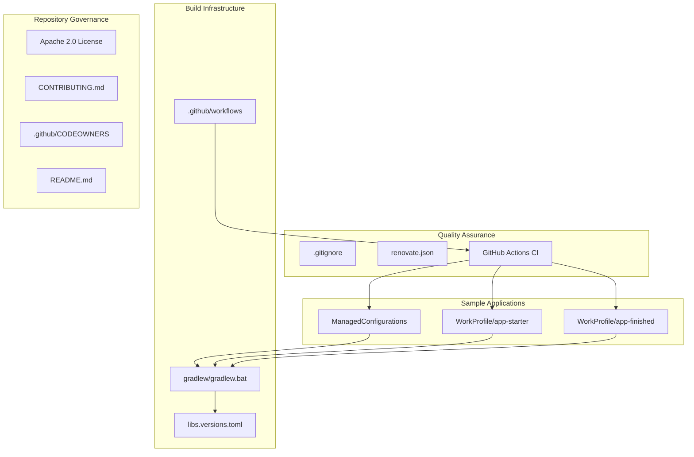
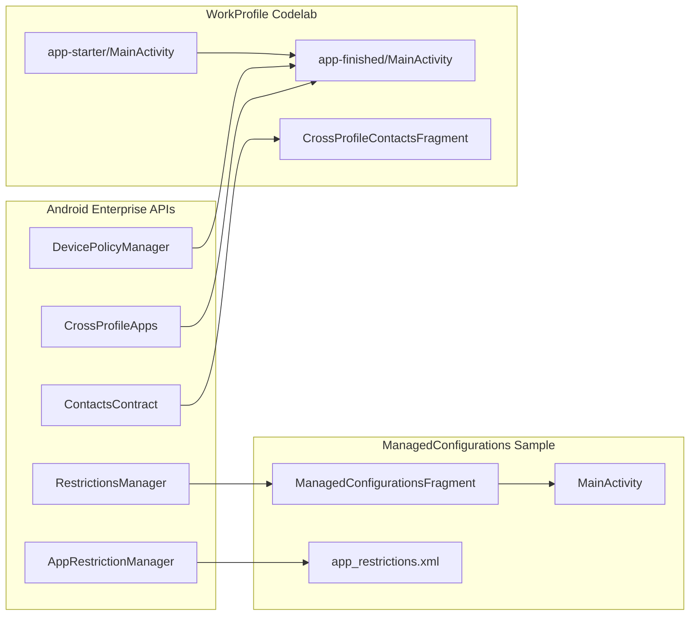
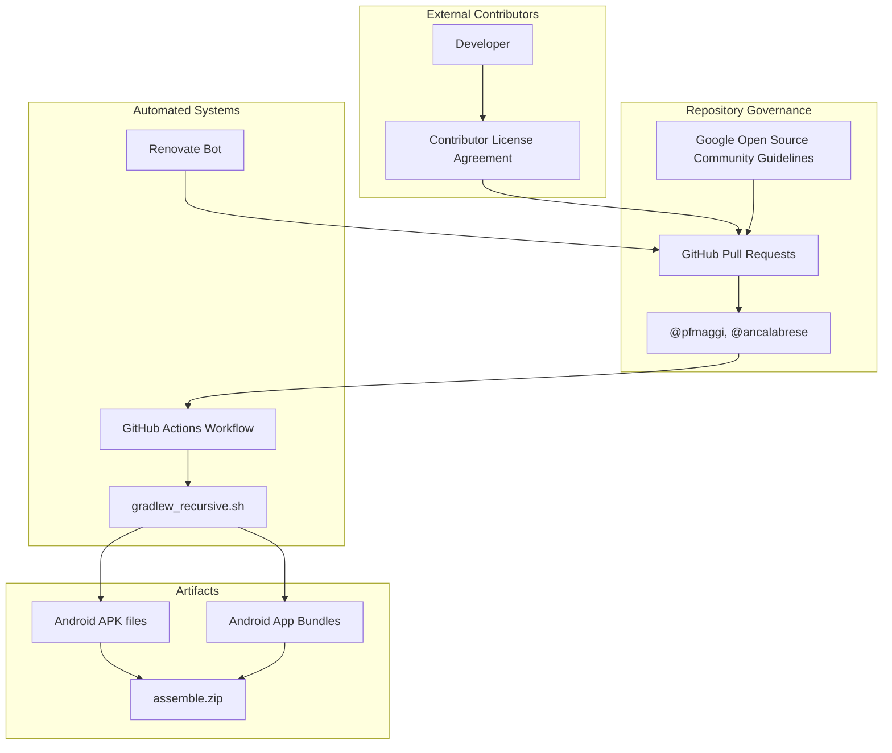

<!-- source: DeepWiki mcp.deepwiki.com · repo android/enterprise-samples · page 1 Overview · fetched 2026-10-23 -->

# Overview

Relevant source files

The following files were used as context for generating this wiki page:

- [.gitignore](.gitignore)
- [CONTRIBUTING.md](CONTRIBUTING.md)
- [LICENSE](LICENSE)
- [README.md](README.md)

## Purpose and Scope

This document provides a comprehensive overview of the Android Enterprise Samples repository, which contains sample Android applications demonstrating Android Enterprise features. The repository serves as both educational material for developers learning enterprise Android development and reference implementations for production use.

For detailed information about individual sample applications, see [Sample Applications](#2). For build system documentation, see [Build System](#3). For contribution guidelines, see [Development Guide](#4).

## Repository Structure

The repository is organized into distinct functional areas that support both the sample applications and the development infrastructure.

### High-Level Architecture

**Repository Component Overview**

| Component | Purpose | Key Files |
|-----------|---------|-----------|
| Sample Applications | Demonstrate Android Enterprise features | `ManagedConfigurations/`, `WorkProfile/app-starter/`, `WorkProfile/app-finished/` |
| Build System | Gradle-based build automation | `gradlew`, `gradlew.bat`, `libs.versions.toml` |
| CI/CD Pipeline | Automated testing and artifact generation | `.github/workflows/` |
| Governance | Legal framework and contribution guidelines | `LICENSE`, `CONTRIBUTING.md`, `.github/CODEOWNERS` |

Sources: [README.md:1-6](), [LICENSE:1-192](), [CONTRIBUTING.md:1-29](), [.gitignore:1-37]()

## Sample Applications Overview

The repository contains two primary sample applications that demonstrate different Android Enterprise capabilities:

### Enterprise Feature Mapping

**Sample Application Features**

| Application | Enterprise Feature | Target Audience | Implementation Status |
|-------------|-------------------|-----------------|---------------------|
| ManagedConfigurations | App Restrictions & Managed Configurations | EMM administrators, developers | Complete implementation |
| WorkProfile/app-starter | Work Profile basics | Learning developers | Basic implementation |
| WorkProfile/app-finished | Cross-profile contacts & apps | Learning developers | Complete implementation |

Sources: [README.md:4-5]()

## Development Ecosystem

The repository implements a comprehensive development ecosystem with automated quality assurance and contributor management.

### Contribution and Build Workflow

**Development Process Requirements**

| Requirement | Description | Reference |
|-------------|-------------|-----------|
| Contributor License Agreement | Required for all contributions | [CONTRIBUTING.md:6-16]() |
| Code Review | All submissions require review via GitHub PRs | [CONTRIBUTING.md:18-23]() |
| Community Guidelines | Must follow Google's Open Source Community Guidelines | [CONTRIBUTING.md:25-28]() |
| Apache 2.0 License | All code distributed under Apache License 2.0 | [LICENSE:1-192]() |

Sources: [CONTRIBUTING.md:1-29](), [LICENSE:1-192]()

## Technical Specifications

### Build System Requirements

The repository uses a standardized Android build environment with the following specifications:

- **Build Tool**: Gradle with wrapper scripts
- **License**: Apache License 2.0
- **Contribution Process**: GitHub PRs with CLA requirement
- **Quality Assurance**: Automated CI/CD pipeline
- **Dependency Management**: Centralized version catalogs

### Repository Metadata

| Property | Value |
|----------|--------|
| License | Apache 2.0 |
| Primary Language | Java/Kotlin (Android) |
| Build System | Gradle |
| CI/CD Platform | GitHub Actions |
| Code Owners | @pfmaggi, @ancalabrese |

Sources: [README.md:1-6](), [LICENSE:1-2](), [CONTRIBUTING.md:27-28]()

## Getting Started

To work with this repository:

1. **Review License Terms**: All usage is governed by [LICENSE:1-192]()
2. **Read Contribution Guidelines**: See [CONTRIBUTING.md:1-29]() for submission requirements
3. **Explore Sample Applications**: Start with the applications documented in [Sample Applications](#2)
4. **Understand Build System**: Refer to [Build System](#3) for compilation and CI/CD details

The repository provides both educational codelabs and production-ready sample implementations for Android Enterprise feature development.

Sources: [README.md:1-6](), [CONTRIBUTING.md:1-29](), [LICENSE:1-192]()

---

