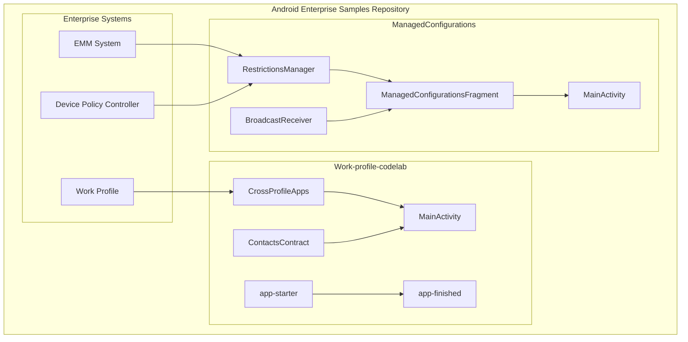
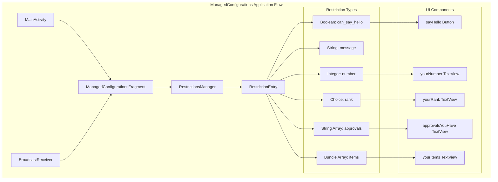
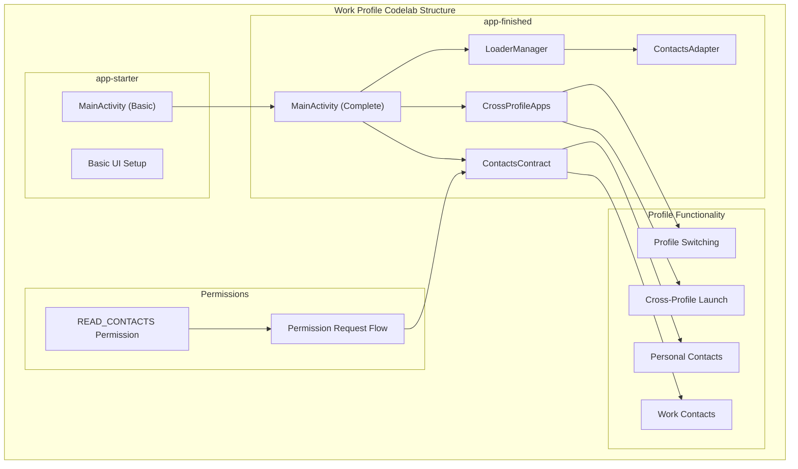

<!-- source: DeepWiki mcp.deepwiki.com · repo android/enterprise-samples · page 2 Sample Applications · fetched 2026-10-23 -->

# Sample Applications

Relevant source files

The following files were used as context for generating this wiki page:

- [ManagedConfigurations/app/src/main/java/com/example/android/managedconfigurations/MainActivity.kt](ManagedConfigurations/app/src/main/java/com/example/android/managedconfigurations/MainActivity.kt)
- [ManagedConfigurations/app/src/main/java/com/example/android/managedconfigurations/ManagedConfigurationsFragment.kt](ManagedConfigurations/app/src/main/java/com/example/android/managedconfigurations/ManagedConfigurationsFragment.kt)
- [ManagedConfigurations/app/src/main/res/values/styles.xml](ManagedConfigurations/app/src/main/res/values/styles.xml)
- [ManagedConfigurations/build.gradle.kts](ManagedConfigurations/build.gradle.kts)
- [ManagedConfigurations/gradle.properties](ManagedConfigurations/gradle.properties)
- [Work-profile-codelab/app-finished/src/main/java/com/example/workprofile/MainActivity.kt](Work-profile-codelab/app-finished/src/main/java/com/example/workprofile/MainActivity.kt)
- [Work-profile-codelab/app-finished/src/main/res/values/styles.xml](Work-profile-codelab/app-finished/src/main/res/values/styles.xml)

This document provides an overview of the two main sample applications in the Android Enterprise Samples repository that demonstrate different enterprise capabilities. These applications serve as practical examples and learning resources for developers implementing Android Enterprise features.

For detailed documentation of each individual sample application, see [ManagedConfigurations Sample](#2.1) and [Work Profile Codelab](#2.2). For information about the build system and CI/CD infrastructure that supports these applications, see [Build System](#3).

## Repository Structure and Sample Applications

The repository contains two distinct sample applications that demonstrate different aspects of Android Enterprise functionality:

**Sample Applications Architecture Overview**

Sources: [ManagedConfigurations/app/src/main/java/com/example/android/managedconfigurations/MainActivity.kt:1-117](), [Work-profile-codelab/app-finished/src/main/java/com/example/workprofile/MainActivity.kt:1-156](), [ManagedConfigurations/app/src/main/java/com/example/android/managedconfigurations/ManagedConfigurationsFragment.kt:1-255]()

## Sample Applications Overview

| Sample Application | Primary Purpose | Key Components | Target Use Case |
|-------------------|----------------|----------------|-----------------|
| ManagedConfigurations | Demonstrates app restrictions and managed configurations | `RestrictionsManager`, `BroadcastReceiver`, `RestrictionEntry` | Enterprise app configuration management |
| Work-profile-codelab | Teaches work profile implementation with starter and finished versions | `CrossProfileApps`, `ContactsContract`, profile switching | Cross-profile application development |

## ManagedConfigurations Sample

The ManagedConfigurations sample demonstrates how applications can receive and respond to restrictions set by enterprise administrators through EMM systems or Device Policy Controllers.

**ManagedConfigurations Component Architecture**

The sample handles six different types of restrictions defined in [ManagedConfigurations/app/src/main/java/com/example/android/managedconfigurations/ManagedConfigurationsFragment.kt:245-252]():

- `KEY_CAN_SAY_HELLO`: Boolean restriction controlling button enablement
- `KEY_MESSAGE`: String restriction for toast message content  
- `KEY_NUMBER`: Integer restriction displayed in UI
- `KEY_RANK`: Choice restriction from predefined options
- `KEY_APPROVALS`: String array restriction for multiple selections
- `KEY_ITEMS`: Bundle array restriction for complex data structures

Sources: [ManagedConfigurations/app/src/main/java/com/example/android/managedconfigurations/ManagedConfigurationsFragment.kt:101-133](), [ManagedConfigurations/app/src/main/java/com/example/android/managedconfigurations/MainActivity.kt:56-61]()

## Work Profile Codelab

The Work Profile Codelab provides both starter and finished implementations to teach developers how to build applications that work seamlessly across personal and work profiles.

**Work Profile Codelab Learning Progression**

The finished implementation in [Work-profile-codelab/app-finished/src/main/java/com/example/workprofile/MainActivity.kt:75-86]() demonstrates key cross-profile functionality:

- Profile detection using `CrossProfileApps.targetUserProfiles`
- Profile switching with `CrossProfileApps.startMainActivity()`
- Dual contact loading from personal and enterprise directories
- Permission handling for cross-profile contact access

The application loads contacts from both profiles using different `ContactsContract` URIs:
- Personal contacts: `ContactsContract.Contacts.CONTENT_URI`
- Work contacts: `ContactsContract.Contacts.ENTERPRISE_CONTENT_FILTER_URI`

Sources: [Work-profile-codelab/app-finished/src/main/java/com/example/workprofile/MainActivity.kt:108-136](), [Work-profile-codelab/app-finished/src/main/java/com/example/workprofile/MainActivity.kt:75-86](), [Work-profile-codelab/app-finished/src/main/java/com/example/workprofile/MainActivity.kt:65-73]()

## Enterprise Integration Points

Both sample applications demonstrate different aspects of Android Enterprise integration:

| Integration Area | ManagedConfigurations | Work Profile Codelab |
|-----------------|---------------------|-------------------|
| **EMM Communication** | `RestrictionsManager.applicationRestrictions` | `CrossProfileApps.targetUserProfiles` |
| **Runtime Updates** | `Intent.ACTION_APPLICATION_RESTRICTIONS_CHANGED` | Profile state changes |
| **Data Access** | Restriction values and types | Cross-profile contacts |
| **User Experience** | Dynamically configured UI | Seamless profile switching |

The ManagedConfigurations sample uses [ManagedConfigurations/app/src/main/java/com/example/android/managedconfigurations/ManagedConfigurationsFragment.kt:82-85]() to register for restriction changes, while the Work Profile Codelab demonstrates cross-profile capabilities through [Work-profile-codelab/app-finished/src/main/java/com/example/workprofile/MainActivity.kt:75-86]().

Sources: [ManagedConfigurations/app/src/main/java/com/example/android/managedconfigurations/ManagedConfigurationsFragment.kt:77-85](), [Work-profile-codelab/app-finished/src/main/java/com/example/workprofile/MainActivity.kt:42-87]()

---

