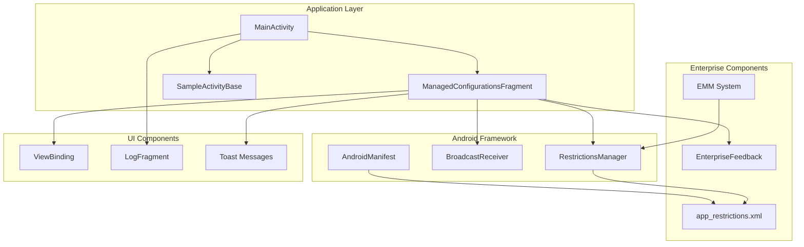
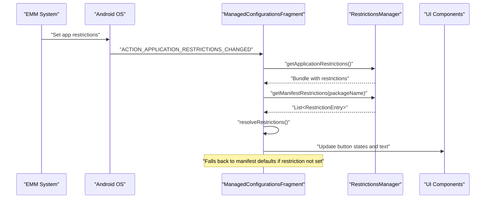
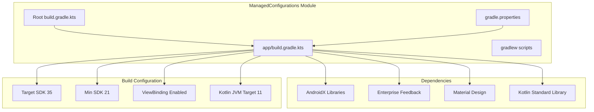

<!-- source: DeepWiki mcp.deepwiki.com · repo android/enterprise-samples · page 2.1 ManagedConfigurations Sample · fetched 2026-10-23 -->

# ManagedConfigurations Sample

<details>
<summary>Relevant source files</summary>

The following files were used as context for generating this wiki page:

- [ManagedConfigurations/app/build.gradle.kts](ManagedConfigurations/app/build.gradle.kts)
- [ManagedConfigurations/app/src/main/AndroidManifest.xml](ManagedConfigurations/app/src/main/AndroidManifest.xml)
- [ManagedConfigurations/app/src/main/java/com/example/android/managedconfigurations/MainActivity.kt](ManagedConfigurations/app/src/main/java/com/example/android/managedconfigurations/MainActivity.kt)
- [ManagedConfigurations/app/src/main/java/com/example/android/managedconfigurations/ManagedConfigurationsFragment.kt](ManagedConfigurations/app/src/main/java/com/example/android/managedconfigurations/ManagedConfigurationsFragment.kt)
- [ManagedConfigurations/app/src/main/res/values/styles.xml](ManagedConfigurations/app/src/main/res/values/styles.xml)
- [ManagedConfigurations/build.gradle.kts](ManagedConfigurations/build.gradle.kts)
- [ManagedConfigurations/gradle.properties](ManagedConfigurations/gradle.properties)

</details>


## Purpose and Scope

The ManagedConfigurations sample demonstrates how to implement Android app restrictions (managed configurations) in an enterprise application. This sample shows how applications can receive and respond to configuration policies set by Enterprise Mobility Management (EMM) systems or Device Policy Controllers (DPC). The application displays various types of restrictions including boolean toggles, text messages, numbers, choice selections, and complex bundle data structures.

For information about work profile functionality and cross-profile app interactions, see [Work Profile Codelab](#2.2).

## Application Architecture

The ManagedConfigurations sample follows a standard Android Activity-Fragment architecture with enterprise-specific components integrated for restriction handling.

### Component Overview



**Sources:** [ManagedConfigurations/app/src/main/java/com/example/android/managedconfigurations/MainActivity.kt:40-117](), [ManagedConfigurations/app/src/main/java/com/example/android/managedconfigurations/ManagedConfigurationsFragment.kt:40-255](), [ManagedConfigurations/app/src/main/AndroidManifest.xml:22-41]()

### Class Hierarchy and Relationships

```mermaid
classDiagram
    class MainActivity {
        -logShown: Boolean
        -binding: ActivityMainBinding
        +onCreate(Bundle)
        +onCreateOptionsMenu(Menu)
        +onOptionsItemSelected(MenuItem)
        +initializeLogging()
    }
    
    class ManagedConfigurationsFragment {
        -message: String?
        -broadcastReceiver: BroadcastReceiver?
        -binding: FragmentManagedConfigurationsBinding
        +resolveRestrictions()
        +updateCanSayHello(RestrictionEntry, Bundle?)
        +updateMessage(RestrictionEntry, Bundle?)
        +onClick(View)
    }
    
    class SampleActivityBase {
        +initializeLogging()
    }
    
    class RestrictionsManager {
        +getApplicationRestrictions(): Bundle
        +getManifestRestrictions(String): List~RestrictionEntry~
    }
    
    MainActivity --|> SampleActivityBase
    MainActivity --> ManagedConfigurationsFragment
    ManagedConfigurationsFragment --> RestrictionsManager
    ManagedConfigurationsFragment ..|> "View.OnClickListener"
```

**Sources:** [ManagedConfigurations/app/src/main/java/com/example/android/managedconfigurations/MainActivity.kt:40-117](), [ManagedConfigurations/app/src/main/java/com/example/android/managedconfigurations/ManagedConfigurationsFragment.kt:40-255]()

## App Restrictions Framework Integration

The sample integrates with Android's app restrictions framework through the `RestrictionsManager` system service and manifest declarations.

### Restrictions Configuration

| Restriction Key | Type | Purpose | Default Behavior |
|---|---|---|---|
| `can_say_hello` | Boolean | Controls button enablement | Uses manifest default |
| `message` | String | Custom toast message | Uses manifest default |
| `number` | Integer | Numeric display value | Uses manifest default |
| `rank` | Choice | Selection from predefined options | Uses manifest default |
| `approvals` | String Array | Multiple selection values | Uses manifest default |
| `items` | Bundle Array | Complex structured data | Uses manifest default (API 23+) |

**Sources:** [ManagedConfigurations/app/src/main/java/com/example/android/managedconfigurations/ManagedConfigurationsFragment.kt:242-253]()

### Restriction Resolution Flow



**Sources:** [ManagedConfigurations/app/src/main/java/com/example/android/managedconfigurations/ManagedConfigurationsFragment.kt:101-133](), [ManagedConfigurations/app/src/main/java/com/example/android/managedconfigurations/ManagedConfigurationsFragment.kt:76-86]()

## Configuration Handling Implementation

### Restrictions Manager Integration

The `ManagedConfigurationsFragment` uses the `RestrictionsManager` to retrieve both applied restrictions and manifest-defined defaults:

```kotlin
// From resolveRestrictions() method
val manager = requireActivity().getSystemService(Context.RESTRICTIONS_SERVICE) as RestrictionsManager
val restrictions = manager.applicationRestrictions
val entries = manager.getManifestRestrictions(requireActivity().applicationContext.packageName)
```

**Sources:** [ManagedConfigurations/app/src/main/java/com/example/android/managedconfigurations/ManagedConfigurationsFragment.kt:102-107]()

### Dynamic Restriction Updates

The application registers a `BroadcastReceiver` to handle real-time restriction changes:

| Lifecycle Method | Action | Purpose |
|---|---|---|
| `onStart()` | Register receiver for `ACTION_APPLICATION_RESTRICTIONS_CHANGED` | Enable real-time updates |
| `onStop()` | Unregister receiver | Clean up resources |
| `onResume()` | Call `resolveRestrictions()` | Refresh on activity resume |

**Sources:** [ManagedConfigurations/app/src/main/java/com/example/android/managedconfigurations/ManagedConfigurationsFragment.kt:75-94]()

### Enterprise Feedback Integration

The sample uses the `androidx.enterprise.feedback` library to provide telemetry back to EMM systems:

```kotlin
activity?.enterpriseFeedback(KEY_CAN_SAY_HELLO, "Value is $canSayHello", "$canSayHello")
```

**Sources:** [ManagedConfigurations/app/src/main/java/com/example/android/managedconfigurations/ManagedConfigurationsFragment.kt:142](), [ManagedConfigurations/app/build.gradle.kts:64-66]()

## User Interface Components

### Main Activity Structure

The `MainActivity` provides a dual-pane layout with logging capabilities:

- **Primary Content**: Hosts `ManagedConfigurationsFragment` in `R.id.sample_content_fragment`
- **Secondary Content**: Optional `LogFragment` for debugging output
- **Toggle Mechanism**: Menu item to switch between content and log views

**Sources:** [ManagedConfigurations/app/src/main/java/com/example/android/managedconfigurations/MainActivity.kt:56-61](), [ManagedConfigurations/app/src/main/java/com/example/android/managedconfigurations/MainActivity.kt:76-90]()

### Fragment UI Binding

The `ManagedConfigurationsFragment` uses ViewBinding for type-safe view access:

| UI Element | Binding Property | Purpose |
|---|---|---|
| Say Hello Button | `binding.sayHello` | Demonstrates boolean restriction |
| Number Display | `binding.yourNumber` | Shows integer restriction |
| Rank Display | `binding.yourRank` | Shows choice restriction |
| Approvals Display | `binding.approvalsYouHave` | Shows multi-select restriction |
| Items Display | `binding.yourItems` | Shows bundle array restriction (API 23+) |

**Sources:** [ManagedConfigurations/app/src/main/java/com/example/android/managedconfigurations/ManagedConfigurationsFragment.kt:47-68]()

### API Level Compatibility

The sample handles API level differences for bundle array support:

```kotlin
private val BUNDLE_SUPPORTED = Build.VERSION.SDK_INT >= 23
```

Items functionality is conditionally displayed based on this flag.

**Sources:** [ManagedConfigurations/app/src/main/java/com/example/android/managedconfigurations/ManagedConfigurationsFragment.kt:253](), [ManagedConfigurations/app/src/main/java/com/example/android/managedconfigurations/ManagedConfigurationsFragment.kt:63-67]()

## Build Configuration

### Module Structure



**Sources:** [ManagedConfigurations/app/build.gradle.kts:22-55](), [ManagedConfigurations/build.gradle.kts:17-20](), [ManagedConfigurations/gradle.properties:1-23]()

### Key Dependencies

| Dependency | Purpose | Version Source |
|---|---|---|
| `androidx.enterprise.feedback` | EMM telemetry integration | Version catalog |
| `androidx.enterprise.feedback.testing` | Testing enterprise features | Version catalog |
| `androidx.core.ktx` | Android KTX extensions | Version catalog |
| `material` | Material Design components | Version catalog |
| `androidx.activity` | Modern activity APIs | Version catalog |

**Sources:** [ManagedConfigurations/app/build.gradle.kts:57-70]()

### Application Configuration

| Setting | Value | Purpose |
|---|---|---|
| `namespace` | `com.example.android.managedconfigurations` | Package namespace |
| `applicationId` | `com.example.android.managedconfigurations` | Unique app identifier |
| `compileSdk` | 35 | Latest SDK for compilation |
| `minSdk` | 21 | Android 5.0+ support |
| `targetSdk` | 35 | Target latest platform features |

**Sources:** [ManagedConfigurations/app/build.gradle.kts:23-31]()

---

