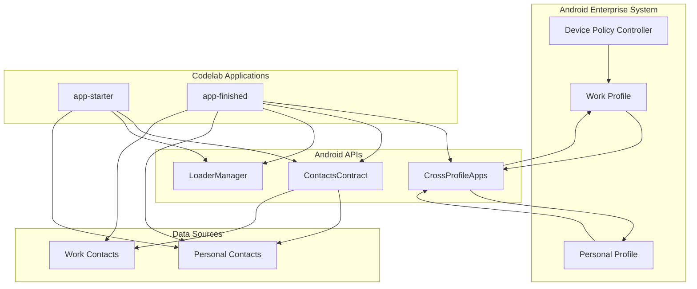
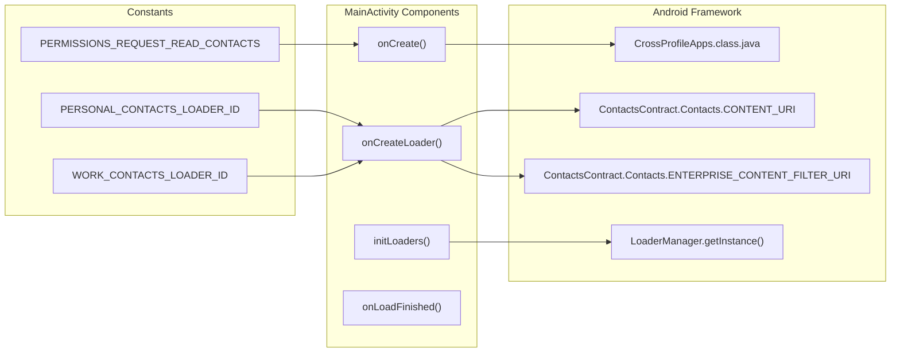
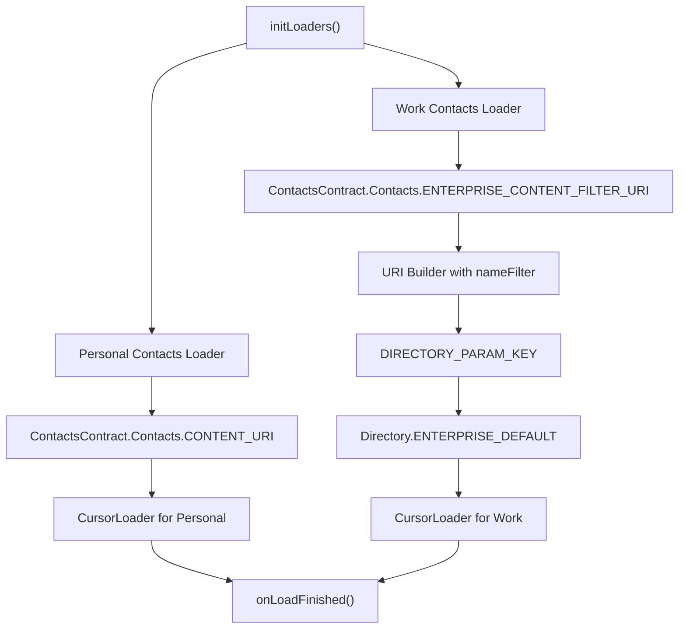
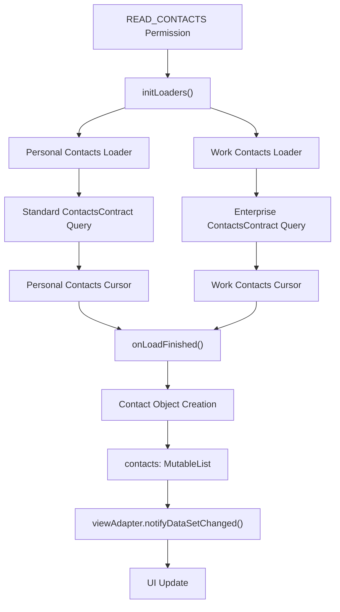

<!-- source: DeepWiki mcp.deepwiki.com · repo android/enterprise-samples · page 2.2 Work Profile Codelab · fetched 2026-10-23 -->

# Work Profile Codelab

<details>
<summary>Relevant source files</summary>

The following files were used as context for generating this wiki page:

- [Work-profile-codelab/app-finished/src/main/java/com/example/workprofile/MainActivity.kt](Work-profile-codelab/app-finished/src/main/java/com/example/workprofile/MainActivity.kt)
- [Work-profile-codelab/app-finished/src/main/res/values/styles.xml](Work-profile-codelab/app-finished/src/main/res/values/styles.xml)
- [Work-profile-codelab/app-starter/src/main/java/com/example/workprofile/MainActivity.kt](Work-profile-codelab/app-starter/src/main/java/com/example/workprofile/MainActivity.kt)

</details>


## Purpose and Scope

The Work Profile Codelab is an educational sample application that teaches developers how to build Android applications that work seamlessly across work and personal profiles in an Android Enterprise environment. This codelab demonstrates cross-profile functionality, enterprise contact access, and profile switching capabilities.

The codelab is structured as a progressive learning experience with two implementations: a starter version with basic functionality and a finished version with complete cross-profile features. For information about managed configurations and app restrictions, see [ManagedConfigurations Sample](#2.1).

## Architecture Overview

The Work Profile Codelab demonstrates the interaction between Android's work profile system and application code through two distinct implementations.

### System Architecture



Sources: [Work-profile-codelab/app-starter/src/main/java/com/example/workprofile/MainActivity.kt:1-127](), [Work-profile-codelab/app-finished/src/main/java/com/example/workprofile/MainActivity.kt:1-155]()

## Implementation Comparison

The codelab provides two versions to illustrate the progression from basic to enterprise-aware functionality.

### Key Differences

| Feature | Starter Implementation | Finished Implementation |
|---------|----------------------|------------------------|
| Contact Sources | Personal contacts only | Personal + Work contacts |
| Profile Switching | Not implemented | CrossProfileApps integration |
| Contact Loaders | Single loader (`PERSONAL_CONTACTS_LOADER_ID`) | Dual loaders (`PERSONAL_CONTACTS_LOADER_ID`, `WORK_CONTACTS_LOADER_ID`) |
| Enterprise APIs | Basic ContactsContract | Enterprise ContactsContract with filtering |

### Code Entity Mapping



Sources: [Work-profile-codelab/app-starter/src/main/java/com/example/workprofile/MainActivity.kt:37-39](), [Work-profile-codelab/app-finished/src/main/java/com/example/workprofile/MainActivity.kt:38-40](), [Work-profile-codelab/app-finished/src/main/java/com/example/workprofile/MainActivity.kt:75-86]()

## Core Components

### MainActivity Class Structure

Both implementations share a common base structure but differ in their enterprise capabilities.

#### Common Components

| Component | Purpose | Implementation |
|-----------|---------|----------------|
| `contacts: MutableList<Contact>` | Contact data storage | Populated by cursor loaders |
| `viewAdapter: RecyclerView.Adapter` | UI contact display | ContactsAdapter instance |
| `binding: ActivityMainBinding` | View binding | Data binding for UI elements |

#### Permission Handling

Both implementations request `READ_CONTACTS` permission using the same pattern:

```kotlin
const val PERMISSIONS_REQUEST_READ_CONTACTS = 1
```

The permission request is handled in `onRequestPermissionsResult()` with proper error messaging for denied permissions.

Sources: [Work-profile-codelab/app-starter/src/main/java/com/example/workprofile/MainActivity.kt:37](), [Work-profile-codelab/app-finished/src/main/java/com/example/workprofile/MainActivity.kt:38](), [Work-profile-codelab/app-starter/src/main/java/com/example/workprofile/MainActivity.kt:74-91](), [Work-profile-codelab/app-finished/src/main/java/com/example/workprofile/MainActivity.kt:89-106]()

### Contact Loading Implementation

#### Starter Implementation

The starter version implements basic contact loading:

- Single loader: `PERSONAL_CONTACTS_LOADER_ID` 
- Uses standard `ContactsContract.Contacts.CONTENT_URI`
- Simple cursor handling in `onCreateLoader()`

#### Finished Implementation

The finished version demonstrates enterprise contact access:

- Dual loaders: `PERSONAL_CONTACTS_LOADER_ID` and `WORK_CONTACTS_LOADER_ID`
- Enterprise URI construction with filtering parameters
- Advanced cursor handling for different contact sources



Sources: [Work-profile-codelab/app-starter/src/main/java/com/example/workprofile/MainActivity.kt:93-95](), [Work-profile-codelab/app-finished/src/main/java/com/example/workprofile/MainActivity.kt:108-111](), [Work-profile-codelab/app-finished/src/main/java/com/example/workprofile/MainActivity.kt:113-136]()

### Cross-Profile Functionality

The finished implementation includes cross-profile app switching capabilities using the `CrossProfileApps` system service.

#### CrossProfileApps Integration

The cross-profile functionality is implemented in the `onCreate()` method:

| Step | Code Entity | Purpose |
|------|-------------|---------|
| 1 | `getSystemService(CrossProfileApps::class.java)` | Obtain CrossProfileApps service |
| 2 | `crossProfileApps.targetUserProfiles` | Get available user profiles |
| 3 | `crossProfileApps.getProfileSwitchingLabel()` | Get appropriate button label |
| 4 | `crossProfileApps.startMainActivity()` | Launch app in target profile |

The button configuration dynamically adapts its label based on the current profile context and provides seamless switching between work and personal instances of the application.

Sources: [Work-profile-codelab/app-finished/src/main/java/com/example/workprofile/MainActivity.kt:75-86]()

## Data Flow Architecture

### Contact Data Processing



Sources: [Work-profile-codelab/app-finished/src/main/java/com/example/workprofile/MainActivity.kt:138-151](), [Work-profile-codelab/app-starter/src/main/java/com/example/workprofile/MainActivity.kt:110-123]()

## Learning Progression

The codelab is designed to demonstrate the incremental addition of enterprise features:

### Starter → Finished Migration

| Enhancement | Implementation | API Usage |
|-------------|----------------|-----------|
| Work Contact Access | Add `WORK_CONTACTS_LOADER_ID` constant | `ContactsContract.Contacts.ENTERPRISE_CONTENT_FILTER_URI` |
| Enterprise Filtering | Build filtered URI with name parameter | `appendPath()`, `appendQueryParameter()` |
| Cross-Profile Switching | Add CrossProfileApps service integration | `CrossProfileApps.startMainActivity()` |
| Dynamic UI Labels | Context-aware button labeling | `CrossProfileApps.getProfileSwitchingLabel()` |

This progression teaches developers how to evolve a basic Android application into an enterprise-aware application that respects work profile boundaries while providing seamless user experience across profiles.

Sources: [Work-profile-codelab/app-starter/src/main/java/com/example/workprofile/MainActivity.kt:37-39](), [Work-profile-codelab/app-finished/src/main/java/com/example/workprofile/MainActivity.kt:38-40](), [Work-profile-codelab/app-finished/src/main/java/com/example/workprofile/MainActivity.kt:75-86](), [Work-profile-codelab/app-finished/src/main/java/com/example/workprofile/MainActivity.kt:113-136]()

---

