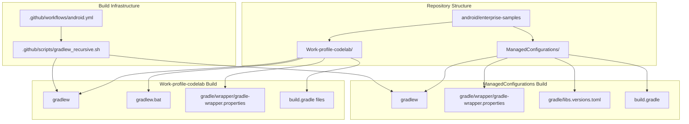
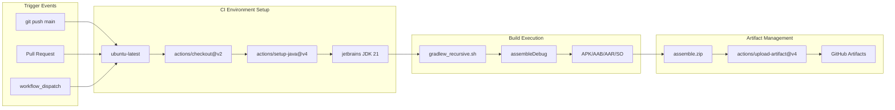
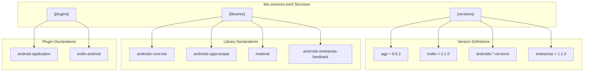

<!-- source: DeepWiki mcp.deepwiki.com · repo android/enterprise-samples · page 3 Build System · fetched 2026-10-23 -->

# Build System

<details>
<summary>Relevant source files</summary>

The following files were used as context for generating this wiki page:

- [.github/workflows/android.yml](.github/workflows/android.yml)
- [ManagedConfigurations/gradle/libs.versions.toml](ManagedConfigurations/gradle/libs.versions.toml)
- [ManagedConfigurations/gradle/wrapper/gradle-wrapper.properties](ManagedConfigurations/gradle/wrapper/gradle-wrapper.properties)
- [Work-profile-codelab/gradlew](Work-profile-codelab/gradlew)
- [Work-profile-codelab/gradlew.bat](Work-profile-codelab/gradlew.bat)

</details>


## Purpose and Scope

This document covers the comprehensive Gradle-based build system and CI/CD infrastructure for the Android Enterprise Samples repository. The build system manages compilation, testing, and artifact generation for all sample applications in the repository. For details about the specific sample applications being built, see [Sample Applications](#2). For information about the automated CI/CD pipeline execution, see [CI/CD Pipeline](#3.1). For dependency management specifics, see [Version Catalogs and Dependencies](#3.2.2).

## Build System Architecture

The repository uses a multi-module Gradle build system with GitHub Actions CI/CD integration. Each sample application maintains its own Gradle wrapper and dependency configuration while sharing common build patterns.



**Sources:** [.github/workflows/android.yml:1-46](), [ManagedConfigurations/gradle/wrapper/gradle-wrapper.properties:1-7](), [ManagedConfigurations/gradle/libs.versions.toml:1-44]()

## Build Process Flow

The build system follows a standardized process across all modules, executed through both local development and automated CI/CD environments.



**Sources:** [.github/workflows/android.yml:17-22](), [.github/workflows/android.yml:30-45]()

## Gradle Configuration Details

### Wrapper Configuration

Each module uses Gradle wrapper to ensure consistent build environments across different development machines and CI systems.

| Module | Gradle Version | Distribution URL |
|--------|----------------|-----------------|
| ManagedConfigurations | 8.11.1 | `https://services.gradle.org/distributions/gradle-8.11.1-bin.zip` |
| Work-profile-codelab | 8.x (wrapper specific) | Standard Gradle distribution |

The `gradlew` and `gradlew.bat` scripts provide cross-platform build execution with specific JVM memory settings:

- Default JVM Options: `"-Xmx64m" "-Xms64m"`
- Java compatibility checks and `JAVA_HOME` validation
- Cross-platform path resolution for Windows, macOS, and Linux

**Sources:** [ManagedConfigurations/gradle/wrapper/gradle-wrapper.properties:1-7](), [Work-profile-codelab/gradlew:46-47](), [Work-profile-codelab/gradlew.bat:36]()

### Version Catalog System

The `ManagedConfigurations` module implements centralized dependency management using Gradle version catalogs:



**Key dependency versions managed:**
- Android Gradle Plugin: `8.9.2`
- Kotlin: `2.1.0`
- AndroidX Core: `1.16.0`
- Enterprise Feedback: `1.1.0`
- Material Design: `1.12.0`

**Sources:** [ManagedConfigurations/gradle/libs.versions.toml:15-27](), [ManagedConfigurations/gradle/libs.versions.toml:28-39](), [ManagedConfigurations/gradle/libs.versions.toml:41-44]()

## CI/CD Pipeline Implementation

### Workflow Configuration

The `android.yml` workflow implements a comprehensive build and artifact management system:

| Configuration | Value |
|---------------|-------|
| Workflow Name | `Android CI` |
| Runner OS | `ubuntu-latest` |
| Java Distribution | `jetbrains` |
| Java Version | `21` |
| Build Task | `assembleDebug` |

### Build Script Execution

The CI system uses `.github/scripts/gradlew_recursive.sh` to execute builds across all modules. This script:

1. Discovers all `gradlew` scripts in the repository
2. Executes the `assembleDebug` task for each module
3. Handles build failures and success reporting
4. Ensures consistent build environment across modules

### Artifact Collection

The workflow collects and packages build artifacts using specific file patterns:

```bash
zip -r assemble.zip . -i '**/build/*.apk' '**/build/*.aab' '**/build/*.aar' '**/build/*.so'
```

This creates a comprehensive artifact package containing:
- `*.apk` - Android Application Packages
- `*.aab` - Android App Bundles
- `*.aar` - Android Archive Libraries
- `*.so` - Native Shared Objects

**Sources:** [.github/workflows/android.yml:15](), [.github/workflows/android.yml:32-36](), [.github/workflows/android.yml:38](), [.github/workflows/android.yml:40]()

## Build System Integration

### Cross-Module Consistency

The build system ensures consistency across modules through:

1. **Standardized Gradle Wrapper**: Each module maintains its own wrapper configuration but follows common patterns
2. **Unified CI Execution**: Single workflow executes builds for all modules
3. **Common Artifact Patterns**: All modules generate artifacts following the same naming conventions
4. **Shared JVM Configuration**: Consistent memory settings and Java version requirements

### Development Workflow Support

The build system supports multiple development scenarios:

| Scenario | Execution Method | Trigger |
|----------|------------------|---------|
| Local Development | `./gradlew assembleDebug` | Developer command |
| Pull Request Validation | GitHub Actions | PR creation/update |
| Main Branch Integration | GitHub Actions | Push to `main` |
| Manual Testing | GitHub Actions | `workflow_dispatch` |

**Sources:** [.github/workflows/android.yml:17-22](), [Work-profile-codelab/gradlew:183-185](), [Work-profile-codelab/gradlew.bat:74]()

---

