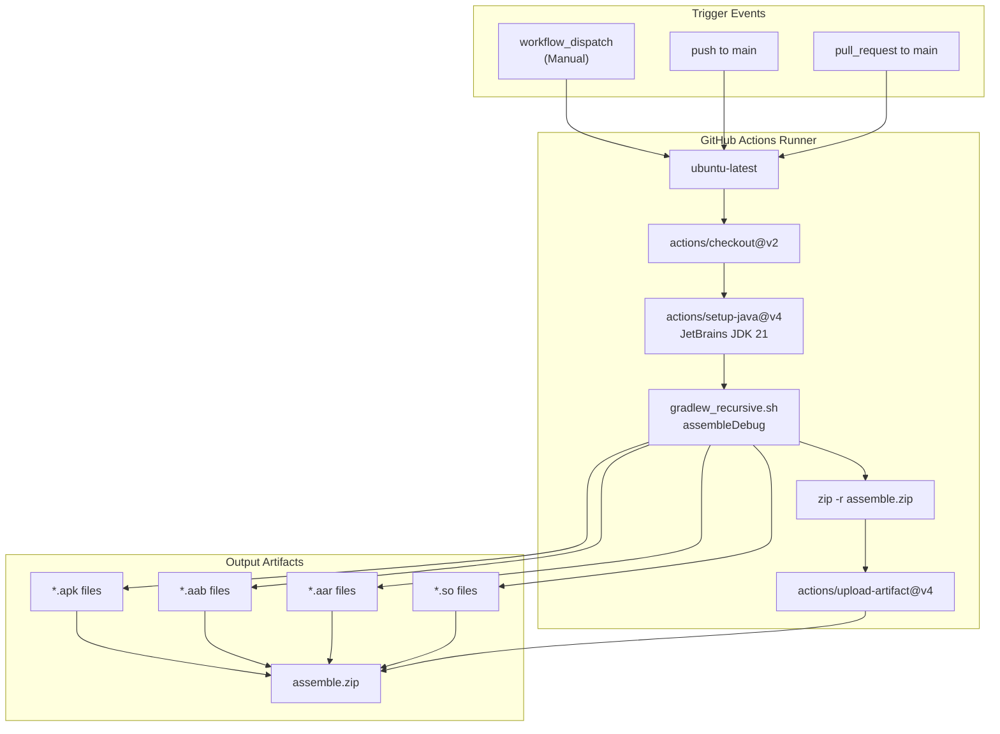
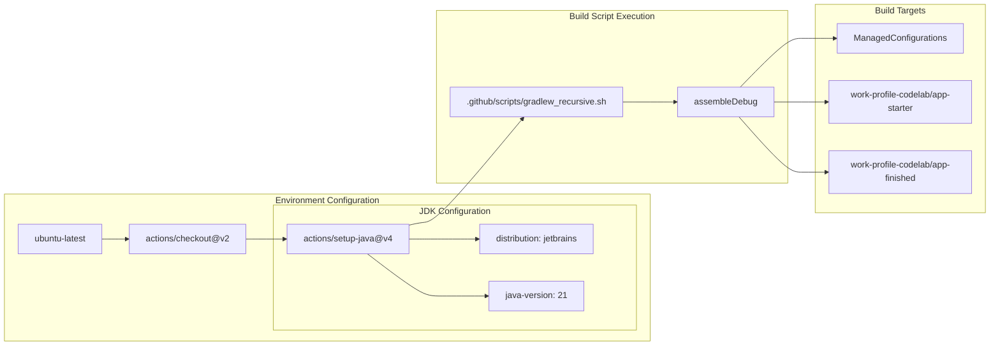
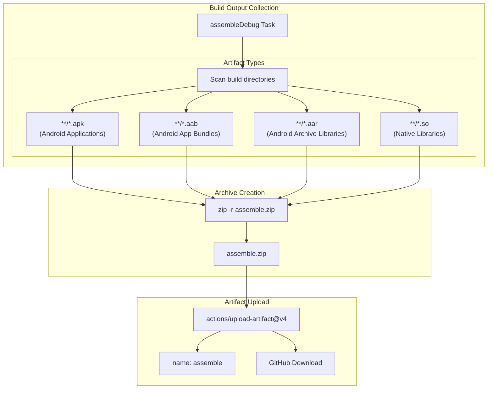

<!-- source: DeepWiki mcp.deepwiki.com · repo android/enterprise-samples · page 3.1 CI/CD Pipeline · fetched 2026-10-23 -->

# CI/CD Pipeline

Relevant source files

The following files were used as context for generating this wiki page:

- [.github/workflows/android.yml](.github/workflows/android.yml)

## Purpose and Scope

This document describes the GitHub Actions-based CI/CD pipeline that automatically builds and validates the Android Enterprise sample applications. The pipeline is defined in a single workflow file and handles building all sample applications, packaging artifacts, and making them available for download.

For information about the underlying Gradle build system configuration, see [Gradle Configuration](#3.2). For details about the Gradle wrapper scripts executed by this pipeline, see [Gradle Wrapper Scripts](#3.2.1).

## Workflow Overview

The CI/CD pipeline is implemented as a single GitHub Actions workflow named `Android CI` that performs automated builds of all sample applications in the repository. The workflow ensures consistent build environments and produces distributable artifacts for each successful build.

### Workflow Triggers and Execution Flow

**Sources:** [.github/workflows/android.yml:17-46]()

## Trigger Mechanisms

The `Android CI` workflow supports three distinct trigger mechanisms that provide flexibility for different development scenarios:

| Trigger Type | Configuration | Use Case |
|--------------|---------------|----------|
| `workflow_dispatch` | Manual trigger | On-demand builds for testing or releases |
| `push` to `main` | Automatic on main branch | Continuous integration for main branch |
| `pull_request` to `main` | Automatic on PR | Pre-merge validation |

**Sources:** [.github/workflows/android.yml:17-22]()

## Build Execution Process

### Environment Setup

The workflow executes on `ubuntu-latest` runners and establishes a consistent build environment through standardized tool installation:

**Sources:** [.github/workflows/android.yml:28-38]()

### Build Task Execution

The core build process uses a recursive Gradle wrapper script that executes the `assembleDebug` task across all project modules. This approach ensures that all sample applications are built consistently using the same build configuration.

The `gradlew_recursive.sh` script automatically discovers and builds all Gradle projects within the repository structure, making the CI pipeline resilient to the addition of new sample applications without requiring workflow modifications.

**Sources:** [.github/workflows/android.yml:37-38]()

## Artifact Management

### Artifact Collection and Packaging

The pipeline automatically collects build outputs from all projects and packages them into a single downloadable archive:

**Sources:** [.github/workflows/android.yml:39-45]()

### Artifact Types and Structure

The CI pipeline produces and archives multiple types of Android build artifacts:

| Artifact Type | Extension | Description |
|---------------|-----------|-------------|
| Android Application Package | `.apk` | Installable applications for direct deployment |
| Android App Bundle | `.aab` | Optimized distribution format for Google Play |
| Android Archive | `.aar` | Library modules for integration into other projects |
| Native Library | `.so` | Compiled native code components |

The `zip` command uses include patterns to selectively archive only build artifacts while excluding intermediate build files, resulting in a clean distribution package.

**Sources:** [.github/workflows/android.yml:40]()

## Integration with Build System

The CI/CD pipeline integrates with the broader build system architecture through standardized interfaces and shared build configurations. The workflow delegates actual compilation to the Gradle build system while providing orchestration and artifact management capabilities.

The use of the `gradlew_recursive.sh` script creates a clean separation between CI orchestration logic and build system implementation, allowing the build system to evolve independently while maintaining consistent CI behavior.

**Sources:** [.github/workflows/android.yml:38]()

---

