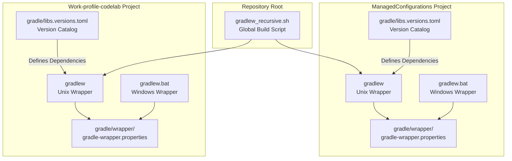
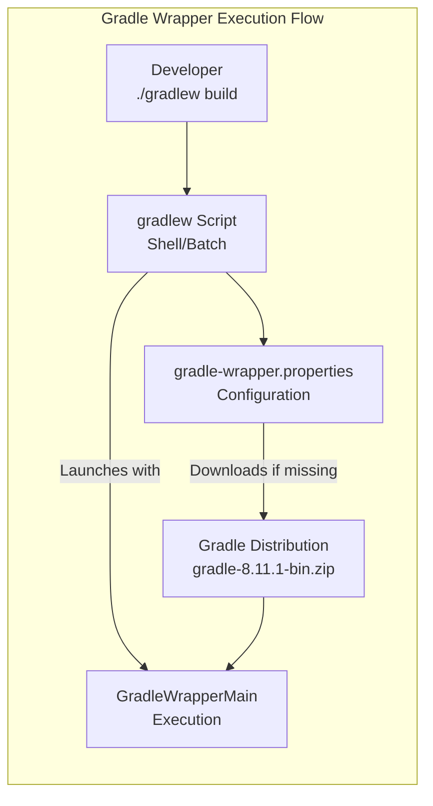
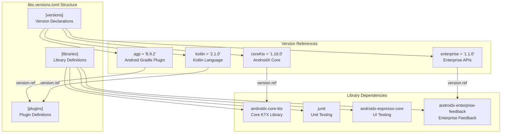
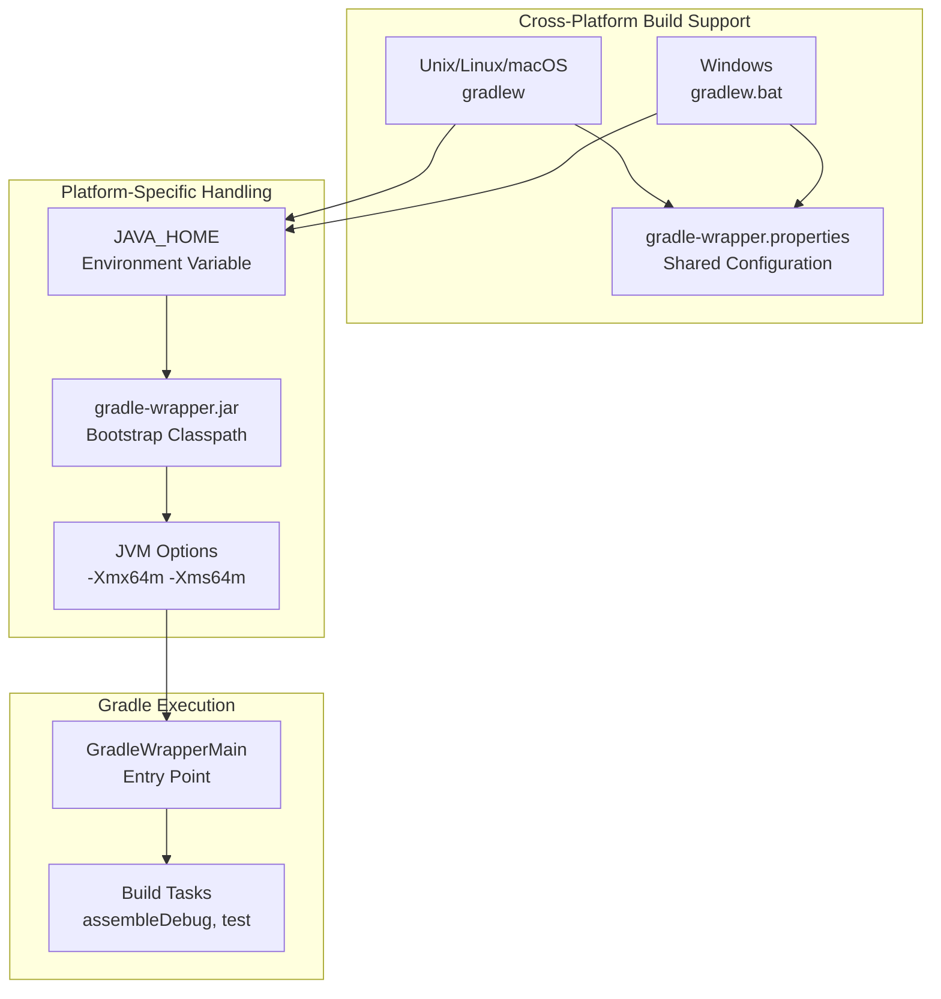

<!-- source: DeepWiki mcp.deepwiki.com · repo android/enterprise-samples · page 3.2 Gradle Configuration · fetched 2026-10-23 -->

# Gradle Configuration

Relevant source files

The following files were used as context for generating this wiki page:

- [ManagedConfigurations/gradle/libs.versions.toml](ManagedConfigurations/gradle/libs.versions.toml)
- [ManagedConfigurations/gradle/wrapper/gradle-wrapper.properties](ManagedConfigurations/gradle/wrapper/gradle-wrapper.properties)
- [ManagedConfigurations/gradlew](ManagedConfigurations/gradlew)
- [ManagedConfigurations/gradlew.bat](ManagedConfigurations/gradlew.bat)
- [Work-profile-codelab/gradlew](Work-profile-codelab/gradlew)
- [Work-profile-codelab/gradlew.bat](Work-profile-codelab/gradlew.bat)

This page documents the Gradle build system configuration used across the Android Enterprise Samples repository. It covers the overall structure and architecture of the build system, including the Gradle wrapper setup and centralized dependency management through version catalogs.

For detailed information about the Gradle wrapper scripts themselves, see [Gradle Wrapper Scripts](#3.2.1). For specifics on dependency management and version catalogs, see [Version Catalogs and Dependencies](#3.2.2).

## Overview

The repository uses a standardized Gradle configuration across both sample applications (`ManagedConfigurations` and `Work-profile-codelab`) to ensure consistent build environments and dependency management. The configuration is built around the Gradle wrapper pattern with centralized version management through TOML-based version catalogs.

**Build System Architecture**

Sources: [ManagedConfigurations/gradlew:1-186](), [Work-profile-codelab/gradlew:1-186](), [ManagedConfigurations/gradle/libs.versions.toml:1-44]()

## Gradle Wrapper Configuration

Each sample application maintains its own Gradle wrapper configuration to ensure build reproducibility and version consistency. The wrapper configuration is standardized across projects to use Gradle version 8.11.1.

### Wrapper Properties Structure

| Property | Value | Purpose |
|----------|--------|---------|
| `distributionBase` | `GRADLE_USER_HOME` | Base directory for Gradle distributions |
| `distributionPath` | `wrapper/dists` | Path within base for storing distributions |
| `distributionUrl` | `https://services.gradle.org/distributions/gradle-8.11.1-bin.zip` | Gradle distribution download URL |
| `zipStoreBase` | `GRADLE_USER_HOME` | Base directory for ZIP storage |
| `zipStorePath` | `wrapper/dists` | Path for ZIP storage |

**Gradle Wrapper Execution Process**

Sources: [ManagedConfigurations/gradle/wrapper/gradle-wrapper.properties:1-7](), [ManagedConfigurations/gradlew:183-185]()

## Version Catalog Implementation

The repository implements centralized dependency management using Gradle's version catalog feature through `libs.versions.toml` files. This approach ensures consistent dependency versions across modules while providing type-safe dependency references.

### Version Catalog Structure

**Version Catalog Dependency Resolution**

Sources: [ManagedConfigurations/gradle/libs.versions.toml:15-44]()

## Build System Integration

The Gradle configuration integrates with the CI/CD pipeline through the `gradlew_recursive.sh` script, which executes builds across all sample applications in a standardized manner.

### JVM Configuration

Both wrapper scripts are configured with consistent JVM options to ensure reliable build performance:

| JVM Option | Value | Purpose |
|------------|--------|---------|
| `-Xmx64m` | Maximum heap size | Limits memory usage for wrapper process |
| `-Xms64m` | Initial heap size | Sets consistent initial memory allocation |

**Cross-Platform Build Execution**

Sources: [ManagedConfigurations/gradlew:47](), [ManagedConfigurations/gradlew.bat:36](), [Work-profile-codelab/gradlew:47](), [Work-profile-codelab/gradlew.bat:36]()

## Configuration Consistency

The build system maintains consistency across sample applications through:

1. **Identical Wrapper Versions**: Both projects use Gradle 8.11.1 as defined in their respective `gradle-wrapper.properties` files
2. **Shared JVM Settings**: Consistent memory allocation settings (`-Xmx64m -Xms64m`) across all wrapper scripts
3. **Standardized Structure**: Common directory layout for `gradle/wrapper/` and `gradle/libs.versions.toml` files
4. **Version Catalog Pattern**: Both applications implement centralized dependency management using the same TOML structure

This consistency ensures that builds are reproducible across different environments and that the CI/CD pipeline can process all sample applications using the same build logic.

Sources: [ManagedConfigurations/gradle/wrapper/gradle-wrapper.properties:4](), [ManagedConfigurations/gradle/libs.versions.toml:15-26]()

---

