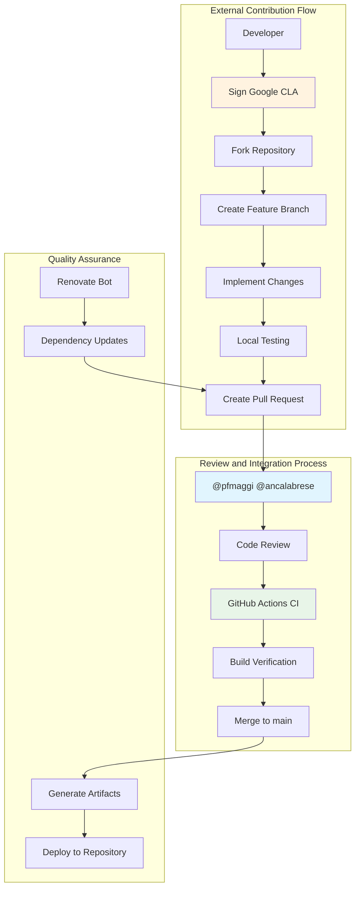
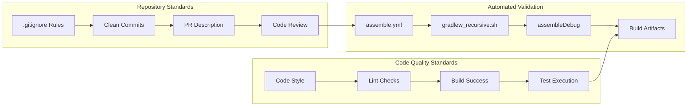
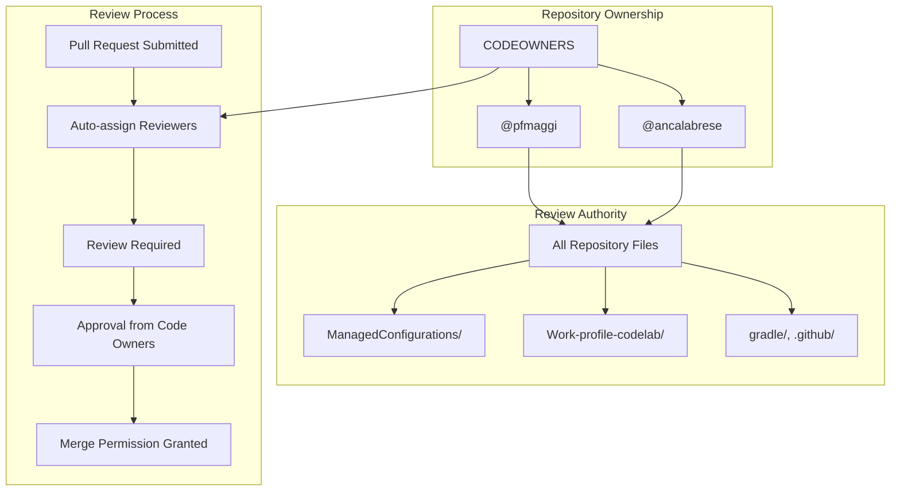
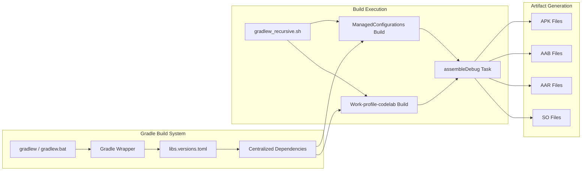
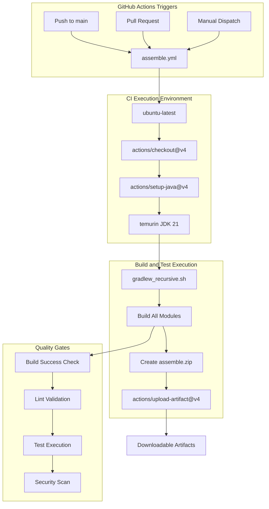

<!-- source: DeepWiki mcp.deepwiki.com · repo android/enterprise-samples · page 4 Development Guide · fetched 2026-10-23 -->

# Development Guide

Relevant source files

The following files were used as context for generating this wiki page:

- [.gitignore](.gitignore)
- [CODEOWNERS](CODEOWNERS)
- [CONTRIBUTING.md](CONTRIBUTING.md)
- [LICENSE](LICENSE)
- [README.md](README.md)

This document provides comprehensive guidelines for developing and contributing to the Android Enterprise Samples repository. It covers the development workflow, contribution requirements, code review processes, and automated maintenance systems that ensure code quality and project sustainability.

For detailed information about specific contribution requirements, see [Contributing Guidelines](#4.1). For code ownership structure and review processes, see [Code Ownership and Review](#4.2). For automated dependency management and maintenance, see [Automated Maintenance](#4.3).

## Development Workflow Overview

The Android Enterprise Samples repository follows a structured development workflow that balances open contribution with quality control and enterprise-grade reliability.

**Development Workflow Process**: This diagram illustrates the complete development lifecycle from external contribution through integration and quality assurance.

Sources: [CONTRIBUTING.md:1-29](), [CODEOWNERS:1](), [.github/workflows/assemble.yml]()

## Contribution Requirements

All contributions to the Android Enterprise Samples repository must meet specific legal and technical requirements before integration.

### Legal Requirements

| Requirement | Description | Reference |
|-------------|-------------|-----------|
| **Contributor License Agreement** | All contributors must sign Google's CLA before any code can be accepted | [CONTRIBUTING.md:6-16]() |
| **Apache 2.0 License** | All code contributions are licensed under Apache License Version 2.0 | [LICENSE:1-192]() |
| **Community Guidelines** | Contributors must follow Google's Open Source Community Guidelines | [CONTRIBUTING.md:25-28]() |

### Technical Requirements

**Technical Validation Process**: This diagram shows the automated and manual validation steps that ensure code quality and repository standards.

Sources: [CONTRIBUTING.md:18-23](), [.gitignore:1-37](), [.github/workflows/assemble.yml]()

## Code Ownership Structure

The repository implements a structured code ownership model to ensure consistent review quality and maintain project direction.

### Ownership Hierarchy

**Code Ownership and Review Structure**: This diagram shows how the `CODEOWNERS` file defines review requirements and the automated assignment process.

Sources: [CODEOWNERS:1](), [CONTRIBUTING.md:18-23]()

## Development Environment Setup

Developers working with the Android Enterprise Samples repository need to configure their environment to match the project's build requirements and standards.

### Required Tools and Versions

| Tool | Version/Configuration | Location |
|------|----------------------|----------|
| **Java Development Kit** | JDK 21 | CI configuration requirement |
| **Android Gradle Plugin** | Version defined in `libs.versions.toml` | [gradle/libs.versions.toml]() |
| **Gradle Wrapper** | Project-specific version | [gradlew](), [gradlew.bat]() |
| **Android SDK** | Latest stable with required API levels | Local configuration |

### Build System Configuration

**Build System Architecture**: This diagram shows the Gradle-based build system that compiles all sample applications and generates distributable artifacts.

Sources: [gradlew](), [gradlew.bat](), [gradle/libs.versions.toml](), [.github/workflows/assemble.yml]()

## Automated Quality Assurance

The repository employs multiple automated systems to maintain code quality, security, and dependency currency without requiring manual intervention.

### Continuous Integration Pipeline

**Continuous Integration Pipeline**: This diagram details the automated build and quality assurance process that runs on every code change.

Sources: [.github/workflows/assemble.yml](), [gradlew_recursive.sh]()

### Automated Dependency Management

The repository uses Renovate bot for automated dependency updates, ensuring security patches and feature updates are applied consistently across all modules.

| Component | Function | Configuration |
|-----------|----------|---------------|
| **Renovate Bot** | Automated dependency updates | Repository-level configuration |
| **Version Catalogs** | Centralized dependency management | [gradle/libs.versions.toml]() |
| **Security Updates** | Automatic security patch application | High priority scheduling |
| **Feature Updates** | Controlled feature dependency updates | Weekly scheduling |

Sources: [CONTRIBUTING.md:1-29](), [CODEOWNERS:1](), [LICENSE:1-192](), [.gitignore:1-37](), [README.md:1-6]()

---

