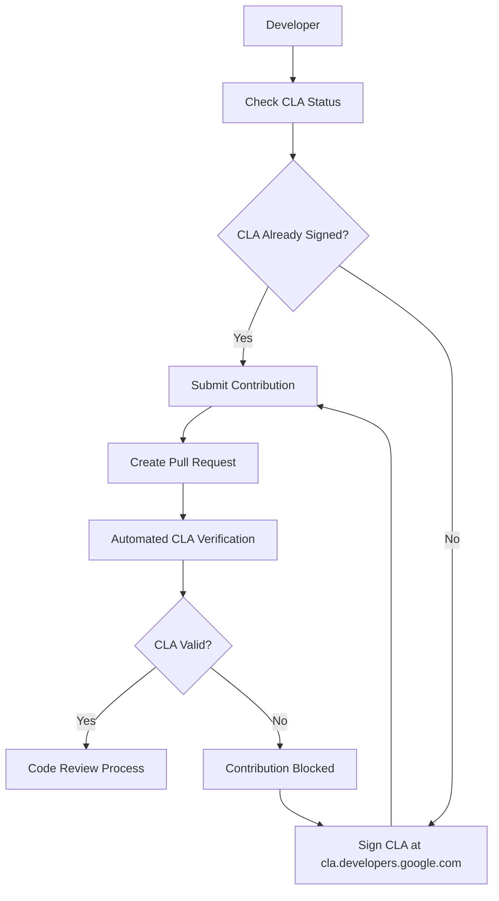
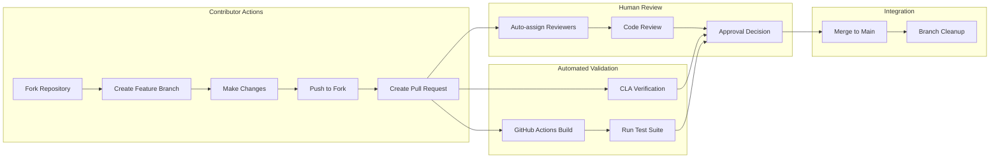
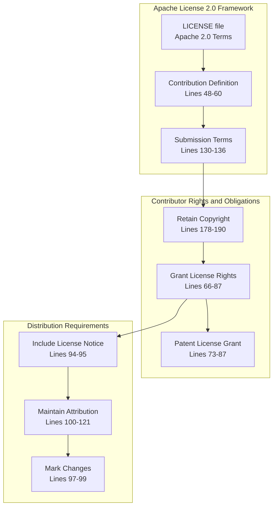
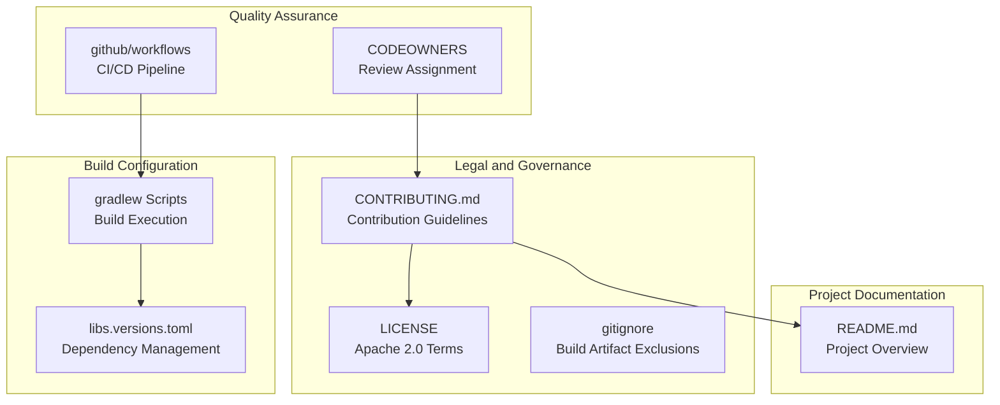

<!-- source: DeepWiki mcp.deepwiki.com · repo android/enterprise-samples · page 4.1 Contributing Guidelines · fetched 2026-10-23 -->

# Contributing Guidelines

Relevant source files

The following files were used as context for generating this wiki page:

- [.gitignore](.gitignore)
- [CONTRIBUTING.md](CONTRIBUTING.md)
- [LICENSE](LICENSE)
- [README.md](README.md)

This document outlines the requirements and processes for contributing code, documentation, and other improvements to the Android Enterprise Samples repository. It covers the legal requirements, review processes, and community standards that all contributors must follow.

For information about the code ownership structure and automated review processes, see [Code Ownership and Review](#4.2). For details about automated dependency updates and maintenance systems, see [Automated Maintenance](#4.3).

## Contributor License Agreement Requirements

All contributions to this project must be accompanied by a signed Contributor License Agreement (CLA). The CLA ensures that Google has the necessary rights to use and redistribute contributions while preserving the contributor's copyright ownership.

### CLA Process Overview

Contributors retain full copyright to their contributions, but the CLA grants Google permission to use and redistribute the code as part of the project. The CLA signing process is managed through Google's centralized system.

Key requirements:
- **Individual contributors**: Must sign a CLA before any contributions can be accepted
- **Corporate contributors**: Employers may need to sign a corporate CLA on behalf of their employees
- **One-time process**: CLAs are typically valid across multiple Google open source projects
- **Verification**: The CLA status is automatically checked for each pull request

### CLA Workflow

Sources: [CONTRIBUTING.md:6-16]()

## Code Review Process

All code submissions, including those from project maintainers, must undergo review before being merged. The repository uses GitHub's pull request system for managing code reviews and ensuring code quality.

### Review Requirements

| Requirement | Description | Enforcement |
|-------------|-------------|-------------|
| **Pull Request** | All changes must be submitted via GitHub pull requests | Mandatory |
| **Review Approval** | At least one approved review required before merge | Automated |
| **CI Validation** | All automated checks must pass | Blocking |
| **CLA Status** | Valid CLA must be on file | Blocking |

### GitHub Pull Request Workflow

The review process follows GitHub's standard pull request model with additional validation steps:

Sources: [CONTRIBUTING.md:18-23]()

## Community Guidelines Compliance

This project adheres to Google's Open Source Community Guidelines, which establish standards for respectful and productive collaboration within the open source community.

### Expected Behavior Standards

The community guidelines cover several key areas:

- **Respectful Communication**: All interactions should be professional and respectful
- **Constructive Feedback**: Code reviews and discussions should focus on technical merit
- **Inclusive Environment**: The project welcomes contributors from diverse backgrounds
- **Professional Conduct**: All communication should maintain professional standards

### Enforcement and Reporting

The guidelines provide mechanisms for reporting and addressing community standard violations. Project maintainers are responsible for enforcing these standards and may take corrective action when necessary.

Sources: [CONTRIBUTING.md:25-28]()

## Legal Framework and Licensing

The repository operates under the Apache License 2.0, which defines the legal framework for contributions and usage rights.

### License Terms for Contributors

### Key Legal Requirements

| Aspect | Requirement | License Section |
|--------|-------------|-----------------|
| **Contribution Licensing** | Automatic under Apache 2.0 unless explicitly stated otherwise | Section 5 |
| **Copyright Retention** | Contributors retain copyright to their work | Implied |
| **Patent Grant** | Contributors grant patent rights for their contributions | Section 3 |
| **Attribution** | Proper attribution must be maintained in distributions | Section 4(c) |
| **License Distribution** | Apache license must accompany any redistribution | Section 4(a) |

Sources: [LICENSE:1-192](), [CONTRIBUTING.md:8-10]()

## Repository File Structure for Contributors

Understanding the repository's governance and build structure helps contributors navigate the contribution process effectively.

### Governance Files Overview

### File Interaction Flow

The governance files work together to ensure consistent contribution handling:

1. **Entry Point**: `README.md` provides project overview for new contributors
2. **Legal Framework**: `LICENSE` establishes usage and contribution rights
3. **Process Guide**: `CONTRIBUTING.md` outlines specific contribution requirements
4. **Quality Control**: `.gitignore` prevents inappropriate file submissions
5. **Automation**: GitHub Actions and CODEOWNERS enforce policies automatically

Sources: [README.md:1-6](), [CONTRIBUTING.md:1-29](), [LICENSE:1-192](), [.gitignore:1-37]()

## Contribution Workflow Summary

The complete contribution process integrates legal, technical, and social requirements into a streamlined workflow that ensures high-quality contributions while maintaining project standards.

### End-to-End Process

| Phase | Actions | Validation | Files Involved |
|-------|---------|------------|----------------|
| **Preparation** | Fork repository, read guidelines | Manual review | `README.md`, `CONTRIBUTING.md` |
| **Legal Compliance** | Sign CLA if needed | Automated check | CLA system, `LICENSE` |
| **Development** | Create branch, implement changes | Local testing | Source files, `.gitignore` |
| **Submission** | Create pull request | Automated CI/CD | GitHub Actions workflow |
| **Review** | Code review by maintainers | Human approval | `CODEOWNERS` assignments |
| **Integration** | Merge approved changes | Automated merge | Git history |

This structured approach ensures that all contributions meet the project's legal, technical, and community standards while providing clear guidance for contributors at each step of the process.

Sources: [CONTRIBUTING.md:1-29](), [LICENSE:1-192]()

---

