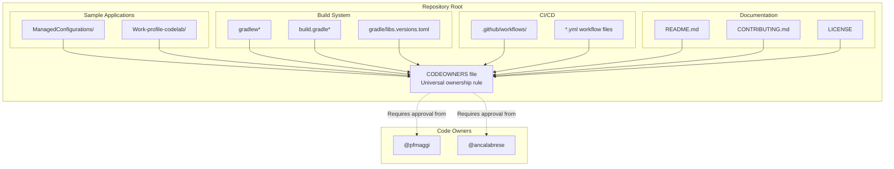
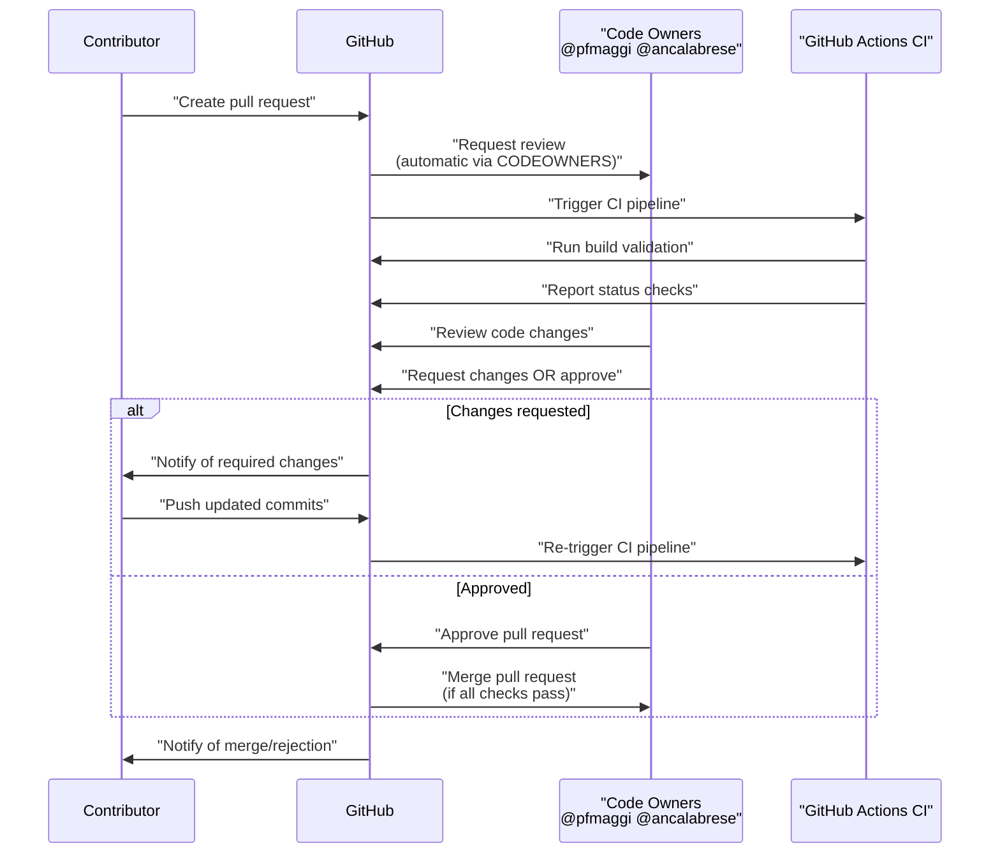
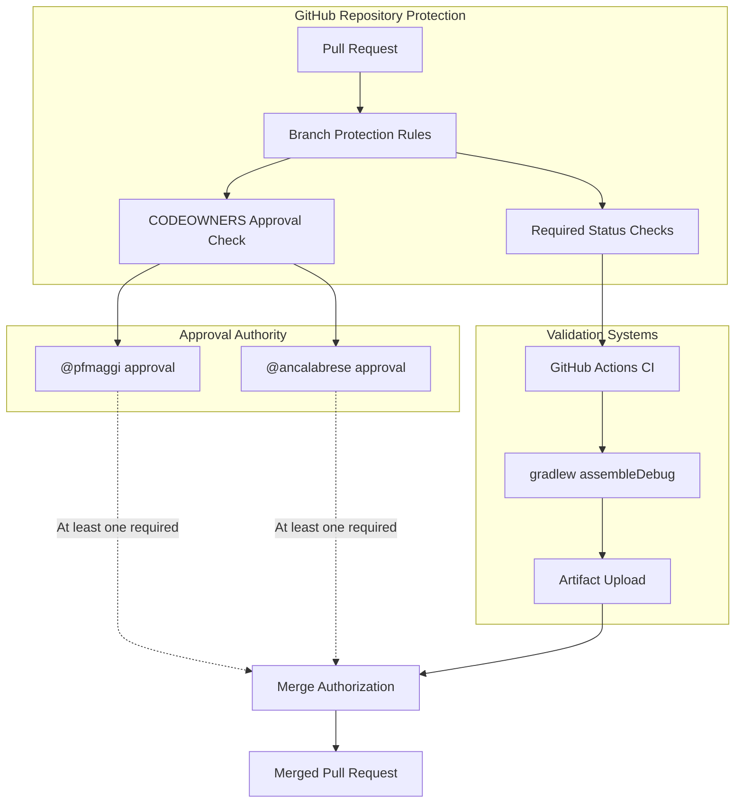
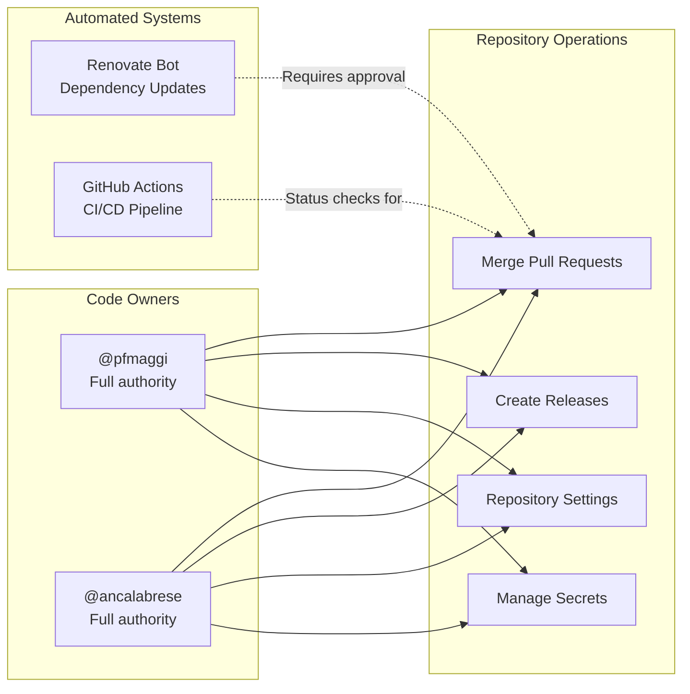

<!-- source: DeepWiki mcp.deepwiki.com · repo android/enterprise-samples · page 4.2 Code Ownership and Review · fetched 2026-10-23 -->

# Code Ownership and Review

Relevant source files

The following files were used as context for generating this wiki page:

- [CODEOWNERS](CODEOWNERS)

## Purpose and Scope

This document describes the code ownership structure and review process for the Android Enterprise Samples repository. It covers the designated code owners, their responsibilities, and the workflow for reviewing and approving changes to the codebase.

For information about contributing guidelines and external contributor requirements, see [Contributing Guidelines](#4.1). For details about automated maintenance systems, see [Automated Maintenance](#4.3).

## Code Ownership Structure

The repository implements a centralized code ownership model through GitHub's `CODEOWNERS` mechanism. All files and directories in the repository are owned by two designated maintainers who have final authority over code changes.

### Designated Code Owners

The current code owners are defined in [CODEOWNERS:1]() and include:

| GitHub Handle | Role |
|---------------|------|
| `@pfmaggi` | Primary code owner and maintainer |
| `@ancalabrese` | Secondary code owner and maintainer |

The ownership rule `* @pfmaggi @ancalabrese` applies universally to all files in the repository, ensuring consistent oversight across all sample applications, build configurations, and documentation.

**Code Ownership Scope Diagram**

Sources: [CODEOWNERS:1]()

## Review Process Workflow

The repository enforces a mandatory review process for all changes through GitHub's pull request system. The `CODEOWNERS` file integration ensures that designated owners must approve changes before they can be merged.

### Pull Request Review Flow

Sources: [CODEOWNERS:1]()

### Review Requirements and Enforcement

The GitHub repository configuration enforces several requirements before any pull request can be merged:

| Requirement | Enforcement Mechanism | Purpose |
|-------------|----------------------|---------|
| Code owner approval | `CODEOWNERS` file | Ensures maintainer oversight |
| Status checks | GitHub Actions CI | Validates build and tests |
| Up-to-date branch | Branch protection rules | Prevents integration conflicts |

**Review Enforcement Architecture**

Sources: [CODEOWNERS:1]()

## Integration with Repository Systems

The code ownership system integrates with several repository automation systems to ensure consistent quality and maintenance standards.

### Automated Review Triggers

The `CODEOWNERS` configuration automatically triggers review requests for various types of changes:

- **Sample Application Code**: Changes to `ManagedConfigurations/` and `Work-profile-codelab/` directories
- **Build System Updates**: Modifications to Gradle wrapper scripts, build configurations, and version catalogs
- **CI/CD Changes**: Updates to GitHub Actions workflows in `.github/workflows/`
- **Documentation**: Changes to README files, contributing guidelines, and license information

### Owner Responsibilities

Code owners have several key responsibilities in maintaining the repository:

| Responsibility | Description | Systems Involved |
|----------------|-------------|------------------|
| Code quality review | Ensure adherence to Android development best practices | GitHub pull request reviews |
| Security oversight | Review changes for security implications in enterprise contexts | Manual review process |
| Dependency management | Approve dependency updates from Renovate bot | GitHub integration with Renovate |
| Release coordination | Manage versioning and release processes | GitHub Actions CI/CD |
| Community interaction | Respond to issues and guide external contributors | GitHub issue tracking |

**Owner Authority Matrix**

Sources: [CODEOWNERS:1]()

## Quality Assurance Integration

The code ownership system works in conjunction with automated quality assurance systems to maintain high standards across the repository.

### Review Checklist Integration

Code owners follow a systematic approach when reviewing changes, particularly for the enterprise-focused sample applications:

- **Enterprise Feature Compliance**: Ensure compatibility with Android Enterprise APIs
- **Sample Application Integrity**: Verify that changes maintain educational value
- **Build System Stability**: Confirm that build configurations remain functional
- **Documentation Accuracy**: Ensure that code changes are reflected in documentation

The distributed ownership model between `@pfmaggi` and `@ancalabrese` provides redundancy and ensures that critical changes receive appropriate oversight, while the universal ownership rule in the `CODEOWNERS` file guarantees that no part of the repository can be modified without proper review.

Sources: [CODEOWNERS:1]()

---

