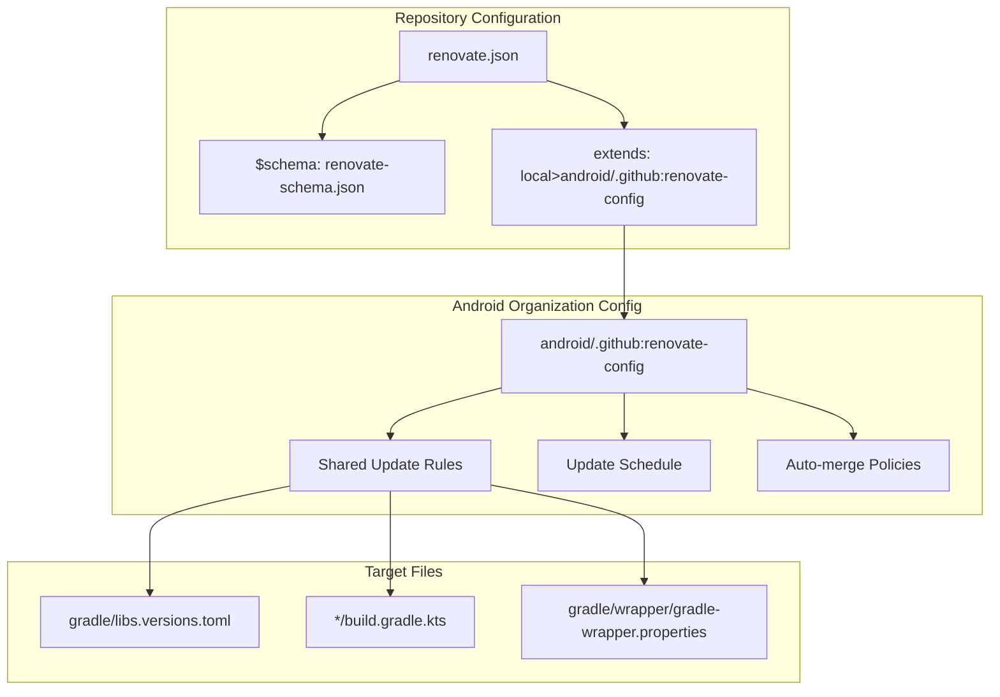
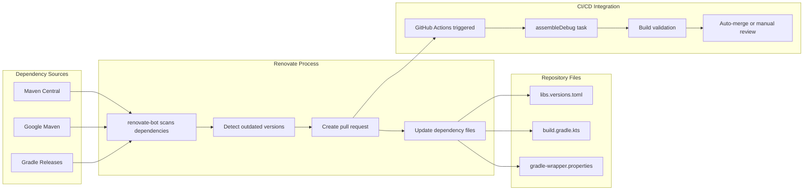

<!-- source: DeepWiki mcp.deepwiki.com · repo android/enterprise-samples · page 4.3 Automated Maintenance · fetched 2026-10-23 -->

# Automated Maintenance

Relevant source files

The following files were used as context for generating this wiki page:

- [renovate.json](renovate.json)

This document covers the automated maintenance systems that keep the Android Enterprise Samples repository up-to-date without manual intervention. The primary focus is on dependency management through Renovate bot configuration and its integration with the repository's CI/CD infrastructure.

For information about the CI/CD pipeline that validates these automated changes, see [CI/CD Pipeline](#3.1). For details about the build system that these maintenance tools interact with, see [Build System](#3).

## Overview

The repository employs automated maintenance systems to ensure dependencies remain current and security vulnerabilities are addressed promptly. The primary automated maintenance tool is Renovate bot, which monitors dependencies across all sample applications and submits pull requests for updates.

Sources: [renovate.json:1-6]()

## Renovate Configuration

The repository uses Renovate bot for automated dependency updates through a minimal configuration that extends shared settings from the Android organization.

### Configuration Structure

**Renovate Configuration Flow**

The configuration is intentionally minimal, delegating most settings to the shared Android organization configuration. This approach ensures consistency across Android repositories while reducing maintenance overhead.

Sources: [renovate.json:1-6]()

### Key Configuration Elements

| Element | Purpose | File Reference |
|---------|---------|----------------|
| `$schema` | Provides IDE support and validation | [renovate.json:2]() |
| `extends` | Inherits shared configuration from Android org | [renovate.json:3-5]() |
| Local reference | Points to `android/.github:renovate-config` | [renovate.json:4]() |

The `local>android/.github:renovate-config` reference indicates that Renovate loads configuration from the Android organization's shared `.github` repository, ensuring consistent behavior across all Android repositories.

Sources: [renovate.json:1-6]()

## Automated Update Workflow

**Automated Dependency Update Process**

Sources: [renovate.json:1-6]()

## Integration Points

### CI/CD Pipeline Integration

Renovate-generated pull requests automatically trigger the GitHub Actions workflow, ensuring that dependency updates are validated before merge. The workflow executes the same build and test processes as developer-submitted changes.

The integration follows this pattern:
1. Renovate creates pull request with dependency updates
2. GitHub Actions workflow triggers automatically
3. Build process validates all sample applications
4. Artifacts are generated and stored
5. Pull request is either auto-merged or flagged for review based on shared policies

### Build System Interaction

Renovate directly modifies build configuration files that are managed by the Gradle build system:

| Target File Type | Purpose | Example Updates |
|------------------|---------|-----------------|
| Version catalogs | Centralized dependency versions | Android SDK, Kotlin version updates |
| Build scripts | Module-specific dependencies | Library version bumps |
| Gradle wrapper | Build tool version | Gradle distribution updates |

Sources: [renovate.json:1-6]()

## Benefits and Maintenance Reduction

The automated maintenance system provides several key advantages:

- **Security**: Automatically applies security patches in dependencies
- **Consistency**: Uses shared Android organization policies
- **Validation**: All updates are tested through CI/CD pipeline
- **Reduced Manual Work**: Eliminates need for manual dependency monitoring
- **Timely Updates**: Ensures samples demonstrate current best practices

The minimal configuration approach means that policy changes and improvements made at the organization level automatically apply to this repository without requiring local configuration updates.

Sources: [renovate.json:1-6]()