# Page: Overview

# Overview

<details>
<summary>Relevant source files</summary>

The following files were used as context for generating this wiki page:

- [.gitignore](.gitignore)
- [CONTRIBUTING.md](CONTRIBUTING.md)
- [LICENSE](LICENSE)
- [README.md](README.md)

</details>


## Purpose and Scope

This document provides a comprehensive overview of the Android Enterprise Samples repository, which contains sample Android applications demonstrating Android Enterprise features. The repository serves as both educational material for developers learning enterprise Android development and reference implementations for production use.

For detailed information about individual sample applications, see [Sample Applications](#2). For build system documentation, see [Build System](#3). For contribution guidelines, see [Development Guide](#4).

## Repository Structure

The repository is organized into distinct functional areas that support both the sample applications and the development infrastructure.

### High-Level Architecture

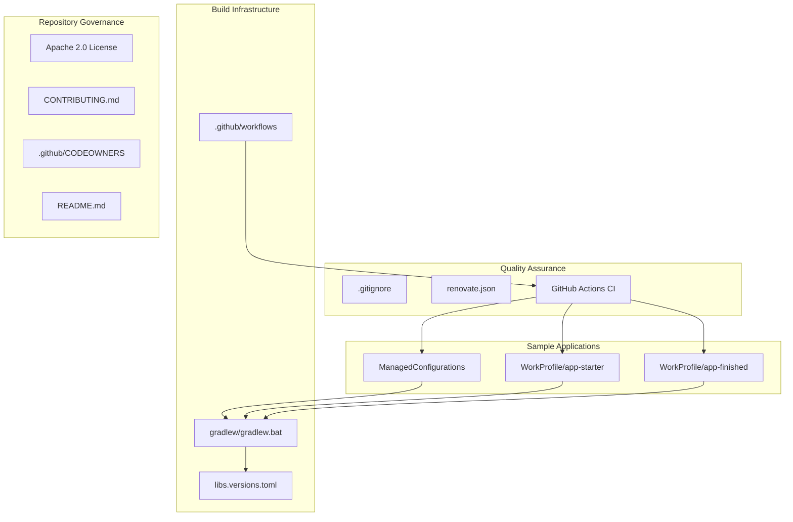

**Repository Component Overview**

| Component | Purpose | Key Files |
|-----------|---------|-----------|
| Sample Applications | Demonstrate Android Enterprise features | `ManagedConfigurations/`, `WorkProfile/app-starter/`, `WorkProfile/app-finished/` |
| Build System | Gradle-based build automation | `gradlew`, `gradlew.bat`, `libs.versions.toml` |
| CI/CD Pipeline | Automated testing and artifact generation | `.github/workflows/` |
| Governance | Legal framework and contribution guidelines | `LICENSE`, `CONTRIBUTING.md`, `.github/CODEOWNERS` |

Sources: [README.md:1-6](), [LICENSE:1-192](), [CONTRIBUTING.md:1-29](), [.gitignore:1-37]()

## Sample Applications Overview

The repository contains two primary sample applications that demonstrate different Android Enterprise capabilities:

### Enterprise Feature Mapping

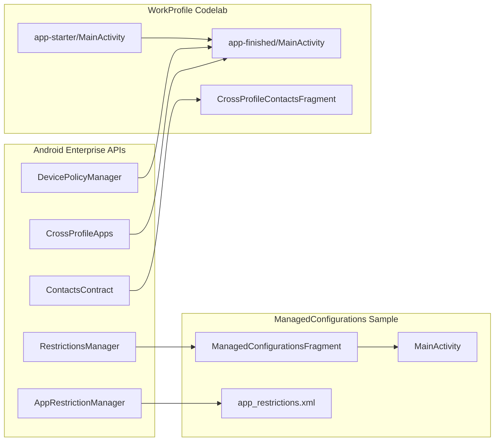

**Sample Application Features**

| Application | Enterprise Feature | Target Audience | Implementation Status |
|-------------|-------------------|-----------------|---------------------|
| ManagedConfigurations | App Restrictions & Managed Configurations | EMM administrators, developers | Complete implementation |
| WorkProfile/app-starter | Work Profile basics | Learning developers | Basic implementation |
| WorkProfile/app-finished | Cross-profile contacts & apps | Learning developers | Complete implementation |

Sources: [README.md:4-5]()

## Development Ecosystem

The repository implements a comprehensive development ecosystem with automated quality assurance and contributor management.

### Contribution and Build Workflow

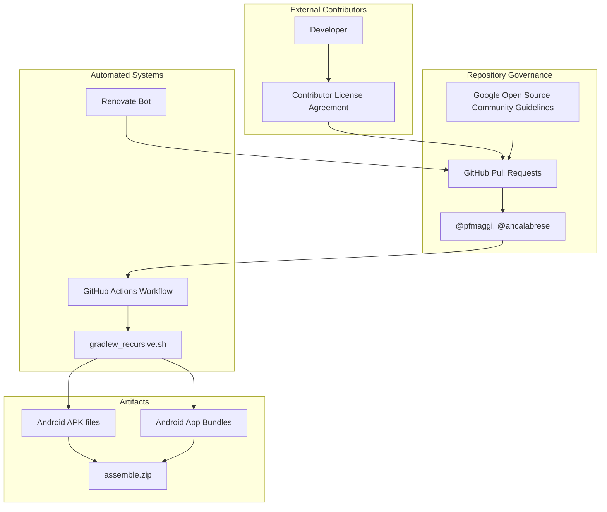

**Development Process Requirements**

| Requirement | Description | Reference |
|-------------|-------------|-----------|
| Contributor License Agreement | Required for all contributions | [CONTRIBUTING.md:6-16]() |
| Code Review | All submissions require review via GitHub PRs | [CONTRIBUTING.md:18-23]() |
| Community Guidelines | Must follow Google's Open Source Community Guidelines | [CONTRIBUTING.md:25-28]() |
| Apache 2.0 License | All code distributed under Apache License 2.0 | [LICENSE:1-192]() |

Sources: [CONTRIBUTING.md:1-29](), [LICENSE:1-192]()

## Technical Specifications

### Build System Requirements

The repository uses a standardized Android build environment with the following specifications:

- **Build Tool**: Gradle with wrapper scripts
- **License**: Apache License 2.0
- **Contribution Process**: GitHub PRs with CLA requirement
- **Quality Assurance**: Automated CI/CD pipeline
- **Dependency Management**: Centralized version catalogs

### Repository Metadata

| Property | Value |
|----------|--------|
| License | Apache 2.0 |
| Primary Language | Java/Kotlin (Android) |
| Build System | Gradle |
| CI/CD Platform | GitHub Actions |
| Code Owners | @pfmaggi, @ancalabrese |

Sources: [README.md:1-6](), [LICENSE:1-2](), [CONTRIBUTING.md:27-28]()

## Getting Started

To work with this repository:

1. **Review License Terms**: All usage is governed by [LICENSE:1-192]()
2. **Read Contribution Guidelines**: See [CONTRIBUTING.md:1-29]() for submission requirements
3. **Explore Sample Applications**: Start with the applications documented in [Sample Applications](#2)
4. **Understand Build System**: Refer to [Build System](#3) for compilation and CI/CD details

The repository provides both educational codelabs and production-ready sample implementations for Android Enterprise feature development.

Sources: [README.md:1-6](), [CONTRIBUTING.md:1-29](), [LICENSE:1-192]()

---

# Page: Sample Applications

# Sample Applications

<details>
<summary>Relevant source files</summary>

The following files were used as context for generating this wiki page:

- [ManagedConfigurations/app/src/main/java/com/example/android/managedconfigurations/MainActivity.kt](ManagedConfigurations/app/src/main/java/com/example/android/managedconfigurations/MainActivity.kt)
- [ManagedConfigurations/app/src/main/java/com/example/android/managedconfigurations/ManagedConfigurationsFragment.kt](ManagedConfigurations/app/src/main/java/com/example/android/managedconfigurations/ManagedConfigurationsFragment.kt)
- [ManagedConfigurations/app/src/main/res/values/styles.xml](ManagedConfigurations/app/src/main/res/values/styles.xml)
- [ManagedConfigurations/build.gradle.kts](ManagedConfigurations/build.gradle.kts)
- [ManagedConfigurations/gradle.properties](ManagedConfigurations/gradle.properties)
- [Work-profile-codelab/app-finished/src/main/java/com/example/workprofile/MainActivity.kt](Work-profile-codelab/app-finished/src/main/java/com/example/workprofile/MainActivity.kt)
- [Work-profile-codelab/app-finished/src/main/res/values/styles.xml](Work-profile-codelab/app-finished/src/main/res/values/styles.xml)

</details>


This document provides an overview of the two main sample applications in the Android Enterprise Samples repository that demonstrate different enterprise capabilities. These applications serve as practical examples and learning resources for developers implementing Android Enterprise features.

For detailed documentation of each individual sample application, see [ManagedConfigurations Sample](#2.1) and [Work Profile Codelab](#2.2). For information about the build system and CI/CD infrastructure that supports these applications, see [Build System](#3).

## Repository Structure and Sample Applications

The repository contains two distinct sample applications that demonstrate different aspects of Android Enterprise functionality:

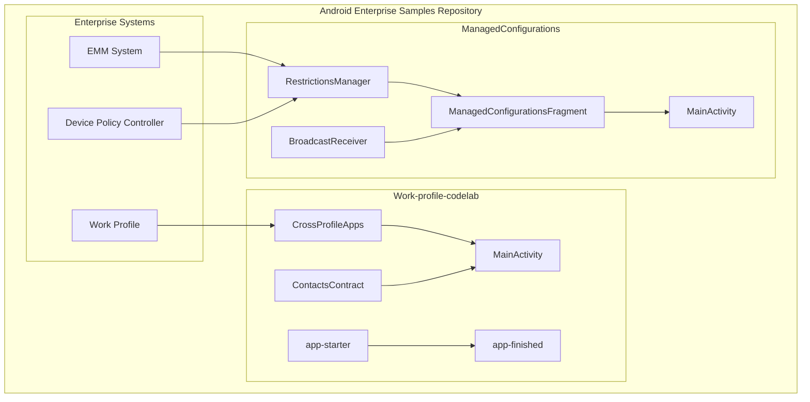

**Sample Applications Architecture Overview**

Sources: [ManagedConfigurations/app/src/main/java/com/example/android/managedconfigurations/MainActivity.kt:1-117](), [Work-profile-codelab/app-finished/src/main/java/com/example/workprofile/MainActivity.kt:1-156](), [ManagedConfigurations/app/src/main/java/com/example/android/managedconfigurations/ManagedConfigurationsFragment.kt:1-255]()

## Sample Applications Overview

| Sample Application | Primary Purpose | Key Components | Target Use Case |
|-------------------|----------------|----------------|-----------------|
| ManagedConfigurations | Demonstrates app restrictions and managed configurations | `RestrictionsManager`, `BroadcastReceiver`, `RestrictionEntry` | Enterprise app configuration management |
| Work-profile-codelab | Teaches work profile implementation with starter and finished versions | `CrossProfileApps`, `ContactsContract`, profile switching | Cross-profile application development |

## ManagedConfigurations Sample

The ManagedConfigurations sample demonstrates how applications can receive and respond to restrictions set by enterprise administrators through EMM systems or Device Policy Controllers.

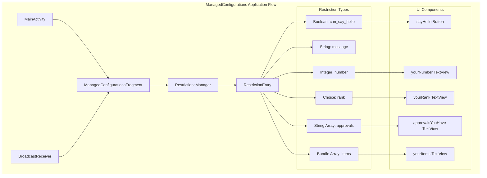

**ManagedConfigurations Component Architecture**

The sample handles six different types of restrictions defined in [ManagedConfigurations/app/src/main/java/com/example/android/managedconfigurations/ManagedConfigurationsFragment.kt:245-252]():

- `KEY_CAN_SAY_HELLO`: Boolean restriction controlling button enablement
- `KEY_MESSAGE`: String restriction for toast message content  
- `KEY_NUMBER`: Integer restriction displayed in UI
- `KEY_RANK`: Choice restriction from predefined options
- `KEY_APPROVALS`: String array restriction for multiple selections
- `KEY_ITEMS`: Bundle array restriction for complex data structures

Sources: [ManagedConfigurations/app/src/main/java/com/example/android/managedconfigurations/ManagedConfigurationsFragment.kt:101-133](), [ManagedConfigurations/app/src/main/java/com/example/android/managedconfigurations/MainActivity.kt:56-61]()

## Work Profile Codelab

The Work Profile Codelab provides both starter and finished implementations to teach developers how to build applications that work seamlessly across personal and work profiles.

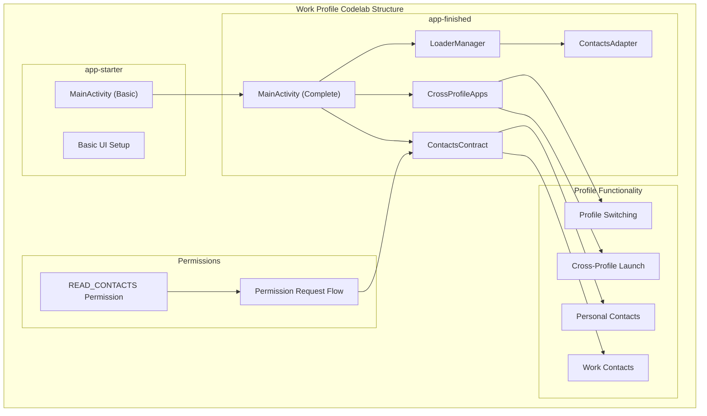

**Work Profile Codelab Learning Progression**

The finished implementation in [Work-profile-codelab/app-finished/src/main/java/com/example/workprofile/MainActivity.kt:75-86]() demonstrates key cross-profile functionality:

- Profile detection using `CrossProfileApps.targetUserProfiles`
- Profile switching with `CrossProfileApps.startMainActivity()`
- Dual contact loading from personal and enterprise directories
- Permission handling for cross-profile contact access

The application loads contacts from both profiles using different `ContactsContract` URIs:
- Personal contacts: `ContactsContract.Contacts.CONTENT_URI`
- Work contacts: `ContactsContract.Contacts.ENTERPRISE_CONTENT_FILTER_URI`

Sources: [Work-profile-codelab/app-finished/src/main/java/com/example/workprofile/MainActivity.kt:108-136](), [Work-profile-codelab/app-finished/src/main/java/com/example/workprofile/MainActivity.kt:75-86](), [Work-profile-codelab/app-finished/src/main/java/com/example/workprofile/MainActivity.kt:65-73]()

## Enterprise Integration Points

Both sample applications demonstrate different aspects of Android Enterprise integration:

| Integration Area | ManagedConfigurations | Work Profile Codelab |
|-----------------|---------------------|-------------------|
| **EMM Communication** | `RestrictionsManager.applicationRestrictions` | `CrossProfileApps.targetUserProfiles` |
| **Runtime Updates** | `Intent.ACTION_APPLICATION_RESTRICTIONS_CHANGED` | Profile state changes |
| **Data Access** | Restriction values and types | Cross-profile contacts |
| **User Experience** | Dynamically configured UI | Seamless profile switching |

The ManagedConfigurations sample uses [ManagedConfigurations/app/src/main/java/com/example/android/managedconfigurations/ManagedConfigurationsFragment.kt:82-85]() to register for restriction changes, while the Work Profile Codelab demonstrates cross-profile capabilities through [Work-profile-codelab/app-finished/src/main/java/com/example/workprofile/MainActivity.kt:75-86]().

Sources: [ManagedConfigurations/app/src/main/java/com/example/android/managedconfigurations/ManagedConfigurationsFragment.kt:77-85](), [Work-profile-codelab/app-finished/src/main/java/com/example/workprofile/MainActivity.kt:42-87]()

---

# Page: ManagedConfigurations Sample

# ManagedConfigurations Sample

<details>
<summary>Relevant source files</summary>

The following files were used as context for generating this wiki page:

- [ManagedConfigurations/app/build.gradle.kts](ManagedConfigurations/app/build.gradle.kts)
- [ManagedConfigurations/app/src/main/AndroidManifest.xml](ManagedConfigurations/app/src/main/AndroidManifest.xml)
- [ManagedConfigurations/app/src/main/java/com/example/android/managedconfigurations/MainActivity.kt](ManagedConfigurations/app/src/main/java/com/example/android/managedconfigurations/MainActivity.kt)
- [ManagedConfigurations/app/src/main/java/com/example/android/managedconfigurations/ManagedConfigurationsFragment.kt](ManagedConfigurations/app/src/main/java/com/example/android/managedconfigurations/ManagedConfigurationsFragment.kt)
- [ManagedConfigurations/app/src/main/res/values/styles.xml](ManagedConfigurations/app/src/main/res/values/styles.xml)
- [ManagedConfigurations/build.gradle.kts](ManagedConfigurations/build.gradle.kts)
- [ManagedConfigurations/gradle.properties](ManagedConfigurations/gradle.properties)

</details>


## Purpose and Scope

The ManagedConfigurations sample demonstrates how to implement Android app restrictions (managed configurations) in an enterprise application. This sample shows how applications can receive and respond to configuration policies set by Enterprise Mobility Management (EMM) systems or Device Policy Controllers (DPC). The application displays various types of restrictions including boolean toggles, text messages, numbers, choice selections, and complex bundle data structures.

For information about work profile functionality and cross-profile app interactions, see [Work Profile Codelab](#2.2).

## Application Architecture

The ManagedConfigurations sample follows a standard Android Activity-Fragment architecture with enterprise-specific components integrated for restriction handling.

### Component Overview

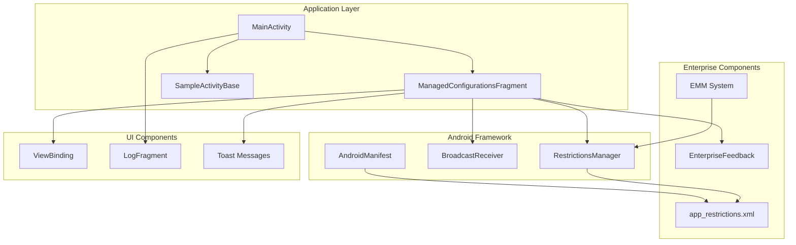

**Sources:** [ManagedConfigurations/app/src/main/java/com/example/android/managedconfigurations/MainActivity.kt:40-117](), [ManagedConfigurations/app/src/main/java/com/example/android/managedconfigurations/ManagedConfigurationsFragment.kt:40-255](), [ManagedConfigurations/app/src/main/AndroidManifest.xml:22-41]()

### Class Hierarchy and Relationships

```mermaid
classDiagram
    class MainActivity {
        -logShown: Boolean
        -binding: ActivityMainBinding
        +onCreate(Bundle)
        +onCreateOptionsMenu(Menu)
        +onOptionsItemSelected(MenuItem)
        +initializeLogging()
    }
    
    class ManagedConfigurationsFragment {
        -message: String?
        -broadcastReceiver: BroadcastReceiver?
        -binding: FragmentManagedConfigurationsBinding
        +resolveRestrictions()
        +updateCanSayHello(RestrictionEntry, Bundle?)
        +updateMessage(RestrictionEntry, Bundle?)
        +onClick(View)
    }
    
    class SampleActivityBase {
        +initializeLogging()
    }
    
    class RestrictionsManager {
        +getApplicationRestrictions(): Bundle
        +getManifestRestrictions(String): List~RestrictionEntry~
    }
    
    MainActivity --|> SampleActivityBase
    MainActivity --> ManagedConfigurationsFragment
    ManagedConfigurationsFragment --> RestrictionsManager
    ManagedConfigurationsFragment ..|> "View.OnClickListener"
```

**Sources:** [ManagedConfigurations/app/src/main/java/com/example/android/managedconfigurations/MainActivity.kt:40-117](), [ManagedConfigurations/app/src/main/java/com/example/android/managedconfigurations/ManagedConfigurationsFragment.kt:40-255]()

## App Restrictions Framework Integration

The sample integrates with Android's app restrictions framework through the `RestrictionsManager` system service and manifest declarations.

### Restrictions Configuration

| Restriction Key | Type | Purpose | Default Behavior |
|---|---|---|---|
| `can_say_hello` | Boolean | Controls button enablement | Uses manifest default |
| `message` | String | Custom toast message | Uses manifest default |
| `number` | Integer | Numeric display value | Uses manifest default |
| `rank` | Choice | Selection from predefined options | Uses manifest default |
| `approvals` | String Array | Multiple selection values | Uses manifest default |
| `items` | Bundle Array | Complex structured data | Uses manifest default (API 23+) |

**Sources:** [ManagedConfigurations/app/src/main/java/com/example/android/managedconfigurations/ManagedConfigurationsFragment.kt:242-253]()

### Restriction Resolution Flow

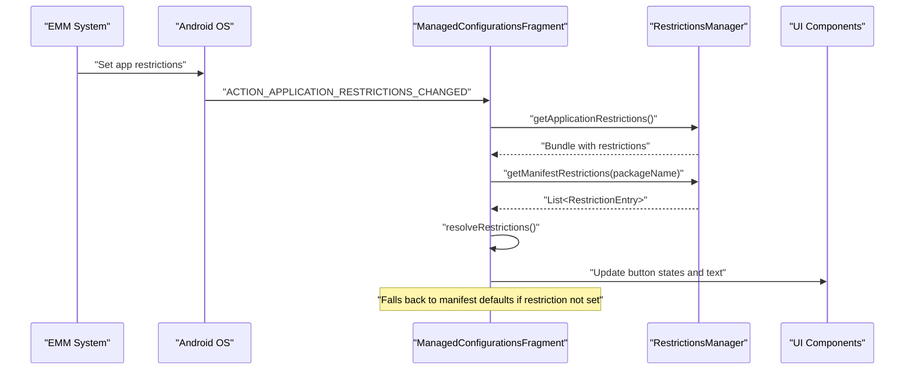

**Sources:** [ManagedConfigurations/app/src/main/java/com/example/android/managedconfigurations/ManagedConfigurationsFragment.kt:101-133](), [ManagedConfigurations/app/src/main/java/com/example/android/managedconfigurations/ManagedConfigurationsFragment.kt:76-86]()

## Configuration Handling Implementation

### Restrictions Manager Integration

The `ManagedConfigurationsFragment` uses the `RestrictionsManager` to retrieve both applied restrictions and manifest-defined defaults:

```kotlin
// From resolveRestrictions() method
val manager = requireActivity().getSystemService(Context.RESTRICTIONS_SERVICE) as RestrictionsManager
val restrictions = manager.applicationRestrictions
val entries = manager.getManifestRestrictions(requireActivity().applicationContext.packageName)
```

**Sources:** [ManagedConfigurations/app/src/main/java/com/example/android/managedconfigurations/ManagedConfigurationsFragment.kt:102-107]()

### Dynamic Restriction Updates

The application registers a `BroadcastReceiver` to handle real-time restriction changes:

| Lifecycle Method | Action | Purpose |
|---|---|---|
| `onStart()` | Register receiver for `ACTION_APPLICATION_RESTRICTIONS_CHANGED` | Enable real-time updates |
| `onStop()` | Unregister receiver | Clean up resources |
| `onResume()` | Call `resolveRestrictions()` | Refresh on activity resume |

**Sources:** [ManagedConfigurations/app/src/main/java/com/example/android/managedconfigurations/ManagedConfigurationsFragment.kt:75-94]()

### Enterprise Feedback Integration

The sample uses the `androidx.enterprise.feedback` library to provide telemetry back to EMM systems:

```kotlin
activity?.enterpriseFeedback(KEY_CAN_SAY_HELLO, "Value is $canSayHello", "$canSayHello")
```

**Sources:** [ManagedConfigurations/app/src/main/java/com/example/android/managedconfigurations/ManagedConfigurationsFragment.kt:142](), [ManagedConfigurations/app/build.gradle.kts:64-66]()

## User Interface Components

### Main Activity Structure

The `MainActivity` provides a dual-pane layout with logging capabilities:

- **Primary Content**: Hosts `ManagedConfigurationsFragment` in `R.id.sample_content_fragment`
- **Secondary Content**: Optional `LogFragment` for debugging output
- **Toggle Mechanism**: Menu item to switch between content and log views

**Sources:** [ManagedConfigurations/app/src/main/java/com/example/android/managedconfigurations/MainActivity.kt:56-61](), [ManagedConfigurations/app/src/main/java/com/example/android/managedconfigurations/MainActivity.kt:76-90]()

### Fragment UI Binding

The `ManagedConfigurationsFragment` uses ViewBinding for type-safe view access:

| UI Element | Binding Property | Purpose |
|---|---|---|
| Say Hello Button | `binding.sayHello` | Demonstrates boolean restriction |
| Number Display | `binding.yourNumber` | Shows integer restriction |
| Rank Display | `binding.yourRank` | Shows choice restriction |
| Approvals Display | `binding.approvalsYouHave` | Shows multi-select restriction |
| Items Display | `binding.yourItems` | Shows bundle array restriction (API 23+) |

**Sources:** [ManagedConfigurations/app/src/main/java/com/example/android/managedconfigurations/ManagedConfigurationsFragment.kt:47-68]()

### API Level Compatibility

The sample handles API level differences for bundle array support:

```kotlin
private val BUNDLE_SUPPORTED = Build.VERSION.SDK_INT >= 23
```

Items functionality is conditionally displayed based on this flag.

**Sources:** [ManagedConfigurations/app/src/main/java/com/example/android/managedconfigurations/ManagedConfigurationsFragment.kt:253](), [ManagedConfigurations/app/src/main/java/com/example/android/managedconfigurations/ManagedConfigurationsFragment.kt:63-67]()

## Build Configuration

### Module Structure

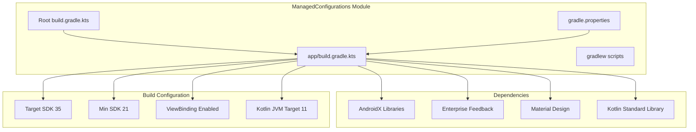

**Sources:** [ManagedConfigurations/app/build.gradle.kts:22-55](), [ManagedConfigurations/build.gradle.kts:17-20](), [ManagedConfigurations/gradle.properties:1-23]()

### Key Dependencies

| Dependency | Purpose | Version Source |
|---|---|---|
| `androidx.enterprise.feedback` | EMM telemetry integration | Version catalog |
| `androidx.enterprise.feedback.testing` | Testing enterprise features | Version catalog |
| `androidx.core.ktx` | Android KTX extensions | Version catalog |
| `material` | Material Design components | Version catalog |
| `androidx.activity` | Modern activity APIs | Version catalog |

**Sources:** [ManagedConfigurations/app/build.gradle.kts:57-70]()

### Application Configuration

| Setting | Value | Purpose |
|---|---|---|
| `namespace` | `com.example.android.managedconfigurations` | Package namespace |
| `applicationId` | `com.example.android.managedconfigurations` | Unique app identifier |
| `compileSdk` | 35 | Latest SDK for compilation |
| `minSdk` | 21 | Android 5.0+ support |
| `targetSdk` | 35 | Target latest platform features |

**Sources:** [ManagedConfigurations/app/build.gradle.kts:23-31]()

---

# Page: Work Profile Codelab

# Work Profile Codelab

<details>
<summary>Relevant source files</summary>

The following files were used as context for generating this wiki page:

- [Work-profile-codelab/app-finished/src/main/java/com/example/workprofile/MainActivity.kt](Work-profile-codelab/app-finished/src/main/java/com/example/workprofile/MainActivity.kt)
- [Work-profile-codelab/app-finished/src/main/res/values/styles.xml](Work-profile-codelab/app-finished/src/main/res/values/styles.xml)
- [Work-profile-codelab/app-starter/src/main/java/com/example/workprofile/MainActivity.kt](Work-profile-codelab/app-starter/src/main/java/com/example/workprofile/MainActivity.kt)

</details>


## Purpose and Scope

The Work Profile Codelab is an educational sample application that teaches developers how to build Android applications that work seamlessly across work and personal profiles in an Android Enterprise environment. This codelab demonstrates cross-profile functionality, enterprise contact access, and profile switching capabilities.

The codelab is structured as a progressive learning experience with two implementations: a starter version with basic functionality and a finished version with complete cross-profile features. For information about managed configurations and app restrictions, see [ManagedConfigurations Sample](#2.1).

## Architecture Overview

The Work Profile Codelab demonstrates the interaction between Android's work profile system and application code through two distinct implementations.

### System Architecture

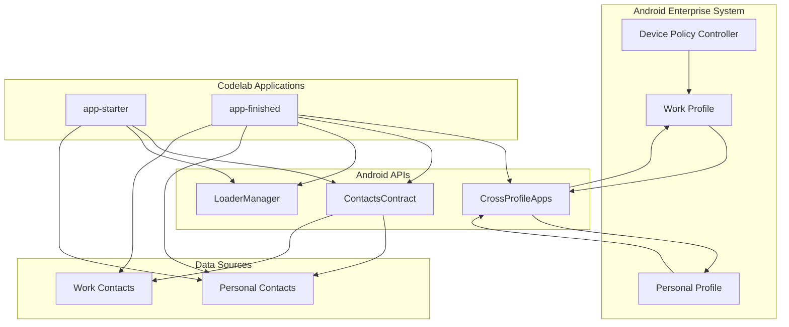

Sources: [Work-profile-codelab/app-starter/src/main/java/com/example/workprofile/MainActivity.kt:1-127](), [Work-profile-codelab/app-finished/src/main/java/com/example/workprofile/MainActivity.kt:1-155]()

## Implementation Comparison

The codelab provides two versions to illustrate the progression from basic to enterprise-aware functionality.

### Key Differences

| Feature | Starter Implementation | Finished Implementation |
|---------|----------------------|------------------------|
| Contact Sources | Personal contacts only | Personal + Work contacts |
| Profile Switching | Not implemented | CrossProfileApps integration |
| Contact Loaders | Single loader (`PERSONAL_CONTACTS_LOADER_ID`) | Dual loaders (`PERSONAL_CONTACTS_LOADER_ID`, `WORK_CONTACTS_LOADER_ID`) |
| Enterprise APIs | Basic ContactsContract | Enterprise ContactsContract with filtering |

### Code Entity Mapping

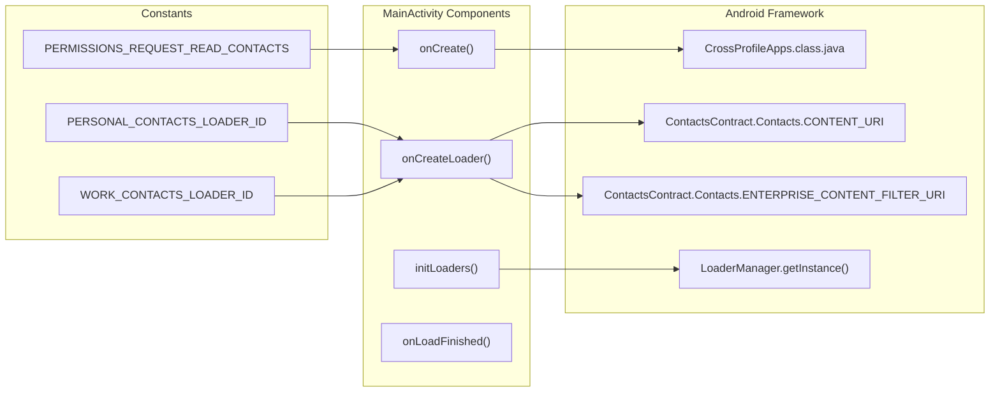

Sources: [Work-profile-codelab/app-starter/src/main/java/com/example/workprofile/MainActivity.kt:37-39](), [Work-profile-codelab/app-finished/src/main/java/com/example/workprofile/MainActivity.kt:38-40](), [Work-profile-codelab/app-finished/src/main/java/com/example/workprofile/MainActivity.kt:75-86]()

## Core Components

### MainActivity Class Structure

Both implementations share a common base structure but differ in their enterprise capabilities.

#### Common Components

| Component | Purpose | Implementation |
|-----------|---------|----------------|
| `contacts: MutableList<Contact>` | Contact data storage | Populated by cursor loaders |
| `viewAdapter: RecyclerView.Adapter` | UI contact display | ContactsAdapter instance |
| `binding: ActivityMainBinding` | View binding | Data binding for UI elements |

#### Permission Handling

Both implementations request `READ_CONTACTS` permission using the same pattern:

```kotlin
const val PERMISSIONS_REQUEST_READ_CONTACTS = 1
```

The permission request is handled in `onRequestPermissionsResult()` with proper error messaging for denied permissions.

Sources: [Work-profile-codelab/app-starter/src/main/java/com/example/workprofile/MainActivity.kt:37](), [Work-profile-codelab/app-finished/src/main/java/com/example/workprofile/MainActivity.kt:38](), [Work-profile-codelab/app-starter/src/main/java/com/example/workprofile/MainActivity.kt:74-91](), [Work-profile-codelab/app-finished/src/main/java/com/example/workprofile/MainActivity.kt:89-106]()

### Contact Loading Implementation

#### Starter Implementation

The starter version implements basic contact loading:

- Single loader: `PERSONAL_CONTACTS_LOADER_ID` 
- Uses standard `ContactsContract.Contacts.CONTENT_URI`
- Simple cursor handling in `onCreateLoader()`

#### Finished Implementation

The finished version demonstrates enterprise contact access:

- Dual loaders: `PERSONAL_CONTACTS_LOADER_ID` and `WORK_CONTACTS_LOADER_ID`
- Enterprise URI construction with filtering parameters
- Advanced cursor handling for different contact sources

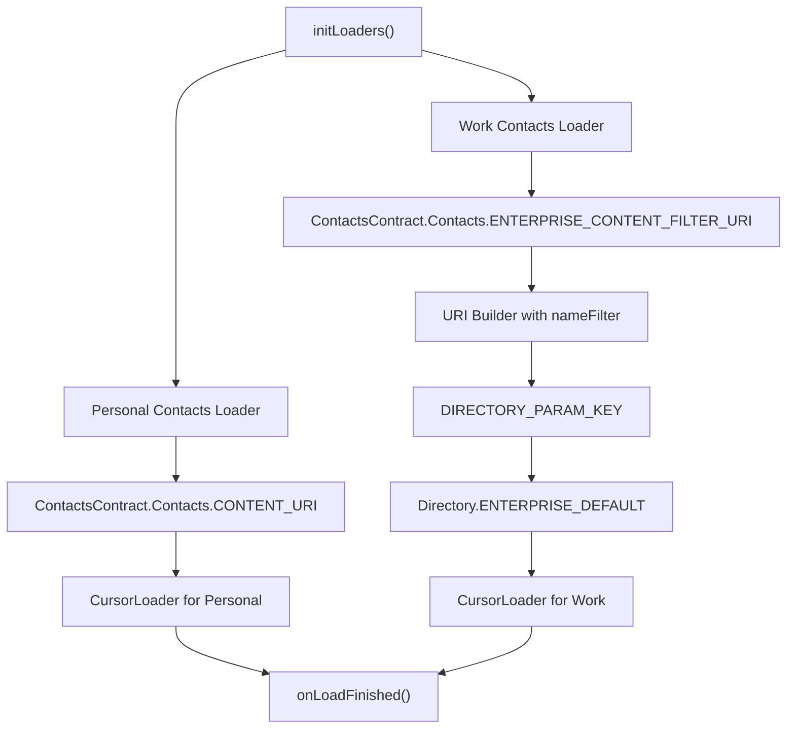

Sources: [Work-profile-codelab/app-starter/src/main/java/com/example/workprofile/MainActivity.kt:93-95](), [Work-profile-codelab/app-finished/src/main/java/com/example/workprofile/MainActivity.kt:108-111](), [Work-profile-codelab/app-finished/src/main/java/com/example/workprofile/MainActivity.kt:113-136]()

### Cross-Profile Functionality

The finished implementation includes cross-profile app switching capabilities using the `CrossProfileApps` system service.

#### CrossProfileApps Integration

The cross-profile functionality is implemented in the `onCreate()` method:

| Step | Code Entity | Purpose |
|------|-------------|---------|
| 1 | `getSystemService(CrossProfileApps::class.java)` | Obtain CrossProfileApps service |
| 2 | `crossProfileApps.targetUserProfiles` | Get available user profiles |
| 3 | `crossProfileApps.getProfileSwitchingLabel()` | Get appropriate button label |
| 4 | `crossProfileApps.startMainActivity()` | Launch app in target profile |

The button configuration dynamically adapts its label based on the current profile context and provides seamless switching between work and personal instances of the application.

Sources: [Work-profile-codelab/app-finished/src/main/java/com/example/workprofile/MainActivity.kt:75-86]()

## Data Flow Architecture

### Contact Data Processing

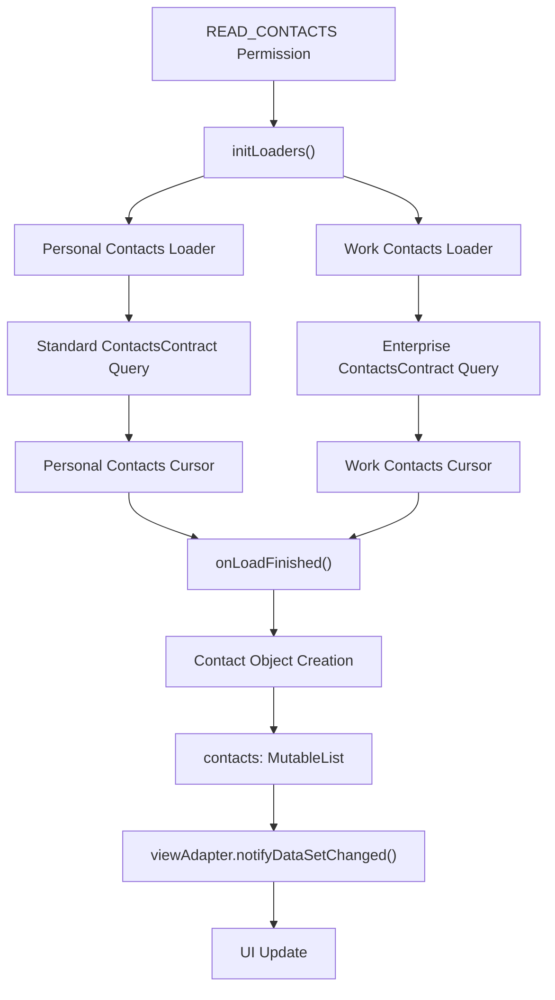

Sources: [Work-profile-codelab/app-finished/src/main/java/com/example/workprofile/MainActivity.kt:138-151](), [Work-profile-codelab/app-starter/src/main/java/com/example/workprofile/MainActivity.kt:110-123]()

## Learning Progression

The codelab is designed to demonstrate the incremental addition of enterprise features:

### Starter → Finished Migration

| Enhancement | Implementation | API Usage |
|-------------|----------------|-----------|
| Work Contact Access | Add `WORK_CONTACTS_LOADER_ID` constant | `ContactsContract.Contacts.ENTERPRISE_CONTENT_FILTER_URI` |
| Enterprise Filtering | Build filtered URI with name parameter | `appendPath()`, `appendQueryParameter()` |
| Cross-Profile Switching | Add CrossProfileApps service integration | `CrossProfileApps.startMainActivity()` |
| Dynamic UI Labels | Context-aware button labeling | `CrossProfileApps.getProfileSwitchingLabel()` |

This progression teaches developers how to evolve a basic Android application into an enterprise-aware application that respects work profile boundaries while providing seamless user experience across profiles.

Sources: [Work-profile-codelab/app-starter/src/main/java/com/example/workprofile/MainActivity.kt:37-39](), [Work-profile-codelab/app-finished/src/main/java/com/example/workprofile/MainActivity.kt:38-40](), [Work-profile-codelab/app-finished/src/main/java/com/example/workprofile/MainActivity.kt:75-86](), [Work-profile-codelab/app-finished/src/main/java/com/example/workprofile/MainActivity.kt:113-136]()

---

# Page: Starter Implementation

# Starter Implementation

<details>
<summary>Relevant source files</summary>

The following files were used as context for generating this wiki page:

- [Work-profile-codelab/app-starter/src/main/java/com/example/workprofile/MainActivity.kt](Work-profile-codelab/app-starter/src/main/java/com/example/workprofile/MainActivity.kt)

</details>


## Purpose and Scope

This document covers the starter implementation of the Work Profile Codelab, which provides a foundational Android application for learning work profile development. The starter app demonstrates basic contact reading functionality using Android's ContactsContract API and serves as the starting point for developers to add cross-profile capabilities.

This implementation contains only personal profile contact access. For the complete work profile functionality including cross-profile app interactions, see [Finished Implementation](#2.2.2).

## Application Architecture

The starter implementation follows a simple Android architecture pattern with a single Activity that manages contact loading and display:

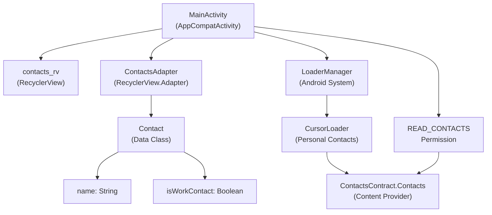

**Sources**: [Work-profile-codelab/app-starter/src/main/java/com/example/workprofile/MainActivity.kt:1-128]()

## Core Components

### MainActivity Class

The `MainActivity` class serves as the primary entry point and coordinator for the application. It extends `AppCompatActivity` and implements `LoaderManager.LoaderCallbacks<Cursor>` to handle asynchronous contact loading.

| Component | Type | Purpose |
|-----------|------|---------|
| `viewAdapter` | `RecyclerView.Adapter<*>` | Manages contact list display |
| `binding` | `ActivityMainBinding` | View binding for UI elements |
| `contacts` | `MutableList<Contact>` | In-memory contact storage |

The class manages three primary responsibilities:
- UI initialization and edge-to-edge display setup
- Contact permission handling
- Contact data loading via CursorLoader

**Sources**: [Work-profile-codelab/app-starter/src/main/java/com/example/workprofile/MainActivity.kt:40-43]()

### Permission Management

The starter implementation demonstrates proper Android permission handling for accessing contacts:

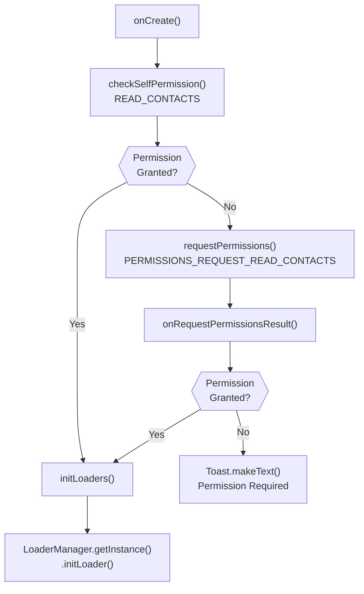

**Sources**: [Work-profile-codelab/app-starter/src/main/java/com/example/workprofile/MainActivity.kt:63-71](), [Work-profile-codelab/app-starter/src/main/java/com/example/workprofile/MainActivity.kt:74-91]()

### Contact Loading Implementation

The contact loading mechanism uses Android's CursorLoader pattern to asynchronously load contact data:

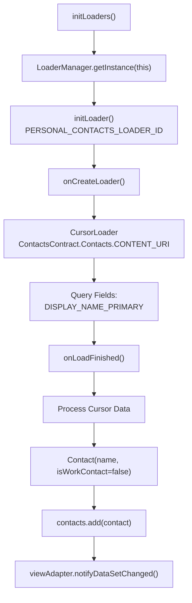

**Sources**: [Work-profile-codelab/app-starter/src/main/java/com/example/workprofile/MainActivity.kt:93-95](), [Work-profile-codelab/app-starter/src/main/java/com/example/workprofile/MainActivity.kt:97-107](), [Work-profile-codelab/app-starter/src/main/java/com/example/workprofile/MainActivity.kt:110-123]()

## Key Implementation Details

### Contact Data Structure

The application uses a simple `Contact` data class with two properties:
- `name: String` - The contact's display name
- `isWorkContact: Boolean` - Flag indicating work profile origin (always `false` in starter)

The contact creation logic in `onLoadFinished()` demonstrates this structure:

```kotlin
val contact = Contact(name, loader.id == 1)
```

The loader ID comparison (`loader.id == 1`) is preparation for work profile functionality, where different loaders will distinguish between personal and work contacts.

**Sources**: [Work-profile-codelab/app-starter/src/main/java/com/example/workprofile/MainActivity.kt:116]()

### Constants and Configuration

The implementation defines key constants that will be extended in the finished version:

| Constant | Value | Purpose |
|----------|-------|---------|
| `PERMISSIONS_REQUEST_READ_CONTACTS` | 1 | Permission request identifier |
| `PERSONAL_CONTACTS_LOADER_ID` | 0 | Personal contacts loader identifier |

**Sources**: [Work-profile-codelab/app-starter/src/main/java/com/example/workprofile/MainActivity.kt:37-38]()

## Limitations and Learning Opportunities

### Missing Work Profile Features

The starter implementation intentionally omits several work profile capabilities that developers will add:

1. **Cross-Profile App Detection** - No `CrossProfileApps` integration
2. **Work Profile Contact Loading** - Only personal contacts are loaded
3. **Profile-Aware UI** - No visual distinction between personal and work contacts
4. **Intent Targeting** - No cross-profile intent handling

### RecyclerView Integration

The RecyclerView setup demonstrates standard Android patterns:
- `LinearLayoutManager` for vertical scrolling
- `ContactsAdapter` for data binding
- Fixed size optimization with `setHasFixedSize(true)`

**Sources**: [Work-profile-codelab/app-starter/src/main/java/com/example/workprofile/MainActivity.kt:56-62]()

## Development Progression

This starter implementation provides the foundation for developers to:

1. Understand basic contact reading patterns
2. Learn permission handling workflows
3. Implement CursorLoader for asynchronous data loading
4. Set up RecyclerView with adapters

The progression to the finished implementation will involve adding `CrossProfileApps` functionality, work profile contact detection, and cross-profile intent handling capabilities.

**Sources**: [Work-profile-codelab/app-starter/src/main/java/com/example/workprofile/MainActivity.kt:1-128]()

---

# Page: Finished Implementation

# Finished Implementation

<details>
<summary>Relevant source files</summary>

The following files were used as context for generating this wiki page:

- [Work-profile-codelab/app-finished/src/main/java/com/example/workprofile/MainActivity.kt](Work-profile-codelab/app-finished/src/main/java/com/example/workprofile/MainActivity.kt)
- [Work-profile-codelab/app-finished/src/main/res/values/styles.xml](Work-profile-codelab/app-finished/src/main/res/values/styles.xml)

</details>


## Purpose and Scope

This document describes the completed implementation of the Work Profile Codelab located in the `Work-profile-codelab/app-finished` directory. This implementation demonstrates a fully functional Android application that showcases cross-profile functionality, allowing users to access and display contacts from both personal and work profiles within a single interface.

For information about the basic starter implementation, see [Starter Implementation](#2.2.1). For broader context about the Work Profile Codelab project, see [Work Profile Codelab](#2.2).

## Architecture Overview

The finished implementation centers around the `MainActivity` class, which orchestrates cross-profile operations, contact data loading, and user interface management.

### High-Level Component Architecture

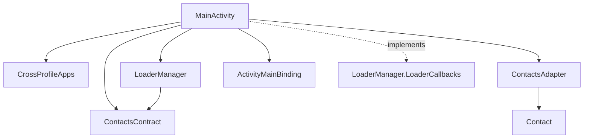

**Sources:** [Work-profile-codelab/app-finished/src/main/java/com/example/workprofile/MainActivity.kt:17-155]()

## Cross-Profile Functionality Implementation

The application implements cross-profile capabilities using the `CrossProfileApps` system service, enabling seamless interaction between personal and work profiles.

### CrossProfileApps Integration

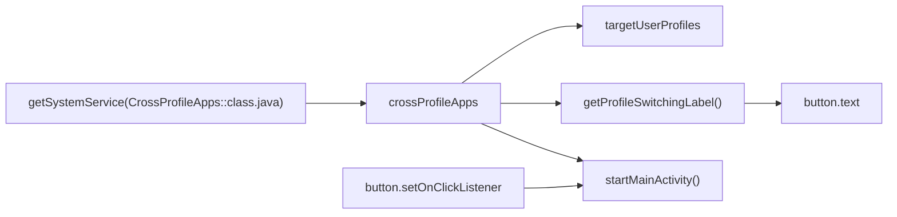

The cross-profile functionality is initialized in the `onCreate` method through the following sequence:

| Step | Operation | Code Reference |
|------|-----------|----------------|
| 1 | Get CrossProfileApps service | `getSystemService(CrossProfileApps::class.java)` |
| 2 | Retrieve target user profiles | `crossProfileApps.targetUserProfiles` |
| 3 | Get profile switching label | `crossProfileApps.getProfileSwitchingLabel(userHandles.first())` |
| 4 | Configure profile switch button | `button.setOnClickListener` with `startMainActivity` |

**Sources:** [Work-profile-codelab/app-finished/src/main/java/com/example/workprofile/MainActivity.kt:75-86]()

## Contact Loading System

The application implements a dual-loader system to simultaneously access contacts from both personal and work profiles using distinct loader IDs and content URIs.

### Loader Configuration and Data Flow

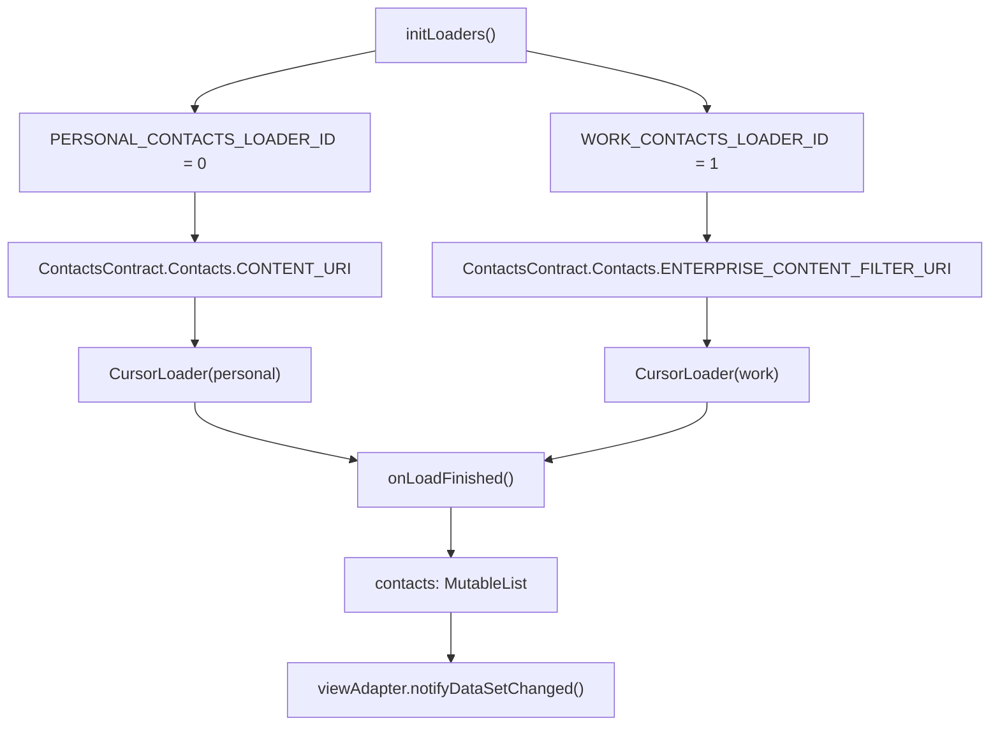

### Contact URI Resolution

The `onCreateLoader` method implements different URI strategies based on the loader ID:

| Loader ID | Content URI Type | Purpose |
|-----------|------------------|---------|
| `PERSONAL_CONTACTS_LOADER_ID` (0) | `ContactsContract.Contacts.CONTENT_URI` | Access personal profile contacts |
| `WORK_CONTACTS_LOADER_ID` (1) | `ContactsContract.Contacts.ENTERPRISE_CONTENT_FILTER_URI` | Access work profile contacts |

The work profile URI construction includes enterprise directory parameters:

```
ENTERPRISE_CONTENT_FILTER_URI
  .buildUpon()
  .appendPath(nameFilter)
  .appendQueryParameter(DIRECTORY_PARAM_KEY, ENTERPRISE_DEFAULT)
  .build()
```

**Sources:** [Work-profile-codelab/app-finished/src/main/java/com/example/workprofile/MainActivity.kt:108-136]()

## Data Processing and UI Integration

The contact data processing pipeline transforms cursor data into `Contact` objects and updates the RecyclerView adapter.

### Contact Data Processing Flow

```mermaid
graph LR
    Cursor["Cursor data"]
    Processing["onLoadFinished()"]
    ContactObject["Contact(name, isWork)"]
    ContactsList["contacts: MutableList<Contact>"]
    Adapter["ContactsAdapter"]
    RecyclerView["contactsRv"]
    
    Cursor --> Processing
    Processing --> ContactObject
    ContactObject --> ContactsList
    ContactsList --> Adapter
    Adapter --> RecyclerView
    
    Processing --> |"loader.id == 1"| WorkFlag["isWork = true"]
    WorkFlag --> ContactObject
```

The contact processing logic in `onLoadFinished` includes:

1. **Cursor Validation**: Checks `!data.isClosed && data.count > 0`
2. **Data Extraction**: Retrieves `DISPLAY_NAME_PRIMARY` from cursor
3. **Contact Creation**: Creates `Contact(name, loader.id == 1)` where `loader.id == 1` indicates work profile
4. **UI Update**: Calls `viewAdapter.notifyDataSetChanged()`

**Sources:** [Work-profile-codelab/app-finished/src/main/java/com/example/workprofile/MainActivity.kt:138-151]()

## Permission Management

The application implements runtime permission handling for `READ_CONTACTS` permission, which is essential for accessing contact data across profiles.

### Permission Request Flow

```mermaid
graph TD
    onCreate["onCreate()"]
    PermissionCheck["checkSelfPermission(READ_CONTACTS)"]
    PermissionGranted{"permission == PERMISSION_GRANTED"}
    RequestPermission["requestPermissions()"]
    PermissionResult["onRequestPermissionsResult()"]
    InitLoaders["initLoaders()"]
    ShowToast["Toast.makeText()"]
    
    onCreate --> PermissionCheck
    PermissionCheck --> PermissionGranted
    PermissionGranted -->|Yes| InitLoaders
    PermissionGranted -->|No| RequestPermission
    RequestPermission --> PermissionResult
    PermissionResult -->|Granted| InitLoaders
    PermissionResult -->|Denied| ShowToast
```

The permission handling uses the constant `PERMISSIONS_REQUEST_READ_CONTACTS = 1` for request identification and provides user feedback through toast messages when permissions are denied.

**Sources:** [Work-profile-codelab/app-finished/src/main/java/com/example/workprofile/MainActivity.kt:38-106]()

## UI Components and Styling

The application uses View Binding with `ActivityMainBinding` and implements Material Design 3 theming.

### UI Component Structure

| Component | Type | Purpose |
|-----------|------|---------|
| `contactsRv` | RecyclerView | Displays contact list with LinearLayoutManager |
| `button` | Button | Triggers cross-profile navigation |
| `viewAdapter` | ContactsAdapter | Manages contact data display |
| Edge-to-edge layout | System UI | Handles window insets and system bars |

The styling configuration uses Material Design 3 with the theme `Theme.Material3.DayNight.NoActionBar` and custom color attributes defined in the styles.xml.

**Sources:** [Work-profile-codelab/app-finished/src/main/java/com/example/workprofile/MainActivity.kt:44-64](), [Work-profile-codelab/app-finished/src/main/res/values/styles.xml:1-11]()

---

# Page: Build System

# Build System

<details>
<summary>Relevant source files</summary>

The following files were used as context for generating this wiki page:

- [.github/workflows/android.yml](.github/workflows/android.yml)
- [ManagedConfigurations/gradle/libs.versions.toml](ManagedConfigurations/gradle/libs.versions.toml)
- [ManagedConfigurations/gradle/wrapper/gradle-wrapper.properties](ManagedConfigurations/gradle/wrapper/gradle-wrapper.properties)
- [Work-profile-codelab/gradlew](Work-profile-codelab/gradlew)
- [Work-profile-codelab/gradlew.bat](Work-profile-codelab/gradlew.bat)

</details>


## Purpose and Scope

This document covers the comprehensive Gradle-based build system and CI/CD infrastructure for the Android Enterprise Samples repository. The build system manages compilation, testing, and artifact generation for all sample applications in the repository. For details about the specific sample applications being built, see [Sample Applications](#2). For information about the automated CI/CD pipeline execution, see [CI/CD Pipeline](#3.1). For dependency management specifics, see [Version Catalogs and Dependencies](#3.2.2).

## Build System Architecture

The repository uses a multi-module Gradle build system with GitHub Actions CI/CD integration. Each sample application maintains its own Gradle wrapper and dependency configuration while sharing common build patterns.

```mermaid
graph TB
    subgraph "Repository Structure"
        REPO["android/enterprise-samples"]
        MC["ManagedConfigurations/"]
        WP["Work-profile-codelab/"]
    end
    
    subgraph "Build Infrastructure"
        GHA[".github/workflows/android.yml"]
        SCRIPT[".github/scripts/gradlew_recursive.sh"]
    end
    
    subgraph "ManagedConfigurations Build"
        MC_GW["gradlew"]
        MC_PROPS["gradle/wrapper/gradle-wrapper.properties"]
        MC_TOML["gradle/libs.versions.toml"]
        MC_BUILD["build.gradle"]
    end
    
    subgraph "Work-profile-codelab Build"
        WP_GW["gradlew"]
        WP_BAT["gradlew.bat"]
        WP_PROPS["gradle/wrapper/gradle-wrapper.properties"]
        WP_BUILD["build.gradle files"]
    end
    
    REPO --> MC
    REPO --> WP
    GHA --> SCRIPT
    SCRIPT --> MC_GW
    SCRIPT --> WP_GW
    
    MC --> MC_GW
    MC --> MC_PROPS
    MC --> MC_TOML
    MC --> MC_BUILD
    
    WP --> WP_GW
    WP --> WP_BAT
    WP --> WP_PROPS
    WP --> WP_BUILD
```

**Sources:** [.github/workflows/android.yml:1-46](), [ManagedConfigurations/gradle/wrapper/gradle-wrapper.properties:1-7](), [ManagedConfigurations/gradle/libs.versions.toml:1-44]()

## Build Process Flow

The build system follows a standardized process across all modules, executed through both local development and automated CI/CD environments.

```mermaid
graph LR
    subgraph "Trigger Events"
        PUSH["git push main"]
        PR["Pull Request"]
        MANUAL["workflow_dispatch"]
    end
    
    subgraph "CI Environment Setup"
        RUNNER["ubuntu-latest"]
        CHECKOUT["actions/checkout@v2"]
        JDK["actions/setup-java@v4"]
        JDK_DIST["jetbrains JDK 21"]
    end
    
    subgraph "Build Execution"
        SCRIPT["gradlew_recursive.sh"]
        ASSEMBLE["assembleDebug"]
        ARTIFACTS["APK/AAB/AAR/SO"]
    end
    
    subgraph "Artifact Management"
        ZIP["assemble.zip"]
        UPLOAD["actions/upload-artifact@v4"]
        DOWNLOAD["GitHub Artifacts"]
    end
    
    PUSH --> RUNNER
    PR --> RUNNER
    MANUAL --> RUNNER
    
    RUNNER --> CHECKOUT
    CHECKOUT --> JDK
    JDK --> JDK_DIST
    JDK_DIST --> SCRIPT
    
    SCRIPT --> ASSEMBLE
    ASSEMBLE --> ARTIFACTS
    ARTIFACTS --> ZIP
    ZIP --> UPLOAD
    UPLOAD --> DOWNLOAD
```

**Sources:** [.github/workflows/android.yml:17-22](), [.github/workflows/android.yml:30-45]()

## Gradle Configuration Details

### Wrapper Configuration

Each module uses Gradle wrapper to ensure consistent build environments across different development machines and CI systems.

| Module | Gradle Version | Distribution URL |
|--------|----------------|-----------------|
| ManagedConfigurations | 8.11.1 | `https://services.gradle.org/distributions/gradle-8.11.1-bin.zip` |
| Work-profile-codelab | 8.x (wrapper specific) | Standard Gradle distribution |

The `gradlew` and `gradlew.bat` scripts provide cross-platform build execution with specific JVM memory settings:

- Default JVM Options: `"-Xmx64m" "-Xms64m"`
- Java compatibility checks and `JAVA_HOME` validation
- Cross-platform path resolution for Windows, macOS, and Linux

**Sources:** [ManagedConfigurations/gradle/wrapper/gradle-wrapper.properties:1-7](), [Work-profile-codelab/gradlew:46-47](), [Work-profile-codelab/gradlew.bat:36]()

### Version Catalog System

The `ManagedConfigurations` module implements centralized dependency management using Gradle version catalogs:

```mermaid
graph TB
    subgraph "libs.versions.toml Structure"
        VERSIONS["[versions]"]
        LIBRARIES["[libraries]"]
        PLUGINS["[plugins]"]
    end
    
    subgraph "Version Definitions"
        AGP["agp = 8.9.2"]
        KOTLIN["kotlin = 2.1.0"]
        ANDROIDX["androidx.* versions"]
        ENTERPRISE["enterprise = 1.1.0"]
    end
    
    subgraph "Library Declarations"
        CORE["androidx-core-ktx"]
        APPCOMPAT["androidx-appcompat"]
        MATERIAL["material"]
        ENT_FB["androidx-enterprise-feedback"]
    end
    
    subgraph "Plugin Declarations"
        ANDROID_APP["android-application"]
        KOTLIN_ANDROID["kotlin-android"]
    end
    
    VERSIONS --> AGP
    VERSIONS --> KOTLIN
    VERSIONS --> ANDROIDX
    VERSIONS --> ENTERPRISE
    
    LIBRARIES --> CORE
    LIBRARIES --> APPCOMPAT
    LIBRARIES --> MATERIAL
    LIBRARIES --> ENT_FB
    
    PLUGINS --> ANDROID_APP
    PLUGINS --> KOTLIN_ANDROID
```

**Key dependency versions managed:**
- Android Gradle Plugin: `8.9.2`
- Kotlin: `2.1.0`
- AndroidX Core: `1.16.0`
- Enterprise Feedback: `1.1.0`
- Material Design: `1.12.0`

**Sources:** [ManagedConfigurations/gradle/libs.versions.toml:15-27](), [ManagedConfigurations/gradle/libs.versions.toml:28-39](), [ManagedConfigurations/gradle/libs.versions.toml:41-44]()

## CI/CD Pipeline Implementation

### Workflow Configuration

The `android.yml` workflow implements a comprehensive build and artifact management system:

| Configuration | Value |
|---------------|-------|
| Workflow Name | `Android CI` |
| Runner OS | `ubuntu-latest` |
| Java Distribution | `jetbrains` |
| Java Version | `21` |
| Build Task | `assembleDebug` |

### Build Script Execution

The CI system uses `.github/scripts/gradlew_recursive.sh` to execute builds across all modules. This script:

1. Discovers all `gradlew` scripts in the repository
2. Executes the `assembleDebug` task for each module
3. Handles build failures and success reporting
4. Ensures consistent build environment across modules

### Artifact Collection

The workflow collects and packages build artifacts using specific file patterns:

```bash
zip -r assemble.zip . -i '**/build/*.apk' '**/build/*.aab' '**/build/*.aar' '**/build/*.so'
```

This creates a comprehensive artifact package containing:
- `*.apk` - Android Application Packages
- `*.aab` - Android App Bundles
- `*.aar` - Android Archive Libraries
- `*.so` - Native Shared Objects

**Sources:** [.github/workflows/android.yml:15](), [.github/workflows/android.yml:32-36](), [.github/workflows/android.yml:38](), [.github/workflows/android.yml:40]()

## Build System Integration

### Cross-Module Consistency

The build system ensures consistency across modules through:

1. **Standardized Gradle Wrapper**: Each module maintains its own wrapper configuration but follows common patterns
2. **Unified CI Execution**: Single workflow executes builds for all modules
3. **Common Artifact Patterns**: All modules generate artifacts following the same naming conventions
4. **Shared JVM Configuration**: Consistent memory settings and Java version requirements

### Development Workflow Support

The build system supports multiple development scenarios:

| Scenario | Execution Method | Trigger |
|----------|------------------|---------|
| Local Development | `./gradlew assembleDebug` | Developer command |
| Pull Request Validation | GitHub Actions | PR creation/update |
| Main Branch Integration | GitHub Actions | Push to `main` |
| Manual Testing | GitHub Actions | `workflow_dispatch` |

**Sources:** [.github/workflows/android.yml:17-22](), [Work-profile-codelab/gradlew:183-185](), [Work-profile-codelab/gradlew.bat:74]()

---

# Page: CI/CD Pipeline

# CI/CD Pipeline

<details>
<summary>Relevant source files</summary>

The following files were used as context for generating this wiki page:

- [.github/workflows/android.yml](.github/workflows/android.yml)

</details>


## Purpose and Scope

This document describes the GitHub Actions-based CI/CD pipeline that automatically builds and validates the Android Enterprise sample applications. The pipeline is defined in a single workflow file and handles building all sample applications, packaging artifacts, and making them available for download.

For information about the underlying Gradle build system configuration, see [Gradle Configuration](#3.2). For details about the Gradle wrapper scripts executed by this pipeline, see [Gradle Wrapper Scripts](#3.2.1).

## Workflow Overview

The CI/CD pipeline is implemented as a single GitHub Actions workflow named `Android CI` that performs automated builds of all sample applications in the repository. The workflow ensures consistent build environments and produces distributable artifacts for each successful build.

### Workflow Triggers and Execution Flow

```mermaid
graph TD
    subgraph "Trigger Events"
        WD["workflow_dispatch<br/>(Manual)"]
        PUSH["push to main"]
        PR["pull_request to main"]
    end
    
    subgraph "GitHub Actions Runner"
        RUNNER["ubuntu-latest"]
        CHECKOUT["actions/checkout@v2"]
        JDK["actions/setup-java@v4<br/>JetBrains JDK 21"]
        BUILD["gradlew_recursive.sh<br/>assembleDebug"]
        ZIP["zip -r assemble.zip"]
        UPLOAD["actions/upload-artifact@v4"]
    end
    
    subgraph "Output Artifacts"
        APK["*.apk files"]
        AAB["*.aab files"] 
        AAR["*.aar files"]
        SO["*.so files"]
        ARCHIVE["assemble.zip"]
    end
    
    WD --> RUNNER
    PUSH --> RUNNER
    PR --> RUNNER
    
    RUNNER --> CHECKOUT
    CHECKOUT --> JDK
    JDK --> BUILD
    BUILD --> ZIP
    ZIP --> UPLOAD
    
    BUILD --> APK
    BUILD --> AAB
    BUILD --> AAR
    BUILD --> SO
    
    APK --> ARCHIVE
    AAB --> ARCHIVE
    AAR --> ARCHIVE
    SO --> ARCHIVE
    
    UPLOAD --> ARCHIVE
```

**Sources:** [.github/workflows/android.yml:17-46]()

## Trigger Mechanisms

The `Android CI` workflow supports three distinct trigger mechanisms that provide flexibility for different development scenarios:

| Trigger Type | Configuration | Use Case |
|--------------|---------------|----------|
| `workflow_dispatch` | Manual trigger | On-demand builds for testing or releases |
| `push` to `main` | Automatic on main branch | Continuous integration for main branch |
| `pull_request` to `main` | Automatic on PR | Pre-merge validation |

**Sources:** [.github/workflows/android.yml:17-22]()

## Build Execution Process

### Environment Setup

The workflow executes on `ubuntu-latest` runners and establishes a consistent build environment through standardized tool installation:

```mermaid
graph LR
    subgraph "Environment Configuration"
        RUNNER["ubuntu-latest"] --> CHECKOUT["actions/checkout@v2"]
        CHECKOUT --> JDK_SETUP["actions/setup-java@v4"]
        
        subgraph "JDK Configuration"
            JDK_SETUP --> DIST["distribution: jetbrains"]
            JDK_SETUP --> VER["java-version: 21"]
        end
    end
    
    subgraph "Build Script Execution"
        JDK_SETUP --> SCRIPT[".github/scripts/gradlew_recursive.sh"]
        SCRIPT --> TASK["assembleDebug"]
    end
    
    subgraph "Build Targets"
        TASK --> MC["ManagedConfigurations"]
        TASK --> WP_START["work-profile-codelab/app-starter"]
        TASK --> WP_FINISH["work-profile-codelab/app-finished"]
    end
```

**Sources:** [.github/workflows/android.yml:28-38]()

### Build Task Execution

The core build process uses a recursive Gradle wrapper script that executes the `assembleDebug` task across all project modules. This approach ensures that all sample applications are built consistently using the same build configuration.

The `gradlew_recursive.sh` script automatically discovers and builds all Gradle projects within the repository structure, making the CI pipeline resilient to the addition of new sample applications without requiring workflow modifications.

**Sources:** [.github/workflows/android.yml:37-38]()

## Artifact Management

### Artifact Collection and Packaging

The pipeline automatically collects build outputs from all projects and packages them into a single downloadable archive:

```mermaid
graph TD
    subgraph "Build Output Collection"
        BUILD["assembleDebug Task"] --> SCAN["Scan build directories"]
        
        subgraph "Artifact Types"
            SCAN --> APK["**/*.apk<br/>(Android Applications)"]
            SCAN --> AAB["**/*.aab<br/>(Android App Bundles)"]
            SCAN --> AAR["**/*.aar<br/>(Android Archive Libraries)"]
            SCAN --> SO["**/*.so<br/>(Native Libraries)"]
        end
    end
    
    subgraph "Archive Creation"
        APK --> ZIP_CMD["zip -r assemble.zip"]
        AAB --> ZIP_CMD
        AAR --> ZIP_CMD
        SO --> ZIP_CMD
        
        ZIP_CMD --> ARCHIVE["assemble.zip"]
    end
    
    subgraph "Artifact Upload"
        ARCHIVE --> UPLOAD_ACTION["actions/upload-artifact@v4"]
        UPLOAD_ACTION --> ARTIFACT_NAME["name: assemble"]
        UPLOAD_ACTION --> DOWNLOAD["GitHub Download"]
    end
```

**Sources:** [.github/workflows/android.yml:39-45]()

### Artifact Types and Structure

The CI pipeline produces and archives multiple types of Android build artifacts:

| Artifact Type | Extension | Description |
|---------------|-----------|-------------|
| Android Application Package | `.apk` | Installable applications for direct deployment |
| Android App Bundle | `.aab` | Optimized distribution format for Google Play |
| Android Archive | `.aar` | Library modules for integration into other projects |
| Native Library | `.so` | Compiled native code components |

The `zip` command uses include patterns to selectively archive only build artifacts while excluding intermediate build files, resulting in a clean distribution package.

**Sources:** [.github/workflows/android.yml:40]()

## Integration with Build System

The CI/CD pipeline integrates with the broader build system architecture through standardized interfaces and shared build configurations. The workflow delegates actual compilation to the Gradle build system while providing orchestration and artifact management capabilities.

The use of the `gradlew_recursive.sh` script creates a clean separation between CI orchestration logic and build system implementation, allowing the build system to evolve independently while maintaining consistent CI behavior.

**Sources:** [.github/workflows/android.yml:38]()

---

# Page: Gradle Configuration

# Gradle Configuration

<details>
<summary>Relevant source files</summary>

The following files were used as context for generating this wiki page:

- [ManagedConfigurations/gradle/libs.versions.toml](ManagedConfigurations/gradle/libs.versions.toml)
- [ManagedConfigurations/gradle/wrapper/gradle-wrapper.properties](ManagedConfigurations/gradle/wrapper/gradle-wrapper.properties)
- [ManagedConfigurations/gradlew](ManagedConfigurations/gradlew)
- [ManagedConfigurations/gradlew.bat](ManagedConfigurations/gradlew.bat)
- [Work-profile-codelab/gradlew](Work-profile-codelab/gradlew)
- [Work-profile-codelab/gradlew.bat](Work-profile-codelab/gradlew.bat)

</details>


This page documents the Gradle build system configuration used across the Android Enterprise Samples repository. It covers the overall structure and architecture of the build system, including the Gradle wrapper setup and centralized dependency management through version catalogs.

For detailed information about the Gradle wrapper scripts themselves, see [Gradle Wrapper Scripts](#3.2.1). For specifics on dependency management and version catalogs, see [Version Catalogs and Dependencies](#3.2.2).

## Overview

The repository uses a standardized Gradle configuration across both sample applications (`ManagedConfigurations` and `Work-profile-codelab`) to ensure consistent build environments and dependency management. The configuration is built around the Gradle wrapper pattern with centralized version management through TOML-based version catalogs.

```mermaid
graph TB
    subgraph "Repository Root"
        GRS["gradlew_recursive.sh<br/>Global Build Script"]
    end
    
    subgraph "ManagedConfigurations Project"
        MCG["gradlew<br/>Unix Wrapper"]
        MCGB["gradlew.bat<br/>Windows Wrapper"]
        MCGWP["gradle/wrapper/<br/>gradle-wrapper.properties"]
        MCVC["gradle/libs.versions.toml<br/>Version Catalog"]
    end
    
    subgraph "Work-profile-codelab Project"
        WPG["gradlew<br/>Unix Wrapper"]
        WPGB["gradlew.bat<br/>Windows Wrapper"]
        WPGWP["gradle/wrapper/<br/>gradle-wrapper.properties"]
        WPVC["gradle/libs.versions.toml<br/>Version Catalog"]
    end
    
    GRS --> MCG
    GRS --> WPG
    MCG --> MCGWP
    MCGB --> MCGWP
    WPG --> WPGWP
    WPGB --> WPGWP
    
    MCVC --> |"Defines Dependencies"| MCG
    WPVC --> |"Defines Dependencies"| WPG
```

**Build System Architecture**

Sources: [ManagedConfigurations/gradlew:1-186](), [Work-profile-codelab/gradlew:1-186](), [ManagedConfigurations/gradle/libs.versions.toml:1-44]()

## Gradle Wrapper Configuration

Each sample application maintains its own Gradle wrapper configuration to ensure build reproducibility and version consistency. The wrapper configuration is standardized across projects to use Gradle version 8.11.1.

### Wrapper Properties Structure

| Property | Value | Purpose |
|----------|--------|---------|
| `distributionBase` | `GRADLE_USER_HOME` | Base directory for Gradle distributions |
| `distributionPath` | `wrapper/dists` | Path within base for storing distributions |
| `distributionUrl` | `https://services.gradle.org/distributions/gradle-8.11.1-bin.zip` | Gradle distribution download URL |
| `zipStoreBase` | `GRADLE_USER_HOME` | Base directory for ZIP storage |
| `zipStorePath` | `wrapper/dists` | Path for ZIP storage |

```mermaid
graph LR
    subgraph "Gradle Wrapper Execution Flow"
        DEV["Developer<br/>./gradlew build"]
        SCRIPT["gradlew Script<br/>Shell/Batch"]
        PROPS["gradle-wrapper.properties<br/>Configuration"]
        DIST["Gradle Distribution<br/>gradle-8.11.1-bin.zip"]
        EXEC["GradleWrapperMain<br/>Execution"]
    end
    
    DEV --> SCRIPT
    SCRIPT --> PROPS
    PROPS --> |"Downloads if missing"| DIST
    SCRIPT --> |"Launches with"| EXEC
    DIST --> EXEC
```

**Gradle Wrapper Execution Process**

Sources: [ManagedConfigurations/gradle/wrapper/gradle-wrapper.properties:1-7](), [ManagedConfigurations/gradlew:183-185]()

## Version Catalog Implementation

The repository implements centralized dependency management using Gradle's version catalog feature through `libs.versions.toml` files. This approach ensures consistent dependency versions across modules while providing type-safe dependency references.

### Version Catalog Structure

```mermaid
graph TB
    subgraph "libs.versions.toml Structure"
        VS["[versions]<br/>Version Declarations"]
        LIB["[libraries]<br/>Library Definitions"]
        PLUG["[plugins]<br/>Plugin Definitions"]
    end
    
    subgraph "Version References"
        AGP["agp = '8.9.2'<br/>Android Gradle Plugin"]
        KOT["kotlin = '2.1.0'<br/>Kotlin Language"]
        CORE["coreKtx = '1.16.0'<br/>AndroidX Core"]
        ENT["enterprise = '1.1.0'<br/>Enterprise APIs"]
    end
    
    subgraph "Library Dependencies"
        CKTX["androidx-core-ktx<br/>Core KTX Library"]
        JUNIT["junit<br/>Unit Testing"]
        ESP["androidx-espresso-core<br/>UI Testing"]
        ENTF["androidx-enterprise-feedback<br/>Enterprise Feedback"]
    end
    
    VS --> AGP
    VS --> KOT
    VS --> CORE
    VS --> ENT
    
    LIB --> CKTX
    LIB --> JUNIT
    LIB --> ESP
    LIB --> ENTF
    
    AGP --> |"version.ref"| PLUG
    KOT --> |"version.ref"| PLUG
    CORE --> |"version.ref"| CKTX
    ENT --> |"version.ref"| ENTF
```

**Version Catalog Dependency Resolution**

Sources: [ManagedConfigurations/gradle/libs.versions.toml:15-44]()

## Build System Integration

The Gradle configuration integrates with the CI/CD pipeline through the `gradlew_recursive.sh` script, which executes builds across all sample applications in a standardized manner.

### JVM Configuration

Both wrapper scripts are configured with consistent JVM options to ensure reliable build performance:

| JVM Option | Value | Purpose |
|------------|--------|---------|
| `-Xmx64m` | Maximum heap size | Limits memory usage for wrapper process |
| `-Xms64m` | Initial heap size | Sets consistent initial memory allocation |

```mermaid
graph TB
    subgraph "Cross-Platform Build Support"
        UNIX["Unix/Linux/macOS<br/>gradlew"]
        WIN["Windows<br/>gradlew.bat"]
        PROPS["gradle-wrapper.properties<br/>Shared Configuration"]
    end
    
    subgraph "Platform-Specific Handling"
        JAVAHOME["JAVA_HOME<br/>Environment Variable"]
        CLASSPATH["gradle-wrapper.jar<br/>Bootstrap Classpath"]
        JVMOPTS["JVM Options<br/>-Xmx64m -Xms64m"]
    end
    
    subgraph "Gradle Execution"
        MAIN["GradleWrapperMain<br/>Entry Point"]
        TASKS["Build Tasks<br/>assembleDebug, test"]
    end
    
    UNIX --> PROPS
    WIN --> PROPS
    
    UNIX --> JAVAHOME
    WIN --> JAVAHOME
    JAVAHOME --> CLASSPATH
    CLASSPATH --> JVMOPTS
    JVMOPTS --> MAIN
    MAIN --> TASKS
```

**Cross-Platform Build Execution**

Sources: [ManagedConfigurations/gradlew:47](), [ManagedConfigurations/gradlew.bat:36](), [Work-profile-codelab/gradlew:47](), [Work-profile-codelab/gradlew.bat:36]()

## Configuration Consistency

The build system maintains consistency across sample applications through:

1. **Identical Wrapper Versions**: Both projects use Gradle 8.11.1 as defined in their respective `gradle-wrapper.properties` files
2. **Shared JVM Settings**: Consistent memory allocation settings (`-Xmx64m -Xms64m`) across all wrapper scripts
3. **Standardized Structure**: Common directory layout for `gradle/wrapper/` and `gradle/libs.versions.toml` files
4. **Version Catalog Pattern**: Both applications implement centralized dependency management using the same TOML structure

This consistency ensures that builds are reproducible across different environments and that the CI/CD pipeline can process all sample applications using the same build logic.

Sources: [ManagedConfigurations/gradle/wrapper/gradle-wrapper.properties:4](), [ManagedConfigurations/gradle/libs.versions.toml:15-26]()

---

# Page: Gradle Wrapper Scripts

# Gradle Wrapper Scripts

<details>
<summary>Relevant source files</summary>

The following files were used as context for generating this wiki page:

- [ManagedConfigurations/gradlew](ManagedConfigurations/gradlew)
- [ManagedConfigurations/gradlew.bat](ManagedConfigurations/gradlew.bat)

</details>


## Purpose and Scope

This document covers the Gradle wrapper scripts (`gradlew` and `gradlew.bat`) that provide cross-platform build execution capabilities for the Android Enterprise Samples repository. These scripts ensure consistent Gradle builds across different development environments without requiring manual Gradle installation. For information about the broader Gradle configuration including version catalogs and dependency management, see [Version Catalogs and Dependencies](#3.2.2). For details about the CI/CD pipeline that utilizes these scripts, see [CI/CD Pipeline](#3.1).

## Wrapper Script Architecture

The Gradle wrapper system consists of platform-specific scripts that bootstrap the Gradle build process by downloading and executing the appropriate Gradle distribution.

### Wrapper Script Components

```mermaid
graph TD
    subgraph "Gradle Wrapper System"
        DEV["Developer/CI System"]
        
        subgraph "Platform Detection"
            UNIX["Unix/Linux/macOS<br/>Environment"]
            WIN["Windows<br/>Environment"]
        end
        
        subgraph "Wrapper Scripts"
            GRADLEW["gradlew<br/>Shell Script"]
            GRADLEWBAT["gradlew.bat<br/>Batch Script"]
        end
        
        subgraph "Execution Environment"
            JAVADETECT["Java Detection<br/>JAVA_HOME/PATH"]
            JVMOPTS["JVM Options<br/>Memory Settings"]
            CLASSPATH["Classpath Setup<br/>gradle-wrapper.jar"]
        end
        
        subgraph "Gradle Execution"
            WRAPPERMAIN["GradleWrapperMain<br/>Bootstrap Class"]
            GRADLETASKS["Gradle Tasks<br/>assembleDebug, etc."]
        end
    end
    
    DEV --> UNIX
    DEV --> WIN
    UNIX --> GRADLEW
    WIN --> GRADLEWBAT
    
    GRADLEW --> JAVADETECT
    GRADLEWBAT --> JAVADETECT
    JAVADETECT --> JVMOPTS
    JVMOPTS --> CLASSPATH
    CLASSPATH --> WRAPPERMAIN
    WRAPPERMAIN --> GRADLETASKS
```

**Sources:** [ManagedConfigurations/gradlew:1-186](), [ManagedConfigurations/gradlew.bat:1-90]()

## Unix/Linux Wrapper Script (gradlew)

The `gradlew` script provides comprehensive Unix-like system support with sophisticated environment detection and path handling.

### Script Initialization and Environment Setup

The script begins by resolving its own location and setting up the application home directory:

```mermaid
graph LR
    subgraph "Script Initialization"
        SCRIPT["Script Start<br/>$0"]
        SYMLINK["Symlink Resolution<br/>while [ -h PRG ]"]
        APPHOME["APP_HOME Resolution<br/>pwd -P"]
        APPNAME["APP_NAME=Gradle<br/>APP_BASE_NAME"]
    end
    
    subgraph "Environment Variables"
        DEFAULTJVM["DEFAULT_JVM_OPTS<br/>-Xmx64m -Xms64m"]
        MAXFD["MAX_FD=maximum<br/>File Descriptor Limit"]
        CLASSPATH["CLASSPATH Setup<br/>gradle-wrapper.jar"]
    end
    
    SCRIPT --> SYMLINK
    SYMLINK --> APPHOME
    APPHOME --> APPNAME
    APPNAME --> DEFAULTJVM
    DEFAULTJVM --> MAXFD
    MAXFD --> CLASSPATH
```

The script resolves symlinks to determine the actual script location [ManagedConfigurations/gradlew:27-41]() and sets default JVM memory options to 64MB for both minimum and maximum heap [ManagedConfigurations/gradlew:47]().

**Sources:** [ManagedConfigurations/gradlew:25-47]()

### Operating System Detection and Platform-Specific Handling

The script includes comprehensive OS detection to handle different Unix variants:

| OS Type | Detection Method | Special Handling |
|---------|------------------|------------------|
| Cygwin | `uname` pattern `CYGWIN*` | Path conversion to Windows format |
| Darwin (macOS) | `uname` pattern `Darwin*` | Dock appearance options |
| MINGW/MSYS | `uname` pattern `MINGW*` | Windows-style path handling |
| NonStop | `uname` pattern `NONSTOP*` | Generic Unix handling |

The Cygwin path conversion logic is particularly complex, handling the conversion between Unix and Windows path formats [ManagedConfigurations/gradlew:129-173]().

**Sources:** [ManagedConfigurations/gradlew:63-81](), [ManagedConfigurations/gradlew:124-173]()

### Java Runtime Detection

```mermaid
graph TD
    subgraph "Java Detection Process"
        JAVAHOME["JAVA_HOME<br/>Environment Variable"]
        JAVACHECK["Java Executable<br/>Validation"]
        PATHFALLBACK["PATH Fallback<br/>which java"]
        ERROREXIT["Error Exit<br/>Invalid Configuration"]
    end
    
    subgraph "Java Command Resolution"
        IBMJDK["IBM JDK Special Case<br/>$JAVA_HOME/jre/sh/java"]
        STANDARDJDK["Standard JDK<br/>$JAVA_HOME/bin/java"]
        SYSTEMJAVA["System Java<br/>java command"]
    end
    
    JAVAHOME --> JAVACHECK
    JAVACHECK --> IBMJDK
    JAVACHECK --> STANDARDJDK
    JAVAHOME --> PATHFALLBACK
    PATHFALLBACK --> SYSTEMJAVA
    JAVACHECK --> ERROREXIT
    PATHFALLBACK --> ERROREXIT
```

The script includes special handling for IBM's JDK on AIX systems, which uses non-standard executable locations [ManagedConfigurations/gradlew:88-90]().

**Sources:** [ManagedConfigurations/gradlew:86-106]()

## Windows Wrapper Script (gradlew.bat)

The Windows batch script provides equivalent functionality with Windows-specific syntax and error handling.

### Windows Environment Setup

The batch script establishes local variable scope and resolves the application directory:

```mermaid
graph LR
    subgraph "Windows Initialization"
        LOCALSCOPE["setlocal<br/>Variable Isolation"]
        DIRNAME["DIRNAME Resolution<br/>%~dp0"]
        APPHOME["APP_HOME Canonicalization<br/>%%~fi expansion"]
        JVMOPTS["DEFAULT_JVM_OPTS<br/>Memory Settings"]
    end
    
    subgraph "Java Detection"
        JAVAHOMECHECK["JAVA_HOME Check<br/>if defined"]
        PATHCHECK["PATH java.exe<br/>%JAVA_EXE% -version"]
        JAVAEXE["JAVA_EXE Setup<br/>java.exe path"]
    end
    
    LOCALSCOPE --> DIRNAME
    DIRNAME --> APPHOME
    APPHOME --> JVMOPTS
    JVMOPTS --> JAVAHOMECHECK
    JAVAHOMECHECK --> PATHCHECK
    PATHCHECK --> JAVAEXE
```

The script uses Windows batch file path expansion syntax `%%~fi` to canonicalize the application home path [ManagedConfigurations/gradlew.bat:33]().

**Sources:** [ManagedConfigurations/gradlew.bat:24-36]()

### Windows Java Detection Flow

| Detection Method | Implementation | Error Handling |
|------------------|----------------|----------------|
| JAVA_HOME | `%JAVA_HOME%/bin/java.exe` | Invalid directory message |
| PATH fallback | `java.exe -version` | Command not found message |
| Execution test | `%ERRORLEVEL%` check | Graceful failure with guidance |

The Windows script provides clear error messages directing users to set `JAVA_HOME` appropriately [ManagedConfigurations/gradlew.bat:45-49]().

**Sources:** [ManagedConfigurations/gradlew.bat:38-65]()

## Cross-Platform Gradle Execution

Both wrapper scripts converge on the same execution pattern, invoking the `GradleWrapperMain` class with consistent parameters.

### Wrapper Execution Model

```mermaid
graph TD
    subgraph "Wrapper Execution Flow"
        PLATFORM["Platform Script<br/>gradlew / gradlew.bat"]
        JAVASETUP["Java Environment<br/>JAVA_EXE + JVM_OPTS"]
        CLASSPATH["Classpath Assembly<br/>gradle-wrapper.jar"]
        MAINCLASS["GradleWrapperMain<br/>Bootstrap Entry Point"]
        GRADLECORE["Gradle Core<br/>Task Execution"]
    end
    
    subgraph "Build Artifacts"
        ASSEMBLYDEBUG["assembleDebug<br/>Debug APK Generation"]
        ASSEMBLERELEASE["assembleRelease<br/>Release APK Generation"]
        BUNDLEDEBUG["bundleDebug<br/>App Bundle Generation"]
    end
    
    PLATFORM --> JAVASETUP
    JAVASETUP --> CLASSPATH
    CLASSPATH --> MAINCLASS
    MAINCLASS --> GRADLECORE
    GRADLECORE --> ASSEMBLYDEBUG
    GRADLECORE --> ASSEMBLERELEASE
    GRADLECORE --> BUNDLEDEBUG
```

The Unix script assembles the final command using shell argument preservation [ManagedConfigurations/gradlew:183](), while the Windows script uses batch parameter passing [ManagedConfigurations/gradlew.bat:74]().

**Sources:** [ManagedConfigurations/gradlew:183-185](), [ManagedConfigurations/gradlew.bat:68-74]()

## Integration with CI/CD Pipeline

The wrapper scripts integrate seamlessly with the GitHub Actions CI/CD pipeline, providing consistent build execution across different runner environments.

### CI/CD Wrapper Usage Pattern

| CI Stage | Script Usage | Environment |
|----------|--------------|-------------|
| Checkout | N/A | ubuntu-latest runner |
| JDK Setup | Java 21 installation | CI environment |
| Build Execution | `./gradlew assembleDebug` | Wrapper bootstrap |
| Artifact Generation | Gradle task execution | Build outputs |

The CI/CD system relies on the wrapper scripts to provide consistent Gradle execution without requiring pre-installed Gradle on the runner systems.

**Sources:** [ManagedConfigurations/gradlew:1-186](), [ManagedConfigurations/gradlew.bat:1-90]()

## Memory and Performance Configuration

Both wrapper scripts configure conservative JVM memory settings suitable for the Android Enterprise sample applications:

- **Initial Heap Size (`-Xms`)**: 64MB for fast startup
- **Maximum Heap Size (`-Xmx`)**: 64MB to prevent excessive memory usage
- **File Descriptor Limits**: Automatically maximized on Unix systems

The memory settings are defined in `DEFAULT_JVM_OPTS` variables in both scripts [ManagedConfigurations/gradlew:47](), [ManagedConfigurations/gradlew.bat:36]().

**Sources:** [ManagedConfigurations/gradlew:47](), [ManagedConfigurations/gradlew.bat:36](), [ManagedConfigurations/gradlew:108-122]()

---

# Page: Version Catalogs and Dependencies

# Version Catalogs and Dependencies

<details>
<summary>Relevant source files</summary>

The following files were used as context for generating this wiki page:

- [Work-profile-codelab/app-finished/build.gradle.kts](Work-profile-codelab/app-finished/build.gradle.kts)
- [Work-profile-codelab/app-starter/build.gradle.kts](Work-profile-codelab/app-starter/build.gradle.kts)
- [Work-profile-codelab/app-starter/src/main/res/values/styles.xml](Work-profile-codelab/app-starter/src/main/res/values/styles.xml)
- [Work-profile-codelab/build.gradle.kts](Work-profile-codelab/build.gradle.kts)
- [Work-profile-codelab/gradle.properties](Work-profile-codelab/gradle.properties)
- [Work-profile-codelab/gradle/libs.versions.toml](Work-profile-codelab/gradle/libs.versions.toml)
- [Work-profile-codelab/gradle/wrapper/gradle-wrapper.properties](Work-profile-codelab/gradle/wrapper/gradle-wrapper.properties)

</details>


This document covers the centralized dependency management system used in the Android Enterprise Samples repository, specifically focusing on Gradle Version Catalogs implementation. It details how versions, libraries, and plugins are defined and consumed across all sample applications.

For information about the CI/CD build pipeline that utilizes these dependencies, see [CI/CD Pipeline](#3.1). For details about the Gradle wrapper execution system, see [Gradle Wrapper Scripts](#3.2.1).

## Overview

The repository employs Gradle Version Catalogs as the centralized dependency management solution, replacing traditional dependency declarations in individual `build.gradle` files. This system provides type-safe dependency management and ensures version consistency across all modules in the Work Profile Codelab project.

**Version Catalog Architecture**

```mermaid
graph TB
    subgraph "Version Catalog System"
        TOML["libs.versions.toml<br/>Central Catalog"]
        
        subgraph "Catalog Sections"
            VERSIONS["[versions]<br/>Version Declarations"]
            LIBRARIES["[libraries]<br/>Library Definitions"]
            PLUGINS["[plugins]<br/>Plugin Definitions"]
        end
        
        TOML --> VERSIONS
        TOML --> LIBRARIES
        TOML --> PLUGINS
    end
    
    subgraph "Build Files"
        ROOT["build.gradle.kts<br/>Root Project"]
        STARTER["app-starter/build.gradle.kts<br/>Starter Module"]
        FINISHED["app-finished/build.gradle.kts<br/>Finished Module"]
    end
    
    subgraph "Dependency References"
        PLUGIN_REF["alias(libs.plugins.*)"]
        LIB_REF["implementation(libs.*)"]
        TEST_REF["testImplementation(libs.*)"]
    end
    
    VERSIONS --> LIBRARIES
    VERSIONS --> PLUGINS
    
    LIBRARIES --> LIB_REF
    PLUGINS --> PLUGIN_REF
    
    LIB_REF --> STARTER
    LIB_REF --> FINISHED
    TEST_REF --> STARTER
    TEST_REF --> FINISHED
    PLUGIN_REF --> ROOT
    PLUGIN_REF --> STARTER
    PLUGIN_REF --> FINISHED
```

Sources: [Work-profile-codelab/gradle/libs.versions.toml:1-43](), [Work-profile-codelab/build.gradle.kts:17-20](), [Work-profile-codelab/app-starter/build.gradle.kts:17-19](), [Work-profile-codelab/app-finished/build.gradle.kts:17-19]()

## Version Catalog Structure

The version catalog is defined in `libs.versions.toml` using TOML (Tom's Obvious, Minimal Language) format. The catalog organizes dependency management into three main sections:

### Version Declarations

```mermaid
graph LR
    subgraph "Version Variables"
        AGP["agp = '8.8.0'"]
        KOTLIN["kotlin = '2.0.21'"]
        CORE_KTX["coreKtx = '1.15.0'"]
        JUNIT["junit = '4.13.2'"]
        APPCOMPAT["appcompat = '1.7.0'"]
        MATERIAL["material = '1.12.0'"]
        ACTIVITY["activity = '1.9.3'"]
        CONSTRAINT["constraintlayout = '2.2.0'"]
        RECYCLER["recyclerview = '1.3.2'"]
    end
    
    subgraph "Version Categories"
        BUILD_TOOLS["Build Tools<br/>AGP, Kotlin"]
        ANDROIDX["AndroidX Libraries<br/>Core, AppCompat, UI"]
        TESTING["Testing Libraries<br/>JUnit, Espresso"]
    end
    
    AGP --> BUILD_TOOLS
    KOTLIN --> BUILD_TOOLS
    CORE_KTX --> ANDROIDX
    APPCOMPAT --> ANDROIDX
    MATERIAL --> ANDROIDX
    ACTIVITY --> ANDROIDX
    CONSTRAINT --> ANDROIDX
    RECYCLER --> ANDROIDX
    JUNIT --> TESTING
```

The version section defines all dependency versions as variables that can be referenced throughout the catalog, ensuring consistency and simplifying version updates.

Sources: [Work-profile-codelab/gradle/libs.versions.toml:15-27]()

### Library Definitions

The libraries section maps dependency coordinates to their versions using a structured format:

| Library Alias | Group | Artifact | Version Reference |
|--------------|--------|----------|------------------|
| `androidx-core-ktx` | androidx.core | core-ktx | coreKtx |
| `androidx-appcompat` | androidx.appcompat | appcompat | appcompat |
| `material` | com.google.android.material | material | material |
| `androidx-activity` | androidx.activity | activity | activity |
| `androidx-constraintlayout` | androidx.constraintlayout | constraintlayout | constraintlayout |
| `androidx-recyclerview` | androidx.recyclerview | recyclerview | recyclerview |
| `jetbrains-kotlin-stdlib-jdk7` | org.jetbrains.kotlin | kotlin-stdlib-jdk7 | kotlin |

Sources: [Work-profile-codelab/gradle/libs.versions.toml:28-39]()

### Plugin Definitions

```mermaid
graph TB
    subgraph "Plugin Catalog"
        ANDROID_APP["android-application<br/>id: com.android.application<br/>version.ref: agp"]
        KOTLIN_ANDROID["kotlin-android<br/>id: org.jetbrains.kotlin.android<br/>version.ref: kotlin"]
    end
    
    subgraph "Build File Usage"
        ROOT_PLUGINS["Root build.gradle.kts<br/>alias(libs.plugins.android.application) apply false<br/>alias(libs.plugins.kotlin.android) apply false"]
        MODULE_PLUGINS["Module build.gradle.kts<br/>alias(libs.plugins.android.application)<br/>alias(libs.plugins.kotlin.android)"]
    end
    
    ANDROID_APP --> ROOT_PLUGINS
    KOTLIN_ANDROID --> ROOT_PLUGINS
    ANDROID_APP --> MODULE_PLUGINS
    KOTLIN_ANDROID --> MODULE_PLUGINS
```

Sources: [Work-profile-codelab/gradle/libs.versions.toml:40-43](), [Work-profile-codelab/build.gradle.kts:17-20](), [Work-profile-codelab/app-starter/build.gradle.kts:17-19]()

## Dependency Management Flow

The version catalog enables type-safe dependency references across all build files in the project:

**Dependency Resolution Flow**

```mermaid
graph TD
    subgraph "libs.versions.toml"
        VERSION_DEF["[versions]<br/>coreKtx = '1.15.0'"]
        LIB_DEF["[libraries]<br/>androidx-core-ktx = { group = 'androidx.core', name = 'core-ktx', version.ref = 'coreKtx' }"]
    end
    
    subgraph "Build Script Resolution"
        ALIAS_REF["libs.androidx.core.ktx"]
        GRADLE_RESOLUTION["androidx.core:core-ktx:1.15.0"]
    end
    
    subgraph "Module Dependencies"
        STARTER_IMPL["app-starter/build.gradle.kts<br/>implementation(libs.androidx.core.ktx)"]
        FINISHED_IMPL["app-finished/build.gradle.kts<br/>implementation(libs.androidx.core.ktx)"]
    end
    
    VERSION_DEF --> LIB_DEF
    LIB_DEF --> ALIAS_REF
    ALIAS_REF --> GRADLE_RESOLUTION
    GRADLE_RESOLUTION --> STARTER_IMPL
    GRADLE_RESOLUTION --> FINISHED_IMPL
```

### Implementation Dependencies

Both the `app-starter` and `app-finished` modules utilize identical dependency sets, demonstrating the consistency achieved through version catalogs:

**Core Dependencies:**
- `libs.androidx.core.ktx` - AndroidX Core KTX extensions
- `libs.androidx.appcompat` - AppCompat support library
- `libs.material` - Material Design components
- `libs.androidx.activity` - Activity framework
- `libs.androidx.constraintlayout` - ConstraintLayout library
- `libs.jetbrains.kotlin.stdlib.jdk7` - Kotlin standard library
- `libs.androidx.recyclerview` - RecyclerView component

**Testing Dependencies:**
- `libs.junit` - Unit testing framework
- `libs.androidx.junit` - AndroidX JUnit extensions
- `libs.androidx.espresso.core` - UI testing framework

Sources: [Work-profile-codelab/app-starter/build.gradle.kts:57-69](), [Work-profile-codelab/app-finished/build.gradle.kts:57-69]()

## Configuration Synchronization

The version catalog system ensures that both sample applications maintain identical dependency versions, supporting the educational progression from starter to finished implementation:

| Configuration Aspect | Value | Location |
|---------------------|--------|----------|
| Compile SDK | 35 | Both modules |
| Target SDK | 35 | Both modules |
| Min SDK | 29 | Both modules |
| Java Compatibility | VERSION_11 | Both modules |
| Kotlin JVM Target | "11" | Both modules |
| View Binding | true | Both modules |

**Module Configuration Alignment**

```mermaid
graph LR
    subgraph "Shared Configuration"
        SDK_CONFIG["compileSdk: 35<br/>targetSdk: 35<br/>minSdk: 29"]
        JAVA_CONFIG["Java VERSION_11<br/>Kotlin JVM Target: '11'"]
        FEATURES["viewBinding: true"]
    end
    
    subgraph "app-starter Module"
        STARTER_CONFIG["android { } block<br/>Lines 22-55"]
    end
    
    subgraph "app-finished Module"
        FINISHED_CONFIG["android { } block<br/>Lines 22-55"]
    end
    
    SDK_CONFIG --> STARTER_CONFIG
    JAVA_CONFIG --> STARTER_CONFIG
    FEATURES --> STARTER_CONFIG
    
    SDK_CONFIG --> FINISHED_CONFIG
    JAVA_CONFIG --> FINISHED_CONFIG
    FEATURES --> FINISHED_CONFIG
```

Sources: [Work-profile-codelab/app-starter/build.gradle.kts:22-55](), [Work-profile-codelab/app-finished/build.gradle.kts:22-55]()

## Gradle Configuration Properties

The project utilizes specific Gradle properties to optimize build performance and enable modern Android development features:

**Build Optimization Properties:**
- `org.gradle.jvmargs=-Xmx2048m -Dfile.encoding=UTF-8` - JVM memory allocation
- `android.useAndroidX=true` - AndroidX library usage
- `android.nonTransitiveRClass=true` - R class optimization
- `kotlin.code.style=official` - Kotlin code style enforcement

Sources: [Work-profile-codelab/gradle.properties:9-23]()

## Gradle Wrapper Integration

The version catalog system integrates with the Gradle wrapper configuration to ensure consistent build environments:

**Wrapper Configuration:**
- Distribution URL: `gradle-8.10.2-bin.zip`
- Distribution Base: `GRADLE_USER_HOME`
- Storage Path: `wrapper/dists`

Sources: [Work-profile-codelab/gradle/wrapper/gradle-wrapper.properties:1-6]()

---

# Page: Development Guide

# Development Guide

<details>
<summary>Relevant source files</summary>

The following files were used as context for generating this wiki page:

- [.gitignore](.gitignore)
- [CODEOWNERS](CODEOWNERS)
- [CONTRIBUTING.md](CONTRIBUTING.md)
- [LICENSE](LICENSE)
- [README.md](README.md)

</details>


This document provides comprehensive guidelines for developing and contributing to the Android Enterprise Samples repository. It covers the development workflow, contribution requirements, code review processes, and automated maintenance systems that ensure code quality and project sustainability.

For detailed information about specific contribution requirements, see [Contributing Guidelines](#4.1). For code ownership structure and review processes, see [Code Ownership and Review](#4.2). For automated dependency management and maintenance, see [Automated Maintenance](#4.3).

## Development Workflow Overview

The Android Enterprise Samples repository follows a structured development workflow that balances open contribution with quality control and enterprise-grade reliability.

```mermaid
graph TB
    subgraph "External Contribution Flow"
        DEV["Developer"] --> CLA["Sign Google CLA"]
        CLA --> FORK["Fork Repository"]
        FORK --> BRANCH["Create Feature Branch"]
        BRANCH --> CODE["Implement Changes"]
        CODE --> TEST["Local Testing"]
        TEST --> PR["Create Pull Request"]
    end
    
    subgraph "Review and Integration Process"
        PR --> CODEOWNERS["@pfmaggi @ancalabrese"]
        CODEOWNERS --> REVIEW["Code Review"]
        REVIEW --> CI["GitHub Actions CI"]
        CI --> BUILD["Build Verification"]
        BUILD --> MERGE["Merge to main"]
    end
    
    subgraph "Quality Assurance"
        MERGE --> ARTIFACTS["Generate Artifacts"]
        ARTIFACTS --> DEPLOY["Deploy to Repository"]
        RENOVATE["Renovate Bot"] --> UPDATES["Dependency Updates"]
        UPDATES --> PR
    end
    
    style CLA fill:#fff3e0
    style CODEOWNERS fill:#e1f5fe
    style CI fill:#e8f5e8
```

**Development Workflow Process**: This diagram illustrates the complete development lifecycle from external contribution through integration and quality assurance.

Sources: [CONTRIBUTING.md:1-29](), [CODEOWNERS:1](), [.github/workflows/assemble.yml]()

## Contribution Requirements

All contributions to the Android Enterprise Samples repository must meet specific legal and technical requirements before integration.

### Legal Requirements

| Requirement | Description | Reference |
|-------------|-------------|-----------|
| **Contributor License Agreement** | All contributors must sign Google's CLA before any code can be accepted | [CONTRIBUTING.md:6-16]() |
| **Apache 2.0 License** | All code contributions are licensed under Apache License Version 2.0 | [LICENSE:1-192]() |
| **Community Guidelines** | Contributors must follow Google's Open Source Community Guidelines | [CONTRIBUTING.md:25-28]() |

### Technical Requirements

```mermaid
graph LR
    subgraph "Code Quality Standards"
        STYLE["Code Style"] --> LINT["Lint Checks"]
        LINT --> BUILD["Build Success"]
        BUILD --> TEST["Test Execution"]
    end
    
    subgraph "Repository Standards"
        GITIGNORE[".gitignore Rules"] --> CLEAN["Clean Commits"]
        CLEAN --> PR_TEMPLATE["PR Description"]
        PR_TEMPLATE --> REVIEW["Code Review"]
    end
    
    subgraph "Automated Validation"
        CI_WORKFLOW["assemble.yml"] --> GRADLE["gradlew_recursive.sh"]
        GRADLE --> COMPILE["assembleDebug"]
        COMPILE --> ARTIFACTS["Build Artifacts"]
    end
    
    REVIEW --> CI_WORKFLOW
    TEST --> ARTIFACTS
```

**Technical Validation Process**: This diagram shows the automated and manual validation steps that ensure code quality and repository standards.

Sources: [CONTRIBUTING.md:18-23](), [.gitignore:1-37](), [.github/workflows/assemble.yml]()

## Code Ownership Structure

The repository implements a structured code ownership model to ensure consistent review quality and maintain project direction.

### Ownership Hierarchy

```mermaid
graph TD
    subgraph "Repository Ownership"
        CODEOWNERS_FILE["CODEOWNERS"] --> PFMAGGI["@pfmaggi"]
        CODEOWNERS_FILE --> ANCALABRESE["@ancalabrese"]
    end
    
    subgraph "Review Authority"
        PFMAGGI --> ALL_FILES["All Repository Files"]
        ANCALABRESE --> ALL_FILES
        ALL_FILES --> MANAGED_CONFIGS["ManagedConfigurations/"]
        ALL_FILES --> WORK_PROFILE["Work-profile-codelab/"]
        ALL_FILES --> BUILD_SYSTEM["gradle/, .github/"]
    end
    
    subgraph "Review Process"
        PR_SUBMIT["Pull Request Submitted"] --> AUTO_ASSIGN["Auto-assign Reviewers"]
        AUTO_ASSIGN --> REVIEW_REQUIRED["Review Required"]
        REVIEW_REQUIRED --> APPROVAL["Approval from Code Owners"]
        APPROVAL --> MERGE_PERMISSION["Merge Permission Granted"]
    end
    
    CODEOWNERS_FILE --> AUTO_ASSIGN
```

**Code Ownership and Review Structure**: This diagram shows how the `CODEOWNERS` file defines review requirements and the automated assignment process.

Sources: [CODEOWNERS:1](), [CONTRIBUTING.md:18-23]()

## Development Environment Setup

Developers working with the Android Enterprise Samples repository need to configure their environment to match the project's build requirements and standards.

### Required Tools and Versions

| Tool | Version/Configuration | Location |
|------|----------------------|----------|
| **Java Development Kit** | JDK 21 | CI configuration requirement |
| **Android Gradle Plugin** | Version defined in `libs.versions.toml` | [gradle/libs.versions.toml]() |
| **Gradle Wrapper** | Project-specific version | [gradlew](), [gradlew.bat]() |
| **Android SDK** | Latest stable with required API levels | Local configuration |

### Build System Configuration

```mermaid
graph LR
    subgraph "Gradle Build System"
        GRADLEW["gradlew / gradlew.bat"] --> WRAPPER["Gradle Wrapper"]
        WRAPPER --> VERSION_CATALOG["libs.versions.toml"]
        VERSION_CATALOG --> DEPENDENCIES["Centralized Dependencies"]
    end
    
    subgraph "Build Execution"
        RECURSIVE_SCRIPT["gradlew_recursive.sh"] --> MANAGED_CONFIGS_BUILD["ManagedConfigurations Build"]
        RECURSIVE_SCRIPT --> WORK_PROFILE_BUILD["Work-profile-codelab Build"]
        MANAGED_CONFIGS_BUILD --> ASSEMBLE_DEBUG["assembleDebug Task"]
        WORK_PROFILE_BUILD --> ASSEMBLE_DEBUG
    end
    
    subgraph "Artifact Generation"
        ASSEMBLE_DEBUG --> APK_FILES["APK Files"]
        ASSEMBLE_DEBUG --> AAB_FILES["AAB Files"] 
        ASSEMBLE_DEBUG --> AAR_FILES["AAR Files"]
        ASSEMBLE_DEBUG --> SO_FILES["SO Files"]
    end
    
    DEPENDENCIES --> MANAGED_CONFIGS_BUILD
    DEPENDENCIES --> WORK_PROFILE_BUILD
```

**Build System Architecture**: This diagram shows the Gradle-based build system that compiles all sample applications and generates distributable artifacts.

Sources: [gradlew](), [gradlew.bat](), [gradle/libs.versions.toml](), [.github/workflows/assemble.yml]()

## Automated Quality Assurance

The repository employs multiple automated systems to maintain code quality, security, and dependency currency without requiring manual intervention.

### Continuous Integration Pipeline

```mermaid
graph TB
    subgraph "GitHub Actions Triggers"
        PUSH_MAIN["Push to main"] --> WORKFLOW["assemble.yml"]
        PULL_REQUEST["Pull Request"] --> WORKFLOW
        MANUAL_DISPATCH["Manual Dispatch"] --> WORKFLOW
    end
    
    subgraph "CI Execution Environment"
        WORKFLOW --> UBUNTU_RUNNER["ubuntu-latest"]
        UBUNTU_RUNNER --> CHECKOUT_CODE["actions/checkout@v4"]
        CHECKOUT_CODE --> SETUP_JDK["actions/setup-java@v4"]
        SETUP_JDK --> JDK21["temurin JDK 21"]
    end
    
    subgraph "Build and Test Execution"
        JDK21 --> GRADLE_RECURSIVE["gradlew_recursive.sh"]
        GRADLE_RECURSIVE --> BUILD_ALL["Build All Modules"]
        BUILD_ALL --> ARTIFACT_CREATION["Create assemble.zip"]
        ARTIFACT_CREATION --> UPLOAD_ARTIFACTS["actions/upload-artifact@v4"]
    end
    
    subgraph "Quality Gates"
        BUILD_ALL --> BUILD_SUCCESS["Build Success Check"]
        BUILD_SUCCESS --> LINT_VALIDATION["Lint Validation"]
        LINT_VALIDATION --> TEST_EXECUTION["Test Execution"]
        TEST_EXECUTION --> SECURITY_SCAN["Security Scan"]
    end
    
    UPLOAD_ARTIFACTS --> DOWNLOADABLE["Downloadable Artifacts"]
```

**Continuous Integration Pipeline**: This diagram details the automated build and quality assurance process that runs on every code change.

Sources: [.github/workflows/assemble.yml](), [gradlew_recursive.sh]()

### Automated Dependency Management

The repository uses Renovate bot for automated dependency updates, ensuring security patches and feature updates are applied consistently across all modules.

| Component | Function | Configuration |
|-----------|----------|---------------|
| **Renovate Bot** | Automated dependency updates | Repository-level configuration |
| **Version Catalogs** | Centralized dependency management | [gradle/libs.versions.toml]() |
| **Security Updates** | Automatic security patch application | High priority scheduling |
| **Feature Updates** | Controlled feature dependency updates | Weekly scheduling |

Sources: [CONTRIBUTING.md:1-29](), [CODEOWNERS:1](), [LICENSE:1-192](), [.gitignore:1-37](), [README.md:1-6]()

---

# Page: Contributing Guidelines

# Contributing Guidelines

<details>
<summary>Relevant source files</summary>

The following files were used as context for generating this wiki page:

- [.gitignore](.gitignore)
- [CONTRIBUTING.md](CONTRIBUTING.md)
- [LICENSE](LICENSE)
- [README.md](README.md)

</details>


This document outlines the requirements and processes for contributing code, documentation, and other improvements to the Android Enterprise Samples repository. It covers the legal requirements, review processes, and community standards that all contributors must follow.

For information about the code ownership structure and automated review processes, see [Code Ownership and Review](#4.2). For details about automated dependency updates and maintenance systems, see [Automated Maintenance](#4.3).

## Contributor License Agreement Requirements

All contributions to this project must be accompanied by a signed Contributor License Agreement (CLA). The CLA ensures that Google has the necessary rights to use and redistribute contributions while preserving the contributor's copyright ownership.

### CLA Process Overview

Contributors retain full copyright to their contributions, but the CLA grants Google permission to use and redistribute the code as part of the project. The CLA signing process is managed through Google's centralized system.

Key requirements:
- **Individual contributors**: Must sign a CLA before any contributions can be accepted
- **Corporate contributors**: Employers may need to sign a corporate CLA on behalf of their employees
- **One-time process**: CLAs are typically valid across multiple Google open source projects
- **Verification**: The CLA status is automatically checked for each pull request

### CLA Workflow

```mermaid
graph TD
    DEV["Developer"] --> CHECK["Check CLA Status"]
    CHECK --> SIGNED{"CLA Already Signed?"}
    SIGNED -->|Yes| CONTRIBUTE["Submit Contribution"]
    SIGNED -->|No| SIGN["Sign CLA at cla.developers.google.com"]
    SIGN --> CONTRIBUTE
    CONTRIBUTE --> PR["Create Pull Request"]
    PR --> VERIFY["Automated CLA Verification"]
    VERIFY --> PASS{"CLA Valid?"}
    PASS -->|Yes| REVIEW["Code Review Process"]
    PASS -->|No| BLOCK["Contribution Blocked"]
    BLOCK --> SIGN
```

Sources: [CONTRIBUTING.md:6-16]()

## Code Review Process

All code submissions, including those from project maintainers, must undergo review before being merged. The repository uses GitHub's pull request system for managing code reviews and ensuring code quality.

### Review Requirements

| Requirement | Description | Enforcement |
|-------------|-------------|-------------|
| **Pull Request** | All changes must be submitted via GitHub pull requests | Mandatory |
| **Review Approval** | At least one approved review required before merge | Automated |
| **CI Validation** | All automated checks must pass | Blocking |
| **CLA Status** | Valid CLA must be on file | Blocking |

### GitHub Pull Request Workflow

The review process follows GitHub's standard pull request model with additional validation steps:

```mermaid
graph LR
    subgraph "Contributor Actions"
        FORK["Fork Repository"]
        BRANCH["Create Feature Branch"]
        COMMIT["Make Changes"]
        PUSH["Push to Fork"]
        PR["Create Pull Request"]
    end
    
    subgraph "Automated Validation"
        CLA_CHECK["CLA Verification"]
        CI_BUILD["GitHub Actions Build"]
        TESTS["Run Test Suite"]
    end
    
    subgraph "Human Review"
        ASSIGN["Auto-assign Reviewers"]
        REVIEW["Code Review"]
        APPROVE["Approval Decision"]
    end
    
    subgraph "Integration"
        MERGE["Merge to Main"]
        CLEANUP["Branch Cleanup"]
    end
    
    FORK --> BRANCH
    BRANCH --> COMMIT
    COMMIT --> PUSH
    PUSH --> PR
    PR --> CLA_CHECK
    PR --> CI_BUILD
    CI_BUILD --> TESTS
    PR --> ASSIGN
    ASSIGN --> REVIEW
    REVIEW --> APPROVE
    CLA_CHECK --> APPROVE
    TESTS --> APPROVE
    APPROVE --> MERGE
    MERGE --> CLEANUP
```

Sources: [CONTRIBUTING.md:18-23]()

## Community Guidelines Compliance

This project adheres to Google's Open Source Community Guidelines, which establish standards for respectful and productive collaboration within the open source community.

### Expected Behavior Standards

The community guidelines cover several key areas:

- **Respectful Communication**: All interactions should be professional and respectful
- **Constructive Feedback**: Code reviews and discussions should focus on technical merit
- **Inclusive Environment**: The project welcomes contributors from diverse backgrounds
- **Professional Conduct**: All communication should maintain professional standards

### Enforcement and Reporting

The guidelines provide mechanisms for reporting and addressing community standard violations. Project maintainers are responsible for enforcing these standards and may take corrective action when necessary.

Sources: [CONTRIBUTING.md:25-28]()

## Legal Framework and Licensing

The repository operates under the Apache License 2.0, which defines the legal framework for contributions and usage rights.

### License Terms for Contributors

```mermaid
graph TB
    subgraph "Apache License 2.0 Framework"
        LICENSE["LICENSE file<br/>Apache 2.0 Terms"]
        CONTRIB_DEF["Contribution Definition<br/>Lines 48-60"]
        SUBMISSION["Submission Terms<br/>Lines 130-136"]
    end
    
    subgraph "Contributor Rights and Obligations"
        COPYRIGHT["Retain Copyright<br/>Lines 178-190"]
        GRANT["Grant License Rights<br/>Lines 66-87"]
        PATENT["Patent License Grant<br/>Lines 73-87"]
    end
    
    subgraph "Distribution Requirements"
        NOTICE["Include License Notice<br/>Lines 94-95"]
        ATTRIBUTION["Maintain Attribution<br/>Lines 100-121"]
        MODIFICATIONS["Mark Changes<br/>Lines 97-99"]
    end
    
    LICENSE --> CONTRIB_DEF
    CONTRIB_DEF --> SUBMISSION
    SUBMISSION --> COPYRIGHT
    COPYRIGHT --> GRANT
    GRANT --> PATENT
    GRANT --> NOTICE
    NOTICE --> ATTRIBUTION
    ATTRIBUTION --> MODIFICATIONS
```

### Key Legal Requirements

| Aspect | Requirement | License Section |
|--------|-------------|-----------------|
| **Contribution Licensing** | Automatic under Apache 2.0 unless explicitly stated otherwise | Section 5 |
| **Copyright Retention** | Contributors retain copyright to their work | Implied |
| **Patent Grant** | Contributors grant patent rights for their contributions | Section 3 |
| **Attribution** | Proper attribution must be maintained in distributions | Section 4(c) |
| **License Distribution** | Apache license must accompany any redistribution | Section 4(a) |

Sources: [LICENSE:1-192](), [CONTRIBUTING.md:8-10]()

## Repository File Structure for Contributors

Understanding the repository's governance and build structure helps contributors navigate the contribution process effectively.

### Governance Files Overview

```mermaid
graph TD
    subgraph "Legal and Governance"
        LICENSE_FILE["LICENSE<br/>Apache 2.0 Terms"]
        CONTRIBUTING_FILE["CONTRIBUTING.md<br/>Contribution Guidelines"]
        GITIGNORE["gitignore<br/>Build Artifact Exclusions"]
    end
    
    subgraph "Project Documentation"
        README["README.md<br/>Project Overview"]
    end
    
    subgraph "Build Configuration"
        GRADLE_WRAPPER["gradlew Scripts<br/>Build Execution"]
        VERSION_CATALOG["libs.versions.toml<br/>Dependency Management"]
    end
    
    subgraph "Quality Assurance"
        GITHUB_ACTIONS["github/workflows<br/>CI/CD Pipeline"]
        CODEOWNERS_FILE["CODEOWNERS<br/>Review Assignment"]
    end
    
    CONTRIBUTING_FILE --> LICENSE_FILE
    CONTRIBUTING_FILE --> README
    GITHUB_ACTIONS --> GRADLE_WRAPPER
    GRADLE_WRAPPER --> VERSION_CATALOG
    CODEOWNERS_FILE --> CONTRIBUTING_FILE
```

### File Interaction Flow

The governance files work together to ensure consistent contribution handling:

1. **Entry Point**: `README.md` provides project overview for new contributors
2. **Legal Framework**: `LICENSE` establishes usage and contribution rights
3. **Process Guide**: `CONTRIBUTING.md` outlines specific contribution requirements
4. **Quality Control**: `.gitignore` prevents inappropriate file submissions
5. **Automation**: GitHub Actions and CODEOWNERS enforce policies automatically

Sources: [README.md:1-6](), [CONTRIBUTING.md:1-29](), [LICENSE:1-192](), [.gitignore:1-37]()

## Contribution Workflow Summary

The complete contribution process integrates legal, technical, and social requirements into a streamlined workflow that ensures high-quality contributions while maintaining project standards.

### End-to-End Process

| Phase | Actions | Validation | Files Involved |
|-------|---------|------------|----------------|
| **Preparation** | Fork repository, read guidelines | Manual review | `README.md`, `CONTRIBUTING.md` |
| **Legal Compliance** | Sign CLA if needed | Automated check | CLA system, `LICENSE` |
| **Development** | Create branch, implement changes | Local testing | Source files, `.gitignore` |
| **Submission** | Create pull request | Automated CI/CD | GitHub Actions workflow |
| **Review** | Code review by maintainers | Human approval | `CODEOWNERS` assignments |
| **Integration** | Merge approved changes | Automated merge | Git history |

This structured approach ensures that all contributions meet the project's legal, technical, and community standards while providing clear guidance for contributors at each step of the process.

Sources: [CONTRIBUTING.md:1-29](), [LICENSE:1-192]()

---

# Page: Code Ownership and Review

# Code Ownership and Review

<details>
<summary>Relevant source files</summary>

The following files were used as context for generating this wiki page:

- [CODEOWNERS](CODEOWNERS)

</details>


## Purpose and Scope

This document describes the code ownership structure and review process for the Android Enterprise Samples repository. It covers the designated code owners, their responsibilities, and the workflow for reviewing and approving changes to the codebase.

For information about contributing guidelines and external contributor requirements, see [Contributing Guidelines](#4.1). For details about automated maintenance systems, see [Automated Maintenance](#4.3).

## Code Ownership Structure

The repository implements a centralized code ownership model through GitHub's `CODEOWNERS` mechanism. All files and directories in the repository are owned by two designated maintainers who have final authority over code changes.

### Designated Code Owners

The current code owners are defined in [CODEOWNERS:1]() and include:

| GitHub Handle | Role |
|---------------|------|
| `@pfmaggi` | Primary code owner and maintainer |
| `@ancalabrese` | Secondary code owner and maintainer |

The ownership rule `* @pfmaggi @ancalabrese` applies universally to all files in the repository, ensuring consistent oversight across all sample applications, build configurations, and documentation.

**Code Ownership Scope Diagram**

```mermaid
graph TB
    subgraph "Repository Root"
        CODEOWNERS["CODEOWNERS file<br/>Universal ownership rule"]
        
        subgraph "Sample Applications"
            MC["ManagedConfigurations/"]
            WP["Work-profile-codelab/"]
        end
        
        subgraph "Build System"
            GW["gradlew*"]
            BUILD["build.gradle*"]
            LIBS["gradle/libs.versions.toml"]
        end
        
        subgraph "CI/CD"
            GHA[".github/workflows/"]
            ACTIONS["*.yml workflow files"]
        end
        
        subgraph "Documentation"
            README["README.md"]
            CONTRIB["CONTRIBUTING.md"]
            LICENSE["LICENSE"]
        end
    end
    
    subgraph "Code Owners"
        PFMAGGI["@pfmaggi"]
        ANCALABRESE["@ancalabrese"]
    end
    
    CODEOWNERS -.-> |"Requires approval from"| PFMAGGI
    CODEOWNERS -.-> |"Requires approval from"| ANCALABRESE
    
    MC --> CODEOWNERS
    WP --> CODEOWNERS
    GW --> CODEOWNERS
    BUILD --> CODEOWNERS
    LIBS --> CODEOWNERS
    GHA --> CODEOWNERS
    ACTIONS --> CODEOWNERS
    README --> CODEOWNERS
    CONTRIB --> CODEOWNERS
    LICENSE --> CODEOWNERS
```

Sources: [CODEOWNERS:1]()

## Review Process Workflow

The repository enforces a mandatory review process for all changes through GitHub's pull request system. The `CODEOWNERS` file integration ensures that designated owners must approve changes before they can be merged.

### Pull Request Review Flow

```mermaid
sequenceDiagram
    participant Contributor
    participant GitHub
    participant CodeOwners as "Code Owners<br/>@pfmaggi @ancalabrese"
    participant CI as "GitHub Actions CI"
    
    Contributor->>GitHub: "Create pull request"
    GitHub->>CodeOwners: "Request review<br/>(automatic via CODEOWNERS)"
    GitHub->>CI: "Trigger CI pipeline"
    
    CI->>GitHub: "Run build validation"
    CI->>GitHub: "Report status checks"
    
    CodeOwners->>GitHub: "Review code changes"
    CodeOwners->>GitHub: "Request changes OR approve"
    
    alt Changes requested
        GitHub->>Contributor: "Notify of required changes"
        Contributor->>GitHub: "Push updated commits"
        GitHub->>CI: "Re-trigger CI pipeline"
    else Approved
        CodeOwners->>GitHub: "Approve pull request"
        GitHub->>CodeOwners: "Merge pull request<br/>(if all checks pass)"
    end
    
    GitHub->>Contributor: "Notify of merge/rejection"
```

Sources: [CODEOWNERS:1]()

### Review Requirements and Enforcement

The GitHub repository configuration enforces several requirements before any pull request can be merged:

| Requirement | Enforcement Mechanism | Purpose |
|-------------|----------------------|---------|
| Code owner approval | `CODEOWNERS` file | Ensures maintainer oversight |
| Status checks | GitHub Actions CI | Validates build and tests |
| Up-to-date branch | Branch protection rules | Prevents integration conflicts |

**Review Enforcement Architecture**

```mermaid
graph TD
    subgraph "GitHub Repository Protection"
        PR["Pull Request"]
        BRANCH_PROTECTION["Branch Protection Rules"]
        CODEOWNERS_CHECK["CODEOWNERS Approval Check"]
        STATUS_CHECKS["Required Status Checks"]
    end
    
    subgraph "Validation Systems"
        CI_PIPELINE["GitHub Actions CI"]
        BUILD_VALIDATION["gradlew assembleDebug"]
        ARTIFACT_GENERATION["Artifact Upload"]
    end
    
    subgraph "Approval Authority"
        OWNER1["@pfmaggi approval"]
        OWNER2["@ancalabrese approval"]
    end
    
    PR --> BRANCH_PROTECTION
    BRANCH_PROTECTION --> CODEOWNERS_CHECK
    BRANCH_PROTECTION --> STATUS_CHECKS
    
    CODEOWNERS_CHECK --> OWNER1
    CODEOWNERS_CHECK --> OWNER2
    
    STATUS_CHECKS --> CI_PIPELINE
    CI_PIPELINE --> BUILD_VALIDATION
    BUILD_VALIDATION --> ARTIFACT_GENERATION
    
    OWNER1 -.-> |"At least one required"| MERGE_GATE["Merge Authorization"]
    OWNER2 -.-> |"At least one required"| MERGE_GATE
    ARTIFACT_GENERATION --> MERGE_GATE
    
    MERGE_GATE --> MERGED_PR["Merged Pull Request"]
```

Sources: [CODEOWNERS:1]()

## Integration with Repository Systems

The code ownership system integrates with several repository automation systems to ensure consistent quality and maintenance standards.

### Automated Review Triggers

The `CODEOWNERS` configuration automatically triggers review requests for various types of changes:

- **Sample Application Code**: Changes to `ManagedConfigurations/` and `Work-profile-codelab/` directories
- **Build System Updates**: Modifications to Gradle wrapper scripts, build configurations, and version catalogs
- **CI/CD Changes**: Updates to GitHub Actions workflows in `.github/workflows/`
- **Documentation**: Changes to README files, contributing guidelines, and license information

### Owner Responsibilities

Code owners have several key responsibilities in maintaining the repository:

| Responsibility | Description | Systems Involved |
|----------------|-------------|------------------|
| Code quality review | Ensure adherence to Android development best practices | GitHub pull request reviews |
| Security oversight | Review changes for security implications in enterprise contexts | Manual review process |
| Dependency management | Approve dependency updates from Renovate bot | GitHub integration with Renovate |
| Release coordination | Manage versioning and release processes | GitHub Actions CI/CD |
| Community interaction | Respond to issues and guide external contributors | GitHub issue tracking |

**Owner Authority Matrix**

```mermaid
graph LR
    subgraph "Repository Operations"
        MERGE["Merge Pull Requests"]
        RELEASE["Create Releases"]
        SETTINGS["Repository Settings"]
        SECRETS["Manage Secrets"]
    end
    
    subgraph "Code Owners"
        PFMAGGI_AUTH["@pfmaggi<br/>Full authority"]
        ANCALABRESE_AUTH["@ancalabrese<br/>Full authority"]
    end
    
    subgraph "Automated Systems"
        RENOVATE["Renovate Bot<br/>Dependency Updates"]
        GHA_CI["GitHub Actions<br/>CI/CD Pipeline"]
    end
    
    PFMAGGI_AUTH --> MERGE
    PFMAGGI_AUTH --> RELEASE
    PFMAGGI_AUTH --> SETTINGS
    PFMAGGI_AUTH --> SECRETS
    
    ANCALABRESE_AUTH --> MERGE
    ANCALABRESE_AUTH --> RELEASE
    ANCALABRESE_AUTH --> SETTINGS
    ANCALABRESE_AUTH --> SECRETS
    
    RENOVATE -.-> |"Requires approval"| MERGE
    GHA_CI -.-> |"Status checks for"| MERGE
```

Sources: [CODEOWNERS:1]()

## Quality Assurance Integration

The code ownership system works in conjunction with automated quality assurance systems to maintain high standards across the repository.

### Review Checklist Integration

Code owners follow a systematic approach when reviewing changes, particularly for the enterprise-focused sample applications:

- **Enterprise Feature Compliance**: Ensure compatibility with Android Enterprise APIs
- **Sample Application Integrity**: Verify that changes maintain educational value
- **Build System Stability**: Confirm that build configurations remain functional
- **Documentation Accuracy**: Ensure that code changes are reflected in documentation

The distributed ownership model between `@pfmaggi` and `@ancalabrese` provides redundancy and ensures that critical changes receive appropriate oversight, while the universal ownership rule in the `CODEOWNERS` file guarantees that no part of the repository can be modified without proper review.

Sources: [CODEOWNERS:1]()

---

# Page: Automated Maintenance

# Automated Maintenance

<details>
<summary>Relevant source files</summary>

The following files were used as context for generating this wiki page:

- [renovate.json](renovate.json)

</details>


This document covers the automated maintenance systems that keep the Android Enterprise Samples repository up-to-date without manual intervention. The primary focus is on dependency management through Renovate bot configuration and its integration with the repository's CI/CD infrastructure.

For information about the CI/CD pipeline that validates these automated changes, see [CI/CD Pipeline](#3.1). For details about the build system that these maintenance tools interact with, see [Build System](#3).

## Overview

The repository employs automated maintenance systems to ensure dependencies remain current and security vulnerabilities are addressed promptly. The primary automated maintenance tool is Renovate bot, which monitors dependencies across all sample applications and submits pull requests for updates.

Sources: [renovate.json:1-6]()

## Renovate Configuration

The repository uses Renovate bot for automated dependency updates through a minimal configuration that extends shared settings from the Android organization.

### Configuration Structure

```mermaid
graph TB
    subgraph "Repository Configuration"
        RC["renovate.json"]
        SCHEMA["$schema: renovate-schema.json"]
        EXTENDS["extends: local>android/.github:renovate-config"]
    end
    
    subgraph "Android Organization Config"
        SHARED["android/.github:renovate-config"]
        RULES["Shared Update Rules"]
        SCHEDULE["Update Schedule"]
        AUTOMERGE["Auto-merge Policies"]
    end
    
    subgraph "Target Files"
        GVT["gradle/libs.versions.toml"]
        GB["*/build.gradle.kts"]
        GW["gradle/wrapper/gradle-wrapper.properties"]
    end
    
    RC --> SCHEMA
    RC --> EXTENDS
    EXTENDS --> SHARED
    SHARED --> RULES
    SHARED --> SCHEDULE
    SHARED --> AUTOMERGE
    
    RULES --> GVT
    RULES --> GB
    RULES --> GW
```

**Renovate Configuration Flow**

The configuration is intentionally minimal, delegating most settings to the shared Android organization configuration. This approach ensures consistency across Android repositories while reducing maintenance overhead.

Sources: [renovate.json:1-6]()

### Key Configuration Elements

| Element | Purpose | File Reference |
|---------|---------|----------------|
| `$schema` | Provides IDE support and validation | [renovate.json:2]() |
| `extends` | Inherits shared configuration from Android org | [renovate.json:3-5]() |
| Local reference | Points to `android/.github:renovate-config` | [renovate.json:4]() |

The `local>android/.github:renovate-config` reference indicates that Renovate loads configuration from the Android organization's shared `.github` repository, ensuring consistent behavior across all Android repositories.

Sources: [renovate.json:1-6]()

## Automated Update Workflow

```mermaid
graph LR
    subgraph "Dependency Sources"
        MAVEN["Maven Central"]
        GOOGLE["Google Maven"]
        GRADLE["Gradle Releases"]
    end
    
    subgraph "Renovate Process"
        SCAN["renovate-bot scans dependencies"]
        DETECT["Detect outdated versions"]
        CREATE["Create pull request"]
        UPDATE["Update dependency files"]
    end
    
    subgraph "Repository Files"
        LVT["libs.versions.toml"]
        BUILD["build.gradle.kts"]
        WRAPPER["gradle-wrapper.properties"]
    end
    
    subgraph "CI/CD Integration"
        TRIGGER["GitHub Actions triggered"]
        BUILD_TASK["assembleDebug task"]
        VALIDATE["Build validation"]
        MERGE["Auto-merge or manual review"]
    end
    
    MAVEN --> SCAN
    GOOGLE --> SCAN
    GRADLE --> SCAN
    
    SCAN --> DETECT
    DETECT --> CREATE
    CREATE --> UPDATE
    
    UPDATE --> LVT
    UPDATE --> BUILD
    UPDATE --> WRAPPER
    
    CREATE --> TRIGGER
    TRIGGER --> BUILD_TASK
    BUILD_TASK --> VALIDATE
    VALIDATE --> MERGE
```

**Automated Dependency Update Process**

Sources: [renovate.json:1-6]()

## Integration Points

### CI/CD Pipeline Integration

Renovate-generated pull requests automatically trigger the GitHub Actions workflow, ensuring that dependency updates are validated before merge. The workflow executes the same build and test processes as developer-submitted changes.

The integration follows this pattern:
1. Renovate creates pull request with dependency updates
2. GitHub Actions workflow triggers automatically
3. Build process validates all sample applications
4. Artifacts are generated and stored
5. Pull request is either auto-merged or flagged for review based on shared policies

### Build System Interaction

Renovate directly modifies build configuration files that are managed by the Gradle build system:

| Target File Type | Purpose | Example Updates |
|------------------|---------|-----------------|
| Version catalogs | Centralized dependency versions | Android SDK, Kotlin version updates |
| Build scripts | Module-specific dependencies | Library version bumps |
| Gradle wrapper | Build tool version | Gradle distribution updates |

Sources: [renovate.json:1-6]()

## Benefits and Maintenance Reduction

The automated maintenance system provides several key advantages:

- **Security**: Automatically applies security patches in dependencies
- **Consistency**: Uses shared Android organization policies
- **Validation**: All updates are tested through CI/CD pipeline
- **Reduced Manual Work**: Eliminates need for manual dependency monitoring
- **Timely Updates**: Ensures samples demonstrate current best practices

The minimal configuration approach means that policy changes and improvements made at the organization level automatically apply to this repository without requiring local configuration updates.

Sources: [renovate.json:1-6]()