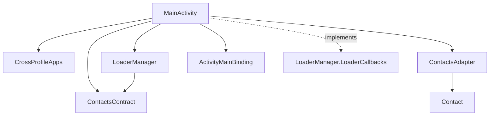
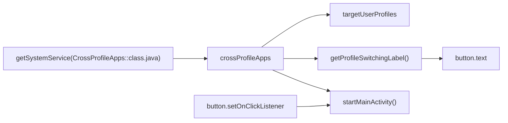
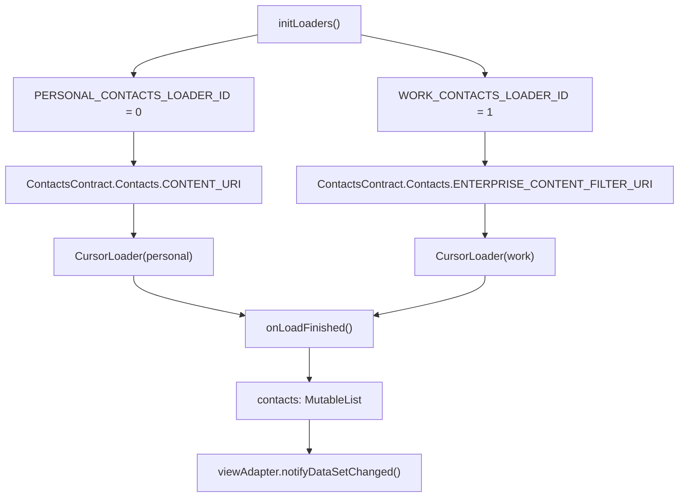
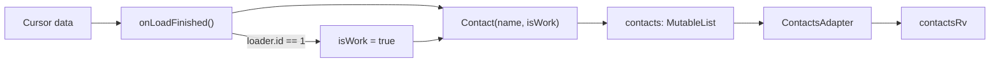
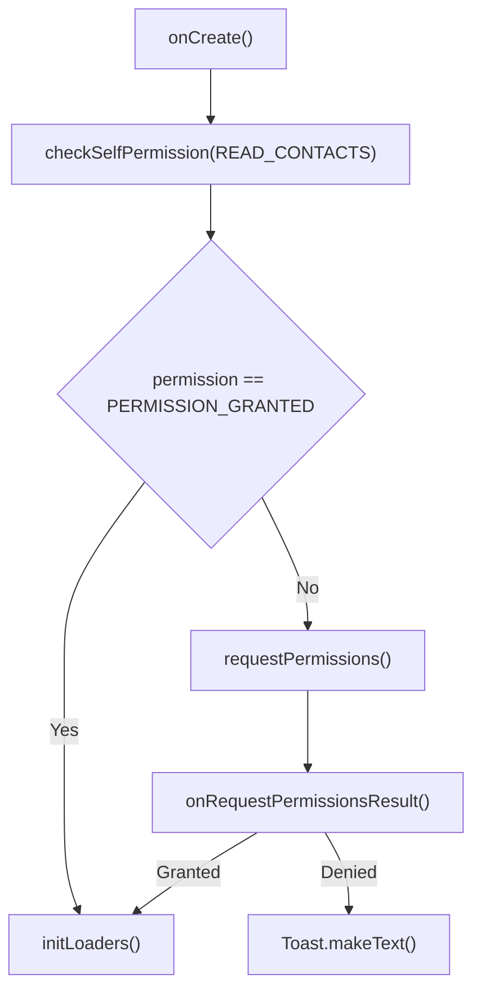

<!-- source: DeepWiki mcp.deepwiki.com · repo android/enterprise-samples · extra page Finished Implementation · fetched 2026-10-23 -->

# Finished Implementation

<details>
<summary>Relevant source files</summary>

The following files were used as context for generating this wiki page:

- [Work-profile-codelab/app-finished/src/main/java/com/example/workprofile/MainActivity.kt](Work-profile-codelab/app-finished/src/main/java/com/example/workprofile/MainActivity.kt)
- [Work-profile-codelab/app-finished/src/main/res/values/styles.xml](Work-profile-codelab/app-finished/src/main/res/values/styles.xml)

</details>


## Purpose and Scope

This document describes the completed implementation of the Work Profile Codelab located in the `Work-profile-codelab/app-finished` directory. This implementation demonstrates a fully functional Android application that showcases cross-profile functionality, allowing users to access and display contacts from both personal and work profiles within a single interface.

For information about the basic starter implementation, see [Starter Implementation](#2.2.1). For broader context about the Work Profile Codelab project, see [Work Profile Codelab](#2.2).

## Architecture Overview

The finished implementation centers around the `MainActivity` class, which orchestrates cross-profile operations, contact data loading, and user interface management.

### High-Level Component Architecture



**Sources:** [Work-profile-codelab/app-finished/src/main/java/com/example/workprofile/MainActivity.kt:17-155]()

## Cross-Profile Functionality Implementation

The application implements cross-profile capabilities using the `CrossProfileApps` system service, enabling seamless interaction between personal and work profiles.

### CrossProfileApps Integration



The cross-profile functionality is initialized in the `onCreate` method through the following sequence:

| Step | Operation | Code Reference |
|------|-----------|----------------|
| 1 | Get CrossProfileApps service | `getSystemService(CrossProfileApps::class.java)` |
| 2 | Retrieve target user profiles | `crossProfileApps.targetUserProfiles` |
| 3 | Get profile switching label | `crossProfileApps.getProfileSwitchingLabel(userHandles.first())` |
| 4 | Configure profile switch button | `button.setOnClickListener` with `startMainActivity` |

**Sources:** [Work-profile-codelab/app-finished/src/main/java/com/example/workprofile/MainActivity.kt:75-86]()

## Contact Loading System

The application implements a dual-loader system to simultaneously access contacts from both personal and work profiles using distinct loader IDs and content URIs.

### Loader Configuration and Data Flow



### Contact URI Resolution

The `onCreateLoader` method implements different URI strategies based on the loader ID:

| Loader ID | Content URI Type | Purpose |
|-----------|------------------|---------|
| `PERSONAL_CONTACTS_LOADER_ID` (0) | `ContactsContract.Contacts.CONTENT_URI` | Access personal profile contacts |
| `WORK_CONTACTS_LOADER_ID` (1) | `ContactsContract.Contacts.ENTERPRISE_CONTENT_FILTER_URI` | Access work profile contacts |

The work profile URI construction includes enterprise directory parameters:

```
ENTERPRISE_CONTENT_FILTER_URI
  .buildUpon()
  .appendPath(nameFilter)
  .appendQueryParameter(DIRECTORY_PARAM_KEY, ENTERPRISE_DEFAULT)
  .build()
```

**Sources:** [Work-profile-codelab/app-finished/src/main/java/com/example/workprofile/MainActivity.kt:108-136]()

## Data Processing and UI Integration

The contact data processing pipeline transforms cursor data into `Contact` objects and updates the RecyclerView adapter.

### Contact Data Processing Flow



The contact processing logic in `onLoadFinished` includes:

1. **Cursor Validation**: Checks `!data.isClosed && data.count > 0`
2. **Data Extraction**: Retrieves `DISPLAY_NAME_PRIMARY` from cursor
3. **Contact Creation**: Creates `Contact(name, loader.id == 1)` where `loader.id == 1` indicates work profile
4. **UI Update**: Calls `viewAdapter.notifyDataSetChanged()`

**Sources:** [Work-profile-codelab/app-finished/src/main/java/com/example/workprofile/MainActivity.kt:138-151]()

## Permission Management

The application implements runtime permission handling for `READ_CONTACTS` permission, which is essential for accessing contact data across profiles.

### Permission Request Flow



The permission handling uses the constant `PERMISSIONS_REQUEST_READ_CONTACTS = 1` for request identification and provides user feedback through toast messages when permissions are denied.

**Sources:** [Work-profile-codelab/app-finished/src/main/java/com/example/workprofile/MainActivity.kt:38-106]()

## UI Components and Styling

The application uses View Binding with `ActivityMainBinding` and implements Material Design 3 theming.

### UI Component Structure

| Component | Type | Purpose |
|-----------|------|---------|
| `contactsRv` | RecyclerView | Displays contact list with LinearLayoutManager |
| `button` | Button | Triggers cross-profile navigation |
| `viewAdapter` | ContactsAdapter | Manages contact data display |
| Edge-to-edge layout | System UI | Handles window insets and system bars |

The styling configuration uses Material Design 3 with the theme `Theme.Material3.DayNight.NoActionBar` and custom color attributes defined in the styles.xml.

**Sources:** [Work-profile-codelab/app-finished/src/main/java/com/example/workprofile/MainActivity.kt:44-64](), [Work-profile-codelab/app-finished/src/main/res/values/styles.xml:1-11]()

---

