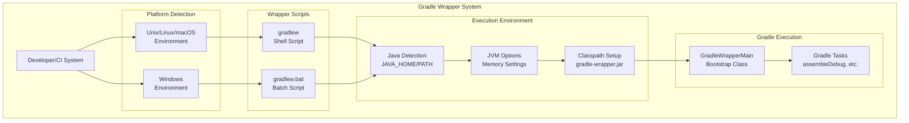
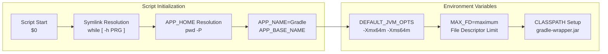
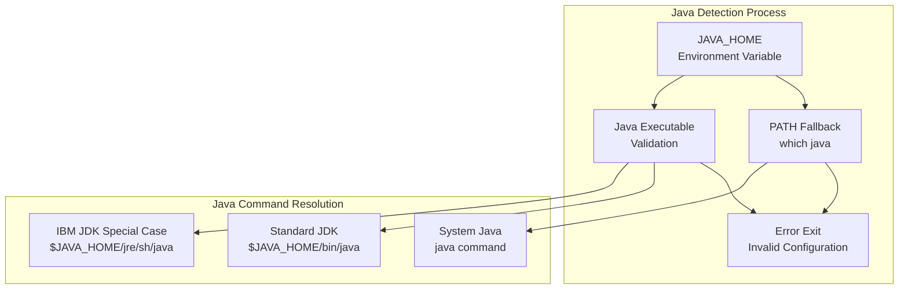
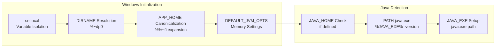
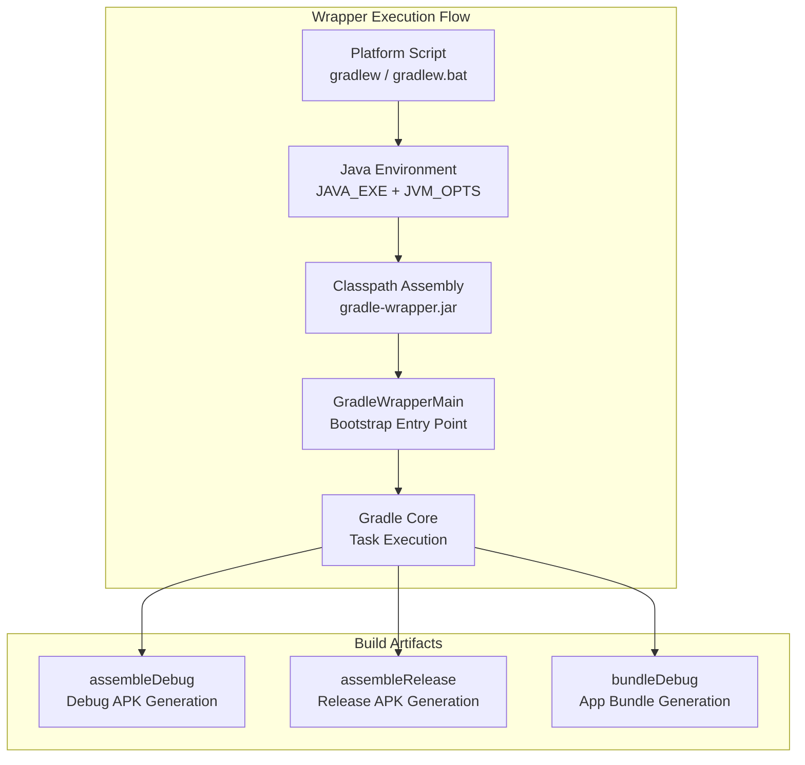

<!-- source: DeepWiki mcp.deepwiki.com · repo android/enterprise-samples · extra page Gradle Wrapper Scripts · fetched 2026-10-23 -->

# Gradle Wrapper Scripts

Relevant source files

The following files were used as context for generating this wiki page:

- [ManagedConfigurations/gradlew](ManagedConfigurations/gradlew)
- [ManagedConfigurations/gradlew.bat](ManagedConfigurations/gradlew.bat)

## Purpose and Scope

This document covers the Gradle wrapper scripts (`gradlew` and `gradlew.bat`) that provide cross-platform build execution capabilities for the Android Enterprise Samples repository. These scripts ensure consistent Gradle builds across different development environments without requiring manual Gradle installation. For information about the broader Gradle configuration including version catalogs and dependency management, see [Version Catalogs and Dependencies](#3.2.2). For details about the CI/CD pipeline that utilizes these scripts, see [CI/CD Pipeline](#3.1).

## Wrapper Script Architecture

The Gradle wrapper system consists of platform-specific scripts that bootstrap the Gradle build process by downloading and executing the appropriate Gradle distribution.

### Wrapper Script Components

**Sources:** [ManagedConfigurations/gradlew:1-186](), [ManagedConfigurations/gradlew.bat:1-90]()

## Unix/Linux Wrapper Script (gradlew)

The `gradlew` script provides comprehensive Unix-like system support with sophisticated environment detection and path handling.

### Script Initialization and Environment Setup

The script begins by resolving its own location and setting up the application home directory:

The script resolves symlinks to determine the actual script location [ManagedConfigurations/gradlew:27-41]() and sets default JVM memory options to 64MB for both minimum and maximum heap [ManagedConfigurations/gradlew:47]().

**Sources:** [ManagedConfigurations/gradlew:25-47]()

### Operating System Detection and Platform-Specific Handling

The script includes comprehensive OS detection to handle different Unix variants:

| OS Type | Detection Method | Special Handling |
|---------|------------------|------------------|
| Cygwin | `uname` pattern `CYGWIN*` | Path conversion to Windows format |
| Darwin (macOS) | `uname` pattern `Darwin*` | Dock appearance options |
| MINGW/MSYS | `uname` pattern `MINGW*` | Windows-style path handling |
| NonStop | `uname` pattern `NONSTOP*` | Generic Unix handling |

The Cygwin path conversion logic is particularly complex, handling the conversion between Unix and Windows path formats [ManagedConfigurations/gradlew:129-173]().

**Sources:** [ManagedConfigurations/gradlew:63-81](), [ManagedConfigurations/gradlew:124-173]()

### Java Runtime Detection

The script includes special handling for IBM's JDK on AIX systems, which uses non-standard executable locations [ManagedConfigurations/gradlew:88-90]().

**Sources:** [ManagedConfigurations/gradlew:86-106]()

## Windows Wrapper Script (gradlew.bat)

The Windows batch script provides equivalent functionality with Windows-specific syntax and error handling.

### Windows Environment Setup

The batch script establishes local variable scope and resolves the application directory:

The script uses Windows batch file path expansion syntax `%%~fi` to canonicalize the application home path [ManagedConfigurations/gradlew.bat:33]().

**Sources:** [ManagedConfigurations/gradlew.bat:24-36]()

### Windows Java Detection Flow

| Detection Method | Implementation | Error Handling |
|------------------|----------------|----------------|
| JAVA_HOME | `%JAVA_HOME%/bin/java.exe` | Invalid directory message |
| PATH fallback | `java.exe -version` | Command not found message |
| Execution test | `%ERRORLEVEL%` check | Graceful failure with guidance |

The Windows script provides clear error messages directing users to set `JAVA_HOME` appropriately [ManagedConfigurations/gradlew.bat:45-49]().

**Sources:** [ManagedConfigurations/gradlew.bat:38-65]()

## Cross-Platform Gradle Execution

Both wrapper scripts converge on the same execution pattern, invoking the `GradleWrapperMain` class with consistent parameters.

### Wrapper Execution Model

The Unix script assembles the final command using shell argument preservation [ManagedConfigurations/gradlew:183](), while the Windows script uses batch parameter passing [ManagedConfigurations/gradlew.bat:74]().

**Sources:** [ManagedConfigurations/gradlew:183-185](), [ManagedConfigurations/gradlew.bat:68-74]()

## Integration with CI/CD Pipeline

The wrapper scripts integrate seamlessly with the GitHub Actions CI/CD pipeline, providing consistent build execution across different runner environments.

### CI/CD Wrapper Usage Pattern

| CI Stage | Script Usage | Environment |
|----------|--------------|-------------|
| Checkout | N/A | ubuntu-latest runner |
| JDK Setup | Java 21 installation | CI environment |
| Build Execution | `./gradlew assembleDebug` | Wrapper bootstrap |
| Artifact Generation | Gradle task execution | Build outputs |

The CI/CD system relies on the wrapper scripts to provide consistent Gradle execution without requiring pre-installed Gradle on the runner systems.

**Sources:** [ManagedConfigurations/gradlew:1-186](), [ManagedConfigurations/gradlew.bat:1-90]()

## Memory and Performance Configuration

Both wrapper scripts configure conservative JVM memory settings suitable for the Android Enterprise sample applications:

- **Initial Heap Size (`-Xms`)**: 64MB for fast startup
- **Maximum Heap Size (`-Xmx`)**: 64MB to prevent excessive memory usage
- **File Descriptor Limits**: Automatically maximized on Unix systems

The memory settings are defined in `DEFAULT_JVM_OPTS` variables in both scripts [ManagedConfigurations/gradlew:47](), [ManagedConfigurations/gradlew.bat:36]().

**Sources:** [ManagedConfigurations/gradlew:47](), [ManagedConfigurations/gradlew.bat:36](), [ManagedConfigurations/gradlew:108-122]()

---

