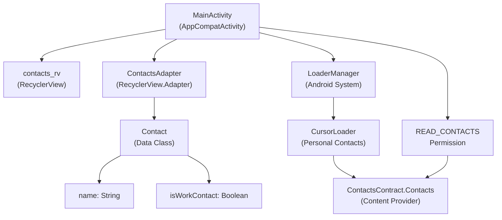
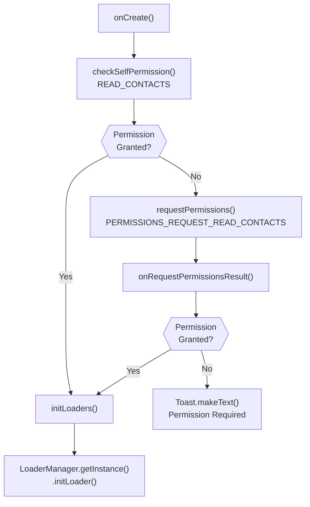
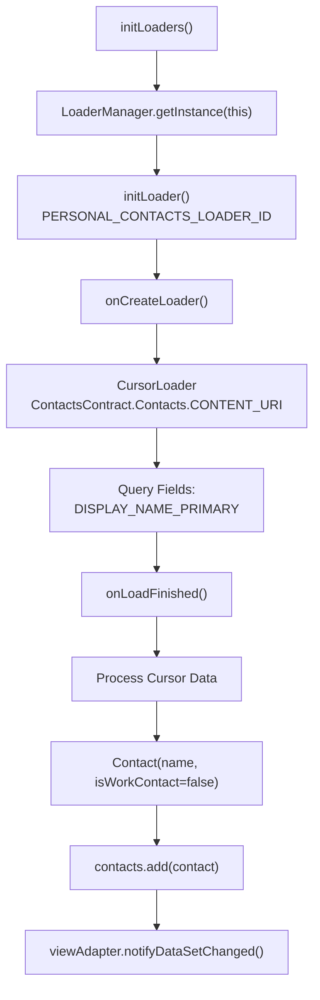

<!-- source: DeepWiki mcp.deepwiki.com · repo android/enterprise-samples · extra page Starter Implementation · fetched 2026-10-23 -->

# Starter Implementation

<details>
<summary>Relevant source files</summary>

The following files were used as context for generating this wiki page:

- [Work-profile-codelab/app-starter/src/main/java/com/example/workprofile/MainActivity.kt](Work-profile-codelab/app-starter/src/main/java/com/example/workprofile/MainActivity.kt)

</details>


## Purpose and Scope

This document covers the starter implementation of the Work Profile Codelab, which provides a foundational Android application for learning work profile development. The starter app demonstrates basic contact reading functionality using Android's ContactsContract API and serves as the starting point for developers to add cross-profile capabilities.

This implementation contains only personal profile contact access. For the complete work profile functionality including cross-profile app interactions, see [Finished Implementation](#2.2.2).

## Application Architecture

The starter implementation follows a simple Android architecture pattern with a single Activity that manages contact loading and display:



**Sources**: [Work-profile-codelab/app-starter/src/main/java/com/example/workprofile/MainActivity.kt:1-128]()

## Core Components

### MainActivity Class

The `MainActivity` class serves as the primary entry point and coordinator for the application. It extends `AppCompatActivity` and implements `LoaderManager.LoaderCallbacks<Cursor>` to handle asynchronous contact loading.

| Component | Type | Purpose |
|-----------|------|---------|
| `viewAdapter` | `RecyclerView.Adapter<*>` | Manages contact list display |
| `binding` | `ActivityMainBinding` | View binding for UI elements |
| `contacts` | `MutableList<Contact>` | In-memory contact storage |

The class manages three primary responsibilities:
- UI initialization and edge-to-edge display setup
- Contact permission handling
- Contact data loading via CursorLoader

**Sources**: [Work-profile-codelab/app-starter/src/main/java/com/example/workprofile/MainActivity.kt:40-43]()

### Permission Management

The starter implementation demonstrates proper Android permission handling for accessing contacts:



**Sources**: [Work-profile-codelab/app-starter/src/main/java/com/example/workprofile/MainActivity.kt:63-71](), [Work-profile-codelab/app-starter/src/main/java/com/example/workprofile/MainActivity.kt:74-91]()

### Contact Loading Implementation

The contact loading mechanism uses Android's CursorLoader pattern to asynchronously load contact data:



**Sources**: [Work-profile-codelab/app-starter/src/main/java/com/example/workprofile/MainActivity.kt:93-95](), [Work-profile-codelab/app-starter/src/main/java/com/example/workprofile/MainActivity.kt:97-107](), [Work-profile-codelab/app-starter/src/main/java/com/example/workprofile/MainActivity.kt:110-123]()

## Key Implementation Details

### Contact Data Structure

The application uses a simple `Contact` data class with two properties:
- `name: String` - The contact's display name
- `isWorkContact: Boolean` - Flag indicating work profile origin (always `false` in starter)

The contact creation logic in `onLoadFinished()` demonstrates this structure:

```kotlin
val contact = Contact(name, loader.id == 1)
```

The loader ID comparison (`loader.id == 1`) is preparation for work profile functionality, where different loaders will distinguish between personal and work contacts.

**Sources**: [Work-profile-codelab/app-starter/src/main/java/com/example/workprofile/MainActivity.kt:116]()

### Constants and Configuration

The implementation defines key constants that will be extended in the finished version:

| Constant | Value | Purpose |
|----------|-------|---------|
| `PERMISSIONS_REQUEST_READ_CONTACTS` | 1 | Permission request identifier |
| `PERSONAL_CONTACTS_LOADER_ID` | 0 | Personal contacts loader identifier |

**Sources**: [Work-profile-codelab/app-starter/src/main/java/com/example/workprofile/MainActivity.kt:37-38]()

## Limitations and Learning Opportunities

### Missing Work Profile Features

The starter implementation intentionally omits several work profile capabilities that developers will add:

1. **Cross-Profile App Detection** - No `CrossProfileApps` integration
2. **Work Profile Contact Loading** - Only personal contacts are loaded
3. **Profile-Aware UI** - No visual distinction between personal and work contacts
4. **Intent Targeting** - No cross-profile intent handling

### RecyclerView Integration

The RecyclerView setup demonstrates standard Android patterns:
- `LinearLayoutManager` for vertical scrolling
- `ContactsAdapter` for data binding
- Fixed size optimization with `setHasFixedSize(true)`

**Sources**: [Work-profile-codelab/app-starter/src/main/java/com/example/workprofile/MainActivity.kt:56-62]()

## Development Progression

This starter implementation provides the foundation for developers to:

1. Understand basic contact reading patterns
2. Learn permission handling workflows
3. Implement CursorLoader for asynchronous data loading
4. Set up RecyclerView with adapters

The progression to the finished implementation will involve adding `CrossProfileApps` functionality, work profile contact detection, and cross-profile intent handling capabilities.

**Sources**: [Work-profile-codelab/app-starter/src/main/java/com/example/workprofile/MainActivity.kt:1-128]()

---

