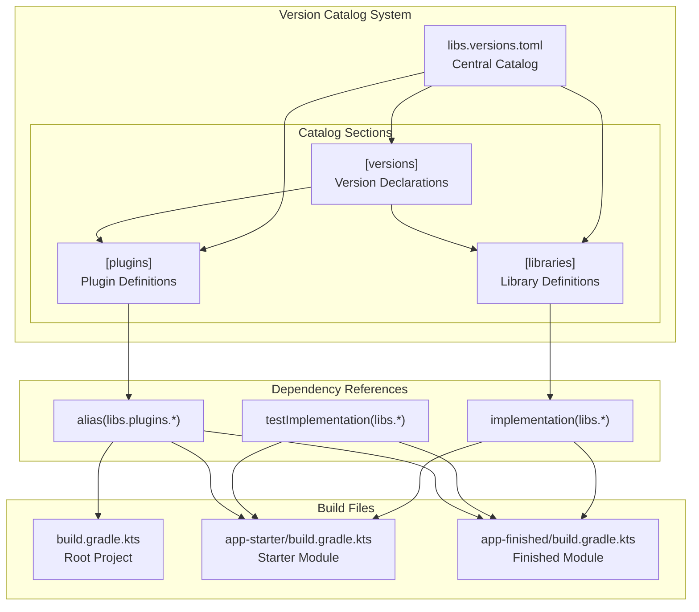
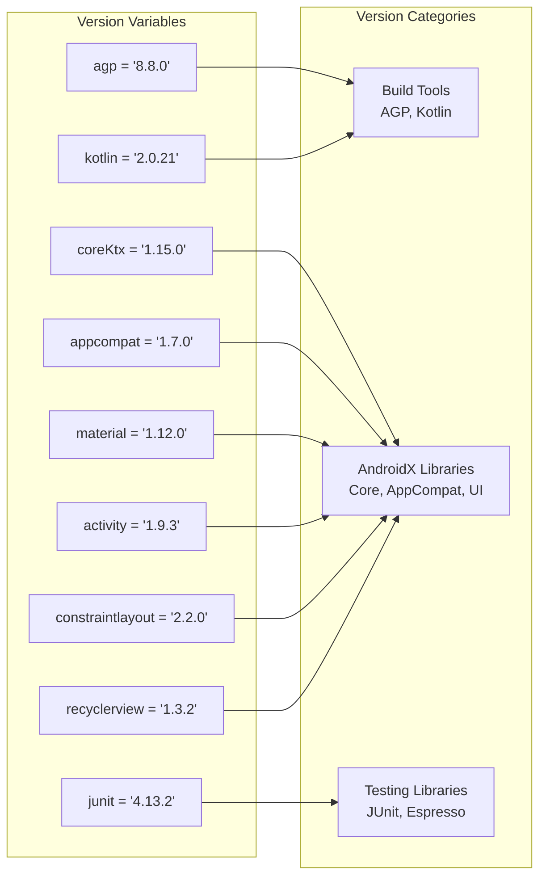
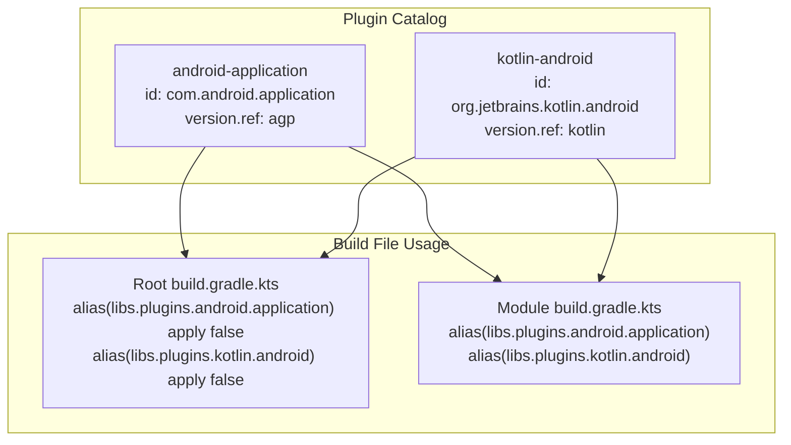
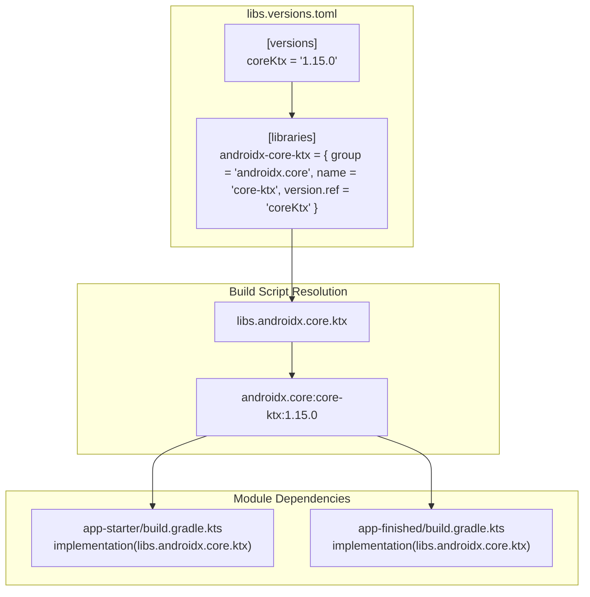
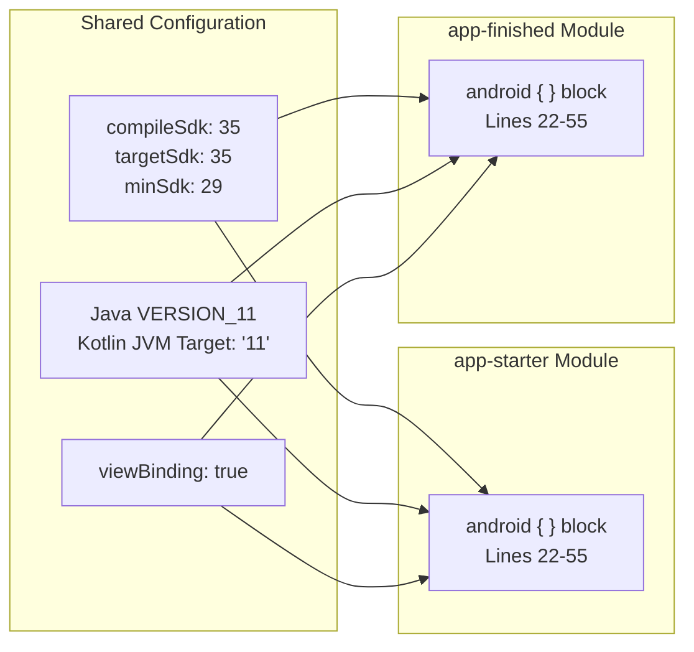

<!-- source: DeepWiki mcp.deepwiki.com · repo android/enterprise-samples · extra page Version Catalogs and Dependencies · fetched 2026-10-23 -->

# Version Catalogs and Dependencies

Relevant source files

The following files were used as context for generating this wiki page:

- [Work-profile-codelab/app-finished/build.gradle.kts](Work-profile-codelab/app-finished/build.gradle.kts)
- [Work-profile-codelab/app-starter/build.gradle.kts](Work-profile-codelab/app-starter/build.gradle.kts)
- [Work-profile-codelab/app-starter/src/main/res/values/styles.xml](Work-profile-codelab/app-starter/src/main/res/values/styles.xml)
- [Work-profile-codelab/build.gradle.kts](Work-profile-codelab/build.gradle.kts)
- [Work-profile-codelab/gradle.properties](Work-profile-codelab/gradle.properties)
- [Work-profile-codelab/gradle/libs.versions.toml](Work-profile-codelab/gradle/libs.versions.toml)
- [Work-profile-codelab/gradle/wrapper/gradle-wrapper.properties](Work-profile-codelab/gradle/wrapper/gradle-wrapper.properties)

This document covers the centralized dependency management system used in the Android Enterprise Samples repository, specifically focusing on Gradle Version Catalogs implementation. It details how versions, libraries, and plugins are defined and consumed across all sample applications.

For information about the CI/CD build pipeline that utilizes these dependencies, see [CI/CD Pipeline](#3.1). For details about the Gradle wrapper execution system, see [Gradle Wrapper Scripts](#3.2.1).

## Overview

The repository employs Gradle Version Catalogs as the centralized dependency management solution, replacing traditional dependency declarations in individual `build.gradle` files. This system provides type-safe dependency management and ensures version consistency across all modules in the Work Profile Codelab project.

**Version Catalog Architecture**

Sources: [Work-profile-codelab/gradle/libs.versions.toml:1-43](), [Work-profile-codelab/build.gradle.kts:17-20](), [Work-profile-codelab/app-starter/build.gradle.kts:17-19](), [Work-profile-codelab/app-finished/build.gradle.kts:17-19]()

## Version Catalog Structure

The version catalog is defined in `libs.versions.toml` using TOML (Tom's Obvious, Minimal Language) format. The catalog organizes dependency management into three main sections:

### Version Declarations

The version section defines all dependency versions as variables that can be referenced throughout the catalog, ensuring consistency and simplifying version updates.

Sources: [Work-profile-codelab/gradle/libs.versions.toml:15-27]()

### Library Definitions

The libraries section maps dependency coordinates to their versions using a structured format:

| Library Alias | Group | Artifact | Version Reference |
|--------------|--------|----------|------------------|
| `androidx-core-ktx` | androidx.core | core-ktx | coreKtx |
| `androidx-appcompat` | androidx.appcompat | appcompat | appcompat |
| `material` | com.google.android.material | material | material |
| `androidx-activity` | androidx.activity | activity | activity |
| `androidx-constraintlayout` | androidx.constraintlayout | constraintlayout | constraintlayout |
| `androidx-recyclerview` | androidx.recyclerview | recyclerview | recyclerview |
| `jetbrains-kotlin-stdlib-jdk7` | org.jetbrains.kotlin | kotlin-stdlib-jdk7 | kotlin |

Sources: [Work-profile-codelab/gradle/libs.versions.toml:28-39]()

### Plugin Definitions

Sources: [Work-profile-codelab/gradle/libs.versions.toml:40-43](), [Work-profile-codelab/build.gradle.kts:17-20](), [Work-profile-codelab/app-starter/build.gradle.kts:17-19]()

## Dependency Management Flow

The version catalog enables type-safe dependency references across all build files in the project:

**Dependency Resolution Flow**

### Implementation Dependencies

Both the `app-starter` and `app-finished` modules utilize identical dependency sets, demonstrating the consistency achieved through version catalogs:

**Core Dependencies:**
- `libs.androidx.core.ktx` - AndroidX Core KTX extensions
- `libs.androidx.appcompat` - AppCompat support library
- `libs.material` - Material Design components
- `libs.androidx.activity` - Activity framework
- `libs.androidx.constraintlayout` - ConstraintLayout library
- `libs.jetbrains.kotlin.stdlib.jdk7` - Kotlin standard library
- `libs.androidx.recyclerview` - RecyclerView component

**Testing Dependencies:**
- `libs.junit` - Unit testing framework
- `libs.androidx.junit` - AndroidX JUnit extensions
- `libs.androidx.espresso.core` - UI testing framework

Sources: [Work-profile-codelab/app-starter/build.gradle.kts:57-69](), [Work-profile-codelab/app-finished/build.gradle.kts:57-69]()

## Configuration Synchronization

The version catalog system ensures that both sample applications maintain identical dependency versions, supporting the educational progression from starter to finished implementation:

| Configuration Aspect | Value | Location |
|---------------------|--------|----------|
| Compile SDK | 35 | Both modules |
| Target SDK | 35 | Both modules |
| Min SDK | 29 | Both modules |
| Java Compatibility | VERSION_11 | Both modules |
| Kotlin JVM Target | "11" | Both modules |
| View Binding | true | Both modules |

**Module Configuration Alignment**

Sources: [Work-profile-codelab/app-starter/build.gradle.kts:22-55](), [Work-profile-codelab/app-finished/build.gradle.kts:22-55]()

## Gradle Configuration Properties

The project utilizes specific Gradle properties to optimize build performance and enable modern Android development features:

**Build Optimization Properties:**
- `org.gradle.jvmargs=-Xmx2048m -Dfile.encoding=UTF-8` - JVM memory allocation
- `android.useAndroidX=true` - AndroidX library usage
- `android.nonTransitiveRClass=true` - R class optimization
- `kotlin.code.style=official` - Kotlin code style enforcement

Sources: [Work-profile-codelab/gradle.properties:9-23]()

## Gradle Wrapper Integration

The version catalog system integrates with the Gradle wrapper configuration to ensure consistent build environments:

**Wrapper Configuration:**
- Distribution URL: `gradle-8.10.2-bin.zip`
- Distribution Base: `GRADLE_USER_HOME`
- Storage Path: `wrapper/dists`

Sources: [Work-profile-codelab/gradle/wrapper/gradle-wrapper.properties:1-6]()

---

