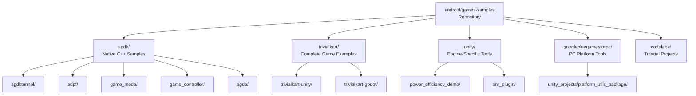
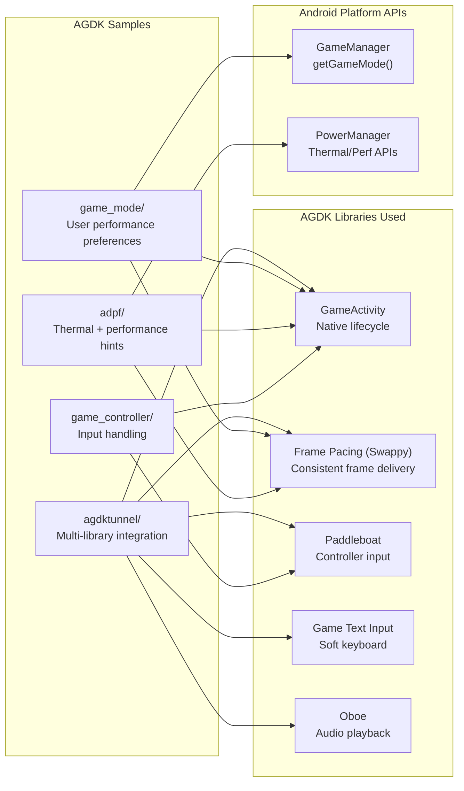
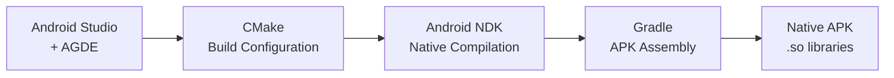
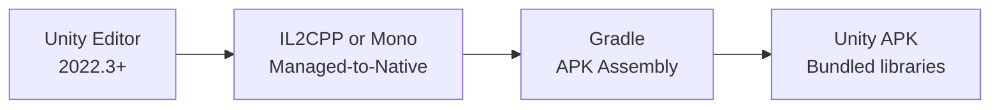

<!-- source: DeepWiki mcp.deepwiki.com · repo android/games-samples · page 1 Overview · fetched 2026-10-23 -->

# Overview

<details>
<summary>Relevant source files</summary>

The following files were used as context for generating this wiki page:

- [.gitignore](.gitignore)
- [CONTRIBUTING.md](CONTRIBUTING.md)
- [LICENSE](LICENSE)
- [README.md](README.md)
- [agdk/README.md](agdk/README.md)
- [agdk/game_mode/README.md](agdk/game_mode/README.md)
- [agdk/game_mode/docs/gamedashboardactivity.png](agdk/game_mode/docs/gamedashboardactivity.png)
- [unity/power_efficiency_demo/Assets/GameModeUtil.cs](unity/power_efficiency_demo/Assets/GameModeUtil.cs)

</details>


## Purpose and Scope

This document provides a high-level overview of the Android Games Samples repository, explaining its structure, purpose, and the types of samples it contains. The repository serves as a collection of reference implementations demonstrating best practices for Android game development, with a focus on:

- Native C++ game development using the Android Game Development Kit (AGDK)
- Integration of Google Play technologies (billing, achievements, leaderboards, cloud save)
- Adaptive performance optimization techniques
- Unity engine best practices for Android

For detailed information about specific samples, see:
- AGDK Native Samples: [#2]()
- TrivialKart Game Samples: [#3]()
- Unity Development Tools: [#4]()
- Build System and Development Workflow: [#5]()

Sources: [README.md:1-67]()

## Repository Structure

The repository is organized into four primary directories, each serving a distinct development purpose:



**Directory Descriptions:**

| Directory | Purpose | Technology |
|-----------|---------|------------|
| `agdk/` | Demonstrates AGDK libraries for native game development | C/C++, NDK |
| `trivialkart/` | Production-grade game samples with Google Play integration | Unity, Godot |
| `unity/` | Android best practices and diagnostic tools for Unity | C#, Unity |
| `googleplaygamesforpc/` | Tools for targeting Google Play Games for PC | Unity |
| `codelabs/` | Tutorial projects for Play Asset Delivery | C++, Unity |

Sources: [README.md:1-67](), [agdk/README.md:1-23]()

## AGDK Native Samples

The [agdk/](agdk) directory contains C++ samples demonstrating Android Game Development Kit libraries. These samples target native game engines and show how to integrate Android-specific APIs.



**Key Samples:**

- **AGDKTunnel** ([agdk/agdktunnel/](agdk/agdktunnel)): Comprehensive integration demonstrating six AGDK libraries including Play Games Services and Play Asset Delivery. See [#2.3]() for details.
- **Game Mode** ([agdk/game_mode/](agdk/game_mode)): Demonstrates `GameManager` API to adjust graphics fidelity based on user-selected modes (Standard/Performance/Battery). See [#2.1]() for details.
- **ADPF** ([agdk/adpf/](agdk/adpf)): Shows Android Dynamic Performance Framework APIs for thermal management and CPU scheduling hints. See [#2.2]() for details.
- **Game Controller** ([agdk/game_controller/](agdk/game_controller)): Visualizes Paddleboat library functionality for controller input, motion sensors, and vibration. See [#2.4]() for details.

Sources: [README.md:7-18](), [agdk/README.md:1-23](), [agdk/game_mode/README.md:1-67]()

## TrivialKart Game Samples

The [trivialkart/](trivialkart) directory contains complete, production-ready game implementations demonstrating Google Play technologies.

**Available Implementations:**

| Implementation | Technologies Demonstrated |
|----------------|---------------------------|
| **trivialkart-unity/** | Unity IAP, Play Games Services v1/v2 migration, authentication server, cloud save, Google Play Games for PC Input SDK, Play Integrity |
| **trivialkart-godot/** | Google Play Billing integration |

The Unity implementation is particularly comprehensive, featuring a server-side authentication architecture for migrating from Play Games Services v1 to v2 using OpenID-based account linking. This allows seamless player progress preservation during SDK updates.

Sources: [README.md:19-40]()

## Unity Development Tools

The [unity/](unity) directory provides Android-specific tools and best practices for Unity developers:

**Power Efficiency Demo** ([unity/power_efficiency_demo/](unity/power_efficiency_demo)): Demonstrates adaptive performance using the Game Mode API via JNI. The `GameModeUtil` class bridges C# to Android's `GameManager`:

```mermaid
sequenceDiagram
    participant Unity["Unity C# Code"]
    participant GameModeUtil["GameModeUtil.cs"]
    participant AndroidJNI["AndroidJNI Bridge"]
    participant GameManager["Android GameManager<br/>System Service"]
    
    Unity->>GameModeUtil: GetGameMode()
    GameModeUtil->>AndroidJNI: Get UnityPlayer.currentActivity
    AndroidJNI->>AndroidJNI: getSystemService("game")
    AndroidJNI->>GameManager: getGameMode()
    GameManager-->>AndroidJNI: Mode value (0-4)
    AndroidJNI-->>GameModeUtil: Return mode
    GameModeUtil-->>Unity: Apply adaptations
```

The `GameModeUtil.GetGameMode()` method at [unity/power_efficiency_demo/Assets/GameModeUtil.cs:28-43]() retrieves mode values:
- `GameModeUnsupported = 0`
- `GameModeStandard = 1`
- `GameModePerformance = 2`
- `GameModeBattery = 3`
- `GameModeCustom = 4`

**ANR Plugin** ([unity/anr_plugin/](unity/anr_plugin)): Diagnostic tool for identifying Application Not Responding errors, strict mode violations, and memory issues on Unity 2022 and older versions.

Sources: [README.md:52-61](), [unity/power_efficiency_demo/Assets/GameModeUtil.cs:1-72]()

## Common Framework Architecture

AGDK samples share a common framework located in [agdk/common/](agdk/common) that provides:

- **Graphics API Abstraction**: Unified interface supporting both Vulkan and OpenGL ES rendering backends
- **Display Management**: Screen resolution and orientation handling
- **Rendering Infrastructure**: Texture loading, shader management, and draw call abstraction

This shared infrastructure allows samples to focus on demonstrating specific AGDK features while maintaining consistent rendering quality. The framework follows a "Vulkan-first, OpenGL ES fallback" pattern to support a wide range of Android devices.

Sources: [README.md:1-67]()

## Development Workflows

The repository supports two primary development paths:

### Native C++ Path (AGDK Samples)

**Requirements:**
- Android Studio 2024.3.1 Patch 1 (Meerkat) or higher
- Android Game Development Extension
- CMake build system
- Android NDK 27.2
- Manual setup of third-party libraries (Dear ImGui, Bullet Physics, Volk, VMA)

**Build Flow:**


### Unity Path (TrivialKart, Tools)

**Requirements:**
- Unity Editor 2022.3+
- Unity IAP Package
- Play Games Services Plugin
- Custom plugins (ANR Plugin, GameModeUtil)

**Build Flow:**


Both paths converge on Gradle + Android Gradle Plugin 8.7+ for final artifact generation.

Sources: [README.md:1-67](), [agdk/game_mode/README.md:14-35]()

## Key Concepts: Adaptive Performance

A central theme across multiple samples is adaptive performance—adjusting game behavior based on device state and user preferences.

**Two Approaches:**

| Approach | API | Sample | Trigger |
|----------|-----|--------|---------|
| **User-Driven** | Game Mode API | [game_mode/](agdk/game_mode) | User selects mode via Game Dashboard |
| **System-Driven** | ADPF APIs | [adpf/](agdk/adpf) | Thermal throttling detection |

**Common Adaptation Strategies:**

Both approaches employ similar techniques:
- Frame rate adjustment (60 FPS ↔ 30 FPS)
- Resolution scaling (Full ↔ Half ↔ Quarter)
- Physics complexity reduction
- Object count reduction
- Asset quality variation

The Game Mode sample demonstrates user preferences where players choose between Standard, Performance, and Battery modes. The ADPF sample showcases automatic adaptation responding to thermal events by dynamically reducing simulation complexity.

Sources: [README.md:1-67](), [agdk/game_mode/README.md:1-67]()

## Prerequisites and Third-Party Dependencies

### Native C++ Samples

Before building AGDK samples, third-party libraries must be manually installed:

1. Navigate to `agdk/third_party/`
2. Clone required repositories:
   ```
   git clone https://github.com/ocornut/imgui
   git clone https://github.com/bulletphysics/bullet3
   ```

Additional dependencies (Volk, Vulkan Memory Allocator) are sample-specific.

### Unity Samples

Unity samples manage dependencies via Unity Package Manager and include custom plugins distributed with the samples.

### Minimum API Levels

- **Game Mode API**: Requires API level 31 (Android 12) minimum. Samples demonstrate runtime API level checking at [unity/power_efficiency_demo/Assets/GameModeUtil.cs:26-35]().
- **ADPF APIs**: Require API level 31+ for Performance Hint Manager, API 29+ for Thermal API.
- **Base compatibility**: Most samples set `minSdkVersion` to 24 (Android 7.0) and demonstrate graceful degradation on older devices.

Sources: [agdk/game_mode/README.md:14-31](), [unity/power_efficiency_demo/Assets/GameModeUtil.cs:26-35]()

## Repository Contents Summary

| Category | Sample Count | Primary Language | Key APIs |
|----------|--------------|------------------|----------|
| AGDK Samples | 4+ | C/C++ | GameActivity, Swappy, Paddleboat, Oboe |
| TrivialKart | 2 | Unity (C#), Godot (GDScript) | Play Billing, PGS, Play Integrity |
| Unity Tools | 2 | C# | Game Mode API (JNI), ANR diagnostics |
| Codelabs | 2 | C++, Unity | Play Asset Delivery |

The repository is licensed under Apache License 2.0 and accepts contributions following Google's Open Source Community Guidelines.

Sources: [README.md:1-67](), [LICENSE:1-203](), [CONTRIBUTING.md:1-29]()

---

