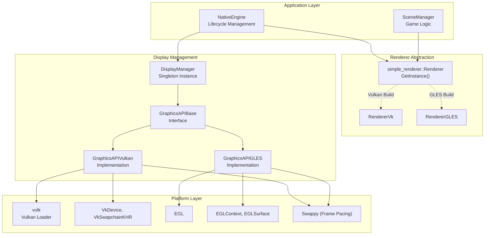
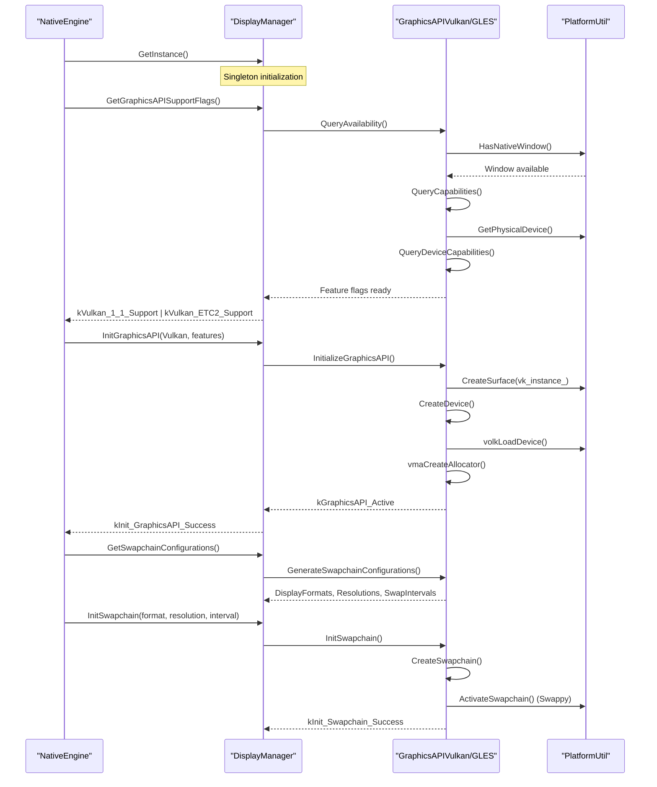
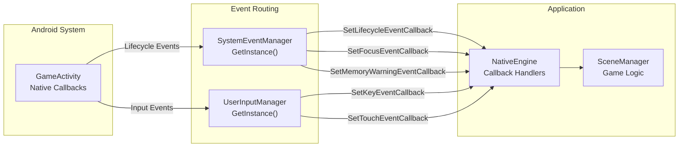
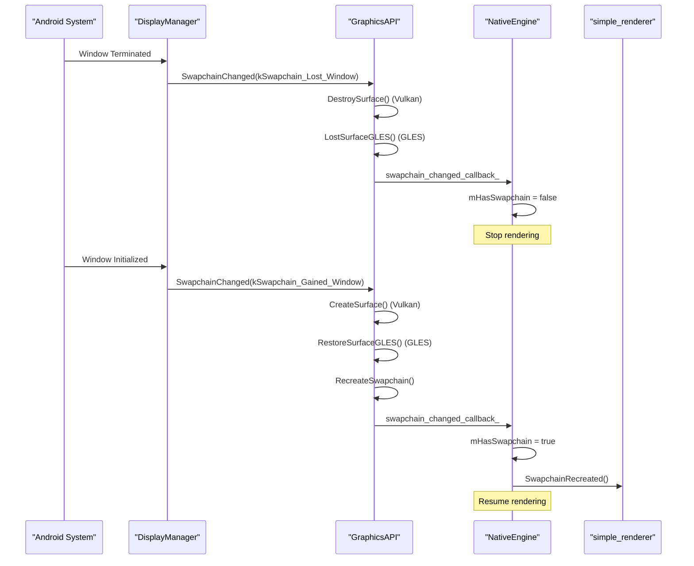
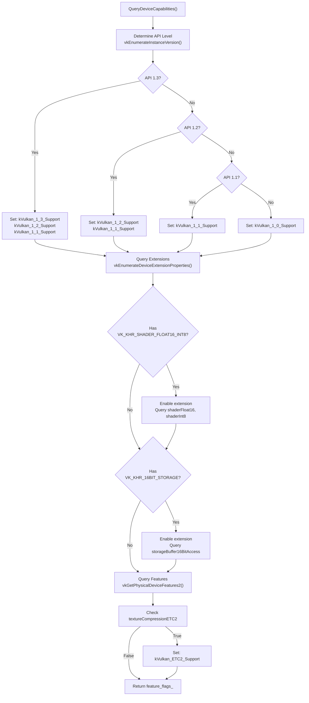
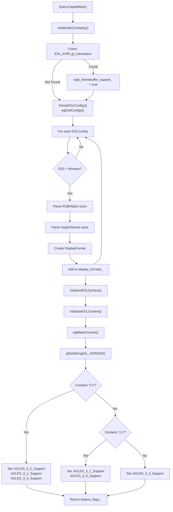
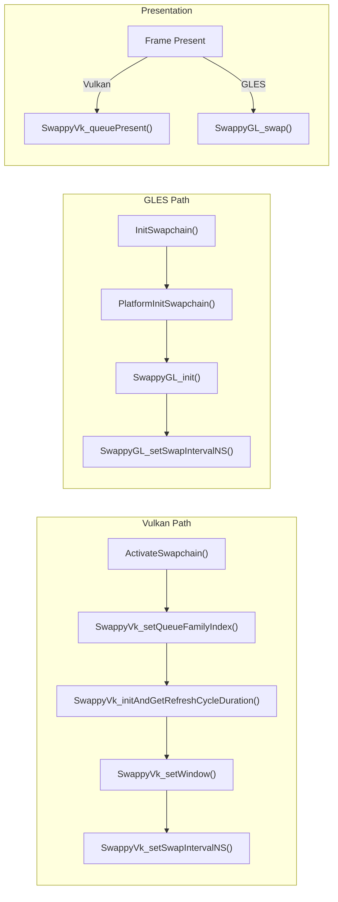

<!-- source: DeepWiki mcp.deepwiki.com · repo android/games-samples · page 2 AGDK Native Samples · fetched 2026-10-23 -->

# AGDK Native Samples

<details>
<summary>Relevant source files</summary>

The following files were used as context for generating this wiki page:

- [README.md](README.md)
- [agdk/README.md](agdk/README.md)
- [agdk/agdktunnel/app/src/main/cpp/native_engine.cpp](agdk/agdktunnel/app/src/main/cpp/native_engine.cpp)
- [agdk/common/base_game_framework/include/graphics_api_features.h](agdk/common/base_game_framework/include/graphics_api_features.h)
- [agdk/common/base_game_framework/src/android/display_manager_android.cpp](agdk/common/base_game_framework/src/android/display_manager_android.cpp)
- [agdk/common/base_game_framework/src/android/platform_util_vulkan_android.cpp](agdk/common/base_game_framework/src/android/platform_util_vulkan_android.cpp)
- [agdk/common/base_game_framework/src/gles/graphics_api_gles.cpp](agdk/common/base_game_framework/src/gles/graphics_api_gles.cpp)
- [agdk/common/base_game_framework/src/vulkan/graphics_api_vulkan.cpp](agdk/common/base_game_framework/src/vulkan/graphics_api_vulkan.cpp)
- [agdk/common/base_game_framework/src/vulkan/graphics_api_vulkan_utils.cpp](agdk/common/base_game_framework/src/vulkan/graphics_api_vulkan_utils.cpp)
- [agdk/common/simple_renderer/renderer_render_pass_vk.cpp](agdk/common/simple_renderer/renderer_render_pass_vk.cpp)
- [agdk/game_mode/README.md](agdk/game_mode/README.md)
- [agdk/game_mode/docs/gamedashboardactivity.png](agdk/game_mode/docs/gamedashboardactivity.png)
- [unity/power_efficiency_demo/Assets/GameModeUtil.cs](unity/power_efficiency_demo/Assets/GameModeUtil.cs)

</details>


## Purpose and Scope

The AGDK Native Samples are a collection of C++ game samples demonstrating the integration and use of [Android Game Development Kit (AGDK) libraries](https://developer.android.com/games/agdk/libraries-overview). These samples showcase native Android game development using modern graphics APIs (Vulkan/OpenGL ES), adaptive performance features, and input handling through a shared framework architecture.

This page provides an architectural overview of the native samples and their common infrastructure. For details on individual samples, see:
- [Game Mode Sample](#2.1) - User-driven performance adaptation
- [ADPF Sample](#2.2) - System-driven thermal management
- [AGDKTunnel Sample](#2.3) - Multi-library integration example
- [Game Controller Sample](#2.4) - Input handling with Paddleboat
- [Common Framework Architecture](#2.5) - Shared rendering and display infrastructure

For Unity-based samples and tools, see [Unity Development Tools](#4). For complete game examples, see [TrivialKart Game Samples](#3).

## Sample Overview

The AGDK native samples are located in the `agdk/` directory and consist of four primary examples, each demonstrating different aspects of the AGDK:

| Sample | Primary Focus | Key AGDK Libraries | Importance Score |
|--------|---------------|-------------------|------------------|
| Game Mode | User-selected performance modes | GameActivity, Frame Pacing | 23.27 |
| ADPF | Thermal-aware adaptive performance | GameActivity, Frame Pacing, ADPF APIs | 18.00 |
| AGDKTunnel | Comprehensive multi-library integration | GameActivity, Frame Pacing, Paddleboat, Oboe, GameTextInput | 20.30 |
| Game Controller | Controller input and visualization | GameActivity, Paddleboat | 12.94 |

All samples share a common Base Game Framework that provides graphics API abstraction (Vulkan/OpenGL ES), display management, and system event handling.

**Sources:** [README.md:7-17](), [agdk/README.md:1-23]()

## AGDK Library Integration Pattern

```mermaid
graph TB
    subgraph "Sample Applications"
        GameMode["Game Mode Sample<br/>(game_mode/)"]
        ADPF["ADPF Sample<br/>(adpf/)"]
        Tunnel["AGDKTunnel<br/>(agdktunnel/)"]
        Controller["Game Controller<br/>(game_controller/)"]
    end
    
    subgraph "AGDK Libraries (Prefab Dependencies)"
        GameActivity["game-activity<br/>Native Lifecycle"]
        FramePacing["swappy (Frame Pacing)<br/>Consistent Frame Delivery"]
        Paddleboat["paddleboat<br/>Game Controller Input"]
        GameTextInput["game-text-input<br/>Soft Keyboard"]
        Oboe["oboe<br/>Audio API"]
    end
    
    subgraph "Android Platform APIs"
        GameModeAPI["GameManager.getGameMode()"]
        ADPFAPI["ThermalManager, PerformanceHintManager"]
    end
    
    subgraph "Common Infrastructure"
        BaseFramework["base_game_framework<br/>DisplayManager, GraphicsAPIBase"]
        SimpleRenderer["simple_renderer<br/>Renderer Interface"]
    end
    
    GameMode --> GameActivity
    GameMode --> FramePacing
    GameMode --> BaseFramework
    GameMode --> SimpleRenderer
    GameMode -.-> GameModeAPI
    
    ADPF --> GameActivity
    ADPF --> FramePacing
    ADPF --> BaseFramework
    ADPF --> SimpleRenderer
    ADPF -.-> ADPFAPI
    
    Tunnel --> GameActivity
    Tunnel --> FramePacing
    Tunnel --> Paddleboat
    Tunnel --> GameTextInput
    Tunnel --> Oboe
    Tunnel --> BaseFramework
    Tunnel --> SimpleRenderer
    
    Controller --> GameActivity
    Controller --> Paddleboat
    Controller --> BaseFramework
    Controller --> SimpleRenderer
```



The samples follow a consistent integration pattern:
- **GameActivity** provides native app lifecycle management (replaces deprecated NativeActivity)
- **Frame Pacing (Swappy)** ensures consistent frame delivery and refresh rate handling
- **Base Game Framework** abstracts graphics API selection and display management
- **Simple Renderer** provides a higher-level rendering interface built on the framework

Platform-specific APIs (Game Mode, ADPF) are accessed directly through JNI or NDK APIs where available.

**Sources:** [agdk/README.md:1-23](), [agdk/agdktunnel/app/src/main/cpp/native_engine.cpp:1-467]()

## Graphics API Architecture

### Dual Graphics API Support

All AGDK samples support both Vulkan and OpenGL ES through a unified abstraction layer. The framework automatically selects the appropriate backend based on device capabilities:



The graphics API selection follows this decision logic:

1. **Query Vulkan availability** via `DisplayManager::GetGraphicsAPISupportFlags(kGraphicsAPI_Vulkan)`
2. **Check for Vulkan 1.1+ and ETC2 texture compression** support
3. **Fall back to OpenGL ES 3.0** if Vulkan requirements not met
4. **Initialize graphics API** via `DisplayManager::InitGraphicsAPI()`

**Sources:** [agdk/agdktunnel/app/src/main/cpp/native_engine.cpp:108-157](), [agdk/common/base_game_framework/src/vulkan/graphics_api_vulkan.cpp:117-168](), [agdk/common/base_game_framework/src/gles/graphics_api_gles.cpp:54-129]()

### Display Manager Initialization Flow



Key classes involved:
- **`DisplayManager`** ([agdk/common/base_game_framework/include/display_manager.h]()) - Singleton managing graphics API lifecycle
- **`GraphicsAPIVulkan`** ([agdk/common/base_game_framework/src/vulkan/graphics_api_vulkan.cpp:45-88]()) - Vulkan backend implementation
- **`GraphicsAPIGLES`** ([agdk/common/base_game_framework/src/gles/graphics_api_gles.cpp:31-52]()) - OpenGL ES backend implementation
- **`NativeEngine`** ([agdk/agdktunnel/app/src/main/cpp/native_engine.cpp:44-97]()) - Application lifecycle manager

**Sources:** [agdk/agdktunnel/app/src/main/cpp/native_engine.cpp:108-218](), [agdk/common/base_game_framework/src/vulkan/graphics_api_vulkan.cpp:117-435](), [agdk/common/base_game_framework/src/gles/graphics_api_gles.cpp:54-404]()

## Build System and Dependencies

### CMake Build Configuration

The AGDK native samples use CMake with the Android Gradle Plugin for building. Each sample follows a standard project structure:

```
agdk/<sample_name>/
├── app/
│   ├── src/main/
│   │   ├── cpp/           # C++ source files
│   │   └── AndroidManifest.xml
│   ├── CMakeLists.txt     # Native build configuration
│   └── build.gradle       # Android build configuration
└── gradle.properties
```

Key CMake patterns:

1. **Prefab dependency consumption** for AGDK libraries:
```cmake
find_package(game-activity REQUIRED CONFIG)
find_package(games-frame-pacing REQUIRED CONFIG)
```

2. **Static linking of common framework**:
```cmake
add_subdirectory(${AGDK_DIR}/common/base_game_framework base_game_framework)
target_link_libraries(${PROJECT_NAME} base_game_framework)
```

3. **Conditional graphics API selection**:
```cmake
target_compile_definitions(${PROJECT_NAME} PRIVATE AGDK_ENABLE_VULKAN)
```

**Sources:** [README.md:1-67](), [agdk/README.md:1-23]()

### Third-Party Library Requirements

All AGDK samples depend on manually-installed third-party libraries:

| Library | Purpose | Installation Path | Used By |
|---------|---------|------------------|---------|
| Dear ImGui | Debug UI overlays | `agdk/third_party/imgui/` | All samples |
| Bullet Physics | Physics simulation (workload) | `agdk/third_party/bullet3/` | ADPF, Game Mode |
| Volk | Vulkan meta-loader | Included in framework | Vulkan builds |
| VMA (Vulkan Memory Allocator) | GPU memory management | Included in framework | Vulkan builds |

**Installation steps** (from `agdk/third_party/`):
```bash
git clone https://github.com/ocornut/imgui
git clone https://github.com/bulletphysics/bullet3
```

These libraries are **not** managed through package managers and must be manually cloned before building in Android Studio.

**Sources:** [agdk/game_mode/README.md:24-31](), [agdk/common/base_game_framework/src/vulkan/graphics_api_vulkan.cpp:409-427]()

## System Event and Lifecycle Management

### Event Manager Architecture

The Base Game Framework provides a centralized event management system through `SystemEventManager` and `UserInputManager` singletons:



**Event categories managed:**

1. **Lifecycle Events** (`SystemEventManager::LifecycleEvent`):
   - `kLifecycleStart`, `kLifecycleResume`, `kLifecyclePause`
   - `kLifecycleStop`, `kLifecycleQuit`, `kLifecycleSaveState`

2. **Focus Events** (`SystemEventManager::FocusEvent`):
   - `kSentToBackground`, `kMadeForeground`

3. **Input Events** (`UserInputManager`):
   - `KeyEvent` with action codes
   - `TouchEvent` with touch coordinates and action

4. **Swapchain Events** (`DisplayManager::SwapchainChangeMessage`):
   - `kSwapchain_Gained_Window`, `kSwapchain_Lost_Window`
   - `kSwapchain_Needs_Recreation`

**Sources:** [agdk/agdktunnel/app/src/main/cpp/native_engine.cpp:60-80](), [agdk/agdktunnel/app/src/main/cpp/native_engine.cpp:388-438]()

### Swapchain Recreation Handling

A critical pattern in native Android games is handling window lifecycle events that require swapchain recreation:



**Platform-specific handling:**

- **Vulkan**: Surface destruction/recreation via `PlatformUtilVulkan::CreateSurface()` / `DestroySurface()`
- **OpenGL ES**: EGL surface recreation via `GraphicsAPIGLES::InitializeEGLSurface()` / `eglDestroySurface()`
- **Renderer cleanup**: Framebuffer cache purge in `RenderPassVk::PurgeFramebufferCache()`

**Sources:** [agdk/agdktunnel/app/src/main/cpp/native_engine.cpp:359-386](), [agdk/common/base_game_framework/src/android/display_manager_android.cpp:22-43](), [agdk/common/base_game_framework/src/vulkan/graphics_api_vulkan.cpp:759-772](), [agdk/common/simple_renderer/renderer_render_pass_vk.cpp:188-194]()

## Graphics API Feature Detection

### Vulkan Device Capability Querying

The framework performs comprehensive feature detection during initialization to determine available graphics capabilities:



**Feature flags determined** (`DisplayManager::VulkanFeatureFlags`):
- `kVulkan_1_0_Support` through `kVulkan_1_3_Support` - API version support
- `kVulkan_ETC2_Support` - ETC2 texture compression
- Shader precision: `kGraphicsFeature_F16_Math`, `kGraphicsFeature_I8_Math`, `kGraphicsFeature_I16_Math`
- Storage formats: `kGraphicsFeature_F16_I16_SSBO`, `kGraphicsFeature_F16_I16_UBO`

The AGDKTunnel sample requires **Vulkan 1.1+ with ETC2 support**, falling back to OpenGL ES 3.0 if unavailable.

**Sources:** [agdk/common/base_game_framework/src/vulkan/graphics_api_vulkan.cpp:170-277](), [agdk/common/base_game_framework/src/vulkan/graphics_api_vulkan.cpp:309-377](), [agdk/common/base_game_framework/src/android/platform_util_vulkan_android.cpp:293-301](), [agdk/common/base_game_framework/include/graphics_api_features.h:24-108]()

### OpenGL ES Capability Detection

For OpenGL ES, the framework parses `GL_VERSION` strings and queries EGL configurations:



**Sources:** [agdk/common/base_game_framework/src/gles/graphics_api_gles.cpp:62-129](), [agdk/common/base_game_framework/src/gles/graphics_api_gles.cpp:227-345]()

## Frame Pacing Integration (Swappy)

All AGDK samples use **Swappy** (Frame Pacing library) for consistent frame delivery and refresh rate management:

### Swappy Initialization Pattern



**Key Swappy functions used:**

- **Vulkan**: 
  - `SwappyVk_initAndGetRefreshCycleDuration()` - Initialize and query refresh cycle
  - `SwappyVk_setSwapIntervalNS()` - Set target frame rate
  - `SwappyVk_queuePresent()` - Present with pacing
  - `SwappyVk_getSupportedRefreshPeriodsNS()` - Query available refresh rates

- **OpenGL ES**:
  - `SwappyGL_init()` - Initialize Swappy
  - `SwappyGL_setSwapIntervalNS()` - Set target frame rate
  - `SwappyGL_swap()` - Swap buffers with pacing

**Refresh rate handling:** The framework queries supported refresh rates through Swappy and maps them to `DisplayManager::DisplaySwapInterval` constants (120 FPS, 90 FPS, 60 FPS, 45 FPS, 30 FPS).

**Sources:** [agdk/common/base_game_framework/src/android/platform_util_vulkan_android.cpp:32-169]()

## Development Prerequisites

### Android Studio Requirements

- **Android Studio**: 2024.3.1 Patch 1 (Meerkat) or higher
- **Android Game Development Extension**: Recommended for enhanced native development
- **NDK**: Version 27.2 (managed by Gradle)
- **Gradle**: 8.11+
- **Android Gradle Plugin**: 8.7+
- **Minimum API Level**: 24 (Android 7.0) for base samples
  - Game Mode API requires API 31+ (Android 12)
  - ADPF requires API 31+ for full features

### Sample-Specific Requirements

**Game Mode Sample:**
- Requires Pixel devices or OEM devices with Game Dashboard for user-facing mode selection
- Can use `adb shell cmd game mode [standard|performance|battery] <PACKAGE_NAME>` for testing

**ADPF Sample:**
- Requires API 31+ for `ThermalManager` and `PerformanceHintManager` APIs
- Best tested on devices with thermal throttling capability

**AGDKTunnel Sample:**
- Most comprehensive; demonstrates integration of 6 AGDK libraries
- Requires all third-party dependencies (ImGui, optional Bullet Physics for physics demo)

**Sources:** [agdk/game_mode/README.md:14-49](), [README.md:1-67]()

---

