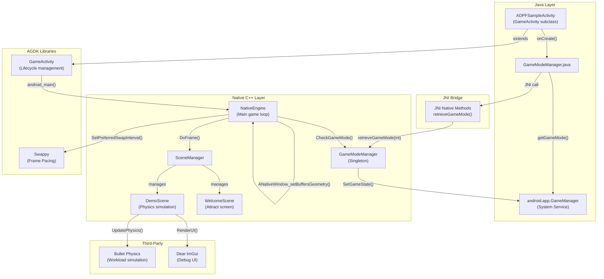
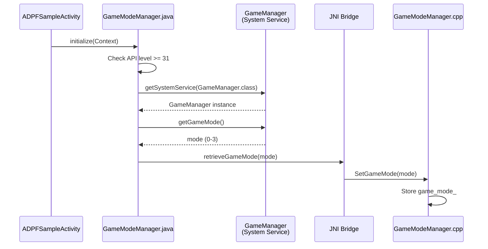
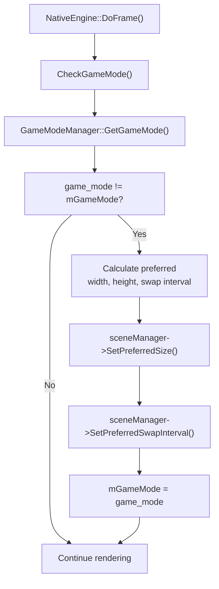
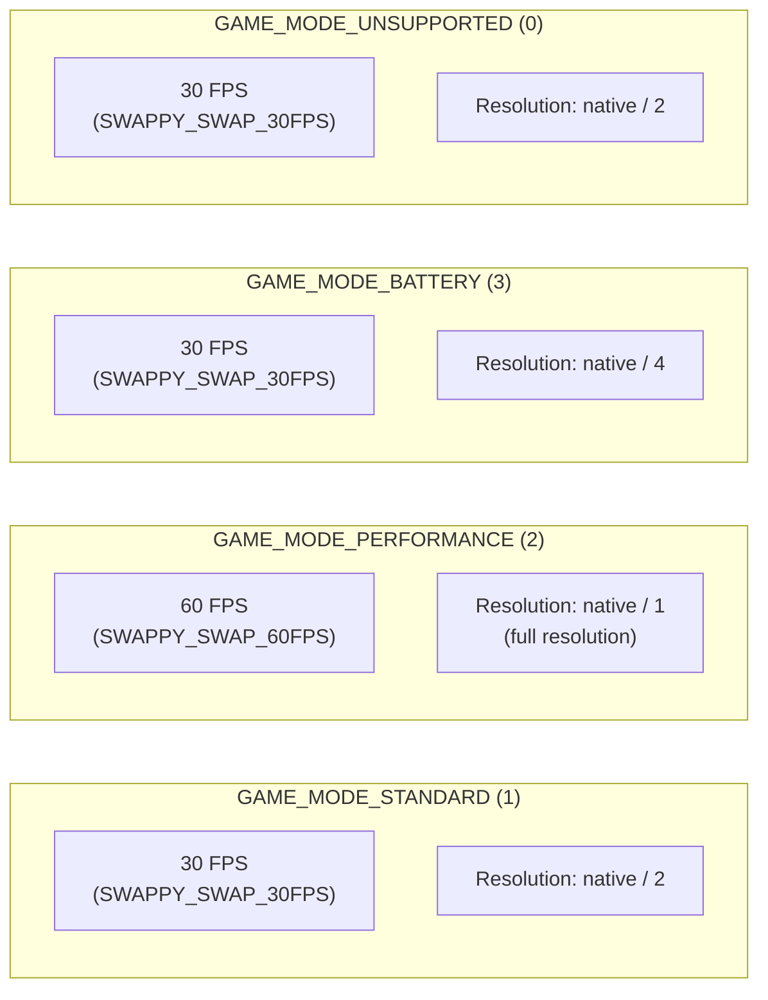
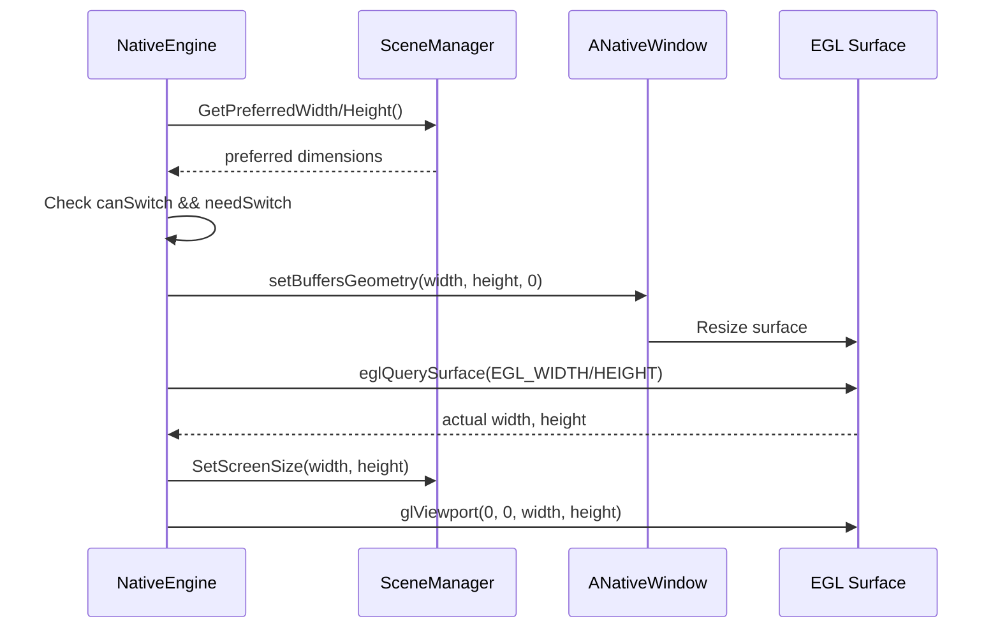
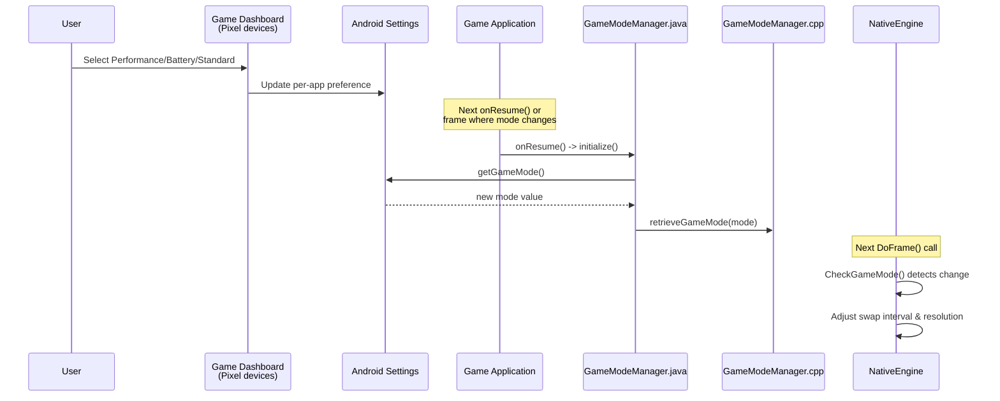
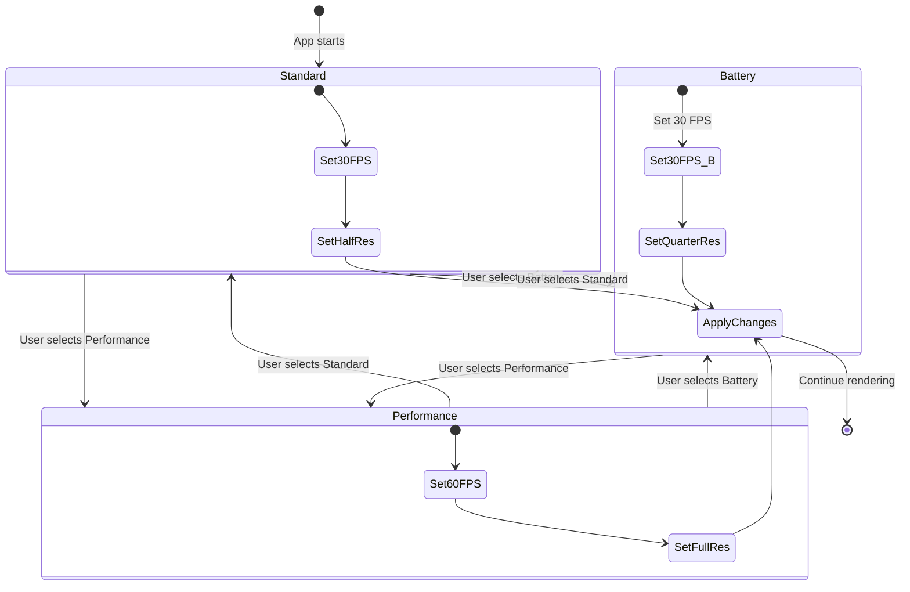

<!-- source: DeepWiki mcp.deepwiki.com · repo android/games-samples · page 2.1 Game Mode Sample · fetched 2026-10-23 -->

# Game Mode Sample

<details>
<summary>Relevant source files</summary>

The following files were used as context for generating this wiki page:

- [README.md](README.md)
- [agdk/README.md](agdk/README.md)
- [agdk/game_mode/README.md](agdk/game_mode/README.md)
- [agdk/game_mode/app/build.gradle](agdk/game_mode/app/build.gradle)
- [agdk/game_mode/app/src/main/cpp/CMakeLists.txt](agdk/game_mode/app/src/main/cpp/CMakeLists.txt)
- [agdk/game_mode/app/src/main/cpp/android_main.cpp](agdk/game_mode/app/src/main/cpp/android_main.cpp)
- [agdk/game_mode/app/src/main/cpp/demo_scene.cpp](agdk/game_mode/app/src/main/cpp/demo_scene.cpp)
- [agdk/game_mode/app/src/main/cpp/demo_scene.h](agdk/game_mode/app/src/main/cpp/demo_scene.h)
- [agdk/game_mode/app/src/main/cpp/game_mode_manager.cpp](agdk/game_mode/app/src/main/cpp/game_mode_manager.cpp)
- [agdk/game_mode/app/src/main/cpp/game_mode_manager.h](agdk/game_mode/app/src/main/cpp/game_mode_manager.h)
- [agdk/game_mode/app/src/main/cpp/native_engine.cpp](agdk/game_mode/app/src/main/cpp/native_engine.cpp)
- [agdk/game_mode/app/src/main/cpp/welcome_scene.cpp](agdk/game_mode/app/src/main/cpp/welcome_scene.cpp)
- [agdk/game_mode/app/src/main/cpp/welcome_scene.h](agdk/game_mode/app/src/main/cpp/welcome_scene.h)
- [agdk/game_mode/app/src/main/java/com/android/example/games/ADPFSampleActivity.java](agdk/game_mode/app/src/main/java/com/android/example/games/ADPFSampleActivity.java)
- [agdk/game_mode/app/src/main/java/com/android/example/games/GameModeManager.java](agdk/game_mode/app/src/main/java/com/android/example/games/GameModeManager.java)
- [agdk/game_mode/build.gradle](agdk/game_mode/build.gradle)
- [agdk/game_mode/docs/gamedashboardactivity.png](agdk/game_mode/docs/gamedashboardactivity.png)
- [agdk/game_mode/gradle.properties](agdk/game_mode/gradle.properties)
- [agdk/game_mode/gradle/wrapper/gradle-wrapper.jar](agdk/game_mode/gradle/wrapper/gradle-wrapper.jar)
- [agdk/game_mode/gradle/wrapper/gradle-wrapper.properties](agdk/game_mode/gradle/wrapper/gradle-wrapper.properties)
- [agdk/game_mode/gradlew](agdk/game_mode/gradlew)
- [agdk/game_mode/gradlew.bat](agdk/game_mode/gradlew.bat)
- [unity/power_efficiency_demo/Assets/GameModeUtil.cs](unity/power_efficiency_demo/Assets/GameModeUtil.cs)

</details>


This document describes the Game Mode sample, a native C++ application that demonstrates integration with Android's Game Mode API to implement user-driven adaptive performance. The sample adjusts frame rate and rendering resolution based on the user's selected optimization preference (Standard, Performance, or Battery mode).

For system-driven adaptive performance based on thermal throttling, see [ADPF Sample](#2.2). For Unity integration of Game Mode API, see [Power Efficiency Demo](#4.2).

---

## Purpose and Scope

The Game Mode sample demonstrates:
- Querying the user's Game Mode preference via `GameManager` API
- Dynamically adjusting frame rate using Swappy (Frame Pacing library)
- Scaling rendering resolution using `ANativeWindow_setBuffersGeometry`
- Implementing a realistic workload using Bullet Physics to showcase performance differences
- Communicating Game State to the system for optimization hints
- Bridging Java-side `GameManager` access to native C++ code via JNI

**Minimum Requirements**: Android API 31+ for Game Mode API functionality. The sample targets minSdkVersion 24 but checks API level at runtime.

Sources: [agdk/game_mode/README.md:1-67](), [agdk/game_mode/app/build.gradle:23-26]()

---

## System Architecture

### Component Overview



Sources: [agdk/game_mode/app/src/main/java/com/android/example/games/ADPFSampleActivity.java:32-101](), [agdk/game_mode/app/src/main/cpp/android_main.cpp:60-69](), [agdk/game_mode/app/src/main/cpp/native_engine.cpp:50-89]()

---

## Game Mode API Integration

### Java-Side Game Mode Retrieval

The `GameModeManager.java` class retrieves the current Game Mode from the Android system:



**Game Mode Values**:
| Value | Constant | Description |
|-------|----------|-------------|
| 0 | `GAME_MODE_UNSUPPORTED` | Device/app doesn't support Game Mode |
| 1 | `GAME_MODE_STANDARD` | Balanced performance and battery |
| 2 | `GAME_MODE_PERFORMANCE` | Prioritize performance |
| 3 | `GAME_MODE_BATTERY` | Prioritize battery life |

Sources: [agdk/game_mode/app/src/main/java/com/android/example/games/GameModeManager.java:26-59](), [agdk/game_mode/app/src/main/cpp/game_mode_manager.h:30-35](), [agdk/game_mode/app/src/main/cpp/game_mode_manager.cpp:23-29]()

### Native-Side Game Mode Monitoring

The native `NativeEngine` checks for Game Mode changes every frame in `CheckGameMode()`:



Sources: [agdk/game_mode/app/src/main/cpp/native_engine.cpp:650-690](), [agdk/game_mode/app/src/main/cpp/native_engine.cpp:737-769]()

---

## Adaptive Performance Strategy

### Resolution and Frame Rate Adjustments

The sample implements different performance profiles for each Game Mode:



**Implementation Details**:

| Game Mode | Frame Rate | Resolution Divisor | Swap Interval |
|-----------|------------|-------------------|---------------|
| Standard (1) | 30 FPS | 2 | `SWAPPY_SWAP_30FPS` |
| Performance (2) | 60 FPS | 1 | `SWAPPY_SWAP_60FPS` |
| Battery (3) | 30 FPS | 4 | `SWAPPY_SWAP_30FPS` |
| Unsupported (0) | 30 FPS | 2 | `SWAPPY_SWAP_30FPS` |

Sources: [agdk/game_mode/app/src/main/cpp/native_engine.cpp:663-683](), [agdk/game_mode/README.md:6-10]()

### Resolution Switching Implementation

Resolution changes are applied via `ANativeWindow_setBuffersGeometry` in `SwitchToPreferredDisplaySize()`:



Sources: [agdk/game_mode/app/src/main/cpp/native_engine.cpp:692-735]()

---

## Key Classes and Responsibilities

### GameModeManager (Native)

**File**: [agdk/game_mode/app/src/main/cpp/game_mode_manager.h:48-86](), [agdk/game_mode/app/src/main/cpp/game_mode_manager.cpp:1-121]()

**Responsibilities**:
- Singleton pattern for managing Game Mode state
- Stores current `game_mode_` value
- Provides `GetGameModeString()` for UI display
- Implements `SetGameState()` to communicate game loading/gameplay state to system

**Key Methods**:
- `SetGameMode(int)` - Called from JNI bridge when mode changes
- `GetGameMode()` - Returns current mode value
- `SetGameState(bool is_loading, GAME_STATE_DEFINITION)` - Reports game state via `GameManager.setGameState()`

**Game State Values**:
| Value | Constant | Usage |
|-------|----------|-------|
| 1 | `GAME_STATE_NONE` | Loading or cleaning up |
| 2 | `GAME_STATE_GAMEPLAY_INTERRUPTIBLE` | Gameplay that can be interrupted (welcome screen) |
| 3 | `GAME_STATE_GAMEPLAY_UNINTERRUPTIBLE` | Active gameplay (demo scene) |

Sources: [agdk/game_mode/app/src/main/cpp/game_mode_manager.cpp:37-56](), [agdk/game_mode/app/src/main/cpp/demo_scene.cpp:104-116]()

### NativeEngine

**File**: [agdk/game_mode/app/src/main/cpp/native_engine.cpp:50-796]()

**Responsibilities**:
- Main game loop implementation via `GameLoop()` and `DoFrame()`
- EGL context and surface management
- Game Mode monitoring via `CheckGameMode()`
- Resolution switching via `SwitchToPreferredDisplaySize()`
- Swappy initialization and swap interval control
- Scene management lifecycle

**Key State Variables**:
- `mGameMode` - Cached Game Mode value for change detection
- `mSurfNativeWidth`, `mSurfNativeHeight` - Native display dimensions
- `mSurfWidth`, `mSurfHeight` - Current rendering dimensions

Sources: [agdk/game_mode/app/src/main/cpp/native_engine.cpp:50-112]()

### DemoScene

**File**: [agdk/game_mode/app/src/main/cpp/demo_scene.cpp:62-652]()

**Responsibilities**:
- Bullet Physics world simulation (ground + falling boxes)
- Physics complexity adjustment based on thermal state (ADPF integration)
- ImGui UI rendering showing current Game Mode and surface dimensions
- Box rendering via `BoxRenderer`

**Physics Workload**:
- Creates `array_size_^3` rigid body boxes (default: 8x8x8 = 512 boxes)
- Runs `current_physics_step_` simulation steps per frame (default: 16)
- Resets physics every 10 seconds to prevent boxes from falling off-screen

Sources: [agdk/game_mode/app/src/main/cpp/demo_scene.cpp:62-87](), [agdk/game_mode/app/src/main/cpp/demo_scene.cpp:391-477](), [agdk/game_mode/app/src/main/cpp/demo_scene.cpp:505-565]()

### WelcomeScene

**File**: [agdk/game_mode/app/src/main/cpp/welcome_scene.cpp:41-162]()

**Responsibilities**:
- Simple attract screen showing current Game Mode and surface size
- Displays "Touch Anywhere To Continue" instruction
- Transitions to `DemoScene` on any touch input
- Sets `GAME_STATE_GAMEPLAY_INTERRUPTIBLE` game state

Sources: [agdk/game_mode/app/src/main/cpp/welcome_scene.cpp:52-73](), [agdk/game_mode/app/src/main/cpp/welcome_scene.cpp:103-107]()

---

## User Interaction Flow

### Changing Game Mode



**Accessing Game Dashboard**:
- **Pixel Devices**: Swipe up from bottom corners during gameplay
- **Other OEMs**: Manufacturer-specific game tools (Game Space, Game Booster, etc.)
- **Development/Testing**: Use `adb` command:
  ```
  adb shell cmd game mode [standard|performance|battery] <PACKAGE_NAME>
  ```

Sources: [agdk/game_mode/README.md:37-48]()

### Runtime Behavior

The sample checks for Game Mode changes every frame but only reconfigures when the mode actually changes:



Sources: [agdk/game_mode/app/src/main/cpp/native_engine.cpp:650-690]()

---

## Build Configuration

### Dependencies

**Gradle Configuration** ([agdk/game_mode/app/build.gradle:57-65]()):
```
androidx.games:games-activity:3.0.5
androidx.games:games-frame-pacing:2.1.2
```

**CMake Dependencies** ([agdk/game_mode/app/src/main/cpp/CMakeLists.txt:22-23]()):
- `game-activity` (via Prefab)
- `games-frame-pacing` (Swappy, via Prefab)

**Third-Party Libraries** (Manual Setup):
- Dear ImGui: [agdk/third_party/imgui]()
- Bullet Physics: [agdk/third_party/bullet3]()

Sources: [agdk/game_mode/README.md:24-31](), [agdk/game_mode/app/src/main/cpp/CMakeLists.txt:39-157]()

### Setup Instructions

1. **Clone third-party dependencies**:
   ```bash
   cd agdk/third_party/
   git clone https://github.com/ocornut/imgui
   git clone https://github.com/bulletphysics/bullet3
   ```

2. **Open in Android Studio**: Version 2024.3.1+ (Meerkat) or higher

3. **Build and Run**: Target device must support API level 31+ for Game Mode functionality

Sources: [agdk/game_mode/README.md:15-34]()

### Target Configuration

| Property | Value | Note |
|----------|-------|------|
| `compileSdkVersion` | 36 | Latest Android SDK |
| `minSdkVersion` | 24 | Runtime API check for Game Mode |
| `targetSdkVersion` | 36 | Target latest APIs |
| `ndkVersion` | 27.2.12479018 | NDK version |

Sources: [agdk/game_mode/app/build.gradle:20-28]()

---

## Unity Integration

For Unity developers, the repository includes `GameModeUtil.cs` demonstrating JNI bridge to access Game Mode API:

**Key Implementation** ([unity/power_efficiency_demo/Assets/GameModeUtil.cs:28-43]()):
```csharp
public static int GetGameMode()
{
    using var unityPlayerClass = new AndroidJavaClass("com.unity3d.player.UnityPlayer");
    using var context = unityPlayerClass.GetStatic<AndroidJavaObject>("currentActivity");
    using var gameManager = context.Call<AndroidJavaObject>("getSystemService", "game");
    int gameMode = gameManager.Call<int>("getGameMode");
    return gameMode;
}
```

This approach bridges Unity's C# layer to Android's Java APIs, returning the same mode values (0-4) as the native sample.

Sources: [unity/power_efficiency_demo/Assets/GameModeUtil.cs:18-71]()

---

## Related Samples

- **[ADPF Sample](#2.2)**: Demonstrates system-driven adaptive performance based on thermal throttling
- **[Power Efficiency Demo](#4.2)**: Unity-specific implementation of Game Mode API integration
- **[AGDKTunnel](#2.3)**: Comprehensive game sample integrating multiple AGDK libraries

---

