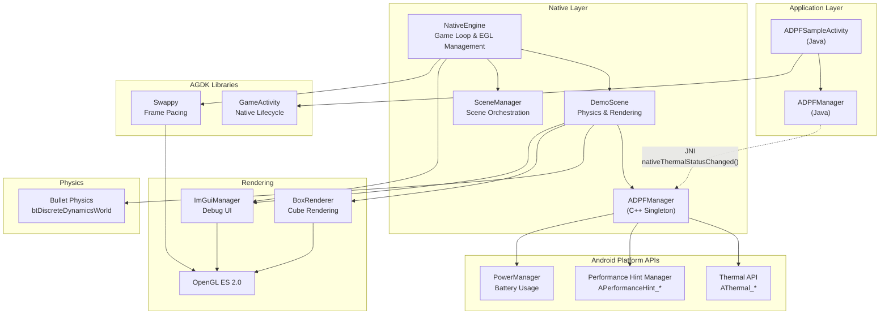
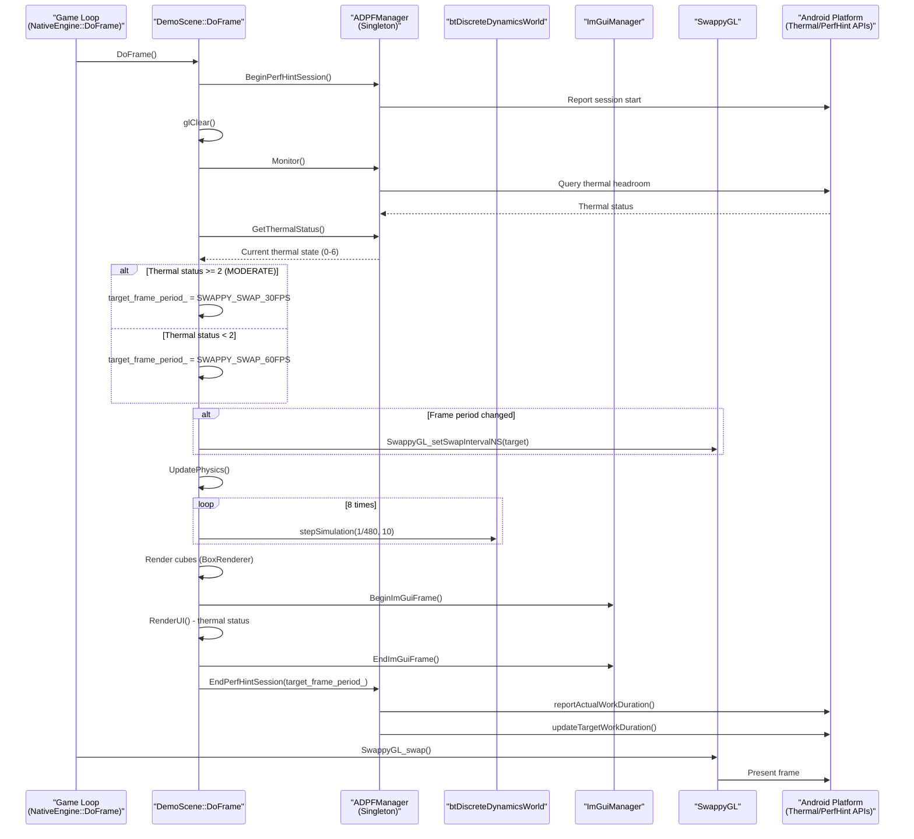
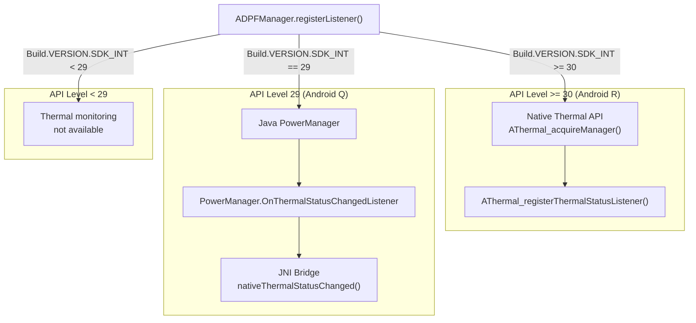
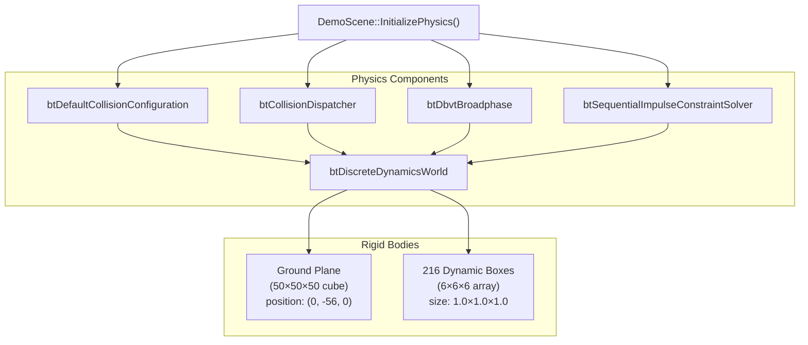
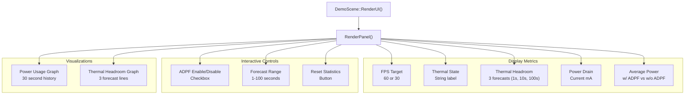
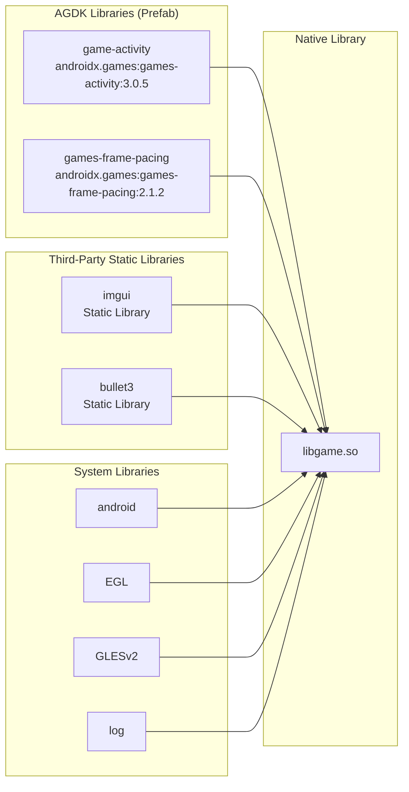

<!-- source: DeepWiki mcp.deepwiki.com · repo android/games-samples · page 2.2 ADPF Sample · fetched 2026-10-23 -->

# ADPF Sample

<details>
<summary>Relevant source files</summary>

The following files were used as context for generating this wiki page:

- [agdk/adpf/README.md](agdk/adpf/README.md)
- [agdk/adpf/app/build.gradle](agdk/adpf/app/build.gradle)
- [agdk/adpf/app/src/main/AndroidManifest.xml](agdk/adpf/app/src/main/AndroidManifest.xml)
- [agdk/adpf/app/src/main/cpp/CMakeLists.txt](agdk/adpf/app/src/main/cpp/CMakeLists.txt)
- [agdk/adpf/app/src/main/cpp/demo_scene.cpp](agdk/adpf/app/src/main/cpp/demo_scene.cpp)
- [agdk/adpf/app/src/main/cpp/demo_scene.h](agdk/adpf/app/src/main/cpp/demo_scene.h)
- [agdk/adpf/app/src/main/cpp/native_engine.cpp](agdk/adpf/app/src/main/cpp/native_engine.cpp)
- [agdk/adpf/app/src/main/java/com/android/example/games/ADPFManager.java](agdk/adpf/app/src/main/java/com/android/example/games/ADPFManager.java)
- [agdk/adpf/app/src/main/java/com/android/example/games/ADPFSampleActivity.java](agdk/adpf/app/src/main/java/com/android/example/games/ADPFSampleActivity.java)
- [agdk/adpf/build.gradle](agdk/adpf/build.gradle)
- [agdk/adpf/gradle.properties](agdk/adpf/gradle.properties)
- [agdk/adpf/gradle/wrapper/gradle-wrapper.jar](agdk/adpf/gradle/wrapper/gradle-wrapper.jar)
- [agdk/adpf/gradle/wrapper/gradle-wrapper.properties](agdk/adpf/gradle/wrapper/gradle-wrapper.properties)
- [agdk/adpf/gradlew](agdk/adpf/gradlew)
- [agdk/adpf/gradlew.bat](agdk/adpf/gradlew.bat)
- [agdk/game_mode/app/src/main/java/com/android/example/games/ADPFManager.java](agdk/game_mode/app/src/main/java/com/android/example/games/ADPFManager.java)

</details>


## Purpose and Scope

This document describes the ADPF (Android Dynamic Performance Framework) sample, which demonstrates the use of Android's Adaptive Performance APIs for thermal management and performance optimization. The sample showcases how to monitor device thermal status, provide performance hints to the Android OS scheduler, and dynamically adjust application workload in response to thermal throttling conditions.

For information about the Game Mode API and user-driven performance preferences, see [Game Mode Sample](#2.1). For the shared rendering infrastructure used across samples, see [Common Framework Architecture](#2.5).

**Sources:** [agdk/adpf/README.md:1-14]()

---

## Architecture Overview

The ADPF sample consists of several integrated components that work together to demonstrate adaptive performance management:



**Sources:** [agdk/adpf/app/src/main/cpp/demo_scene.cpp:1-126](), [agdk/adpf/app/src/main/cpp/native_engine.cpp:1-711](), [agdk/adpf/app/src/main/java/com/android/example/games/ADPFSampleActivity.java:1-102]()

### Core Classes

| Class | Location | Responsibility |
|-------|----------|----------------|
| `ADPFSampleActivity` | [agdk/adpf/app/src/main/java/com/android/example/games/ADPFSampleActivity.java]() | GameActivity subclass, manages thermal listener lifecycle |
| `ADPFManager` (Java) | [agdk/adpf/app/src/main/java/com/android/example/games/ADPFManager.java]() | Java-side thermal status listener, bridges to native code |
| `NativeEngine` | [agdk/adpf/app/src/main/cpp/native_engine.cpp]() | Game loop, EGL context management, input handling |
| `DemoScene` | [agdk/adpf/app/src/main/cpp/demo_scene.cpp]() | Main scene implementation with physics and rendering |
| `ADPFManager` (C++) | Common framework | Native ADPF API wrapper (singleton) |
| `BoxRenderer` | Common framework | OpenGL ES renderer for cubes |

**Sources:** [agdk/adpf/app/src/main/cpp/demo_scene.h:1-147]()

---

## Frame Processing Flow

The sample processes each frame through a structured pipeline that integrates thermal monitoring, physics simulation, and rendering with performance hints:



**Sources:** [agdk/adpf/app/src/main/cpp/demo_scene.cpp:79-126](), [agdk/adpf/app/src/main/cpp/native_engine.cpp:640-698]()

### Frame Processing Steps

1. **Performance Session Start** ([demo_scene.cpp:81]()): `ADPFManager::getInstance().BeginPerfHintSession()` marks the beginning of performance-critical work
2. **Thermal Monitoring** ([demo_scene.cpp:89]()): `ADPFManager::getInstance().Monitor()` queries current thermal status
3. **Frame Rate Adjustment** ([demo_scene.cpp:92-109]()): Target frame rate is set to 30 FPS when thermal status is `MODERATE` (2) or worse, otherwise 60 FPS
4. **Physics Update** ([demo_scene.cpp:111](), [445-454]()): Bullet physics simulation runs 8 substeps per frame
5. **Rendering** ([demo_scene.cpp:114-118]()): ImGui UI displays thermal metrics
6. **Performance Session End** ([demo_scene.cpp:125]()): `EndPerfHintSession()` reports work duration to the platform

**Sources:** [agdk/adpf/app/src/main/cpp/demo_scene.cpp:79-126]()

---

## ADPF API Integration

The sample integrates two key ADPF APIs: the Thermal API for monitoring device temperature state and the Performance Hint Manager API for providing scheduling hints.

### Thermal Status Levels

The sample tracks seven thermal states defined in [demo_scene.cpp:31-35]():

| Status Code | Constant | Description |
|-------------|----------|-------------|
| 0 | `THERMAL_STATUS_NONE` | No thermal throttling |
| 1 | `THERMAL_STATUS_LIGHT` | Light throttling, minimal impact |
| 2 | `THERMAL_STATUS_MODERATE` | Moderate throttling, performance reduction begins |
| 3 | `THERMAL_STATUS_SEVERE` | Severe throttling, significant performance reduction |
| 4 | `THERMAL_STATUS_CRITICAL` | Critical thermal state |
| 5 | `THERMAL_STATUS_EMERGENCY` | Emergency thermal state |
| 6 | `THERMAL_STATUS_SHUTDOWN` | Device approaching thermal shutdown |

The sample uses status code 2 (`MODERATE`) as the threshold for reducing frame rate from 60 FPS to 30 FPS ([demo_scene.cpp:96-101]()).

**Sources:** [agdk/adpf/app/src/main/cpp/demo_scene.cpp:30-35](), [agdk/adpf/app/src/main/cpp/demo_scene.cpp:92-101]()

### Thermal Listener Registration

The sample demonstrates two approaches to thermal monitoring based on API level:



**Sources:** [agdk/adpf/app/src/main/java/com/android/example/games/ADPFManager.java:39-85]()

The Java `ADPFManager` class registers thermal listeners in [ADPFManager.java:53-68]():
- **Android R+**: Calls native `nativeRegisterThermalStatusListener()` to use NDK APIs
- **Android Q**: Uses Java `PowerManager.addThermalStatusListener()`
- **Pre-Q**: Returns false, thermal monitoring unavailable

**Sources:** [agdk/adpf/app/src/main/java/com/android/example/games/ADPFManager.java:38-85]()

### Performance Hint Manager Integration

The Performance Hint Manager API allows the application to communicate its workload characteristics to the Android scheduler:

| Method | Called From | Purpose |
|--------|-------------|---------|
| `InitializePerformanceHintManager()` | UI toggle ([demo_scene.cpp:262]()) | Creates performance hint session |
| `BeginPerfHintSession()` | Frame start ([demo_scene.cpp:81]()) | Marks beginning of critical work |
| `EndPerfHintSession()` | Frame end ([demo_scene.cpp:125]()) | Reports actual and target work duration |
| `ClosePerfHintSession()` | UI toggle ([demo_scene.cpp:264]()) | Closes performance hint session |

The session tracks work duration and provides scheduling hints via `reportActualWorkDuration()` and `updateTargetWorkDuration()` APIs (called in `EndPerfHintSession`).

**Sources:** [agdk/adpf/app/src/main/cpp/demo_scene.cpp:79-126](), [agdk/adpf/app/src/main/cpp/demo_scene.cpp:254-269]()

---

## Physics Simulation Workload

The sample uses Bullet Physics to generate a realistic computational workload that can trigger thermal throttling on sustained execution.

### Physics World Configuration

The physics simulation creates a 6×6×6 array of dynamic cubes ([demo_scene.h:65-70]()):



**Sources:** [agdk/adpf/app/src/main/cpp/demo_scene.cpp:368-439](), [agdk/adpf/app/src/main/cpp/demo_scene.h:64-70]()

### Physics Update Loop

The `UpdatePhysics()` method ([demo_scene.cpp:445-500]()) performs intensive computation:

1. **Simulation Steps**: Runs 8 physics substeps per frame ([demo_scene.cpp:451-454]()):
   ```
   for (steps = 0; steps < max_steps; ++steps) {
       dynamics_world_->stepSimulation(1.f / (60.f * max_steps), 10);
   }
   ```
   Each substep simulates 1/480th of a second (60 FPS × 8 steps = 480 Hz)

2. **Rendering**: Iterates through all 217 collision objects (1 ground + 216 boxes) to render them ([demo_scene.cpp:461-489]())

3. **Reset Logic**: Every 600 frames (10 seconds at 60 FPS), calls `ResetPhysics()` to return boxes to initial positions ([demo_scene.cpp:494-499]())

The intentionally high step count creates sustained CPU load to demonstrate thermal throttling in a reasonable timeframe ([demo_scene.cpp:446-450]()).

**Sources:** [agdk/adpf/app/src/main/cpp/demo_scene.cpp:445-500](), [agdk/adpf/app/src/main/cpp/demo_scene.cpp:505-549]()

---

## Rendering and Frame Pacing

The sample uses OpenGL ES 2.0 for rendering and Swappy for consistent frame delivery.

### Graphics Stack

| Component | Implementation | Purpose |
|-----------|----------------|---------|
| Graphics API | OpenGL ES 2.0 | Rendering backend ([AndroidManifest.xml:42]()) |
| Frame Pacing | Swappy (`SwappyGL`) | Consistent frame timing ([native_engine.cpp:78-80]()) |
| Cube Rendering | `BoxRenderer` | Multi-instance cube rendering |
| UI Rendering | Dear ImGui | Debug overlay with thermal metrics |

**Sources:** [agdk/adpf/app/src/main/AndroidManifest.xml:42](), [agdk/adpf/app/src/main/cpp/native_engine.cpp:77-84]()

### Swappy Configuration

Swappy initialization occurs in [native_engine.cpp:78-80]():
```cpp
SwappyGL_init(GetJniEnv(), mApp->activity->javaGameActivity);
SwappyGL_setSwapIntervalNS(SWAPPY_SWAP_60FPS);
```

The frame period is dynamically adjusted based on thermal status:
- **60 FPS**: `SWAPPY_SWAP_60FPS` constant (16.67ms per frame)
- **30 FPS**: `SWAPPY_SWAP_30FPS` constant (33.33ms per frame)

The swap interval change occurs in [demo_scene.cpp:104-109]():
```cpp
if (current_frame_period_ != target_frame_period_) {
    if (SwappyGL_isEnabled()) {
        SwappyGL_setSwapIntervalNS(target_frame_period_);
    }
    current_frame_period_ = target_frame_period_;
}
```

**Sources:** [agdk/adpf/app/src/main/cpp/native_engine.cpp:77-84](), [agdk/adpf/app/src/main/cpp/demo_scene.cpp:104-109](), [agdk/adpf/app/src/main/cpp/demo_scene.cpp:46-47]()

---

## UI and Monitoring

The sample provides a comprehensive ImGui-based UI for monitoring ADPF metrics in real-time.

### UI Dashboard Components



**Sources:** [agdk/adpf/app/src/main/cpp/demo_scene.cpp:188-359]()

### Key Metrics Display

The `RenderPanel()` method ([demo_scene.cpp:215-359]()) displays:

1. **FPS Target** ([demo_scene.cpp:225-226]()): Shows current target frame rate (60 or 30)
2. **Thermal State** ([demo_scene.cpp:227]()): Displays human-readable thermal status from the label array
3. **Thermal Headroom** ([demo_scene.cpp:233-248]()): Shows forecasted thermal headroom at three time horizons (configurable, default 1s/10s/100s)
4. **Power Drain** ([demo_scene.cpp:284-285]()): Current battery drain in milliamps from `GetBatteryUsage()`
5. **Power Averages** ([demo_scene.cpp:288-313]()): Separate running averages for ADPF enabled vs disabled states

The UI uses ImPlot for graphing ([demo_scene.cpp:325-357]()) with a 30-second history window.

**Sources:** [agdk/adpf/app/src/main/cpp/demo_scene.cpp:215-359]()

### ADPF Enable/Disable Toggle

The checkbox at [demo_scene.cpp:255-269]() allows runtime enable/disable of ADPF:
- **Enabling**: Calls `ADPFManager::getInstance().InitializePerformanceHintManager()`
- **Disabling**: Calls `ADPFManager::getInstance().ClosePerfHintSession()`

This toggle enables direct comparison of power consumption with and without ADPF optimization.

**Sources:** [agdk/adpf/app/src/main/cpp/demo_scene.cpp:254-269]()

---

## Build Configuration

### Dependencies

The sample requires the following third-party libraries to be manually installed in `agdk/third_party/` ([README.md:40-45]()):

| Library | Repository | Purpose |
|---------|------------|---------|
| **ImGui** | `github.com/ocornut/imgui` | Immediate-mode GUI for debug overlay |
| **ImPlot** | `github.com/epezent/implot` | Graph plotting extension for ImGui |
| **Bullet Physics** | `github.com/bulletphysics/bullet3` | 3D physics simulation |

**Sources:** [agdk/adpf/README.md:40-45]()

### CMake Build Configuration

The [CMakeLists.txt]() integrates these dependencies:



**Sources:** [agdk/adpf/app/src/main/cpp/CMakeLists.txt:1-161](), [agdk/adpf/app/build.gradle:57-65]()

Key CMake configurations:

1. **AGDK Libraries** ([CMakeLists.txt:22-23]()): Uses `find_package()` to locate Prefab-packaged libraries
2. **Compiler Flags** ([CMakeLists.txt:34-38]()):
   - `-D__ANDROID_UNAVAILABLE_SYMBOLS_ARE_WEAK__`: Enables weak symbol linking for conditional API availability
   - `-Werror=unguarded-availability`: Ensures API level guards are used
3. **ImGui Build** ([CMakeLists.txt:55-65]()): Compiles ImGui and ImPlot as static library
4. **Bullet Build** ([CMakeLists.txt:68-106]()): Compiles multiple Bullet modules with `-O0` and warnings disabled
5. **Game Library** ([CMakeLists.txt:123-160]()): Links all dependencies into `libgame.so`

**Sources:** [agdk/adpf/app/src/main/cpp/CMakeLists.txt:17-161]()

### Gradle Configuration

The [app/build.gradle]() specifies:

| Property | Value | Purpose |
|----------|-------|---------|
| `compileSdkVersion` | 36 | Latest SDK for compilation |
| `minSdkVersion` | 24 | Minimum Android 7.0 (demonstrates conditional API availability) |
| `targetSdkVersion` | 36 | Target latest Android version |
| `ndkVersion` | 27.2.12479018 | NDK with weak symbol support |

The low `minSdkVersion` of 24 allows demonstrating conditional API availability checking using `__builtin_available` in C++ code ([README.md:32-38]()).

**Sources:** [agdk/adpf/app/build.gradle:19-35](), [agdk/adpf/README.md:32-38]()

---

## API Level Compatibility

The sample demonstrates best practices for supporting ADPF APIs conditionally based on device API level.

### API Level Requirements

| API | Minimum API Level | Platform Version |
|-----|-------------------|------------------|
| Thermal API | 30 | Android 11 (R) |
| Performance Hint Manager | 31 | Android 12 (S) |
| Sample minimum | 24 | Android 7.0 (Nougat) |

**Sources:** [agdk/adpf/README.md:22-38]()

### Conditional API Availability Pattern

The sample uses two techniques for conditional API availability:

1. **Weak Symbols** ([CMakeLists.txt:38]()): The `__ANDROID_UNAVAILABLE_SYMBOLS_ARE_WEAK__` preprocessor define enables weak linking of APIs not available on older Android versions. This allows the code to compile and run, with runtime checks determining if the API is available.

2. **Runtime Checks** ([ADPFManager.java:53-68]()): The Java `ADPFManager` checks `Build.VERSION.SDK_INT` to determine which thermal API variant to use:
   - API 30+: Use native NDK Thermal API
   - API 29: Use Java PowerManager API
   - API < 29: No thermal monitoring available

3. **Compile-Time Guards**: The `-Werror=unguarded-availability` flag ([CMakeLists.txt:34]()) enforces that all uses of newer APIs are properly guarded with availability checks.

This pattern was added in NDK 26 and allows a single APK to run across a wide range of Android versions while gracefully degrading functionality on older devices.

**Sources:** [agdk/adpf/README.md:32-38](), [agdk/adpf/app/src/main/cpp/CMakeLists.txt:34-38](), [agdk/adpf/app/src/main/java/com/android/example/games/ADPFManager.java:39-68]()

---

## Implementation Summary

The ADPF sample demonstrates a complete integration of Android's adaptive performance APIs:

1. **Thermal Monitoring**: Tracks device thermal state using appropriate API for device SDK level
2. **Dynamic Workload Adjustment**: Reduces frame rate from 60 to 30 FPS when thermal status reaches `MODERATE` or higher
3. **Performance Hints**: Provides scheduler hints about critical work duration using Performance Hint Manager
4. **Realistic Workload**: Uses Bullet Physics with 216 dynamic rigid bodies to generate sustained CPU load
5. **Comprehensive Monitoring**: ImGui UI displays real-time thermal status, headroom forecasts, and power consumption metrics
6. **API Level Compatibility**: Demonstrates conditional API availability using weak symbols and runtime checks

The sample provides a reference implementation for games that need to maintain optimal performance across varying thermal conditions on Android devices.

**Sources:** [agdk/adpf/README.md:1-14](), [agdk/adpf/app/src/main/cpp/demo_scene.cpp:1-591]()

---

