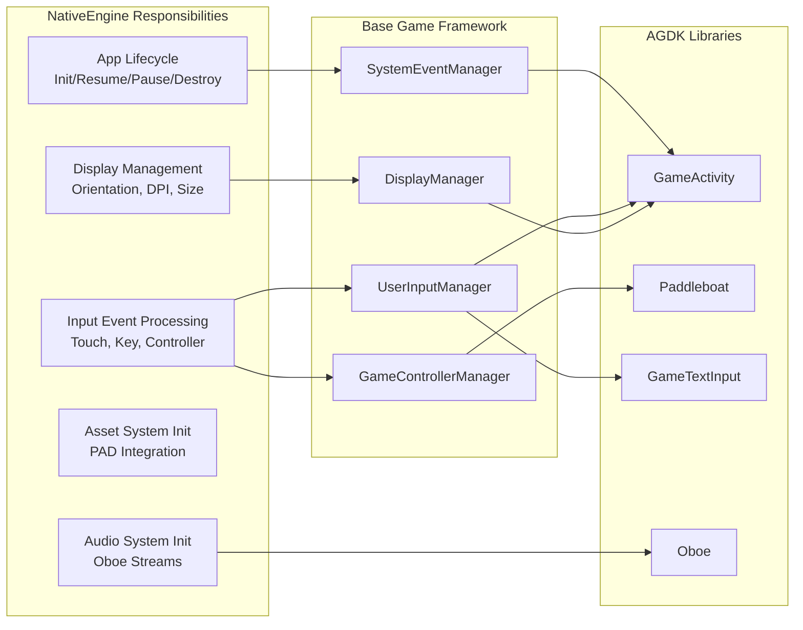
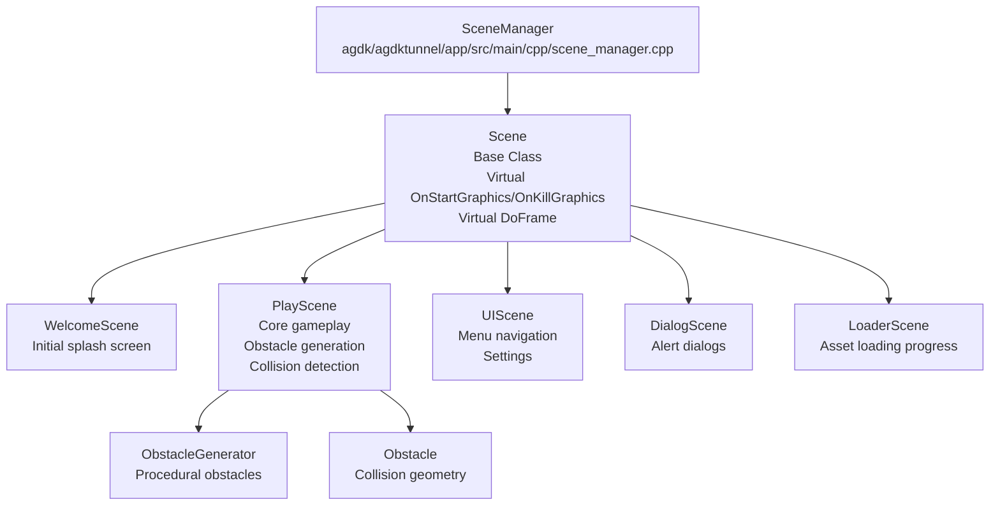
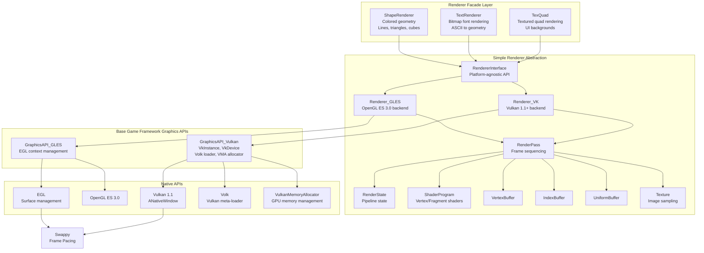
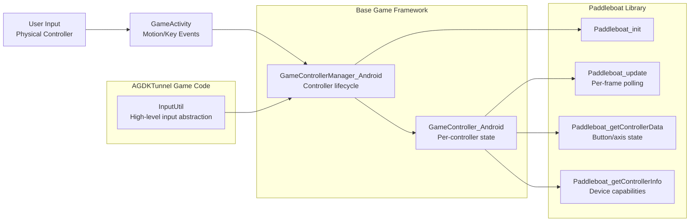
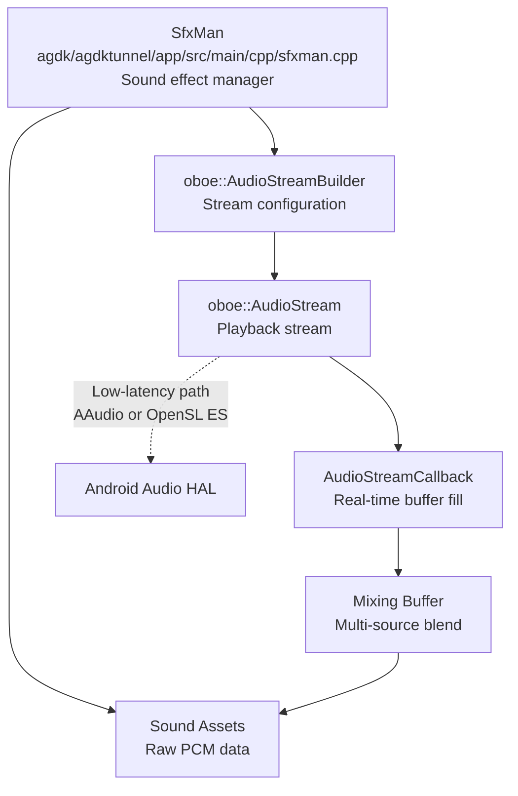
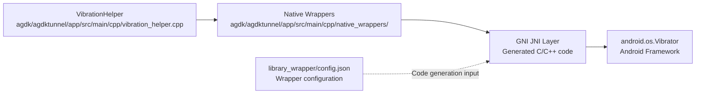
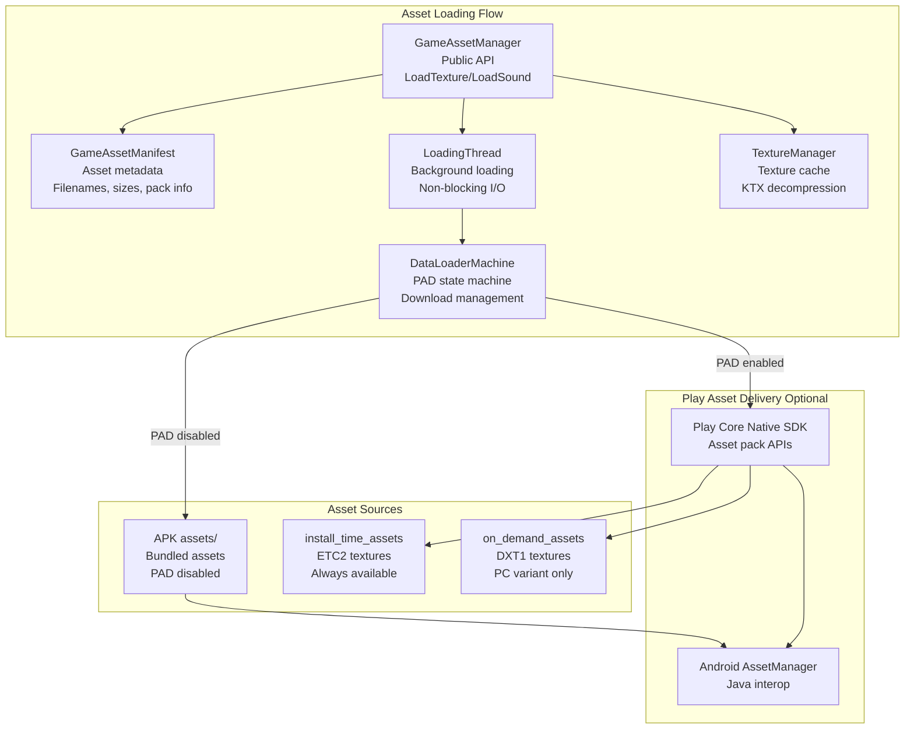

<!-- source: DeepWiki mcp.deepwiki.com · repo android/games-samples · page 2.3 AGDKTunnel Sample · fetched 2026-10-23 -->

# AGDKTunnel Sample

<details>
<summary>Relevant source files</summary>

The following files were used as context for generating this wiki page:

- [README.md](README.md)
- [agdk/README.md](agdk/README.md)
- [agdk/agdktunnel/README.md](agdk/agdktunnel/README.md)
- [agdk/agdktunnel/app/build.gradle](agdk/agdktunnel/app/build.gradle)
- [agdk/agdktunnel/app/src/main/AndroidManifest.xml](agdk/agdktunnel/app/src/main/AndroidManifest.xml)
- [agdk/agdktunnel/app/src/main/cpp/CMakeLists.txt](agdk/agdktunnel/app/src/main/cpp/CMakeLists.txt)
- [agdk/agdktunnel/build.gradle](agdk/agdktunnel/build.gradle)
- [agdk/agdktunnel/gradle.properties](agdk/agdktunnel/gradle.properties)
- [agdk/agdktunnel/gradle/wrapper/gradle-wrapper.properties](agdk/agdktunnel/gradle/wrapper/gradle-wrapper.properties)
- [agdk/game_mode/README.md](agdk/game_mode/README.md)
- [agdk/game_mode/docs/gamedashboardactivity.png](agdk/game_mode/docs/gamedashboardactivity.png)
- [unity/power_efficiency_demo/Assets/GameModeUtil.cs](unity/power_efficiency_demo/Assets/GameModeUtil.cs)

</details>


## Purpose and Scope

This document covers the **AGDKTunnel** sample, a complete demonstration game that integrates multiple Android Game Development Kit (AGDK) libraries into a single application. AGDKTunnel serves as a comprehensive reference implementation showing how AGDK libraries work together in a production-like game environment.

AGDKTunnel is derived from the NDK "Endless Tunnel" sample but has been significantly enhanced to demonstrate modern Android game development practices. It showcases native C++ game development using the Base Game Framework, graphics API abstraction, and optional Google Play integrations.

For information about:
- Individual AGDK library details, see the Common Framework Architecture page [#2.5]()
- Game Mode API adaptive performance, see [#2.1]()
- ADPF thermal management, see [#2.2]()
- Game controller input handling specifics, see [#2.4]()

## Overview

AGDKTunnel is an endless runner-style game where the player navigates a ship through a tunnel, avoiding obstacles. While the gameplay is simple, the implementation demonstrates professional game architecture patterns and the integration of six AGDK libraries plus optional Play services.

### Core AGDK Libraries Integrated

| Library | Purpose in AGDKTunnel |
|---------|---------------------|
| **GameActivity** | Native app lifecycle management, replaces NativeActivity |
| **Frame Pacing (Swappy)** | Consistent frame delivery and presentation timing |
| **Paddleboat** | Game controller input handling with device mapping |
| **GameTextInput** | Soft keyboard input for text entry |
| **Oboe** | High-performance, low-latency audio playback |
| **GNI (Library Wrapper)** | Wrapped Vibrator API for haptic feedback |

### Optional Play Integrations

- **Play Games Services v2**: Player authentication and cloud save synchronization
- **Play Asset Delivery**: Texture Compression Format Targeting (ETC2/DXT1)
- **Input SDK**: Keyboard/mouse mapping for Google Play Games for PC

Sources: [agdk/agdktunnel/README.md:1-23](), [agdk/README.md:8-9]()

## High-Level Architecture

```mermaid
graph TB
    subgraph "AGDKTunnel Application Layer"
        TunnelEngine["TunnelEngine<br/>Game Loop & State"]
        NativeEngine["NativeEngine<br/>Platform Integration"]
        SceneManager["SceneManager<br/>Scene Orchestration"]
        
        WelcomeScene["WelcomeScene"]
        PlayScene["PlayScene<br/>Gameplay Logic"]
        UIScene["UIScene"]
        LoaderScene["LoaderScene"]
    end
    
    subgraph "Rendering System"
        GfxManager["GfxManager<br/>Graphics Management"]
        ShapeRenderer["ShapeRenderer<br/>Geometry Rendering"]
        TextRenderer["TextRenderer<br/>Text Rendering"]
        TexQuad["TexQuad<br/>Textured Quads"]
        SimpleRenderer["SimpleRenderer<br/>Vulkan/GLES Abstraction"]
    end
    
    subgraph "Asset Management"
        GameAssetManager["GameAssetManager<br/>Asset Loading"]
        GameAssetManifest["GameAssetManifest<br/>Asset Metadata"]
        TextureManager["TextureManager<br/>Texture Cache"]
        LoadingThread["LoadingThread<br/>Async Loading"]
        DataLoaderMachine["DataLoaderMachine<br/>PAD State Machine"]
    end
    
    subgraph "Input & Audio"
        InputUtil["InputUtil<br/>Input Processing"]
        SfxMan["SfxMan<br/>Sound Effects"]
        VibrationHelper["VibrationHelper<br/>Haptics via Library Wrapper"]
    end
    
    subgraph "Base Game Framework - BGF"
        DisplayManager["DisplayManager<br/>Display Info & Callbacks"]
        UserInputManager["UserInputManager<br/>Input Event Routing"]
        SystemEventManager["SystemEventManager<br/>Lifecycle Events"]
        GameControllerManager["GameControllerManager<br/>Controller Detection"]
        GraphicsAPIGLES["GraphicsAPI_GLES"]
        GraphicsAPIVulkan["GraphicsAPI_Vulkan"]
    end
    
    subgraph "AGDK Libraries - Prefab"
        GameActivity["game-activity<br/>Native Activity"]
        Swappy["swappy<br/>Frame Pacing"]
        Paddleboat["paddleboat<br/>Game Controller"]
        GameTextInput["GameTextInput<br/>Soft Keyboard"]
        Oboe["oboe<br/>Audio"]
        GNI["GNI<br/>Wrapped Vibrator API"]
    end
    
    TunnelEngine --> NativeEngine
    TunnelEngine --> SceneManager
    SceneManager --> WelcomeScene
    SceneManager --> PlayScene
    SceneManager --> UIScene
    SceneManager --> LoaderScene
    
    NativeEngine --> GfxManager
    NativeEngine --> GameAssetManager
    NativeEngine --> InputUtil
    NativeEngine --> SfxMan
    
    PlayScene --> ShapeRenderer
    PlayScene --> TextRenderer
    
    GfxManager --> SimpleRenderer
    ShapeRenderer --> SimpleRenderer
    TextRenderer --> SimpleRenderer
    TexQuad --> SimpleRenderer
    
    GameAssetManager --> LoadingThread
    GameAssetManager --> DataLoaderMachine
    GameAssetManager --> TextureManager
    GameAssetManager --> GameAssetManifest
    
    SfxMan --> Oboe
    VibrationHelper --> GNI
    
    NativeEngine --> DisplayManager
    NativeEngine --> SystemEventManager
    InputUtil --> UserInputManager
    InputUtil --> GameControllerManager
    
    SimpleRenderer --> GraphicsAPIGLES
    SimpleRenderer --> GraphicsAPIVulkan
    
    DisplayManager --> GameActivity
    SystemEventManager --> GameActivity
    UserInputManager --> GameActivity
    UserInputManager --> GameTextInput
    GameControllerManager --> Paddleboat
    GraphicsAPIGLES --> Swappy
    GraphicsAPIVulkan --> Swappy
```



**AGDKTunnel Layered Architecture**: The application is built in layers, with game-specific logic at the top, reusable rendering and asset systems in the middle, the Base Game Framework providing platform abstraction, and AGDK libraries at the foundation. The architecture demonstrates separation of concerns and clean integration points.

Sources: [agdk/agdktunnel/app/src/main/cpp/CMakeLists.txt:106-140](), [agdk/agdktunnel/README.md:6-23]()

## Core Game Components

### TunnelEngine and Game Loop

`TunnelEngine` ([agdk/agdktunnel/app/src/main/cpp/tunnel_engine.cpp]()) is the central game controller, managing:
- Game state transitions
- Frame update loop
- Time delta calculation
- Integration with `NativeEngine` for platform services

### NativeEngine - Platform Integration Layer

`NativeEngine` ([agdk/agdktunnel/app/src/main/cpp/native_engine.cpp]()) serves as the bridge between AGDKTunnel game logic and the Base Game Framework:



**NativeEngine Integration Pattern**: `NativeEngine` does not directly call AGDK library APIs. Instead, it uses Base Game Framework managers, which in turn integrate with AGDK libraries through clean abstraction layers.

Sources: [agdk/agdktunnel/app/src/main/cpp/native_engine.cpp](), [agdk/agdktunnel/app/src/main/cpp/CMakeLists.txt:57-79]()

### Scene Management System



**Scene Hierarchy**: Each scene inherits from the `Scene` base class and implements lifecycle methods for graphics initialization, frame updates, and input handling. The `SceneManager` handles transitions and maintains the active scene.

Sources: [agdk/agdktunnel/app/src/main/cpp/CMakeLists.txt:114-135](), [agdk/agdktunnel/app/src/main/cpp/scene_manager.cpp](), [agdk/agdktunnel/app/src/main/cpp/scene.cpp]()

## Graphics Stack Integration

AGDKTunnel uses the **Simple Renderer** system from the common framework, which abstracts Vulkan and OpenGL ES 3.0 APIs. The renderer selection is automatic based on device capabilities (Vulkan-first with OpenGL ES fallback).



**Graphics Stack Layers**: The architecture provides three levels of abstraction: (1) Game-specific renderers (`ShapeRenderer`, `TextRenderer`) for high-level drawing, (2) Simple Renderer abstraction for platform-agnostic rendering commands, (3) Base Game Framework graphics API wrappers for backend-specific implementations.

### Frame Pacing Integration

Both OpenGL ES and Vulkan rendering paths integrate **Swappy** (Frame Pacing library) to ensure consistent frame delivery:

- **OpenGL ES path**: Swappy replaces `eglSwapBuffers()` with `SwappyGL_swap()`
- **Vulkan path**: Swappy provides optimal present timing via `SwappyVk_queuePresent()`

This integration happens in the Base Game Framework's `GraphicsAPI_GLES` and `GraphicsAPI_Vulkan` implementations, transparent to game code.

Sources: [agdk/agdktunnel/app/src/main/cpp/CMakeLists.txt:82-104](), [common/simple_renderer/](), [common/base_game_framework/src/gles/graphics_api_gles.cpp](), [common/base_game_framework/src/vulkan/graphics_api_vulkan.cpp]()

## AGDK Library Integration Details

### GameActivity - Native Application Lifecycle

AGDKTunnel uses **GameActivity** instead of the deprecated `NativeActivity`. GameActivity provides:

- Native application lifecycle callbacks
- Input event delivery
- ANativeWindow management
- Text input integration
- Motion event processing

**Integration point**: The app exports `GameActivity_onCreate()` symbol:

```
set(CMAKE_SHARED_LINKER_FLAGS
    "${CMAKE_SHARED_LINKER_FLAGS} -u GameActivity_onCreate")
```

Base Game Framework's `PlatformEventLoop_Android` ([common/base_game_framework/src/android/platform_event_loop_android.cpp]()) handles GameActivity callbacks and dispatches them to registered managers.

**Manifest configuration**:

```xml
<activity android:name=".AGDKTunnelActivity"
    android:configChanges="orientation|keyboardHidden|keyboard|screenSize"
    android:screenOrientation="sensorLandscape">
    <meta-data android:name="android.app.lib_name"
        android:value="agdktunnel" />
</activity>
```

Sources: [agdk/agdktunnel/app/src/main/cpp/CMakeLists.txt:39-42](), [agdk/agdktunnel/app/src/main/AndroidManifest.xml:35-42](), [common/base_game_framework/src/android/platform_event_loop_android.cpp]()

### Paddleboat - Game Controller Support

**Paddleboat** provides unified game controller handling across Android devices with automatic device mapping:



**Controller State Access Pattern**: Game code calls `InputUtil` methods, which query `GameControllerManager` for active controllers. The manager maintains per-controller `GameController_Android` objects that wrap Paddleboat API calls.

**Feature usage in AGDKTunnel**:
- Analog stick input for ship steering
- Button presses for acceleration/braking
- D-pad for menu navigation
- Device capability detection (battery, light bar)

Sources: [agdk/agdktunnel/app/src/main/cpp/CMakeLists.txt:162](), [common/base_game_framework/src/android/game_controller_manager_android.cpp](), [common/base_game_framework/src/android/game_controller_android.cpp](), [agdk/agdktunnel/app/src/main/cpp/input_util.cpp]()

### Oboe - High-Performance Audio

**Oboe** provides low-latency audio playback for sound effects:



**Oboe Configuration in AGDKTunnel**:
- Stream direction: OUTPUT (playback)
- Performance mode: Low latency
- Sharing mode: Exclusive (when available)
- Sample rate: Device-optimal (typically 48kHz)
- Channel count: Stereo (2 channels)
- Format: Float or Int16 (device-dependent)

**Audio callback pattern**: The callback runs on a real-time audio thread. `SfxMan` maintains a queue of active sound effects and mixes them into the output buffer each callback invocation.

Sources: [agdk/agdktunnel/app/src/main/cpp/CMakeLists.txt:161](), [agdk/agdktunnel/app/src/main/cpp/sfxman.cpp](), [agdk/agdktunnel/app/build.gradle:115]()

### GameTextInput - Soft Keyboard

**GameTextInput** provides soft keyboard input for text entry (e.g., player name entry):

The Base Game Framework's `UserInputManager` integrates GameTextInput APIs to show/hide the soft keyboard and receive text input events. Game code calls high-level methods without directly touching GameTextInput APIs.

Sources: [agdk/agdktunnel/app/src/main/cpp/CMakeLists.txt:22](), [common/base_game_framework/src/android/user_input_manager.cpp]()

### Library Wrapper - Vibrator API

AGDKTunnel uses the **Library Wrapper** tool to generate JNI wrappers for the Android Vibrator API, providing haptic feedback on obstacle collisions:



**Wrapper Generation Command**:
```
java -jar lw.jar -o "agdktunnel/app/src/main/cpp/native_wrappers" 
                 -c "agdktunnel/library_wrapper/config.json"
```

**Generated files**: The Library Wrapper generates C and C++ interface files in `native_wrappers/` directory, allowing native code to call Vibrator methods without manual JNI coding.

**Dependency**: Requires `play-services-gni-native-c` library ([agdk/agdktunnel/app/build.gradle:121]()).

Sources: [agdk/agdktunnel/README.md:20-46](), [agdk/agdktunnel/app/src/main/cpp/CMakeLists.txt:19](), [agdk/agdktunnel/app/src/main/cpp/vibration_helper.cpp](), [agdk/agdktunnel/app/build.gradle:120-121]()

## Asset Management System

AGDKTunnel demonstrates a production-ready asset loading architecture with optional **Play Asset Delivery** integration:



**Asset Loading Architecture**: The system abstracts asset sources, supporting both APK-bundled assets (PAD disabled) and Play Asset Delivery packs (PAD enabled). The `DataLoaderMachine` implements the state machine for pack download and mounting.

### Play Asset Delivery Configuration

**Gradle configuration** ([agdk/agdktunnel/gradle.properties:23]()):
```properties
PADEnabled=false  # Set to true to enable PAD
```

**Asset packs definition** ([agdk/agdktunnel/app/build.gradle:89]()):
```gradle
assetPacks = [":install_time_assets", ":on_demand_assets"]
```

**Texture Compression Format Targeting** ([agdk/agdktunnel/app/build.gradle:91-95]()):
```gradle
bundle {
    texture {
        enableSplit true
    }
}
```

This configuration enables TCFT, delivering:
- **ETC2 textures** (install_time_assets) for mobile devices
- **DXT1 textures** (on_demand_assets) for Google Play Games for PC

**Build types**:
- **PAD disabled**: Textures copied to `app/src/main/assets/no_asset_packs_textures/` at build time
- **PAD enabled**: Textures packaged in separate asset pack modules, downloaded via Play Core API

Sources: [agdk/agdktunnel/app/src/main/cpp/CMakeLists.txt:115-116](), [agdk/agdktunnel/app/src/main/cpp/game_asset_manager.cpp](), [agdk/agdktunnel/app/src/main/cpp/data_loader_machine.cpp](), [agdk/agdktunnel/README.md:65-103](), [agdk/agdktunnel/app/build.gradle:89-95]()

## Optional Play Integrations

### Play Games Services Integration

AGDKTunnel optionally integrates **Play Games Services v2** for:
- Player authentication (automatic sign-in)
- Cloud save synchronization (game progress)

**Enabling PGS**:
1. Rename the package name from `com.google.sample.agdktunnel`
2. Create a PGS project in Google Play Console
3. Configure OAuth 2.0 credentials
4. Update `game_services_project_id` in strings.xml:

```xml
<meta-data android:name="com.google.android.gms.games.APP_ID"
    android:value="@string/game_services_project_id"/>
```

**Dependency** ([agdk/agdktunnel/app/build.gradle:124]()):
```gradle
implementation "com.google.android.gms:play-services-games-v2:17.0.0"
```

**Cloud Save Usage**: Game progress (high scores, unlocked levels) is automatically synchronized across devices when the player is signed in.

Sources: [agdk/agdktunnel/README.md:57-64](), [agdk/agdktunnel/app/src/main/AndroidManifest.xml:33-34](), [agdk/agdktunnel/app/build.gradle:124]()

### Input SDK for Google Play Games for PC

When building the **playGamesPC** variant, AGDKTunnel includes the **Input SDK** for keyboard/mouse mapping on PC:

**Build variant selection**:
1. Go to **Build > Select Build Variant**
2. Select `playGamesPC` build variant
3. Build the project

**Dependency** ([agdk/agdktunnel/app/build.gradle:130]()):
```gradle
implementation 'com.google.android.libraries.play.games:inputmapping:1.1.0-beta'
```

The Input SDK allows PC players to use keyboard and mouse instead of touch controls, with automatic input remapping configured via the Play Console.

Sources: [agdk/agdktunnel/README.md:48-56](), [agdk/agdktunnel/app/build.gradle:130]()

## Build Variants and Configuration

AGDKTunnel uses Gradle **build variants** to differentiate between mobile and PC platforms:

| Build Variant | Target Platform | Asset Pack Configuration | Input SDK |
|---------------|----------------|-------------------------|-----------|
| `mobile` | Android devices | ETC2 textures (install-time) | Not included |
| `playGamesPC` | Google Play Games for PC | ETC2 + DXT1 textures (install-time + on-demand) | Included |

### CMake Configuration

**Key CMake arguments** ([agdk/agdktunnel/app/build.gradle:42-45]()):

```cmake
arguments "-DANDROID_STL=c++_shared",
          "-DPLAYCORE_LOCATION=$playcoreDir",
          "-DUSE_ASSET_PACKS=$usePad",
          "-DANDROID_SUPPORT_FLEXIBLE_PAGE_SIZES=ON"
```

**Third-party dependencies** ([agdk/agdktunnel/app/src/main/cpp/CMakeLists.txt:52-54]()):
- GLM (mathematics library)
- Volk (Vulkan meta-loader)
- VulkanMemoryAllocator (GPU memory management)

**Prefab dependencies**: AGDK libraries are consumed via Prefab ([agdk/agdktunnel/app/build.gradle:86]()):
```gradle
buildFeatures {
    prefab true
}
```

### NDK and AGP Versions

- **NDK version**: 27.2.12479018 ([agdk/agdktunnel/app/build.gradle:30]())
- **Android Gradle Plugin**: 8.9.1 ([agdk/agdktunnel/build.gradle:25]())
- **Gradle**: 8.11.1 ([agdk/agdktunnel/gradle/wrapper/gradle-wrapper.properties:3]())
- **Compile SDK**: 36 ([agdk/agdktunnel/app/build.gradle:29]())
- **Min SDK**: 24 (Android 7.0) ([agdk/agdktunnel/app/build.gradle:34]())
- **Target SDK**: 36 ([agdk/agdktunnel/app/build.gradle:35]())

Sources: [agdk/agdktunnel/app/build.gradle:28-106](), [agdk/agdktunnel/build.gradle:18-27](), [agdk/agdktunnel/gradle/wrapper/gradle-wrapper.properties:1-7]()

## Prerequisites and Setup

### Third-Party Libraries Setup

Before building, install required third-party libraries:

```bash
cd agdk/third_party/
git clone https://github.com/zeux/volk.git
git clone https://github.com/GPUOpen-LibrariesAndSDKs/VulkanMemoryAllocator.git
```

These libraries are referenced in CMakeLists.txt but not included in the repository.

### Play Core SDK (Optional - PAD only)

If enabling Play Asset Delivery:

1. Download Play Core Native SDK from [developer.android.com](https://developer.android.com/guide/playcore#native)
2. Extract `play-core-native-sdk` directory
3. Copy to `agdk/agdktunnel/app/libs/play-core-native-sdk/`

**Note**: The Play Core SDK is only required when `PADEnabled=true` in gradle.properties.

### Android Studio Requirements

- **Android Studio**: 2024.3.1 Patch 1 (Meerkat) or higher
- **Android Game Development Extension**: Recommended for debugging

Sources: [agdk/agdktunnel/README.md:24-29](), [agdk/agdktunnel/README.md:70-73]()

## Project Structure and Key Files

```
agdk/agdktunnel/
├── app/
│   ├── src/main/
│   │   ├── cpp/
│   │   │   ├── android_main.cpp          # Entry point, GameActivity_onCreate
│   │   │   ├── tunnel_engine.cpp         # Core game loop
│   │   │   ├── native_engine.cpp         # Platform integration
│   │   │   ├── scene_manager.cpp         # Scene transitions
│   │   │   ├── play_scene.cpp            # Gameplay logic
│   │   │   ├── welcome_scene.cpp         # Initial screen
│   │   │   ├── ui_scene.cpp              # Menu UI
│   │   │   ├── loader_scene.cpp          # Asset loading screen
│   │   │   ├── gfx_manager.cpp           # Graphics management
│   │   │   ├── shape_renderer.cpp        # Geometry rendering
│   │   │   ├── text_renderer.cpp         # Text rendering
│   │   │   ├── game_asset_manager.cpp    # Asset loading
│   │   │   ├── data_loader_machine.cpp   # PAD state machine
│   │   │   ├── texture_manager.cpp       # Texture cache
│   │   │   ├── sfxman.cpp                # Audio manager
│   │   │   ├── input_util.cpp            # Input abstraction
│   │   │   ├── vibration_helper.cpp      # Haptics wrapper
│   │   │   ├── obstacle.cpp              # Obstacle physics
│   │   │   ├── obstacle_generator.cpp    # Procedural generation
│   │   │   ├── native_wrappers/          # Library Wrapper generated code
│   │   │   └── CMakeLists.txt
│   │   ├── java/
│   │   │   └── AGDKTunnelActivity.java   # GameActivity subclass
│   │   ├── assets/                       # Game assets (PAD disabled)
│   │   ├── res/
│   │   │   └── values/strings.xml        # PGS project ID
│   │   └── AndroidManifest.xml
│   ├── libs/
│   │   └── play-core-native-sdk/         # PAD library (optional)
│   └── build.gradle
├── install_time_assets/                   # ETC2 texture pack
│   └── src/main/assets/textures/
├── on_demand_assets/                      # DXT1 texture pack (PC)
│   └── src/main/assets/textures/
├── library_wrapper/
│   └── config.json                        # Vibrator API wrapper config
├── build.gradle
└── gradle.properties                      # PADEnabled flag
```

### Key Source Files by Functionality

**Game Logic**:
- [agdk/agdktunnel/app/src/main/cpp/tunnel_engine.cpp]() - Game state machine, frame loop
- [agdk/agdktunnel/app/src/main/cpp/play_scene.cpp]() - Gameplay, collision detection
- [agdk/agdktunnel/app/src/main/cpp/obstacle_generator.cpp]() - Procedural obstacle generation

**Rendering**:
- [agdk/agdktunnel/app/src/main/cpp/gfx_manager.cpp]() - Graphics initialization, API selection
- [agdk/agdktunnel/app/src/main/cpp/shape_renderer.cpp]() - Colored geometry rendering
- [agdk/agdktunnel/app/src/main/cpp/text_renderer.cpp]() - Bitmap font rendering

**Asset System**:
- [agdk/agdktunnel/app/src/main/cpp/game_asset_manager.cpp]() - High-level asset API
- [agdk/agdktunnel/app/src/main/cpp/data_loader_machine.cpp]() - PAD download state machine
- [agdk/agdktunnel/app/src/main/cpp/loading_thread.cpp]() - Async I/O thread

**Platform Integration**:
- [agdk/agdktunnel/app/src/main/cpp/native_engine.cpp]() - Base Game Framework integration
- [agdk/agdktunnel/app/src/main/cpp/android_main.cpp]() - GameActivity entry point
- [agdk/agdktunnel/app/src/main/cpp/input_util.cpp]() - Input abstraction layer

**Audio & Haptics**:
- [agdk/agdktunnel/app/src/main/cpp/sfxman.cpp]() - Oboe audio streaming
- [agdk/agdktunnel/app/src/main/cpp/vibration_helper.cpp]() - Library Wrapper vibration

Sources: [agdk/agdktunnel/app/src/main/cpp/CMakeLists.txt:106-140]()

## Testing and Deployment

### Local Testing with Bundletool (PAD enabled)

When using Play Asset Delivery, test locally using **bundletool**:

1. Download bundletool from [GitHub releases](https://github.com/google/bundletool/releases)
2. Build Android App Bundle: **Build > Build bundle(s)/APK(s) > Build bundle(s)**
3. Generate APK set:

```bash
java -jar bundletool-all-1.9.1.jar build-apks \
    --bundle=app/build/outputs/bundle/mobileDebug/app-mobile-debug.aab \
    --output=agdktunnel.apks \
    --local-testing
```

4. Install to device:

```bash
java -jar bundletool-all-1.9.1.jar install-apks --apks=agdktunnel.apks
```

**PC variant** ([agdk/agdktunnel/README.md:92-101]()):
```bash
java -jar bundletool-all-1.9.1.jar build-apks \
    --bundle=app/build/outputs/bundle/playGamesPCDebug/app-playGamesPC-debug.aab \
    --output=agdktunnel.apks \
    --local-testing
```

### Graphics API Verification

AGDKTunnel automatically selects the optimal graphics API:
1. **Vulkan 1.1+**: Used if device supports it ([agdk/agdktunnel/app/src/main/AndroidManifest.xml:50-53]())
2. **OpenGL ES 3.0**: Fallback for devices without Vulkan support

Check logcat for initialization messages to verify which API is active.

Sources: [agdk/agdktunnel/README.md:74-103](), [agdk/agdktunnel/app/src/main/AndroidManifest.xml:49-53]()

## Version History

| Version | Changes |
|---------|---------|
| **1.2.5** | Current version (versionCode 125) |
| **1.2.1** | Updated to current AGDK/NDK/AGP versions, deprecated Android Performance Tuner integration |
| **1.2.0** | Major refactor: added Base Game Framework support, Vulkan/GLES Simple Renderer, updated AGDK versions |
| **1.0.4** | Merged Play integrations from AOSP: Play Asset Delivery, Input SDK, PGS sign-in |

Sources: [agdk/agdktunnel/README.md:105-111](), [agdk/agdktunnel/app/build.gradle:36-37]()

---

