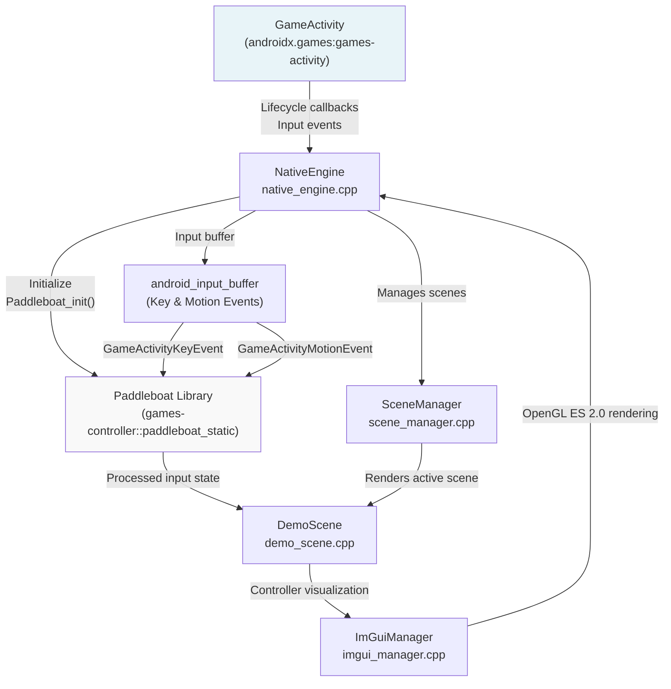
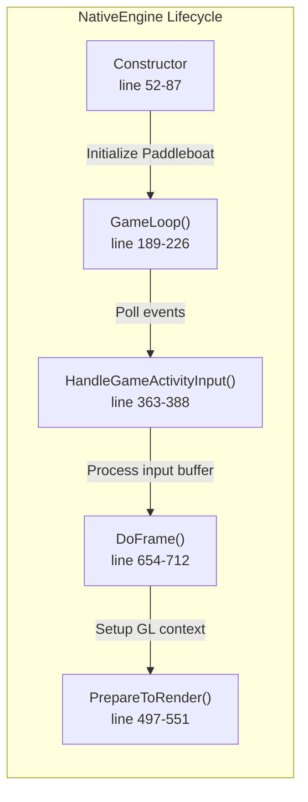
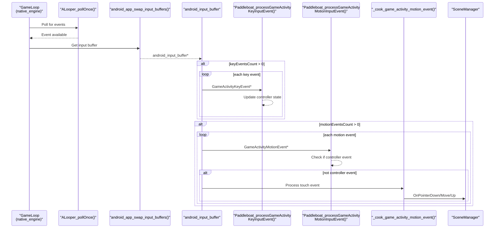
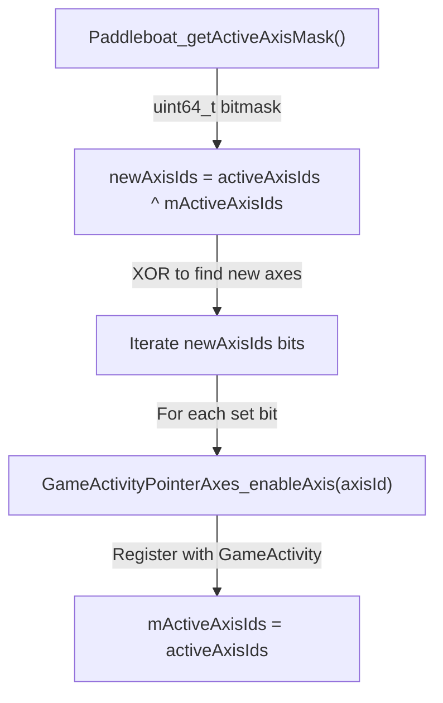
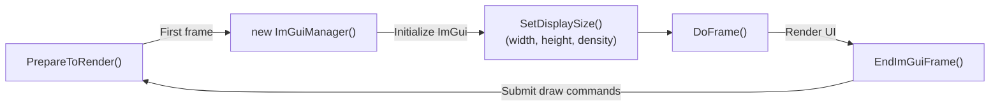
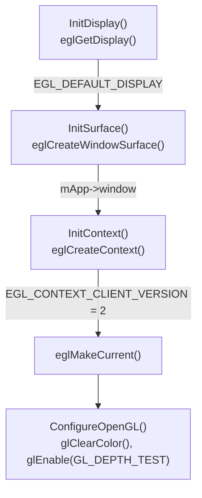

<!-- source: DeepWiki mcp.deepwiki.com · repo android/games-samples · page 2.4 Game Controller Sample · fetched 2026-10-23 -->

# Game Controller Sample

<details>
<summary>Relevant source files</summary>

The following files were used as context for generating this wiki page:

- [agdk/game_controller/README.md](agdk/game_controller/README.md)
- [agdk/game_controller/app/build.gradle](agdk/game_controller/app/build.gradle)
- [agdk/game_controller/app/src/main/AndroidManifest.xml](agdk/game_controller/app/src/main/AndroidManifest.xml)
- [agdk/game_controller/app/src/main/cpp/CMakeLists.txt](agdk/game_controller/app/src/main/cpp/CMakeLists.txt)
- [agdk/game_controller/app/src/main/cpp/native_engine.cpp](agdk/game_controller/app/src/main/cpp/native_engine.cpp)
- [agdk/game_controller/app/src/main/cpp/texture_asset_loader.cpp](agdk/game_controller/app/src/main/cpp/texture_asset_loader.cpp)
- [agdk/game_controller/app/src/main/cpp/texture_asset_loader.h](agdk/game_controller/app/src/main/cpp/texture_asset_loader.h)
- [agdk/game_controller/build.gradle](agdk/game_controller/build.gradle)
- [agdk/game_controller/gradle.properties](agdk/game_controller/gradle.properties)
- [agdk/game_controller/gradle/wrapper/gradle-wrapper.jar](agdk/game_controller/gradle/wrapper/gradle-wrapper.jar)
- [agdk/game_controller/gradle/wrapper/gradle-wrapper.properties](agdk/game_controller/gradle/wrapper/gradle-wrapper.properties)
- [agdk/game_controller/gradlew](agdk/game_controller/gradlew)

</details>


## Purpose and Scope

The Game Controller sample demonstrates the **Paddleboat** library, which is part of the Android Game Development Kit (AGDK) for handling game controller input in native C++ applications. This sample provides a visual interface for testing and debugging controller inputs, including button presses, analog sticks, triggers, vibration (haptics), and integrated motion sensors.

This document covers the architecture, input processing flow, and integration patterns for the Paddleboat library. For information about other AGDK libraries demonstrated in the repository, see [AGDK Native Samples](#2). For the comprehensive sample integrating multiple AGDK libraries including Paddleboat, see [AGDKTunnel Sample](#2.3).

**Sources:** [agdk/game_controller/README.md:1-12]()

---

## Architecture Overview

The Game Controller sample is a native C++ application built on **GameActivity** that uses the **Paddleboat** library to process controller input. The sample renders a visual representation of controller state using OpenGL ES 2.0 and overlays debug information using Dear ImGui.

### High-Level Component Architecture



**Sources:** [agdk/game_controller/app/src/main/cpp/native_engine.cpp:52-87](), [agdk/game_controller/app/src/main/cpp/CMakeLists.txt:21-22](), [agdk/game_controller/app/build.gradle:64-65]()

---

## Core Components

### NativeEngine

`NativeEngine` is the main application class that manages the rendering context, input processing, and application lifecycle. It serves as the bridge between GameActivity and the rest of the application.

| Responsibility | Implementation |
|---|---|
| **EGL Context Management** | Initializes and manages EGL display, surface, and OpenGL ES 2.0 context |
| **Paddleboat Initialization** | Calls `Paddleboat_init()` with JNI environment and GameActivity instance |
| **Input Processing** | Routes GameActivity input buffers to Paddleboat |
| **Lifecycle Management** | Handles APP_CMD events (INIT_WINDOW, START, STOP, etc.) |
| **Frame Rendering** | Orchestrates scene rendering and ImGui overlay |

**Key Methods:**



**Sources:** [agdk/game_controller/app/src/main/cpp/native_engine.cpp:52-109](), [agdk/game_controller/app/src/main/cpp/native_engine.cpp:189-226](), [agdk/game_controller/app/src/main/cpp/native_engine.cpp:363-388]()

### Paddleboat Integration

Paddleboat is initialized in the `NativeEngine` constructor and processes input events throughout the application lifecycle.

**Initialization:**

```
Paddleboat_init(GetJniEnv(), app->activity->javaGameActivity);
```

[agdk/game_controller/app/src/main/cpp/native_engine.cpp:82]()

**Lifecycle Management:**

| Event | Paddleboat Call | Line Reference |
|---|---|---|
| `APP_CMD_STOP` | `Paddleboat_onStop(mJniEnv)` | [native_engine.cpp:312]() |
| `APP_CMD_START` | `Paddleboat_onStart(mJniEnv)` | [native_engine.cpp:317]() |
| Destructor | `Paddleboat_destroy(mJniEnv)` | [native_engine.cpp:96]() |

**Sources:** [agdk/game_controller/app/src/main/cpp/native_engine.cpp:82](), [agdk/game_controller/app/src/main/cpp/native_engine.cpp:312-317](), [agdk/game_controller/app/src/main/cpp/native_engine.cpp:96]()

### Input Processing Pipeline

The input processing flow demonstrates how raw GameActivity events are transformed into controller state that the application can query.



**Key Functions:**

- **`HandleGameActivityInput()`** [line 363-388](): Main input processing entry point
- **`CheckForNewAxis()`** [line 390-407](): Dynamically enables new controller axes
- **`Paddleboat_processGameActivityKeyInputEvent()`** [line 373](): Processes keyboard/controller button events
- **`Paddleboat_processGameActivityMotionInputEvent()`** [line 380-381](): Processes analog stick/trigger motion
- **`_cook_game_activity_motion_event()`** [line 148-187](): Converts non-controller motion events to touch events

**Sources:** [agdk/game_controller/app/src/main/cpp/native_engine.cpp:363-388](), [agdk/game_controller/app/src/main/cpp/native_engine.cpp:390-407](), [agdk/game_controller/app/src/main/cpp/native_engine.cpp:148-187]()

### Dynamic Axis Registration

The sample demonstrates how to handle controllers with varying axis configurations by dynamically registering new axes with GameActivity.



This ensures that GameActivity reports motion events for all axes that Paddleboat detects, even for controllers with non-standard axis configurations.

**Sources:** [agdk/game_controller/app/src/main/cpp/native_engine.cpp:390-407]()

---

## Scene Management and Rendering

The sample uses a scene-based architecture where `DemoScene` handles controller visualization and interaction.

### Scene Hierarchy

| Class | File | Purpose |
|---|---|---|
| `Scene` | `scene.cpp` | Abstract base class for scenes |
| `SceneManager` | `scene_manager.cpp` | Manages active scene and transitions |
| `DemoScene` | `demo_scene.cpp` | Main controller visualization scene |

The `DemoScene` queries Paddleboat for controller state and renders the information using ImGui widgets.

**Sources:** [agdk/game_controller/app/src/main/cpp/CMakeLists.txt:52-65]()

### ImGui Integration

Dear ImGui provides the debug UI overlay for displaying controller information. The integration uses OpenGL ES 2.0 backend.

**ImGui Setup:**



**ImGui Build Configuration:**

The sample builds ImGui as a static library with OpenGL ES 2.0 backend:

- Source files: [CMakeLists.txt:40-46]()
- Definition: `IMGUI_IMPL_OPENGL_ES2` [CMakeLists.txt:32]()
- Backend: `imgui_impl_opengl3.cpp` [CMakeLists.txt:46]()

**Sources:** [agdk/game_controller/app/src/main/cpp/native_engine.cpp:534-536](), [agdk/game_controller/app/src/main/cpp/native_engine.cpp:547](), [agdk/game_controller/app/src/main/cpp/native_engine.cpp:689-691](), [agdk/game_controller/app/src/main/cpp/CMakeLists.txt:32](), [agdk/game_controller/app/src/main/cpp/CMakeLists.txt:40-46]()

---

## Build Configuration

### Gradle Dependencies

The sample uses Prefab to consume native AGDK libraries packaged as AARs.

**Key Dependencies:**

| Dependency | Version | Purpose |
|---|---|---|
| `androidx.games:games-activity` | 3.0.5 | Native app lifecycle via GameActivity |
| `androidx.games:games-controller` | 2.0.2 | Paddleboat controller library |
| `com.android.ndk.thirdparty:libpng` | 1.6.37-alpha-1 | PNG texture loading |

**Prefab Configuration:**

```
buildFeatures {
    prefab true
}
```

[agdk/game_controller/app/build.gradle:48-50]()

**Sources:** [agdk/game_controller/app/build.gradle:57-66](), [agdk/game_controller/app/build.gradle:48-50]()

### CMake Build

The CMake configuration demonstrates how to link against Paddleboat and GameActivity using Prefab.

**Package Discovery:**

```cmake
find_package(game-activity REQUIRED CONFIG)
find_package(games-controller REQUIRED CONFIG)
```

[agdk/game_controller/app/src/main/cpp/CMakeLists.txt:21-22]()

**Library Linkage:**

```cmake
target_link_libraries(game
    game-activity::game-activity_static
    games-controller::paddleboat_static
    ...)
```

[agdk/game_controller/app/src/main/cpp/CMakeLists.txt:83-95]()

**GameActivity Export:**

The sample must export the `GameActivity_onCreate` symbol for the activity to launch correctly:

```cmake
set(CMAKE_SHARED_LINKER_FLAGS
    "${CMAKE_SHARED_LINKER_FLAGS} -u GameActivity_onCreate")
```

[agdk/game_controller/app/src/main/cpp/CMakeLists.txt:26-27]()

**Sources:** [agdk/game_controller/app/src/main/cpp/CMakeLists.txt:21-22](), [agdk/game_controller/app/src/main/cpp/CMakeLists.txt:26-27](), [agdk/game_controller/app/src/main/cpp/CMakeLists.txt:83-95]()

### Third-Party Dependencies

The sample requires manual installation of Dear ImGui:

**ImGui Setup:**

1. Navigate to `agdk/third_party/`
2. Run: `git clone https://github.com/ocornut/imgui`

The CMake build references ImGui from this location: [CMakeLists.txt:38]()

**Sources:** [agdk/game_controller/README.md:18-21](), [agdk/game_controller/app/src/main/cpp/CMakeLists.txt:38]()

---

## AndroidManifest Configuration

The manifest declares the native activity and required permissions.

### Activity Declaration

```xml
<activity android:name=".PaddleboatDemoActivity"
          android:theme="@style/AppTheme"
          android:configChanges="orientation|keyboardHidden|keyboard|screenSize"
          android:screenOrientation="landscape">
    <meta-data android:name="android.app.lib_name"
               android:value="game" />
</activity>
```

Key attributes:
- **`android.app.lib_name`**: Specifies the native library name (`libgame.so`)
- **`configChanges`**: Prevents activity recreation on configuration changes
- **`screenOrientation`**: Forces landscape orientation

**Sources:** [agdk/game_controller/app/src/main/AndroidManifest.xml:28-40]()

### Permissions and Features

| Declaration | Purpose |
|---|---|
| `<uses-feature android:glEsVersion="0x00020000">` | Requires OpenGL ES 2.0 support |
| `<uses-permission android:name="android.permission.VIBRATE">` | Enables controller vibration/haptics |

**Sources:** [agdk/game_controller/app/src/main/AndroidManifest.xml:42-43]()

---

## Controller Features Demonstrated

The sample visualizes and tests the following controller capabilities:

### Input Visualization

| Feature | Paddleboat API | Description |
|---|---|---|
| **Button States** | `Paddleboat_getControllerStatus()` | Real-time button press/release display |
| **Analog Sticks** | Motion event processing | Left/right stick X/Y coordinates |
| **Triggers** | Motion event processing | L2/R2 analog trigger values |
| **D-Pad** | Key event processing | Directional pad input |

### Extended Features

| Feature | Purpose | UI Element |
|---|---|---|
| **Vibration** | Tests controller haptic feedback | Vibration control interface |
| **Motion Sensors** | Displays integrated accelerometer/gyroscope data | Sensor data overlay |
| **Hardware Keyboard Status** | Shows if a hardware keyboard is connected | Connection indicator |

**Sources:** [agdk/game_controller/README.md:4-11]()

### Controller Information Display

The sample displays detailed information about connected controllers:

- Controller index and connection status
- Vendor ID and Product ID
- Controller capabilities (buttons, axes, vibration support)
- Active axis configuration

**Sources:** [agdk/game_controller/README.md:7]()

---

## OpenGL Rendering Context

The sample uses OpenGL ES 2.0 for rendering, initialized through EGL.

### EGL Initialization Flow



**EGL Configuration:**

The sample requests a simple EGL configuration:
- OpenGL ES 2.0 (`EGL_RENDERABLE_TYPE, EGL_OPENGL_ES2_BIT`)
- 8-bit RGB color channels
- 16-bit depth buffer
- Window surface (`EGL_SURFACE_TYPE, EGL_WINDOW_BIT`)

**Sources:** [agdk/game_controller/app/src/main/cpp/native_engine.cpp:409-423](), [agdk/game_controller/app/src/main/cpp/native_engine.cpp:425-462](), [agdk/game_controller/app/src/main/cpp/native_engine.cpp:464-488](), [agdk/game_controller/app/src/main/cpp/native_engine.cpp:439-447]()

---

## Integration Pattern Summary

The Game Controller sample demonstrates a complete integration of the Paddleboat library with GameActivity. The key integration points are:

### Initialization Pattern

1. Create `NativeEngine` instance in native app entry point
2. Call `Paddleboat_init()` with JNI environment and `javaGameActivity` reference
3. Set up motion event filter with `app->motionEventFilter`
4. Initialize EGL context and OpenGL ES

**Sources:** [agdk/game_controller/app/src/main/cpp/native_engine.cpp:52-87]()

### Input Processing Pattern

1. Use `android_app_swap_input_buffers()` to get input buffer
2. Process key events with `Paddleboat_processGameActivityKeyInputEvent()`
3. Process motion events with `Paddleboat_processGameActivityMotionInputEvent()`
4. Handle non-controller motion events as touch input
5. Clear buffers with `android_app_clear_key_events()` and `android_app_clear_motion_events()`

**Sources:** [agdk/game_controller/app/src/main/cpp/native_engine.cpp:363-388]()

### Lifecycle Pattern

1. Call `Paddleboat_onStart()` in `APP_CMD_START` handler
2. Call `Paddleboat_onStop()` in `APP_CMD_STOP` handler
3. Call `Paddleboat_destroy()` in destructor

**Sources:** [agdk/game_controller/app/src/main/cpp/native_engine.cpp:310-319](), [agdk/game_controller/app/src/main/cpp/native_engine.cpp:94-109]()

---

## Project Structure

```
agdk/game_controller/
├── app/
│   ├── build.gradle                    # App module build configuration
│   └── src/main/
│       ├── AndroidManifest.xml         # Activity and permissions
│       └── cpp/
│           ├── CMakeLists.txt          # Native build configuration
│           ├── native_engine.cpp/h     # Main engine and GameActivity integration
│           ├── demo_scene.cpp/h        # Controller visualization scene
│           ├── scene_manager.cpp/h     # Scene lifecycle management
│           ├── imgui_manager.cpp/h     # ImGui integration
│           ├── input_util.cpp/h        # Input event cooking
│           ├── controllerui_data.cpp/h # Controller UI texture data
│           └── texture_asset_loader.cpp/h # PNG texture loading
├── build.gradle                        # Root build configuration
├── gradle/wrapper/                     # Gradle wrapper files
└── README.md                           # Build prerequisites and license
```

**Sources:** [agdk/game_controller/README.md](), [agdk/game_controller/app/src/main/cpp/CMakeLists.txt:52-65]()

---

